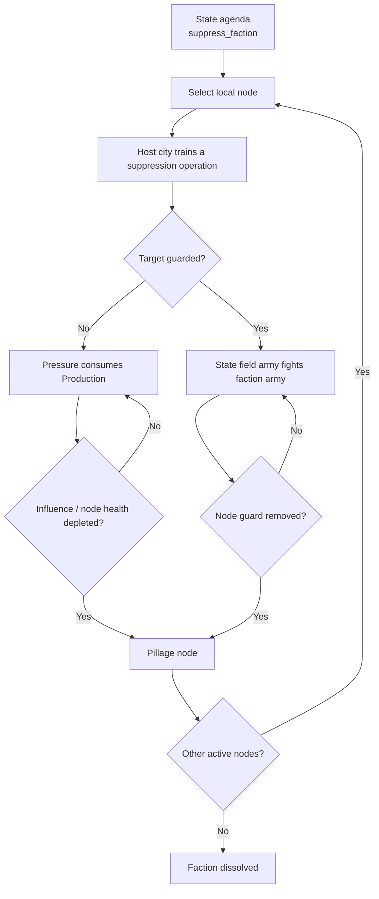

# Plan — State Suppression of Hostile Factions

**Status:** Implemented — Phases 1–5 plus wilderness stronghold assault complete  
**Branch:** `factions`  
**Touchpoints:** `src/types/living.ts`, `src/types/factions.ts`, `src/model/physical/living-generator.ts`, `src/model/political/factions-generator.ts`, `src/controllers/political/factions-editor.ts`, `src/controllers/political/state-cities-dialog.ts`, `src/renderers/draw-living-overlay.ts`, `src/controllers/living-hud.ts`, and `src/model/physical/living-generator.test.ts`  
**Companions:** [`factions.md`](factions.md), [`factions-civ-engine.md`](factions-civ-engine.md), [`living-openciv-armies.md`](living-openciv-armies.md)

---

## 1. Core Vision & Locked-In Decisions

Today a state cannot directly expel a faction from one of its burgs. The only immediate removal controls are editor-level:

- abandoning an outpost;
- removing the entire faction.

Neither is a Living World action.

This plan adds a **state suppression agenda** that behaves like other state work:

1. The state selects a hosted, hostile/clandestine target faction.
2. It applies **administrative pressure** through the host city’s Production queue.
3. The faction guard, if any, blocks further progress until defeated.
4. Sustained pressure pillages the selected node.
5. If the HQ is pillaged and no unpillaged outposts remain, the faction is dissolved.

### Confirmed decisions

1. **Production is the primary cost.** No automatic gold deduction.
2. **Gold only accelerates:** existing `hurryProduction()` can complete the outstanding Production immediately.
3. **One action at a time:** a state may suppress only one faction at a time and only targets one node at a time.
4. **No direct instant deletion.** Severance is gradual pressure and/or a successful tactical assault.
5. **Hostile/clandestine only.** `state_arm`, `Ally`, and ordinary `chartered` operations remain outside this mechanic.



---

## 2. Mechanics & Competition Design

### 2.1 Eligibility & target selection

A state can start `suppress_faction` only when the target:

- has an urban HQ or unpillaged outpost whose host burg is owned by the state;
- is `Enemy` where justified, or is `hostile`/`clandestine`;
- is not the state’s current `state_arm` patron;
- does not share an `Ally` or `Friendly` representation that would make coercion unlawful.

Suggested scoring:

1. occupied capital, then any state burg;
2. highest predatory revenue/siphon harm;
3. greatest provincial-order damage;
4. most cities/nodes affected;
5. weakest local defense;
6. nearest capital.

A wilderness HQ without a burg is excluded from the administrative phase. It can be added later as a military-only stronghold assault.

### 2.2 Production-first pressure

The suppression campaign uses the existing city production queue.

#### Queue model

Extend `ProductionItem` with:

```ts
kind: "operation";
id: string;                  // faction-suppression
targetFactionId?: number;
targetNodeKey?: string;      // "hq" or "outpost:<burgId>"
```

Queue it in the host burg’s `BurgSimState.productionQueue`.

- The city’s normal Production advances it each season.
- Production cost should be computed per node, with an initial tuning baseline of:

```ts
6 + node.tier * 4
```

For ordinary outposts this is roughly 10–18 Production per pressure cycle.
- Each completed cycle performs one pressure application.
- If a cycle is partially funded, `productionProgress` retains the invested Production like normal building/unit items.

#### Hurrying with gold

Reuse the current `hurryProduction(burgId)` path:

- `remainingProduction = productionCost - productionProgress`
- `price = hurryGoldCost(remainingProduction, false, hasBigBen)`
- preserve the existing `GOLD_PURCHASE_RESERVE = 100`.

Gold is therefore an optional accelerator, not the ordinary cost.

### 2.3 Administrative pressure

After a completed operation, apply pressure only when the node has no active enemy combat guard:

```text
influenceDamage =
  max(1, floor((provinceOrder - nodeSecrecy) / 20))
```

For a typical outpost:

| Province order | Faction secrecy | Damage/cycle | Cycles needed |
|---:|---:|---:|---:|
| 90 | 10 | 4 | ~9 |
| 70 | 0 | 3 | ~12 |
| 50 | 40 | 1 | ~35, practically military-first |

Other effects per successful cycle:

- `province.order += 2`
- `burg.unrest += 1`
- `sSim.unravel += 2` only if the campaign has recently stalled
- news on startup, first pillaged outpost, and final dissolution

Faction culture can restore influence faster than the state inflicts it. This keeps secrecy, weak states, and stable rival nodes meaningful resistors.

### 2.4 Armed resolution

The state must be able to defeat the guard before pressure continues.

#### State tactical targeting

`findEnemyArmyInRange` and `tacticalTarget` currently search other states. Add faction selection when:

```text
faction.allegiance === "hostile" ||
faction.stateRelations[stateId] === "Enemy"
```

The state army then follows existing movement/1UPT rules.

#### Resolve guard combat

Extend the existing battle bridge rather than adding a new simulator:

- reuse `resolveFactionBattle` primitives or introduce a small polymorphism layer for `attackerPolityId`;
- use faction happiness and state happiness as lord multipliers;
- preserve rounds, experience, and `lastBattle` recording;
- move the winner into the defender’s cell only when combat capacity remains.

Administrative completion stalls while a non-empty faction regiment is present at the target cell.

#### Node stronghold fight

For an urban HQ/outpost whose influence has reached the assault threshold or an undefended but heavily fortified node, construct temporary garrison blocks from:

- node citizens;
- fortified boolean/market facilities;
- node tier, up to a small cap.

If the state army wins, the node is pillaged. If it loses, the agenda pauses, the army retreats, and pressure efficiency is reduced for a few seasons.

### 2.5 Pillaging and faction dissolution

#### Outpost

When influence reaches zero:

- set `outpost.pillaged = true`;
- remove it from empire yields, city production, culture, and tactical regeneration;
- remove any partial suppression queue state for that node;
- report a `faction` news item;
- cancel the agenda if no active nodes remain for the state.

#### Urban HQ

`FactionHq` needs the same optional `pillaged` flag.

- When the HQ is pillaged, stop its empire/city sim and tactical regeneration.
- If active outposts remain, relocate `hq` to the surviving outpost with the highest `influence`; preserve research, treasury, military, doctrine, and faction ID.
- If no active outposts remain, set `faction.removed = true` and report dissolution.
- A wilderness HQ is not administratively pillaged in phase 1; phase 2 can treat it as a military stronghold.

### 2.6 Pan-state containment

A state can only target local nodes, so destroying one covered outpost group does not wipe a multi-state faction globally.

Surviving remote outposts can:

- continue producing;
- fund a settler that re-establishes a local presence when pressure drops;
- keep the HQ alive.

This models border communities rather than instant nationwide deletion.

### 2.7 News and chronicle feedback

Post only meaningful transitions:

- agenda start: “Aeloria began suppressing the Silver Hand.”
- guard defeat: “Aeloria’s legions broke the Silver Hand’s guard in Corvus.”
- outpost pillage: “Aeloria razed the Silver Hand enclave in Corvus.”
- HQ relocation: “The Silver Hand fled to Oakhaven.”
- dissolution: “The Silver Hand was dissolved after its last stronghold fell.”
- failure/abandonment: “Aeloria abandoned its suppression of the Silver Hand.”

Avoid per-season spam.

---

## 3. Phased Implementation Plan

### Phase 1 — Schema & production plumbing

**Touchpoints:** `src/types/living.ts`, `src/types/factions.ts`, `src/data/factions-catalog.ts`, `src/model/physical/living-generator.ts`

1. Add `"suppress_faction"` to `AgendaKind`.
2. Add optional `targetFactionId` and `stallUntilTick` fields to `StateAgenda`.
3. Extend `ProductionItem.kind` with `"operation"` and optional target faction/node fields.
4. Add optional `pillaged` to `FactionHq`.
5. Add `isHostileToState()` and `eligibleFactionSuppressionTargets()`.
6. Extend `productionCost()` and `completeProductionItem()` for suppression.
7. Add initial cost constants and make `hurryProduction()` work through the generic path.

### Phase 2 — Administrative campaign

**Touchpoints:** `src/model/physical/living-generator.ts`, `src/model/political/factions-generator.ts`

1. Add `pickFactionSuppressionTarget()` to `chooseAgenda()`, prioritized after immediate mustering and below lair/trouble emergencies.
2. Add `startFactionSuppression(stateId, factionId)` as a public API.
3. Make `stepAgenda()` enqueue one suppression operation for the currently targeted node.
4. Complete cities by applying `pressure` on operation completion; pause while the cell contains an undefeated faction guard.
5. Skip pillaged HQs/outposts in:
   - `collectFactionNodes()`;
   - `factionEmpireNodes()`;
   - city/yield rollups;
   - settler targets.
6. On outpost pillage, trigger relocation or final dissolution checks.

### Phase 3 — Armed stronghold clearing

**Touchpoints:** `src/model/physical/living-generator.ts`, `src/model/physical/living-threats.ts`

1. Generalize state/faction army targeting so state armies can engage hostile faction regiments.
2. Add `factionGarrisonBlocks()` from node citizens/fortification.
3. Add `assaultFactionNode()` using the shared battle engine.
4. Apply assault victory/failure:
   - victory pillages the node;
   - failure retreats the army and delays suppression.
5. Let unfinished administrative pressure resume after the guard clears.
6. Add wilderness stronghold assault only after urban node completion proves acceptable. (Done: military-only storm of an HQ with no burg on a state-owned cell; victory pillages and runs the same relocation/dissolution path.)

### Phase 4 — UI & saved-map compatibility

**Touchpoints:** `src/controllers/political/factions-editor.ts`, `src/controllers/political/state-cities-dialog.ts`, `src/renderers/draw-living-overlay.ts`, `src/controllers/living-hud.ts`

1. Show “Suppressing X” in the State Inspector agenda and queue text.
2. Expose the operation target and remaining influence in the Faction Outposts dialog.
3. Add optional “Suppress faction” player-facing command to the State Inspector.
4. Update faction tile badges for pillaged/dissolved nodes.
5. Verify old saves with missing `FactionHq.pillaged` and `StateAgenda.targetFactionId` initialize safely.

### Phase 5 — Tests & balance

**Touchpoint:** `src/model/physical/living-generator.test.ts` and editor tests

Verify:

1. A hostile faction with an urban outpost is eligible; lawful `state_arm`/`chartered` factions are not.
2. A state agenda creates exactly one suppression operation in the correct city queue.
3. Production progress accumulates without consuming gold.
4. `hurryProduction()` finishes the operation at the expected gold cost while retaining the reserve.
5. Each completed operation reduces influence according to the order/secrecy formula.
6. A faction guard pauses pressure and the state field army can defeat it.
7. A defeated outpost is skipped from yields/production.
8. HQ relocation occurs when another active outpost exists.
9. Full pillage marks the faction dissolved/removed.
10. A state with insufficient local production is slower rather than collapsing.
11. No changes to autonomous `state_arm`, `chartered`, or non-hostile factions.

---

## 4. Risks & Non-goals

- **Not in scope:** direct editor deletion, diplomatic declarations, alliances, or instant “banning” orders.
- **States cannot suppress remote factions globally** unless local nodes are engaged in each jurisdiction.
- **Don't turn faction removal into a treasury purchase.** Gold only accelerates production work.
- **Avoid duplicate daily pressure:** one city production queue item at a time per active campaign.
- **Avoid deleting HQs through one clash:** administrative pressure plus armed resolution are deliberately sequential.
- **Watch update ordering:** suppression completion must run after city production but before the next season’s culture/influence ticks, so culture can recover only after an uncontested state cycle.
