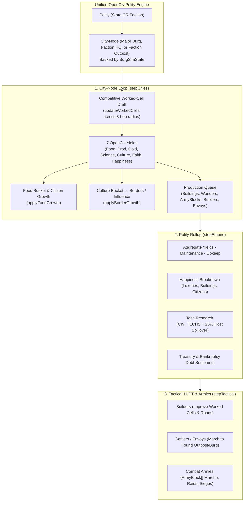

# Plan — Unified OpenCiv Engine for Factions & Burgs

**Status:** Approved Design — Ready for Implementation  
**Branch:** `factions`  
**Touchpoints:** [`src/types/factions.ts`](file:///home/paladin/workspace/Fantasy-Map-Generator/src/types/factions.ts), [`src/types/living.ts`](file:///home/paladin/workspace/Fantasy-Map-Generator/src/types/living.ts), [`src/data/living-civ-buildings.ts`](file:///home/paladin/workspace/Fantasy-Map-Generator/src/data/living-civ-buildings.ts), [`src/data/faction-assets.ts`](file:///home/paladin/workspace/Fantasy-Map-Generator/src/data/faction-assets.ts), [`src/model/political/factions-generator.ts`](file:///home/paladin/workspace/Fantasy-Map-Generator/src/model/political/factions-generator.ts), [`src/model/physical/living-generator.ts`](file:///home/paladin/workspace/Fantasy-Map-Generator/src/model/physical/living-generator.ts), [`src/controllers/political/factions-editor.ts`](file:///home/paladin/workspace/Fantasy-Map-Generator/src/controllers/political/factions-editor.ts), [`src/controllers/political/burgs/burg-editor.ts`](file:///home/paladin/workspace/Fantasy-Map-Generator/src/controllers/political/burgs/burg-editor.ts)  
**Companions:** [factions.md](factions.md), [factions-plan.md](factions-plan.md), [living-openciv.md](living-openciv.md), [living-openciv-armies.md](living-openciv-armies.md)

---

## 1. Core Vision & Locked-In Decisions

Currently, `living-generator.ts` runs two separate simulation loops:
1. **OpenCiv Engine (`stepCities`, `stepEmpire`, `stepTactical`)** — Runs on `State` and `Burg` entities (`BurgSimState`, `StatePolitySim`) tracking citizens, worked cells, 7 yields, food buckets, border culture, and tactical units.
2. **Legacy Faction Loop (`stepFactionEconomyAndTech`, `stepFactionAgendas`, `stepFactionMilitaryAndRaids`)** — Uses flat gold formulas (`outpost.tier * 2`), instant gold-purchased assets (`FACTION_ASSETS_CATALOG`), teleporting outpost creation, and legacy `u: { spear: 50 }` regiments.

This plan unifies **Factions (`pack.factions`)** with the exact same OpenCiv simulation engine used by States and Burgs, where **Faction HQs and Outposts are Burg-Nodes (`BurgSimState`)** that gather the same 7 yields and tile resources, build from a unified building/unit production queue, and **compete with host States and rival Factions** for worked cells, yields, and territory.

### Confirmed Design Decisions
1. **Competitive Cell Draft (`updateWorkedCells`)**: Workable cells within 3 hops (`MAX_WORK_DISTANCE`) are shared in a single pool (`globalWorkedCells`) between the State Burg and any Faction HQs/Outposts in range. Priority is determined by allegiance: `state_arm` (cooperative after state), `chartered` (alternating after state food floor + 15% gold tithe), `autonomous` (interleaved by local influence vs. state order), `clandestine`/`hostile` (predatory first pick + center gold siphoning).
2. **Wilderness HQs as Embedded Sim Nodes**: Wilderness HQs remain an embedded `BurgSimState` on `hq.cell` without creating a premature entry in `pack.burgs`. When state ascension occurs, it promotes to a true sovereign `Burg` and `State`.
3. **Outpost Expansion via Physical Units**: Outpost expansion uses physical Envoy/Settler units produced via the node's `productionQueue` (consuming surplus food while queued), marching across the map to establish new outposts upon arrival.

---

## 2. Mechanics & Competition Design

### 2.1 Faction HQs & Outposts as `BurgSimState` Nodes
- **Data Representation**:
  - Every `FactionHq` and `FactionOutpost` carries its own `sim: BurgSimState` (or is tracked in `living.factionNodes: Record<string, BurgSimState>` keyed by `hq:${factionId}` and `outpost:${factionId}:${burgId}`).
  - **Wilderness HQs**: Operates directly on `hq.cell` with its `BurgSimState` without modifying `pack.burgs` until ascension.
  - Every Faction Node tracks:
    - `citizens` (starting at `2` for HQs, `1` for new Outposts)
    - `workedCells` & `lockedCells`
    - `foodStored` & `cultureStored`
    - `productionQueue` & `productionProgress`
    - `civBuildings` & `cityYields`
    - `hp` & `maxHp`

### 2.2 Resource Gathering & Multi-Actor Competition (`updateWorkedCells`)
All nodes (State Burgs, Faction HQs, Faction Outposts) gather the exact same 7 OpenCiv yields (`food`, `production`, `gold`, `science`, `culture`, `faith`, `happiness`) plus Strategic & Luxury goods from cells within `MAX_WORK_DISTANCE` (3 hops) via `getCellYields()`.

**Competition Rules**:
1. **Cross-Border Reach**:
   - A State Burg only works cells where `pack.cells.state[cell] === state.i`.
   - A Faction Node at `cell` can work workable cells within 3 hops regardless of state ownership (inside host states, rival states, or unowned wildlands).
2. **Competitive Cell Draft (State vs. Factions & Faction vs. Faction)**:
   - Each cell on the map can only be worked by **one citizen** per season across all State Burgs and Faction Nodes (`globalWorkedCells: Set<number>`).
   - Within any Burg or overlapping 3-hop region, citizens are assigned to cells in a **Priority / Round-Robin Draft** governed by the Faction's `allegiance`, `stateRelations`, and local `influence`:
     - **`state_arm` / `Ally` (Cooperative)**: The State Burg claims its worked cells first; the Faction Node works remaining cells in the radius and shares strategic/luxury access with its patron State.
     - **`chartered` / `Friendly` (Licensed Competition)**: After the State Burg secures its minimum Food floor, the State Burg and Chartered Faction alternate cell picks. The Faction pays a `15%` Charter Tax on its local `gold` yield to the host State's treasury.
     - **`autonomous` / `Neutral` / `Rival` (Direct Competition)**: Interleaved cell draft weighted by the State's local `order` vs. the Faction Outpost's `influence`. Every high-yield farm, mine, or luxury plantation worked by the Faction is unavailable to the State (and rival Factions)!
     - **`clandestine` / `hostile` / `Enemy` (Predatory / Parasitic)**:
       - Hostile/Clandestine nodes draft cells **before** the host State Burg (up to their `citizens` count, gated by `influence`), seizing the best gold/luxury/production tiles in the hinterland.
       - Additionally, an urban clandestine/underworld outpost siphons `(influence / 200)` (up to `50%`) of the host Burg's center-tile `gold` yield directly from the State Burg's `cityYields.gold`!

### 2.3 Food Growth & Citizen Competition (`applyFoodGrowth`)
- Faction Nodes run the exact same `applyFoodGrowth()` formula:
  - `surplus = cityYields.food - FOOD_PER_CITIZEN * citizens`
  - Modified by `happinessGrowthFactor(faction.happiness)` and building effects (`aqueduct`, `granary`).
  - When `foodStored >= foodNeededForGrowth(citizens)`, the Faction Node gains `+1 citizen`, allowing it to claim and work another cell in the 3-hop radius!
  - If a State or rival Faction squeezes out a node's food cells, `foodStored < 0` causes citizen loss (and if an Outpost drops to `0` citizens from starvation or siege, it collapses).

### 2.4 Unified Buildings & Production Queue (`applyProduction`)
- **Merging `FACTION_ASSETS_CATALOG` into `CIV_BUILDINGS`**:
  - The 18 faction assets (`trade_depot`, `counting_house`, `grand_exchange`, `chapter_lodge`, `seeker_archives`, `safe_house`, `smuggler_tunnel`, `shadow_court`, `wayside_shrine`, `monastic_scriptorium`, `ritual_sanctum`, `informant_ring`, `printing_cell`, `shadow_directorate`, `muster_camp`, `armory_forge`, `war_citadel`, `alchemical_lab`, `subterranean_delve`) are integrated into `CIV_BUILDINGS` as standard `CivBuildingDef` entries (with `cost` in Production, `maintenance` in Gold, `requiredTech`, `stats: CivBuildingStats`, and optional `factionTrack?: FactionCategory`).
  - Faction HQs and Outposts can build **both** standard OpenCiv buildings (`walls`, `barracks`, `market`, `library`, `workshop`, `forge`, `temple`) and their category's specialized buildings via `productionQueue` using `cityYields.production`!
  - Factions can also use `hurryProduction()` to rush queued buildings or units using `faction.treasury`.

### 2.5 Culture Bucket → Influence, Turf Clashes & Territory (`applyBorderGrowth`)
- Faction Nodes accumulate `cityYields.culture` in `cultureStored` against `borderCultureNeeded(tilesAcquired)`:
  - **Urban Outposts/HQs**: When `cultureStored >= needed`, the Outpost increases its local `influence` (`+10`, reducing rival faction influence or host state order in that burg) and increments `tilesAcquired`.
  - **Wilderness HQs**: When `cultureStored >= needed`, the HQ claims an adjacent unowned cell (`pickBorderClaimCell`); if the Faction has `sovereignAmbition` and reaches `state` scale or `seasonsActive` threshold, its claimed cells and HQ Burg immediately form a sovereign `State`.

### 2.6 Unified Empire Rollup (`stepEmpire`) & Tactical Layer (`stepTactical`)
- **`stepEmpire` for Factions**:
  - `recomputePolityYields`: Sums `cityYields` across HQ + Outposts, applies `citySciencePerTick()` multipliers (`library`, `university`, `monastic_scriptorium`), subtracts building `maintenance` and military block/civilian `upkeep`.
  - `recomputeEmpireHappiness`: Base happiness + unique Luxury resources worked by faction nodes (`+4` each) + building happiness − node count unhappiness − citizen unhappiness.
  - `applyResearch`: Uses the unified OpenCiv tech tree (`CIV_TECHS`) with `+25%` spillover if a host State has already discovered the tech.
  - `applyTreasury` & `settleDebt`: Banks net Gold into `faction.treasury`; negative treasury disbands the newest army block.
- **`stepTactical` for Factions**:
  - Faction regiments use `ArmyBlock[]` composition and `UnitSimState` / `ArmySimState` keyed as `f${faction.i}-${regiment.i}` in `living.units` and `living.armies`.
  - **Builders (`builder`)**: Built in Faction Nodes to construct tile improvements (`farm`, `mine`, `plantation`, `pasture`, `camp`, `quarry`, `lumber_mill`) on cells worked by the Faction.
  - **Envoys / Settlers (`settler`)**: Built in Faction Nodes (consuming surplus Food while queued, just like State Settlers) and march across the map to establish a new **Faction Outpost** at a target Burg or found a new settlement—replacing random teleport expansion!
  - **Combat Armies & Sieges**: Faction armies march on the map, clash with rival Faction or State armies via `resolveArmyBattle()`, pillage rival worked cells, and assault Burgs via `openCivAssault()`.

---

## 3. Phased Implementation Plan

### Phase 1 — Schema & Building Catalog Unification
**Touchpoints:** [`src/types/factions.ts`](file:///home/paladin/workspace/Fantasy-Map-Generator/src/types/factions.ts), [`src/types/living.ts`](file:///home/paladin/workspace/Fantasy-Map-Generator/src/types/living.ts), [`src/data/living-civ-buildings.ts`](file:///home/paladin/workspace/Fantasy-Map-Generator/src/data/living-civ-buildings.ts), [`src/data/faction-assets.ts`](file:///home/paladin/workspace/Fantasy-Map-Generator/src/data/faction-assets.ts)
1. Add `sim?: BurgSimState` to `FactionHq` and `FactionOutpost` (and `yieldsPerTurn?: YieldValues`, `happiness?: number`, `happinessBreakdown?: HappinessBreakdown`, `freeTechs?: number` to `Faction`).
2. Add optional `factionCategory?: FactionCategory | "scholarly" | "wilder"` to `CivBuildingDef` and register the faction asset definitions into `CIV_BUILDINGS` / `CIV_BUILDING_BY_ID` while keeping `FACTION_ASSETS_CATALOG` as a backward-compatible view.
3. Update `Factions.generate()` in [`src/model/political/factions-generator.ts`](file:///home/paladin/workspace/Fantasy-Map-Generator/src/model/political/factions-generator.ts) and `syncWorld()` in [`src/model/physical/living-generator.ts`](file:///home/paladin/workspace/Fantasy-Map-Generator/src/model/physical/living-generator.ts) to initialize `BurgSimState` (`citizens`, `civBuildings`, `productionQueue`, `workedCells`) for every Faction HQ and Outpost, and convert faction military regiments to `ArmyBlock[]` format.

### Phase 2 — Shared City-Node Loop & Competitive Cell Assignment (`stepCities`)
**Touchpoints:** [`src/model/physical/living-generator.ts`](file:///home/paladin/workspace/Fantasy-Map-Generator/src/model/physical/living-generator.ts)
1. Generalize `updateWorkedCells()` into a competitive regional/burg allocation pass:
   - Track `globalWorkedCells: Set<number>` across the tick.
   - For each Burg and its resident/overlapping Faction HQs & Outposts, allocate worked cells in `MAX_WORK_DISTANCE` according to the competition rules (`state_arm` cooperative, `chartered` tithed, `autonomous` interleaved by influence vs. order, `clandestine`/`hostile` predatory + center-gold siphon).
   - For Wilderness Faction HQs, run `updateWorkedCells()` over workable cells within 3 hops of `hq.cell`.
2. Run `applyFoodGrowth()`, `applyBorderGrowth()` (Culture → local Influence or wilderness cell claims), and `applyProduction()` on every Faction HQ and Outpost `BurgSimState`.
3. Update `chooseCityProduction()` so Faction Nodes queue buildings (`walls`, economy/science core, faction category buildings), utility units (`builder`, `settler`), and roster combat units (`ArmyBlock`).

### Phase 3 — Shared Empire Rollup (`stepEmpire`) for Factions
**Touchpoints:** [`src/model/physical/living-generator.ts`](file:///home/paladin/workspace/Fantasy-Map-Generator/src/model/physical/living-generator.ts)
1. Unify `recomputeStateYields()`, `recomputeEmpireHappiness()`, `applyResearch()`, `applyTreasury()`, and `settleDebt()` to operate on both `State` (`StatePolitySim`) and `Faction`:
   - Aggregate `food`, `production`, `gold`, `science`, `culture`, `faith` across HQ + Outposts.
   - Apply Charter Tithes (`chartered` factions paying `%` gold to patron State) and Underworld Siphons (`clandestine`/`hostile` factions draining gold from host Burgs).
   - Compute Faction Happiness from worked Luxury cells (`+4` per unique luxury), buildings, and citizens.
   - Advance `CIV_TECHS` research with `+25%` host-state spillover and settle military/building upkeep.
2. Retire the old flat-math `stepFactionEconomyAndTech()` and `stepFactionAgendas()` instant-buy logic.

### Phase 4 — Shared Tactical Engine (`stepTactical`) for Factions
**Touchpoints:** [`src/model/physical/living-generator.ts`](file:///home/paladin/workspace/Fantasy-Map-Generator/src/model/physical/living-generator.ts)
1. Extend `syncArmies()` and `stepTactical()` to include Faction regiments under key `f${faction.i}-${regiment.i}`:
   - **Faction Builders (`stepBuilder`)**: Improve unimproved cells worked by Faction HQs/Outposts.
   - **Faction Settlers/Envoys (`stepSettler`)**: March to target Burgs (or wilderness cells) and establish a new `FactionOutpost` upon arrival.
   - **Faction Combat Armies (`stepArmyOrders`)**: Move on the map, engage enemy State or rival Faction armies via `resolveArmyBattle()`, raid/pillage tiles, or siege Burgs (`openCivAssault`) to trigger `ascendFactionToState()`.

### Phase 5 — UI Inspector & Tests
**Touchpoints:** [`src/controllers/political/factions-editor.ts`](file:///home/paladin/workspace/Fantasy-Map-Generator/src/controllers/political/factions-editor.ts), [`src/controllers/political/burgs/burg-editor.ts`](file:///home/paladin/workspace/Fantasy-Map-Generator/src/controllers/political/burgs/burg-editor.ts), [`src/model/physical/living-generator.test.ts`](file:///home/paladin/workspace/Fantasy-Map-Generator/src/model/physical/living-generator.test.ts)
1. Surface OpenCiv yields (`Food`, `Prod`, `Gold`, `Sci`, `Cult`, `Hap`), `citizens`, `workedCells`, and `productionQueue` in the Factions Editor and Burg Outposts Inspector.
2. Add unit tests verifying:
   - Faction HQs/Outposts working cells, growing citizens from food, and completing queued buildings/units from production.
   - Cell & yield competition between a host State Burg and resident Faction Outposts (`chartered`, `autonomous`, `clandestine`).
   - Faction Builders improving cells and Faction Settlers marching to found new Outposts.
