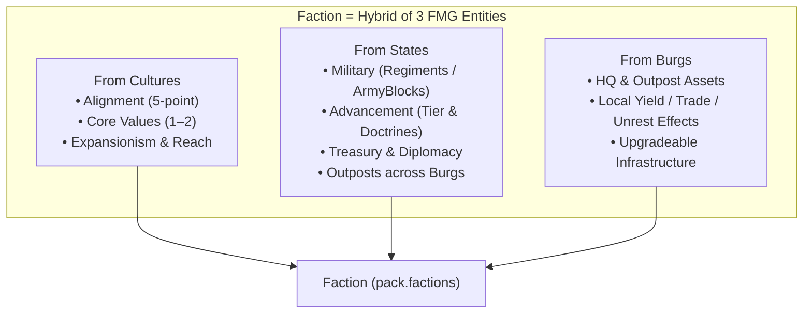

# Plan — Factions: Non-State Organizations, Outposts & Emergent Power

**Status:** Completed (Phases 1–5 Implemented & Verified)  
**Branch:** `factions`  
**Touchpoints:** [`src/types/factions.ts`](file:///home/paladin/workspace/Fantasy-Map-Generator/src/types/factions.ts), [`src/data/factions-catalog.ts`](file:///home/paladin/workspace/Fantasy-Map-Generator/src/data/factions-catalog.ts), [`src/data/faction-assets.ts`](file:///home/paladin/workspace/Fantasy-Map-Generator/src/data/faction-assets.ts), [`src/model/political/factions-generator.ts`](file:///home/paladin/workspace/Fantasy-Map-Generator/src/model/political/factions-generator.ts), [`src/renderers/draw-factions.ts`](file:///home/paladin/workspace/Fantasy-Map-Generator/src/renderers/draw-factions.ts), [`src/controllers/political/factions-editor.ts`](file:///home/paladin/workspace/Fantasy-Map-Generator/src/controllers/political/factions-editor.ts), [`src/model/physical/living-generator.ts`](file:///home/paladin/workspace/Fantasy-Map-Generator/src/model/physical/living-generator.ts), [`src/model/physical/living-threats.ts`](file:///home/paladin/workspace/Fantasy-Map-Generator/src/model/physical/living-threats.ts), [`src/model/physical/living-heroes.ts`](file:///home/paladin/workspace/Fantasy-Map-Generator/src/model/physical/living-heroes.ts), [`src/model/physical/living-guild.ts`](file:///home/paladin/workspace/Fantasy-Map-Generator/src/model/physical/living-guild.ts)

---

## 1. Core Vision

A **Faction** is any organized entity on the map that is **not** a territorial polity (`State` or `Province`). Where States claim Voronoi cells and draw borders, Factions operate **across and beneath borders** through a **Headquarters (HQ)**, a network of **Outposts** in burgs (or wilderness sites), **Assets** (structures, fronts, and operations), and their own **Military** and **Advancement**.

Furthermore, **Troubles** and **Lairs** from [`living-generator.ts`](file:///home/paladin/workspace/Fantasy-Map-Generator/src/model/physical/living-generator.ts) are now unified with Factions—either directly as hostile/predatory Factions or through the friction they create in provincial ecosystems.

---

## 2. Faction Taxonomy (`category` & `type`)

Factions span six broad categories, uniting peaceful guilds, state agencies, underworld syndicates, and former Lair/Trouble threats under one model:

| Category | Archetype Examples (`type`) | Legal Status | Typical HQ | Replaces / Absorbs |
| :--- | :--- | :--- | :--- | :--- |
| **1. Commercial & Civic** | `merchant_company`, `bank_consortium`, `craft_guild`, `smuggler_free_traders` | Chartered or Autonomous | Port or Market Burg | `bad_reputation`, trade guilds |
| **2. Martial & Adventuring** | `adventurer_guild`, `mercenary_company`, `knightly_order`, `ranger_wardens` | Autonomous or Chartered | Citadel Burg or Border Keep | `living.guild`, `mercenary_populace` |
| **3. Underworld & Illicit** | `thieves_guild`, `assassin_brotherhood`, `brigand_band`, `pirate_fleet`, `gang_syndicate` | Clandestine or Hostile | Burg Shanty or Wilderness/Sea Marker | `thieves_stronghold`, `bandit_camp`, `riotous_thugs`, `brigand_raiders`, `secret_society` |
| **4. Religious & Occult** | `monastic_order`, `inquisition`, `heretical_sect`, `sinister_cult`, `doomsday_cult`, `arcane_cabal`, `necromantic_circle` | State-Arm, Autonomous, or Clandestine | Temple Burg, Monastery, or Ruin Marker | `cult_shrine`, `corrupt_monastery`, `school_of_dark_sorcery`, `demonic_master`, `sinister_cult`, `doomsday_cult`, `dark_wizards` |
| **5. Political & State-Arm** | `royal_agency` (Secret Police / Charter), `colonial_governorate`, `noble_faction`, `rebel_front`, `exiled_claimant`, `peasant_commune`, `mutinous_garrison` | State-Arm or Insurgent | Capital, Provincial Burg, or Ruined Fort | `renegade_outpost`, `splinter_group`, `exiled_lord`, `conquering_heirs`, `corrupt_leadership`, `demagogue`, `class_hatred` |
| **6. Warlord & Wilder Lair** | `rogue_warlord`, `marauder_horde`, `exiled_clan_hold`, `xenophobic_enclave`, `ancient_evil`, `planar_rift`, `monster_brood` | Hostile / Sovereign-Aspirant | Wilderness Marker / Ruin / Keep Cell | `aspiring_warlord`, `ancient_fort`, `marauder_warcamp`, `dwarven_outcasts`, `malevolent_creed`, `ancient_evil`, `magical_gate`, `monster_nest`, `blight_infestation` |

---

## 3. Scale Tiers & Reach

Every faction has a **`scale`** (`"burg" | "province" | "state" | "world"`) governing its operational reach, maximum outposts, military cap, and political weight:

| Scale | Reach / Valid Outpost Locations | Max Outposts | Max Regiments | Typical Examples |
| :---: | :--- | :---: | :---: | :--- |
| **`burg`** | HQ Burg (or wilderness HQ cell + 1 nearby burg) | `0–1` | `1` | Local thieves' gang, town guild, single bandit camp, local cult cell, solitary wizard tower |
| **`province`** | Any burg or resource/ruin site within the HQ's `Province` (or adjacent wildlands) | `2–4` | `1–2` | Provincial brigand brotherhood, regional merchant league, frontier warlord, peasant uprising |
| **`state`** | Any burg within the HQ's `State` (plus border ports/markets) | `5–10` | `2–4` | National Thieves' Syndicate, Royal Inquisition, Chartered Trade Company, Realm-wide Knightly Order |
| **`world`** | Any reachable burg across the map (via trade routes / sea lanes) | `10+` | `4–8` | Grand Adventurers' Guild, Continental Banking House, World-Spanning Shadow Cabal, International Crusade |

---

## 4. Implementation Status Across Phases

### Phase 1 — Schema, Catalogs & Procedural Generator (`54eecd19`)
- **Data Model:** Defined [`src/types/factions.ts`](file:///home/paladin/workspace/Fantasy-Map-Generator/src/types/factions.ts) with full type declarations for `Faction`, `FactionOutpost`, `FactionHq`, `FactionAssetDef`, `FactionArchetypeDef`.
- **Catalogs:** Created [`src/data/factions-catalog.ts`](file:///home/paladin/workspace/Fantasy-Map-Generator/src/data/factions-catalog.ts) (24 archetypes) and [`src/data/faction-assets.ts`](file:///home/paladin/workspace/Fantasy-Map-Generator/src/data/faction-assets.ts) (18 assets across 6 tracks).
- **Serialization:** Added `pack.factions` serialization, auto-update schema migrations, and save/load roundtrip in [`src/services/io/factions-save.ts`](file:///home/paladin/workspace/Fantasy-Map-Generator/src/services/io/factions-save.ts).
- **Procedural Generation:** Implemented [`src/model/political/factions-generator.ts`](file:///home/paladin/workspace/Fantasy-Map-Generator/src/model/political/factions-generator.ts) seeding starting factions across states, burgs, and danger markers.

### Phase 2 — Living World Pipeline & State Ascension (`54eecd19`)
- Integrated `Factions.generate()` into the map generation pipeline after burgs and states.
- Implemented `ascendFactionToState()`, `promoteTroubleToState()`, and `ascendLairToState()` handling sovereign independence.
- Implemented `spawnRemnantFaction()` generating hostile insurgent fronts when states collapse.

### Phase 3 — Living Simulation, Economy, Tech & Agendas (`efc58c79`)
- **Seasonal Simulation:** Added `stepFactions()` to the seasonal loop in [`src/model/physical/living-generator.ts`](file:///home/paladin/workspace/Fantasy-Map-Generator/src/model/physical/living-generator.ts):
  - Income and upkeep calculation from HQ and outpost assets.
  - Civic technology research and host-state tech research spillover.
  - Outpost expansion and clash mechanics between rival factions in shared burgs.
  - State arm defection upon high unravel.
  - Regiment mustering, autonomous raids, and sovereign state ascension.

### Phase 4 — UI Overlays, Dialogs & Outpost Inspector (`c8f6097e`)
- **Map Overlays:** Implemented [`src/renderers/draw-factions.ts`](file:///home/paladin/workspace/Fantasy-Map-Generator/src/renderers/draw-factions.ts) rendering HQ and outpost badges on the map canvas. Registered the `factions` layer with hotkey `Shift+F`.
- **Factions Editor Dialog:** Implemented [`src/controllers/political/factions-editor.ts`](file:///home/paladin/workspace/Fantasy-Map-Generator/src/controllers/political/factions-editor.ts) providing an overview table, outpost management subdialog, sorting, visibility toggles, and CSV export.
- **Tools Tab Integration:** Added Factions button under the Political group in [`src/app/chrome/tabs/tools-tab.ts`](file:///home/paladin/workspace/Fantasy-Map-Generator/src/app/chrome/tabs/tools-tab.ts) and wired hotkeys.
- **Burg Editor Outpost Inspector:** Added outposts inspector section to [`src/controllers/political/burgs/burg-editor.ts`](file:///home/paladin/workspace/Fantasy-Map-Generator/src/controllers/political/burgs/burg-editor.ts).

### Phase 5 — Modular Engine Extraction & Decoupling (`e105cc1c`, `fe09788a`, `80de2f36`)
- **Threats Engine:** Extracted danger markers sync, trouble spawning/resolution, lair lifecycle, and emergent state ascension into [`src/model/physical/living-threats.ts`](file:///home/paladin/workspace/Fantasy-Map-Generator/src/model/physical/living-threats.ts).
- **Heroes Engine:** Extracted hero vitals, progression, recruitment, retirement, and specialist commanders into [`src/model/physical/living-heroes.ts`](file:///home/paladin/workspace/Fantasy-Map-Generator/src/model/physical/living-heroes.ts).
- **Guild Engine:** Extracted player guild operations, player faction bridging, mission dispatch & previews, relics management, petitions & popups into [`src/model/physical/living-guild.ts`](file:///home/paladin/workspace/Fantasy-Map-Generator/src/model/physical/living-guild.ts).
- **Complete De-duplication:** Deleted all duplicated threat, hero, guild, mission, relic, and popup function implementations from [`src/model/physical/living-generator.ts`](file:///home/paladin/workspace/Fantasy-Map-Generator/src/model/physical/living-generator.ts), replacing them with clean one-line delegates to modular engines.
- **Full Backward Compatibility:** Maintained 100% API stability on `Living` while re-exporting `LivingThreats`, `LivingHeroes`, and `LivingGuild`.
- **Verification:** All 236 unit tests across 10 test suites pass with 100% success rate.
