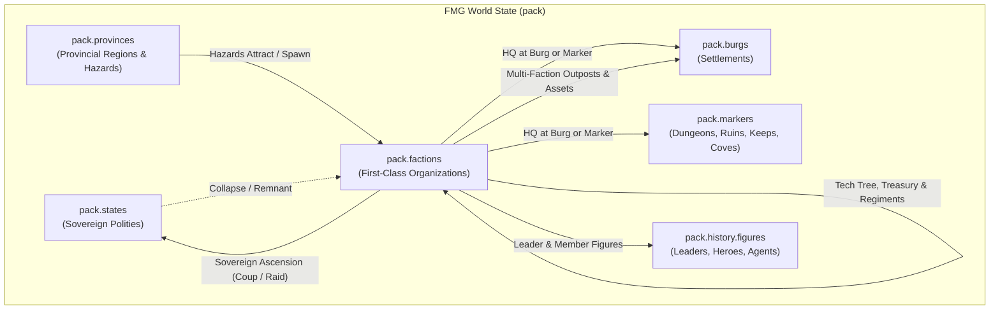

# Plan — Factions: First-Class Non-Polity Organizations, Outposts, Assets & Emergent Power

**Updated:** 2026-11-05  
**Status:** Completed (Phases 1–5 Implemented & Verified; see [factions-plan.md](factions-plan.md))  
**Note:** The legacy `stepFactionEconomyAndTech` / instant-buy / teleport-raid loop described in Phase 3 below is superseded by the unified OpenCiv engine in [factions-civ-engine.md](factions-civ-engine.md) (Phases 1–5 complete). Factions now run on `stepCities`/`stepEmpire`/`stepTactical` — see the wiki [Factions](https://github.com/0xPaladin/Fantasy-Map-Generator/wiki/Factions) and [Living World](https://github.com/0xPaladin/Fantasy-Map-Generator/wiki/Living-World) pages.
**Branch:** `factions`  
**Companions:** [living-world.md](living-world.md), [living-openciv.md](living-openciv.md), [living-openciv-armies.md](living-openciv-armies.md), [lair-ascension.md](lair-ascension.md), [culture-traits.md](culture-traits.md), [unified-figures.md](unified-figures.md)  
**Supersedes:** `GuildState` (`living.guild`) in [living-idle-guild.md](living-idle-guild.md) and standalone `ProvinceLair` / organizational `ProvinceTrouble` structs in `src/types/living.ts`.

---

## 1. Executive Summary & Locked-In Decisions

Azgaar's Fantasy Map Generator models territorial polities (`pack.states` and `pack.provinces`), cultural/linguistic zones (`pack.cultures`), faiths (`pack.religions`), and settlements (`pack.burgs`). However, fantasy worlds and historical simulations are equally shaped by **non-polity organizations** that operate across, within, and beneath state borders: merchant consortia, adventurers' guilds, thieves' syndicates, secret societies, heresies, sinister cults, knightly orders, mercenary free companies, independent arms of local governments, rebel movements, and rogue warlords.

This plan introduces **Factions (`pack.factions`)** as a first-class FMG entity and Living World simulation pillar.

### Locked-In Design Decisions

1. **First-Class FMG Entity (`pack.factions: Faction[]`)**:
   - Factions live on `pack.factions` alongside `pack.states`, `pack.cultures`, `pack.religions`, and `pack.burgs` (`i === 0` reserved, soft deletion via `removed: true`).
   - Generated during standard map generation (`Factions.generate()`), persisted in `.map` files, searchable in the Omnibar (`MapEntities`), rendered on a dedicated `#factions` map layer, and editable via a first-class **Factions Overview** and **Faction Editor**.
2. **Hybrid of Cultures, States, and Burgs**:
   - **Like Cultures**: Every faction has an `alignment` (`good`, `lawful`, `neutral`, `chaotic`, `evil`), `values` (1–2 core ethos values from `CULTURAL_VALUES`), and `expansionism` + `expansionScope`.
   - **Like States**: Every faction has a `military` (`Regiment[]` with `ArmyBlock[]` composition and `rosterId`), `treasury`, full two-tier diplomatic `relations` (with States **and** other Factions), **Tech Tree `advancement`** (`researchedTechs`, `currentTechId`, `researchQueue`), and **Outposts** across burgs.
   - **Like Burgs**: Every faction builds and upgrades **Assets** both at its **HQ** (whether urban or wilderness) and inside each of its **Burg Outposts**.
3. **Calculated Operational Scale (`burg` $\rightarrow$ `province` $\rightarrow$ `state` $\rightarrow$ `world`)**:
   - Scale is **not a static or manually assigned setting**; it is **dynamically calculated** based on the faction's real footprint: total active outposts, geographic span across provinces and states, number and tier of built assets, researched technologies, and accumulated influence. As a faction expands its network, its scale automatically rises; if its outposts are sacked or assets destroyed, its scale contracts.
4. **Behavioral Drivers: Expansionism vs. Type/Alignment/Values**:
   - **`expansionism` drives tempo & investment**: Governs how aggressively and frequently the faction commits its treasury to founding new outposts and building assets.
   - **`type`, `alignment`, and `values` define behavior**: Dictate which **actions/agendas** the faction takes (e.g. peacekeeping, trade expeditions, holy crusades, illicit smuggling, plunder raids, or coups), which **desired asset types** it constructs, and which branches of the **OpenCiv tech tree** it prioritizes researching.
5. **Two-Tier Bilateral Relations (Allied to At War)**:
   - Factions maintain full 6-tier diplomatic relations (`Ally`, `Friendly`, `Neutral`, `Suspicion`, `Rival`, `Enemy` / At War) **with States** AND **with other Factions**. A faction can be allied with a kingdom while at war with a rival criminal syndicate, or multiple factions can band into leagues and coalitions.
6. **Unification of Troubles & Lairs (Option B — Hazard + Faction Split)**:
   - **All 20 Lair archetypes** (`src/data/living-lairs.ts`) and **all 19+ organizational Trouble archetypes** (`src/data/living-troubles.ts`: cults, secret societies, brigands, exiled lords, demagogues, corrupt officials, mutinous garrisons, rebel communes) become **Factions** in `pack.factions`. `ProvinceLair` and `living.activeLairs` are retired.
   - **Environmental, economic, and site hazards** (`flooding`, `barren_surroundings`, `recurrent_sickness`, `no_workers`, `inaccessible`, `ancient_curse`, `leyline_blight`, etc.) remain lightweight provincial/cell hazards (`ProvinceHazard`) that lower order/yields, **attract or spawn Factions**, and can be resolved by State or Faction missions.
7. **Retirement of Bespoke `living.guild` (`GuildState`)**:
   - The standalone `living.guild` singleton is retired. Adventurers' Guilds, Merchant Guilds, Thieves' Guilds, Holy Orders, Cults, and Warlords are all standard `Faction` instances in `pack.factions` sharing one unified engine for HQ, outposts, assets, tech advancement, military, figure rosters (`leaderId`, `memberIds`), missions, and relics (`relics`).
   - In the Living HUD, the user can observe all factions autonomously, intervene via Sandbox God Mode, or select any Faction as their **Controlled / Patron Faction** (`living.playerFactionId?: number`).
8. **Multi-Faction Coexistence & Competition in Burgs**:
   - Multiple factions can establish outposts in the same Burg, building assets that either enrich or parasitize the host settlement and competing with rival factions for local influence, trade, and public order.



---

## 2. Faction Taxonomy, Allegiance & Scale

### 2.1. Six Faction Categories & Archetypes (`src/data/factions-catalog.ts`)

| Category (`FactionCategory`) | Archetype IDs (`type`) | Default Allegiance | Sovereign Ambition? | Absorbs Legacy Lairs / Troubles |
| :--- | :--- | :--- | :---: | :--- |
| **`commercial`** *(Civic & Trade)* | `merchant_company`, `bank_consortium`, `craft_guild`, `chartered_monopoly`, `free_traders` | `chartered` or `autonomous` | Optional (`chartered_monopoly`, `free_traders`) | `bad_reputation` |
| **`adventuring`** *(Orders & Colleges)* | `adventurer_guild`, `arcane_college`, `scholarly_society`, `ranger_wardens`, `relic_seekers` | `autonomous` or `chartered` | No (expands to `world` scale) | Replaces `living.guild`; `mad_wizard` |
| **`underworld`** *(Illicit & Criminal)* | `thieves_guild`, `smuggler_ring`, `assassin_sect`, `gang_syndicate`, `brigand_band`, `pirate_fleet` | `clandestine` or `hostile` | Yes (`brigand_band`, `pirate_fleet`, `gang_syndicate`) | `thieves_stronghold`, `bandit_camp`, `riotous_thugs`, `brigand_raiders`, `secret_society` |
| **`religious`** *(Faith & Occult)* | `monastic_order`, `knightly_order`, `inquisition`, `heretical_sect`, `sinister_cult`, `doomsday_cult`, `dark_cabal`, `demonic_coven` | `state_arm`, `autonomous`, `clandestine`, or `hostile` | Yes (`sinister_cult`, `doomsday_cult`, `dark_cabal`, `demonic_coven`) | `corrupt_monastery`, `cult_shrine`, `demonic_master`, `school_of_dark_sorcery`, `sinister_cult`, `doomsday_cult`, `dark_wizards` |
| **`political`** *(State-Arms & Rebels)* | `state_agency`, `colonial_company`, `noble_house`, `rebel_front`, `exiled_claimant`, `peasant_commune`, `mutinous_garrison`, `nativist_league` | `state_arm`, `clandestine`, or `hostile` | Yes (all insurgent/claimant types; `state_arm` if it defects) | `renegade_outpost`, `splinter_group`, `exiled_lord`, `conquering_heirs`, `corrupt_leadership`, `demagogue`, `class_hatred`, `recalcitrant_locals`, `disunity`, `cultural_feuding`, `xenophobia` |
| **`martial`** *(Warlords & Wilder)* | `mercenary_company`, `rogue_warlord`, `iron_barony`, `marauder_horde`, `exiled_clan_hold`, `xenophobic_enclave`, `ancient_evil`, `planar_rift`, `monster_nest`, `blight_hive`, `savage_warband` | `autonomous` or `hostile` | Yes (except `monster_nest`, `blight_hive`, `savage_warband`) | `aspiring_warlord`, `ancient_fort`, `marauder_warcamp`, `dwarven_outcasts`, `malevolent_creed`, `ancient_evil`, `magical_gate`, `monster_nest`, `blight_infestation`, `vicious_humanoids`, `outland_raiders`, `covetous_polity` |

### 2.2. Legal Status & State Allegiance (`FactionAllegiance`)

- **`state_arm`**: An autonomous arm of a sovereign state (`patronStateId`), such as a Royal Inquisition, Secret Police, State Intelligence Directorate, Chartered Colonial Company, or Border Marcher Order.
  - Receives seasonal patronage (`+Gold`) from `patronStateId` and executes agendas aligned with state interests (rooting out clandestine factions, policing unrest, guarding frontiers).
  - **Rogue Defection**: If the patron state suffers high `unravel >= 60`, bankruptcy, or a succession crisis—or if the faction's leader has `ambitious`/`disloyal`/`greedy` vices and outgrows the crown—a `state_arm` can **defect** into an `autonomous`, `clandestine`, or `hostile` faction (or stage a coup!).
- **`chartered`**: Legally recognized guild, bank, or order operating with state charters. Pays a share of trade/tax to host burgs in exchange for open outposts (`secrecy = 0`).
- **`autonomous`**: Unaligned free agent (e.g., Adventurers' Guild, Mercenary Free Company, Monastic Order, Arcane College). Can sign contracts with any non-enemy state.
- **`clandestine`**: Hidden organization (`secrecy > 50`, e.g., Thieves' Guild, Secret Society, Sinister Cult, Rebel Cell). Operates covert outposts inside burgs; host states must detect/investigate them before launching a military or magistrate crackdown.
- **`hostile`**: Open enemies of settled order (Rogue Warlords, Bandit Camps, Pirate Fleets, Marauder Hordes, Doomsday Cults, Monster Lairs). Attacked on sight by state garrisons and rival adventuring/martial factions.

### 2.3. Operational Scale as a Calculated Metric (`computeFactionScale`)

Scale is **never manually assigned or statically set**. Instead, a faction's scale dynamically reflects its real operational footprint on the map: its active outposts, geographic distribution across provinces and states, accumulated infrastructure assets, and tech level.

Scale is re-evaluated on tick via `computeFactionScale(faction, pack)`:

| Calculated Scale | Reach & Footprint Requirements | Max Outposts Allowed | Max Military Regiments | Description & Examples |
| :---: | :--- | :---: | :---: | :--- |
| **`burg`** | Baseline footprint (HQ only or $\le 1$ outpost) | `1` | `1` | Local cell, gang, neighborhood cult, single bandit camp, isolated wizard spire |
| **`province`** | $\ge 2$ total outposts (or outpost beyond HQ in the province) **AND** $\ge 2$ built assets **AND** $\ge 2$ researched techs | `4` | `2` | Provincial brotherhood, regional merchant guild, border warlord host |
| **`state`** | Outposts across $\ge 2$ different Provinces in the same State (or $\ge 3$ total outposts) **AND** $\ge 5$ built assets (with $\ge 1$ T2 asset) **AND** $\ge 5$ researched techs | `10` | `4` | Kingdom-wide syndicate, Royal Inquisition, Chartered State Company, Realm Knightly Order |
| **`world`** | Outposts across $\ge 2$ different sovereign States **AND** $\ge 7$ total outposts **AND** $\ge 10$ built assets (with $\ge 1$ T3 asset) **AND** $\ge 10$ researched techs | `25` | `8` | Transnational Adventurers' Guild, Continental Banking Consortium, World Cult, Grand Crusade |

> [!NOTE]
> **Dynamic Contraction:** If a faction's outposts are sacked by rival factions or wiped out by state crackdowns, its scale drops automatically. A `world`-spanning guild can be reduced to a `province` or `burg` presence if its foreign branches are severed!

### 2.4. Behavioral Drivers: Expansionism vs. Type, Alignment & Values

A faction's decisions and evolution are driven by two distinct mechanisms:

1. **`expansionism` (0.2 .. 2.0) drives Tempo & Investment**:
   - Acts as the velocity and resource-allocation multiplier.
   - High expansionism factions aggressively prioritize spending their treasury to fund new outposts (`establish_outpost`) and construct assets (`build_asset`), taking higher financial risks to broaden their map footprint.
   - Low expansionism factions hoard gold, fortify their existing HQ, and expand cautiously only within their immediate cultural/state borders.
2. **`type`, `alignment`, and `values` define Actions, Desired Asset Types, and Tech Choices**:
   - **Agendas / Actions**:
     - *Type*: Martial factions raid and muster; Underworld factions smuggle, extort, and run turf wars; Commercial factions secure trade routes and market monopolies; Religious factions spread faith and root out heretics; Political factions stage coups and incite revolts.
     - *Alignment*: Good factions protect settlements and clear hazards; Lawful factions uphold contracts and support state order; Neutral factions seek knowledge and balance; Chaotic factions break monopolies and foster rebellions; Evil factions exploit, corrupt, and subjugate.
     - *Values*: Core values from `CULTURAL_VALUES` weight specific actions (e.g. `greed` weights trade & extortion; `knowledge` weights excavation & research; `valor`/`order` weights hunting lairs & peacekeeping; `subjugation`/`power` weights coups & rival strikes).
   - **Desired Asset Types**:
     - Factions construct assets matching their category and ethos:
       - *Commercial + Lawful / Greed*: `trade_depot`, `counting_house`, `grand_exchange`.
       - *Underworld + Chaotic / Evil*: `safe_house`, `smuggler_tunnel`, `shadow_court`.
       - *Religious + Good / Lawful*: `wayside_shrine`, `monastic_scriptorium`.
       - *Religious + Evil / Chaotic*: `hidden_shrine`, `ritual_sanctum`.
       - *Scholarly + Knowledge*: `alchemical_lab`, `seeker_archives`, `grand_conclave`.
       - *Martial + Conflict / Valor*: `muster_camp`, `armory_forge`, `war_citadel`.
   - **Desired Tech Tree Priorities**:
     - Factions do not research the tech tree randomly; their AI tech-selection weights prioritize branches supporting their archetype:
       - *Commercial*: `sailing`, `currency`, `banking`, `economics`, `navigation`.
       - *Martial / Warlords*: `bronze_working`, `iron_working`, `horseback_riding`, `chivalry`, `steel`, `gunpowder`.
       - *Underworld / Intrigue*: `masonry`, `optics`, `guilds`, `printing_press`, `civil_service`.
       - *Religious / Occult*: `calendar`, `philosophy`, `theology`, `education`.
       - *Scholarly / Arcane*: `writing`, `mathematics`, `education`, `scientific_theory`, `chemistry`.

### 2.5. Two-Tier Comprehensive Diplomacy (`stateRelations` & `factionRelations`)

Factions exist in a dynamic diplomatic matrix spanning both sovereign states and other non-polity organizations:

$$\text{Relations Spectrum: } \text{Ally} \longleftrightarrow \text{Friendly} \longleftrightarrow \text{Neutral} \longleftrightarrow \text{Suspicion} \longleftrightarrow \text{Rival} \longleftrightarrow \text{Enemy (At War)}$$

1. **State Relations (`stateRelations: Record<number, FactionRelation>`)**:
   - **`Ally`**: Sponsoring state charters the faction, grants tax waivers, hires its auxiliary regiments, and stations joint garrisons.
   - **`Enemy` (At War)**: The state outlaws the faction, dispatches military regiments and magistrates to raid the faction's HQ, and demolishes its outposts. The faction retaliates with guerrilla raids, coups, or smuggling embargoes.
2. **Faction Relations (`factionRelations: Record<number, FactionRelation>`)**:
   - **Inter-Faction Warfare (`Enemy`)**:
     - *Guild Turf Wars*: Competing thieves' guilds or smuggler syndicates clash in shared burgs to seize outposts and eliminate rival informants.
     - *Holy Wars & Inquisitions*: Paladin/monastic orders crusade against dark cult fanes and necromantic cabals.
     - *Mercenary & Warlord Rivalries*: Rival free companies battle over state contracts or frontier plunder.
   - **Inter-Faction Alliances (`Ally` / `Friendly`)**:
     - *Trade Leagues*: Commercial factions form alliances (e.g. Hanseatic-style leagues) pooling market goods and sharing outpost facilities.
     - *Rebel Coalitions*: Insurgent fronts, bandit bands, and dissident noble houses band together to overthrow an imperial dynasty.

---

## 3. Data Model (`src/types/factions.ts` & `pack.factions`)

### 3.1. Core Interfaces

```ts
// src/types/factions.ts
import type { Alignment } from "@/data/culture-traits";
import type { Emblem } from "@/types/emblems";
import type { ActiveGuildMission, HistoricalRelic, TroublePool, TroubleSaveKind, TroubleUnitRole } from "@/types/living";
import type { Regiment } from "@/types/military";

export type FactionScale = "burg" | "province" | "state" | "world";

export type FactionCategory =
  | "commercial"
  | "adventuring"
  | "underworld"
  | "religious"
  | "political"
  | "martial";

export type FactionAllegiance = "state_arm" | "chartered" | "autonomous" | "clandestine" | "hostile";

export type FactionExpansionScope = "local" | "province" | "state" | "culture" | "religion" | "global";

export type FactionRelation = "Ally" | "Friendly" | "Neutral" | "Suspicion" | "Rival" | "Enemy";

export type FactionAgendaKind =
  | "establish_outpost"
  | "upgrade_outpost"
  | "build_asset"
  | "research_tech"
  | "muster_forces"
  | "raid_burg"
  | "subvert_burg"
  | "clear_hazard"
  | "strike_rival"
  | "excavate_site"
  | "stage_coup";

export interface FactionAgenda {
  kind: FactionAgendaKind;
  label: string;
  targetBurgId?: number;
  targetProvinceId?: number;
  targetCell?: number;
  targetFactionId?: number;
  targetStateId?: number;
  assetId?: string;
  techId?: string;
  progress: number;
  required: number;
}

export interface FactionHq {
  cell: number;
  burgId?: number;      // Set when headquartered inside a settlement
  markerId?: number;    // Set when headquartered at a map marker (dungeon, keep, monastery, cove)
  provinceId?: number;
  maritime?: boolean;
  fortified: boolean;
  secrecy: number;      // 0 (public landmark) .. 100 (hidden warren / sanctum)
  assets: string[];     // Faction assets built at the HQ
}

export interface FactionOutpost {
  burgId: number;       // Settlement hosting this outpost
  cell: number;
  tier: 1 | 2 | 3;      // 1 = Post/Cell, 2 = Chapterhouse/Branch, 3 = Regional Stronghold
  influence: number;    // 0..100 local grip in the host burg
  secrecy: number;      // 0 (open guildhall) .. 100 (covert cell)
  assets: string[];     // Faction assets built inside this outpost
  establishedYear: number;
  pillaged?: boolean;
}

export interface Faction {
  i: number;                              // Matches index in pack.factions (0 reserved)
  name: string;
  category: FactionCategory;
  type: string;                           // Archetype key in FACTIONS_CATALOG
  readonly scale: FactionScale;           // Calculated dynamically via computeFactionScale(faction, pack)
  allegiance: FactionAllegiance;
  patronStateId?: number;                 // Sponsoring state for "state_arm" or "chartered"

  // Identity & Visuals
  color: string;
  coa?: Emblem;
  icon: string;
  culture: number;
  religion?: number;
  foundedYear: number;
  leaderId?: number;                      // Active leader in pack.history.figures
  memberIds: number[];                    // Recruited heroes, specialists, and agents in pack.history.figures
  candidateIds?: number[];                // Seasonal recruitment pool of figures

  // Culture-like Ethos & Growth
  alignment: Alignment;                   // "good" | "lawful" | "neutral" | "chaotic" | "evil"
  values: string[];                       // 1–2 values from CULTURAL_VALUES
  expansionism: number;                   // 0.2 .. 2.0 growth & ambition multiplier
  expansionScope: FactionExpansionScope;
  sovereignAmbition: boolean;             // True if capable of ascending into a sovereign State
  stateForm?: string;                     // Polity form name when ascending to a State

  // HQ & Burg Outposts (with Burg-like Assets)
  hq: FactionHq;
  outposts: FactionOutpost[];

  // State-like Advancement (Assets + Outposts + OpenCiv Tech Tree)
  tier: number;                           // 1..5 organizational tier
  science: number;                        // Net science/advancement generated per tick
  currentTechId?: string | null;
  researchQueue: string[];
  researchedTechs: string[];
  researchedProgress: Record<string, number>;

  // Economy, Diplomacy & Military
  treasury: number;
  influence: number;                      // Renown / political leverage
  rosterId?: string;                      // OpenConquest unit roster ID
  military: Regiment[];                   // Armed forces (HQ garrison, raiders, mercenary hosts)
  raidThreshold?: number;                 // 4, 5, or 6 on 1d6 for raiding factions
  raidPending?: boolean;
  stateRelations: Record<number, FactionRelation>;   // stateId -> relation
  factionRelations: Record<number, FactionRelation>; // factionId -> relation

  // Operations, Missions & Relics (superseding GuildState)
  doctrine?: "auto_expand" | "auto_bounties" | "auto_lairs" | "auto_excavate" | "auto_subvert" | "manual";
  agenda: FactionAgenda | null;
  missions?: ActiveGuildMission[];
  relics?: HistoricalRelic[];
  seasonsActive: number;

  // Standard FMG Entity Metadata
  tags?: string[];
  lock?: boolean;
  removed?: boolean;
  note?: string;
}
```

### 3.2. Provincial Hazards (`ProvinceHazard` — Option B)

Non-organizational troubles (`flooding`, `barren_surroundings`, `recurrent_sickness`, `no_workers`, `inaccessible`, `ancient_curse`, `leyline_blight`, `contaminated_land`, `harsh_conditions`, `hazardous_resource`, `pervasive_hunger`, `severe_damage`, `taboo_land`, `toxic_process`, `undeveloped`, `wasted_production`, `crushed_spirits`, `destructive_customs`) remain on `ProvinceSimState.trouble` (`ProvinceTrouble`) as **hazards only**. There are no `attractsFactionTypes` / `isHazard` hooks: hazards never become actors, and dangerous factions spawn from the trouble trigger's 50/50 hazard-vs-faction split (and from danger markers), not from hazard affinity tables. Any Faction with an `adventuring`, `religious`, `commercial`, or `state_arm` doctrine can dispatch a hero/specialist mission (`clear_hazard`) to resolve the hazard for gold and influence.

---

## 4. HQ, Outposts, Assets & Advancement Mechanics

### 4.1. HQ & Multi-Faction Burg Outposts

1. **HQ Placement**:
   - **Urban HQ (`hq.burgId`)**: Anchored inside a Burg (e.g., Merchant Company in a major port, Thieves' Guild in a capital's shantytown, Royal Inquisition in a state capital, Arcane College in a university city).
   - **Wilderness / Marker HQ (`hq.markerId` / `hq.cell`)**: Anchored at a map marker or remote cell (e.g., Rogue Warlord in a Ruined Keep, Pirate Fleet in a sea cove, Cult in a Corrupt Monastery, Exiled Dwarves in a mountain mine, Ancient Evil in a Necropolis).
2. **Burg Outpost Network (`faction.outposts`)**:
   - A faction can establish at most 1 outpost per Burg (`outpost.burgId`), up to its `scale` cap (`1` at `burg`, `4` at `province`, `10` at `state`, `25` at `world`).
   - **Multi-Faction Coexistence**: A single Burg can host outposts from multiple factions simultaneously. A Burg's soft capacity before crowding friction increases is:
     $$\text{Burg Outpost Soft Cap} = \max(2, \min(8, 1 + \lfloor \text{citizens} / 2 \rfloor))$$
   - **Turf Dynamics**:
     - Every outpost tracks `influence` (`0..100`) and `secrecy` (`0..100`).
     - When two factions in the same Burg have `Enemy` or `Rival` relations (or opposing alignments/categories, such as a `state_arm` Inquisition vs. a `clandestine` `sinister_cult`, or two rival `thieves_guild` syndicates), they roll seasonal **Turf Clashes** (`strike_rival` agenda), reducing the loser's `influence` or pillaging an outpost asset. If an outpost's `influence` drops to `0` and its assets are destroyed, the outpost is uprooted.

### 4.2. Faction Assets Catalog (`src/data/faction-assets.ts`)

Assets can be built at **both the Faction HQ and inside Burg Outposts**. Each asset has a `tier` (`1..3`), `cost` (Gold), optional `requiredTech` (from [`src/data/living-civ-techs.ts`](file:///home/paladin/workspace/Fantasy-Map-Generator/src/data/living-civ-techs.ts)), allowed location (`"any" | "burg" | "wilderness" | "hq_only"`), **Faction Yields** (`gold`, `science`, `influence`, `militaryCap`, `secrecy`), and **Host Burg / Province Modifiers**:

| Asset ID | Name | Track & Tier | Location | Required Tech | Faction Benefit | Host Burg / Province Impact |
| :--- | :--- | :---: | :---: | :--- | :--- | :--- |
| **`trade_depot`** | Trade Depot | Commercial T1 | `any` | `pottery` / `sailing` | `+3 Gold`, `+1 Influence` | `+1 Gold` to host burg |
| **`counting_house`** | Counting House | Commercial T2 | `burg` | `currency` | `+6 Gold`, `+1 Science`, `+2 Influence` | `+2 Gold` to host burg; `+5%` market trade |
| **`grand_exchange`** | Grand Exchange | Commercial T3 | `burg` | `banking` | `+12 Gold`, `+2 Science`, `+4 Influence` | `+4 Gold`, `+1 Prod` to host burg |
| **`chapter_lodge`** | Chapter Lodge | Adventuring T1 | `any` | — | `+2 Gold`, `+1 Science`, `+2 Influence`, `+1 Hero slot` | `+2 Order` to province; reduces hazard spawn |
| **`seeker_archives`** | Seeker Archives | Adventuring T2 | `any` | `writing` | `+3 Science`, `+3 Influence`, `+1 Relic Vault slot` | `+2 Science` to host burg |
| **`grand_conclave`** | Grand Conclave | Adventuring T3 | `hq_only` | `education` | `+6 Science`, `+6 Influence`, `+2 Hero slots`, `+1 Check bonus` | `+4 Science`, `+4 Order` to host burg |
| **`safe_house`** | Safe House | Underworld T1 | `burg` | — | `+3 Gold` (siphoned), `+15 Secrecy` | `-1 Gold` to state tax; `-1 Order` |
| **`smuggler_tunnel`** | Smuggler Warren | Underworld T2 | `any` | `masonry` / `optics` | `+6 Gold`, `+1 Science`, `+25 Secrecy`, bypasses embargoes | `-2 Gold` to state tax; `-2 Order`, `+1 Unrest` |
| **`shadow_court`** | Shadow Court | Underworld T3 | `hq_only` | `guilds` | `+10 Gold`, `+3 Science`, `+4 Influence`, unlocks Assassin ops | `-4 Order`, `+2 Unrest`; can paralyze burg governor |
| **`wayside_shrine`** | Wayside Shrine | Religious T1 | `any` | — | `+2 Gold`, `+2 Influence`, radiates religion pressure (`+4`) | `+2 Order` (if state faith) or `-2 Order` (if cult/heresy) |
| **`monastic_scriptorium`**| Scriptorium | Religious T2 | `any` | `philosophy` | `+4 Science`, `+3 Influence`, heals wounded heroes | `+2 Science`, `+1 Culture` to host burg |
| **`ritual_sanctum`** | Ritual Sanctum | Religious T3 | `any` | `theology` | `+4 Gold`, `+4 Science`, `+5 Influence`, unlocks zealot/cult units | Radiates `+12` pressure; `-5 Order` & `+3 Unrest` if dark cult |
| **`informant_ring`** | Informant Ring | Political T1 | `burg` | — | `+2 Influence`, `+1 Science`, `+15 Secrecy` (or `-20` rival secrecy) | Detects clandestine outposts in burg |
| **`printing_cell`** | Pamphlet Press | Political T2 | `burg` | `machinery` / `printing_press`| `+3 Science`, `+5 Influence` | `+3 Order` (if `state_arm`) or `+4 Unrest` (if `rebel_front`) |
| **`shadow_directorate`**| Directorate HQ | Political T3 | `hq_only` | `civil_service` | `+6 Gold`, `+4 Science`, `+6 Influence`, `+1 Regiment cap` | Enables direct coup (`stage_coup`) when Order $\le 30$ |
| **`muster_camp`** | Muster Camp | Martial T1 | `any` | — | `+2 Gold` (plunder/dues), `+1 Regiment cap`, `+10%` heal | `+1 Defense` if allied; projects raid threat if hostile |
| **`armory_forge`** | Armory & Forge | Martial T2 | `any` | `iron_working` | `+2 Prod/Gold`, `+2 Science` (military tech), `+10%` unit XP | Supplies garrison weapons |
| **`war_citadel`** | War Citadel | Martial T3 | `hq_only` | `chivalry` / `steel` | `+4 Gold`, `+3 Science`, `+2 Regiment cap`, `fortified = true` | Grants T2 Walls equivalent to HQ defense |
| **`alchemical_lab`** | Alchemical Lab | Scholarly T2 | `any` | `alchemy` / `chemistry` | `+5 Science`, `+2 Gold` | `+2 Science` to host burg |
| **`subterranean_delve`**| Deep Delve | Wilder T2 | `wilderness`| `mining` | `+5 Gold`, `+2 Science`, spawns lair defender block | Exploits underlying cell resource |

### 4.3. Advancement System (Assets + Outposts + OpenCiv Tech Tree)

Faction advancement is a three-part engine:


1. **Seasonal Science (`faction.science`) Calculation**:
   - **Base HQ**: `+2 Science/tick` (`+4` for `adventuring` / `arcane_college` / `scholarly_society`).
   - **Outposts**: $\sum_{\text{outposts}} \text{outpost.tier}$ (`+1` to `+3` Science per active outpost).
   - **Assets**: Sum of `assetDef.science` across `hq.assets` and all `outpost.assets` (`seeker_archives`, `monastic_scriptorium`, `alchemical_lab`, `grand_conclave`, etc.).
   - **Figures**: `+1 Science` per point of `w` or `c` skill on `leaderId`.
2. **Host-Burg Tech Spillover**:
   - Because factions operate inside burgs, if a faction is researching `currentTechId` and **any Burg where the faction holds an HQ or Outpost belongs to a State that has already researched `currentTechId`**, the faction receives a **`+25%` research speed bonus** (`spilloverMult = 1.25`, or `+50%` if the faction has an `informant_ring` or `seeker_archives`!).
   - Newly spawned factions initialize their `researchedTechs` from their founding Burg/State's known Ancient/Classical technologies so mid-game factions never start in the Stone Age.
3. **What Advancement & Growth Unlocks**:
   - **Calculated Scale (`computeFactionScale`)**: Automatically promoted or contracted based on current map footprint:
     - **`burg`**: Baseline (HQ only or $\le 1$ outpost).
     - **`province`**: Requires $\ge 2$ total outposts **AND** $\ge 2$ built assets **AND** $\ge 2$ techs.
     - **`state`**: Requires outposts across $\ge 2$ different provinces in the same state (or $\ge 3$ total outposts) **AND** $\ge 5$ built assets (with $\ge 1$ T2 asset) **AND** $\ge 5$ techs.
     - **`world`**: Requires outposts across $\ge 2$ different sovereign states **AND** $\ge 7$ total outposts **AND** $\ge 10$ built assets (with $\ge 1$ T3 asset) **AND** $\ge 10$ techs.
   - **Military Unit Tech Gating**: Faction regiments use `faction.researchedTechs` to unlock and upgrade roster `UnitType` blocks (`requiredTech`, `upgradesTo`), using the exact same tech-gating rules as States in `living-openciv-armies.md`.

---

## 5. Lifecycle: Trouble/Lair Unification, State Ascension & Remnants

### 5.1. From Local Trouble/Lair to Sovereign State (`ascendFactionToState`)

`promoteTroubleToState()` and `ascendLairToState()` in [`src/model/physical/living-generator.ts`](file:///home/paladin/workspace/Fantasy-Map-Generator/src/model/physical/living-generator.ts) are unified into **`ascendFactionToState(factionId, targetBurgId?)`**:

1. **Eligibility**:
   - `faction.sovereignAmbition === true` (Warlords, Rebel Fronts, Exiled Claimants, Sinister/Doomsday Cults, Mutinous Garrisons, Brigand/Pirate Lords, Marauder Hordes, Outcast Clans, Ancient Evils, or a defected `state_arm`).
   - Commercial, Adventuring, and Monastic factions (`sovereignAmbition === false`) prefer to grow into `state`- and `world`-scale networks rather than becoming territorial polities—unless explicitly forced via God Mode or a `chartered_monopoly` / `knightly_order` frontier takeover!
2. **Trigger Paths**:
   - **Path A — Urban Coup / Revolution**: The faction has an HQ or Tier 2+ Outpost in a Burg where provincial `order <= 25` (or owning state `unravel >= 60`), and completes `stage_coup` (or wins a garrison uprising).
   - **Path B — Raid Takeover**: A hostile faction's `military` regiment defeats a vulnerable non-capital Burg in battle (`order <= 20` or `walls === 0`).
   - **Path C — Wilderness Hold Proclamation**: A fortified wilderness faction (`hq.markerId` / `hq.cell`, `tier >= 2`, `seasonsActive >= 8`) in an unburged or low-order province founds a new capital Burg on `hq.cell` and proclaims a State.
3. **Transition Mechanics**:
   - Calls `spawnEmergentState()` using `faction.name`, `faction.stateForm`, `faction.color`, `faction.coa`, `faction.culture`, `faction.alignment`, `faction.rosterId`, `faction.leaderId` (becomes State Ruler!), `faction.researchedTechs`, `faction.treasury`, and `faction.military` (becomes the new State's regiments!).
   - Any outposts the faction held inside the seized province convert into State buildings/infrastructure; any outposts in foreign states either become diplomatic footholds or are expelled.
   - Marks `faction.removed = true` and logs an `independence` chronicle event linking `{ kind: "faction", id: faction.i }` $\rightarrow$ `{ kind: "state", id: newStateId }`.

### 5.2. Fallen States Spawn Remnant Factions (`spawnRemnantFaction`)

When a sovereign `State` is conquered or collapses in `living-generator.ts`:
- Instead of vanishing without a trace, there is a deterministic chance (or guaranteed when the ruler/general survives) to spawn a **Remnant Faction** (`exiled_claimant`, `conquering_heirs`, `rebel_front`, or `rogue_warlord`) in a frontier ruin or conquered burg!
- The remnant faction inherits the fallen state's surviving leader figure, `culture`, `religion`, `alignment`, `values`, `researchedTechs`, `rosterId`, and a grudge against the conqueror—creating organic restoration wars generations later.

---

## 6. Retiring `living.guild` & Unified Faction Gameplay

### 6.1. What Happens to `GuildState` (`living.guild`)
- `living.guild` (`GuildState`) is deprecated and replaced by `living.playerFactionId?: number` and `living.sandboxGodMode?: boolean`.
- On map generation (`Factions.generate()`), at least one `adventurer_guild` (or `ranger_wardens` / `arcane_college`) faction is always generated among the world's starting factions, and `living.playerFactionId` defaults to it (though the player can switch `playerFactionId` to **any** active faction on the map—playing as a Merchant Consortium, a Thieves' Syndicate, a Sinister Cult, a Royal Inquisition, or a Rogue Warlord!).
- In `auto-update.ts` / `Living.syncWorld()`, any old save carrying `living.guild` automatically migrates `living.guild` into a `Faction` entry in `pack.factions` (preserving its `hqBurgId`, `chapterBurgIds` $\rightarrow$ `outposts`, `gold` $\rightarrow$ `treasury`, `renown` $\rightarrow$ `influence`, `tier`, `roster` $\rightarrow$ `memberIds`, `missions`, and `relics`).

### 6.2. Unified Faction Operations (Player & AI)
Every faction—whether AI-driven or player-selected via `playerFactionId`—uses the same action verbs:
- **Establish / Upgrade Outpost** (`establishOutpost(factionId, burgId)`)
- **Build / Upgrade Asset** (`buildFactionAsset(factionId, location, assetId)`)
- **Recruit Figure / Muster Regiment** (`recruitFactionFigure`, `musterFactionUnit`)
- **Dispatch Mission** (`dispatchFactionMission`: `clear_hazard`, `hunt_faction`, `excavate_site`, `subvert_burg`, `strike_rival`, `pacify_burg`)
- **Diplomatic & Covert Operations** (`inciteUprising`, `assassinateRuler`, `brokerWar`, `hireMercenaries`, `defectFromPatron`)

---

## 7. Detailed Implementation Phases

### Phase 1 — Core Types, Catalogs & `.map` Serialization
**Goal:** Establish the `Faction` domain model, catalogs for archetypes and assets, and zero-loss `.map` save/load support.

1. **`src/types/factions.ts` & `src/types/packed-graph.ts`**:
   - Define `Faction`, `FactionScale`, `FactionCategory`, `FactionAllegiance`, `FactionHq`, `FactionOutpost`, `FactionAgenda`, `FactionAssetDef`, and `FactionArchetypeDef`.
   - Add `factions: Faction[]` to `PackedGraph` (`src/types/packed-graph.ts`) and add `{ kind: "faction"; id: number }` to `HistRefKind` in `src/types/history.ts`.
2. **`src/data/factions-catalog.ts` & `src/data/faction-assets.ts`**:
   - Build `FACTIONS_CATALOG` (~38 archetypes across the 6 categories), absorbing all 20 Lair archetypes from `src/data/living-lairs.ts` and the 19 organizational Trouble archetypes from `src/data/living-troubles.ts`.
   - Build `FACTION_ASSETS_CATALOG` (~20 tiered HQ/outpost assets across Commercial, Adventuring, Underworld, Religious, Political, Martial, Scholarly, and Wilder tracks) with tech prerequisites from `src/data/living-civ-techs.ts`.
   - Update `src/data/living-troubles.ts` to mark the 28 hazards (20 environmental/economic/site + 8 hazardous customs) as hazards; `attractsFactionTypes`/`isHazard` hooks are retired (Option B).
3. **Serialization (`src/services/io/save.ts`, `load.ts`, `epochs-format.ts`, `export-json.ts`, `auto-update.ts`)**:
   - Serialize `pack.factions` in `save.ts` and parse in `load.ts` (initializing `pack.factions = [{ i: 0 } as Faction]` when absent on legacy maps and running `Factions.generate()` or migrating legacy `living.guild` / `living.activeLairs` in `auto-update.ts`).
   - Register `"faction"` in `ENTITY_TYPES` inside `src/model/map-entities.ts` so Omnibar search, notes, and entity references work out of the box.
4. **Unit Tests**:
   - `src/data/factions-catalog.test.ts`: Verify archetype invariants, asset tech prerequisites, and Lair/Trouble mapping coverage.
   - `src/services/io/save.test.ts` & `src/model/map-restoration.test.ts`: Verify `.map` round-trip serialization of `pack.factions`.

---

### Phase 2 — Procedural Factions Generator (`Factions.generate()`)
**Goal:** Generate a rich, lore-consistent ecosystem of starting factions on every new map.

1. **`src/model/political/factions-generator.ts` (`Factions` singleton)**:
   - Implement `Factions.generate()` and wire `{ id: "factions", run: () => Factions.generate() }` into `GenerationPipeline` and `ErasePipeline` (`src/model/generation-pipeline.ts`) right after `markers` and `military`.
   - **Seeding Rules**:
     - **Commercial Guilds**: Seeded in major market/port burgs (`pack.markets`), given `province` or `state` scale and initial outposts along connected trade routes.
     - **Adventuring / Scholarly Orders**: 1–3 seeded in major crossroads/citadel burgs with `province` or `state` scale.
     - **Religious Orders & Cults**: Seeded from `pack.religions` (Holy Orders/Inquisitions for organized state religions; Heretical Sects or Sinister Cults in peripheral/multi-religion burgs).
     - **Underworld Syndicates**: Thieves' Guilds in high-population capitals/ports; Smuggler Rings in high-tariff border ports; Pirate Fleets on maritime danger markers.
     - **Political & State-Arm Agencies**: Major states (`provinces.length >= 3`) receive a `state_arm` agency or noble faction; conquered/multi-culture frontier provinces may seed a `clandestine` `rebel_front` or `exiled_claimant`.
     - **Martial & Wilder Lair Factions**: Every danger marker (`isDangerMarker(marker)`) and untamed frontier zone seeds a corresponding armed Lair Faction (`bandit_camp`, `rogue_warlord`, `marauder_horde`, `ancient_evil`, `monster_nest`, etc.) with `hq.markerId = marker.i` and instantiated `military` regiments.
   - Roll each faction's `alignment` and `values` deterministically via `traitsRng(seed, "faction", i)` (`src/data/culture-traits.ts`), generate evocative names (`Names` + archetype patterns, e.g., *"The Crimson Dagger Syndicate"*, *"Iron Company of Oakhaven"*, *"Order of the Silver Dawn"*), seed starting `hq.assets`, `outposts`, `researchedTechs`, `leaderId` figure, and `military`.
2. **Helper APIs on `Factions`**:
   - `Factions.get(id)`, `Factions.active()`, `Factions.atBurg(burgId)`, `Factions.atCell(cell)`, `Factions.byState(stateId)`, `Factions.add(...)`, `Factions.remove(id)`, `Factions.recomputeScale(faction)`.
   - Expose `FMG.Factions` on `src/app/fmg.ts`.
3. **Unit Tests**:
   - `src/model/political/factions-generator.test.ts`: Verify deterministic generation, scale assignment, outpost placement, danger-marker faction creation, and removal cleanup.

---

### Phase 3 — Living World Simulation: Outposts, Assets, Tech Tree & Military (`stepFactions`)
**Goal:** Replace `stepLairs()`, `stepGuild()`, and organizational `stepProvinces()` troubles with the autonomous `stepFactions()` simulation loop.

1. **Advancement, Economy & Tech Tree (`stepFactionEconomyAndTech`)**:
   - Compute per-tick `gold`, `science`, and `influence` from `hq.assets`, `outposts` (and their `assets`), `patronStateId` stipends, and siphoned underworld trade.
   - Apply host-burg and host-province modifiers from faction outposts/assets (`+Gold`/`+Science`/`+Order` for beneficial guilds; `-Order`/`+Unrest`/`-Tax` for clandestine/hostile factions).
   - Advance `currentTechId` in `faction.researchedProgress` using `faction.science` + the `+25%` host-burg tech spillover bonus; upon completing a tech, pick the next tech from `researchQueue` or AI tech scorer (`living-civ-techs.ts`).
   - Re-evaluate `faction.tier` (`1..5`) and promote `faction.scale` (`burg → province → state → world`) when outpost, asset, and tech thresholds are met.
2. **Outpost Expansion, Asset Construction & Turf Clashes (`stepFactionAgendas`)**:
   - AI agenda selection weighted by `category`, `alignment`, `values`, and `expansionism`:
     - `establish_outpost` / `upgrade_outpost`: Spread to reachable burgs within `scale` and `expansionScope` (following trade routes for `commercial`, high-unrest burgs for `rebel_front`/`cult`, wealthy burgs for `thieves_guild`).
     - `build_asset`: Construct or upgrade tech-unlocked assets at `hq` or `outposts`.
     - `strike_rival`: Clash with rival/enemy outposts in the same burg, or state crackdowns against detected `clandestine` outposts.
     - `defect_from_state`: Triggered when a `state_arm` faction's patron state unravels (`unravel >= 60`) or leader loyalty fails.
3. **Faction Military, Raids & State Ascension**:
   - Muster and replenish `faction.military` (`Regiment[]` with `ArmyBlock[]`) up to the faction's scale and `muster_camp`/`war_citadel` cap, gated by `faction.researchedTechs`.
   - Execute seasonal raids (`tickFactionRaid`, replacing `tickLairRaid`) for `hostile` martial/underworld factions, resolving combat via OpenConquest `battle.ts`.
   - Execute `ascendFactionToState(factionId, targetBurgId)` (replacing `promoteTroubleToState` and `ascendLairToState`) for `sovereignAmbition` factions via urban coup, raid takeover, or wilderness hold proclamation.
   - Implement `spawnRemnantFaction(fallenState)` when a state collapses or is annexed.
4. **Retirement of `living.guild` & `living.activeLairs`**:
   - Remove `GuildState` singleton logic in `living-generator.ts`; route all hero recruitment, mission dispatches (`clear_hazard`, `hunt_faction`, `excavate_site`, `pacify_burg`), relic vault storage, and operations through the active `Faction` (`living.playerFactionId`).
   - Keep environmental/site hazards on `pSim.trouble` (Option B), triggering faction attraction/spawning when left unchecked.
5. **Unit Tests**:
   - `src/model/physical/living-generator.test.ts`: Update trouble/lair/guild tests and add comprehensive suites for `stepFactions()`, outpost spread, asset building, tech spillover, turf clashes, `ascendFactionToState()`, and `spawnRemnantFaction()`.

---

### Phase 4 — Map Rendering Layer (`#factions` & `#trouble`)
**Goal:** Visualize Faction HQs, Burg Outposts, Faction Armies, and Provincial Hazards clearly on the SVG map.

1. **`src/renderers/draw-factions.ts` & `src/renderers/draw-trouble.ts`**:
   - Register the `factions` viewport layer (`#factions`) in `src/renderers/layers.ts` and `src/data/layer-labels.ts`.
   - Render **Faction HQ Pins** (styled by `category` / `allegiance` with emblem/icon, scale badge, and level/tier).
   - Render compact **Outpost Badges** clustered neatly around Burgs that host faction outposts when the `#factions` layer is active (or on hover/selection).
   - Render **Faction Regiments** on the `#military` / `#factions` layer so warlord hosts, mercenary companies, and raiding parties are visible and clickable on the map.
   - Update `draw-trouble.ts` to render active `ProvinceHazard` pins alongside hostile/clandestine Faction threats.
2. **Unit & DOM Tests**:
   - `src/renderers/draw-factions.test.ts` & `src/renderers/layers.test.ts`.

---

### Phase 5 — UI Controllers: Factions Overview, Faction Editor, Burg Outposts & Living HUD
**Goal:** Provide complete FMG editor/overview tools and update the Living World HUD for Factions.

1. **Factions Overview (`src/controllers/political/factions-overview.ts`)**:
   - Standard FMG overview table (like `StatesEditor`, `CulturesEditor`, `ReligionsEditor`) listing all factions with columns for:
     - Color swatch & Emblem/Icon, Name, Category & Type, Scale (`burg` / `province` / `state` / `world`), Allegiance & Patron State, Alignment & Values, HQ (Burg/Marker link), Outposts count, Assets count, Techs count, Regiments/Strength, Treasury, and Actions (Zoom, Edit, Remove, Lock).
   - Filterable by Category, Scale, Allegiance, and State; supports CSV/JSON export and adding a new Faction (`Add Faction`).
2. **Faction Editor / Inspector (`src/controllers/political/faction-dialog.ts`)**:
   - Detailed dialog for a single Faction:
     - **Header**: Name, Emblem (`coa`), Icon, Color, Category, Type, Scale badge, Allegiance, Patron State selector, Alignment & Values editors.
     - **HQ & Outposts Tab**: HQ location & HQ assets list (`+ Build Asset`), plus table of all Burg Outposts with tier, influence, secrecy, local assets, and a **"Place / Remove Outpost on Map"** brush/click tool.
     - **Advancement & Tech Tab**: Current Science/tick, Tech Spillover indicator, `currentTechId` progress bar, and researched tech badges.
     - **Military & Figures Tab**: Leader & Member `HistoricalFigure` cards, Relic Vault, and `faction.military` regiments (opening `RegimentEditor`).
3. **Burg Editor & Living HUD Integration (`src/controllers/living-hud.ts`)**:
   - In the Burg Inspector / Editor, add a **"Factions & Outposts"** section showing every faction with an HQ or Outpost in that burg, its local influence/secrecy, its built assets, and its net effect on the burg.
   - In `living-hud.ts`, replace the retired single-Guild bar with the **Patron Faction Selector & Command Bar** (`living.playerFactionId`), allowing the player to switch between any Faction on the map (or pure Observer / God Mode) to manage outposts, assets, tech, military, and hero missions.
4. **Documentation**:
   - Update `docs/architecture/data-model.md` and `docs/wiki/Living-World.md` to document `pack.factions`, the 4-tier scale system, HQ/outpost assets, tech advancement, and the Hazard/Faction lifecycle.

---

## 8. Verification & Architectural Invariants

1. **FMG 2.0 Layering**: `factions-generator.ts` and `living-generator.ts` mutate `pack.factions` only; `draw-factions.ts` is stateless and idempotent.
2. **Save/Load Round-Trip Integrity**: Saving and reloading a `.map` file preserves `pack.factions` (HQ, outposts, assets, tech progress, military regiments, relations, and notes) bit-identically.
3. **Scale & Outpost Invariant**: Every outpost in `faction.outposts` references a valid, non-removed `burgId`, has `0 <= influence <= 100`, and no faction holds duplicate outposts in the same `burgId`.
4. **Ascension Continuity**: When `ascendFactionToState()` executes, the newborn `State` inherits the faction's `researchedTechs`, `rosterId`, `military` regiments, `treasury`, and `leaderId` ruler without orphaned references.
5. **Determinism**: Given the same `pack` and `seed`, `Factions.generate()` and `Living.tick()` produce identical factions, outposts, assets, tech completions, and state ascensions.
