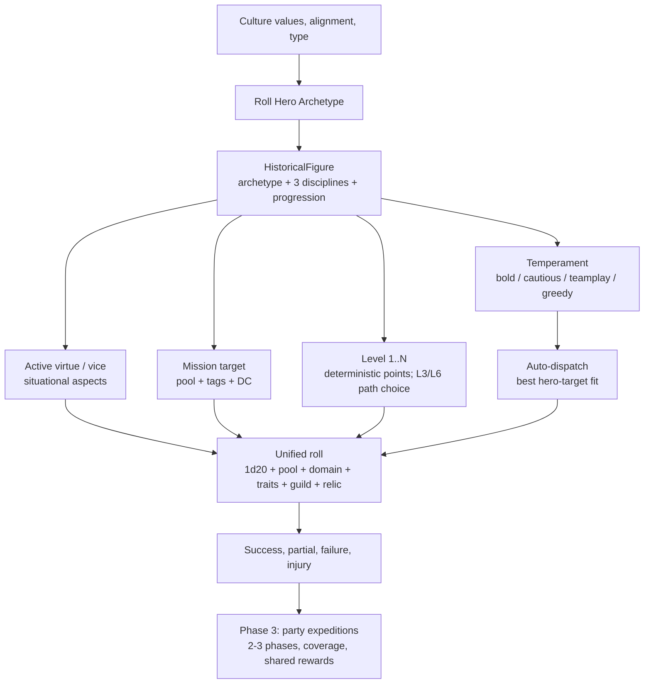

# Plan — Hero Diversity: Archetypes, Disciplines, Aspects & Party Play

Updated: 2026-10-31. Status: **Phase 0 shipped; Phases 1-3 planned**.

Companions: [living-idle-guild.md](living-idle-guild.md), [unified-figures.md](unified-figures.md),
[culture-traits.md](culture-traits.md), [living-world.md](living-world.md),
[lair-ascension.md](lair-ascension.md), [rpg-fantasy-cultures.md](rpg-fantasy-cultures.md).

---

## 1. Executive Summary

The Guild has an economy, missions, relics, petitions and a prestige loop, but its heroes are
still interchangeable. A candidate is usually one random pool at `1..3` and three zeroes; a
veteran's level is displayed but never spent; virtues and vices are a single
`virtues.length - vices.length` modifier. Two heroes with the same primary pool are effectively
the same person.

This plan imports the *shape* of Solo Engine's character rules without importing its volume:

- **Archetypes** (Solo Engine's 10 fantasy classes) give each hero a role, a starting package,
  a growth path and a default doctrine.
- **Disciplines** (Solo Engine's 22 fantasy skills and 10 Arcana domains) become three tags per
  hero, not twenty-two numbers. Tags map to the existing `M/W/S/C` pools and to mission tags.
- **Aspects** turn the existing virtue/vice lists into one active virtue and one active vice with
  situational `+1/-1` effects.
- **Vitals and temperament** (Resolve, Stamina, boldness, caution, teamplay, greed) make risk and
  personality mechanical.
- **Party expeditions** turn single-hero missions into 2-3 phase checks with role coverage.

The design keeps the unified `1d20 + pool + domain + traits + guild + relic` roll. Pool ratings
stay numeric; the WAC polyhedral ladder is a **display layer only** (`d4` to `d12`).

### Resolved decisions

1. **Culture-weighted archetypes**: yes. `pack.cultures[].values`, `alignment` and `type` bias
   the candidate roll.
2. **Polyhedral ladder**: visualize only. Do not change the underlying numeric roll.
3. **Growth**: deterministic default growth, with a small two-option choice at levels 3 and 6.
4. **Mission structure**: single hero in Phase 1; party expeditions in Phase 3.
5. **Arcana**: keep it. Plan for standard fantasy cultures first; Astral is a follow-on.

### Non-goals

- Replacing `FigureSkills` (`m/w/s/c`) with a 22-skill numeric sheet.
- Porting the full Adventuring Company platform (`Guard/Blood/Mana/Crew`) in this plan.
- Porting Mythic scene framing, Chaos Factor, complication tables or the AAR formatter.
- Astral-specific hero generation. Astral integration remains a later overlay.
- Rebalancing every state capacity or trouble DC in one pass.



---

## 2. Design Principles

1. **Keep one resolution shape.** Every hero action still uses `figureCheckRoll()`. New modifiers
   are additive and bounded.
2. **Tags over spreadsheets.** A hero has three disciplines, not twenty-two skill ratings.
3. **Culture produces people.** A martial culture produces more Wardens; a scholarly culture
   produces more Scholars; a merchant culture produces more Factors.
4. **Determinism over generated choices.** Default growth is deterministic. The only player
   choices are the level 3 and level 6 paths.
5. **Idle-first, inspectable.** Auto-dispatch must make sensible choices without the player. The
   inspector explains *why* a hero is good or bad at a mission.
6. **Optional fields, lazy defaults.** Old `.map` files load unchanged. Missing identity is
   inferred once, not written back in a migration pass.
7. **Visual dice, numeric math.** The HUD shows `d4..d12`; the roll uses the existing `0..5`
   pool rating.

---

## 3. The Four Diversity Axes

| Axis | Question | Current state | Target |
|---|---|---|---|
| **Competence** | What are they good at? | One random pool `1..3` | Archetype, 3 disciplines, pool package, growth path |
| **Temperament** | How do they act? | Global guild doctrine only | Per-hero doctrine + 4 temperament knobs |
| **Values** | Who are they? | `virtues.length - vices.length` | Clamped alignment modifier + one active virtue/vice aspect |
| **History** | What have they done? | Deeds, relics, level | Deeds, relics, injuries, paths, prestige scions |

---

## 4. Phase 0 — Consolidation & Bug Fixes (shipped)

Phase 0 is small, shippable immediately, and removes noise before the identity layer lands.

### 4.1. Enforce the Relic Vault cap

The current vault cap is bypassed:

- `mintRelicFromMarker()` and `recoverRelicsFromMarker()` place relics directly into
  `{ kind: "vault" }`.
- `recallRelic()` returns leased relics to the vault without checking `guild.tier`.
- `vaultBonuses()` sums every vault relic, and the HUD never calls `enshrineRelic()`.

**Change**:

- Add `RelicHolder` variant `{ kind: "reserve" }`.
- Add `vaultHasRoom(guild)` and `vaultLimit(guild) = guild.tier`.
- Newly excavated or recovered relics go to:
  1. the excavating hero, if they carry no relic;
  2. the vault, if there is room;
  3. the reserve, otherwise.
- `enshrineRelic()` moves reserve -> vault only when there is room.
- `recallRelic()` moves to vault if there is room, else reserve.
- `vaultBonuses()` and `vaultRelics()` count only `{ kind: "vault" }`.
- HUD shows `Vault (n/tier)` plus `Reserve (n)` with an **Enshrine** button when space opens.

### 4.2. Fix auto-dispatch fit

`autoDispatch()` currently sorts idle heroes by `figure.i` and calls `pickMissionTarget()`, which
does not know which hero is being assigned. Replace it with a pairing pass:

```ts
score = expectedSuccessChance(hero, target) * (1 + target.rewardGold / 100) * target.priority
```

- Compute `expectedSuccessChance` from the target DC and the hero's full modifier.
- Prefer a target the hero's pool, disciplines and aspects match.
- Do not dispatch a hero below a minimum fit (`< 0.25`) unless the guild doctrine is `manual`
  and the player explicitly ordered it.
- Respect `guild.cooldowns`, downed state (Phase 2), and existing missions.
- Tie-break by target level, then target id, then hero id.
- Assign greedily so no hero or target is used twice in one season.

### 4.3. Resolve `pacify`

`GuildMissionKind` includes `pacify` and `resolveMission()` handles it, but no target picker
creates one. Chosen implementation:

- Add the `auto_pacify` idle doctrine (`Pacify Unrest` in the HUD).
- Target burgs with `unrest > 0` that are not already under a pacify contract.
- Roll the `S` pool against `12 + guild.tier`; success clears unrest.
- A Guild Operation can reuse the same target in Phase 3b.

### 4.4. Documentation hygiene

- Mark `living-idle-guild.md` slices 1-5 as shipped.
- Add this plan as a companion link.
- Keep `docs/wiki/Living-World.md` narrative-only until Phase 1 ships.

**Acceptance for Phase 0**

- A vault can never exceed `guild.tier` active relics through excavation, recall or enshrinement.
- Auto-dispatch never assigns a hero whose best matching pool is zero when a better idle hero
  exists.
- No dead `pacify` mission kind remains.
- `living-generator.test.ts`, `living-hud.test.ts` and `living-relics.test.ts` cover the new
  invariants.

---

## 5. Phase 1 — Archetypes, Disciplines & Aspects

Phase 1 is the recommended first feature slice. It changes identity and mission fit without
adding a new action economy.

### 5.1. Archetype catalog

Add `src/data/hero-archetypes.ts`. Each archetype defines:

- a primary and secondary pool;
- a 3-discipline package;
- a starting `FigureSkills` package;
- a growth order for levels 2..N;
- two path choices for levels 3 and 6;
- a virtue bias and a temperament;
- a default doctrine;
- culture-value and culture-type weights.

| Archetype | Base M/W/S/C | Disciplines | Paths (L3 / L6) | Default doctrine | Culture values |
| :--- | :---: | :--- | :--- | :--- | :--- |
| **Warden** | 2/0/1/0 | `melee`, `tactics`, `ride` | *Shieldwall* (+1 M, +1 Resolve) / *Standard-Bearer* (+1 S, +1 teamplay) | `hunt_lairs` | valor 3, honor 2, discipline 2, conflict 1, order 1 |
| **Ranger** | 2/0/0/1 | `scout`, `survival`, `archery` | *Beaststalker* (`nature_lore`, +1 M) / *Pathfinder* (`scout`, +1 C) | `hunt_lairs` | independence 3, satisfaction 2, fate 1, valor 1 |
| **Scholar** | 0/2/0/1 | `investigate`, `planar_lore`, `tongues` | *Archaeologist* (`artifice`, +1 C) / *Loremaster* (`arcana`, +1 W) | `excavate` | knowledge 3, truth 2, advancement 2, balance 1 |
| **Priest** | 0/1/2/0 | `arcana_holy`, `healing`, `persuasion` | *Templar* (+1 M, `melee`) / *Oracle* (`arcana_divination`, +1 S) | `support` | empathy 2, love 2, honor 2, loyalty 1, justice 1, hatred 1 |
| **Shadow** | 1/0/0/2 | `stealth`, `artifice`, `perception` | *Assassin* (+1 M, `melee`) / *Spy* (+1 S, `court_etiquette`) | `hunt_troubles` | control 2, greed 2, impulse 2, disruption 2, independence 1 |
| **Factor** | 0/2/0/1 | `barter`, `court_etiquette`, `investigate` | *Quartermaster* (+1 M, `siegecraft`) / *Magnate* (+1 W, +1 greed) | `patrol` | investment 3, greed 2, advancement 1, satisfaction 1 |
| **Envoy** | 0/0/2/1 | `persuasion`, `court_etiquette`, `tongues` | *Diplomat* (+1 S, +1 teamplay) / *Spymaster* (`stealth`, +1 C) | `support` | cooperation 2, trust 2, justice 1, order 1, honor 1 |
| **Alchemist** | 0/2/1/0 | `alchemy`, `healing`, `nature_lore` | *Physician* (`healing`, +1 S) / *Bombardier* (`artifice`, +1 M) | `support` | knowledge 2, advancement 2, balance 1, empathy 1 |
| **Warlock** | 0/0/1/2 | `arcana_shadow`, `arcana_evocation`, `tongues` | *Binder* (`arcana_necromancy`, +1 C) / *Seer* (`arcana_divination`, +1 S) | `excavate` | power 2, hatred 2, control 2, conflict 1, fate 1 |
| **Freeblade** | 1/1/0/1 | `melee`, `survival`, `barter` | *Duelist* (+1 M, `melee`) / *Quartermaster* (+1 W, `barter`) | `hunt_troubles` | independence 2, valor 1, satisfaction 1, fate 1 |

`baseSkills` totals 3 points. Growth adds one point per level after 1, except levels 3 and 6,
which replace the automatic point with the chosen path. Pool ratings cap at 5.

### 5.2. Discipline catalog

Add `src/data/hero-disciplines.ts` with the Solo Engine fantasy catalog:

- 21 core skills: `court_etiquette`, `persuasion`, `planar_lore`, `athletics`, `barter`,
  `tongues`, `artifice`, `archery`, `siegecraft`, `investigate`, `healing`, `melee`, `brawling`,
  `ride`, `scout`, `nature_lore`, `alchemy`, `perception`, `stealth`, `survival`, `tactics`.
- General `arcana` plus 10 domains: `arcana_evocation`, `arcana_nature`, `arcana_holy`,
  `arcana_abjuration`, `arcana_divination`, `arcana_necromancy`, `arcana_illusion`,
  `arcana_transmutation`, `arcana_enchantment`, `arcana_shadow`.

Each discipline defines:

```ts
interface DisciplineDef {
  id: DisciplineId;
  name: string;
  pool: "m" | "w" | "s" | "c";
  tags: readonly MissionTag[];
  description: string;
}
```

The discipline's `pool` is the pool it supports when it matches. A hero still rolls their pool
rating; the discipline is a `+1` tag match, not a separate number.

### 5.3. Mission tags

Add a small tag vocabulary:

```ts
type MissionTag =
  | "combat" | "lair" | "ruin" | "wild" | "travel"
  | "arcane" | "curse" | "plague" | "undead"
  | "social" | "petition" | "intrigue"
  | "trap" | "order" | "trouble"
  | `save:${TroubleSaveKind}`
  | `role:${TroubleUnitRole}`;
```

Tags are derived from the target, not stored per mission definition:

- **Trouble**: `trouble`, `save:<kind>`, `role:<requiredRole>`, plus `combat` for martial
  troubles, `social` for civic ones, `arcane`/`curse` for magical ones.
- **Lair**: `lair`, `combat`, plus `wild` or `ruin` from its theme.
- **Excavation**: `ruin`, plus `arcane` for chronicle sites, `trap` for dungeons.
- **Pacify**: `social`, `order`.
- **Party phase**: the phase's explicit tag list wins; target tags remain as context.

### 5.4. Active aspects from virtues and vices

No new trait list. Use the **first virtue** and **first vice** as the active aspects. All other
traits remain narrative.

Add `src/data/hero-aspects.ts`:

```ts
interface HeroAspect {
  trait: string;
  tags: readonly MissionTag[];
  modifier: 1 | -1;
  note: string;
}
```

Representative mappings:

| Trait | Tags | Effect |
| :--- | :--- | :--- |
| `brave`, `daring`, `decisive` | `combat`, `lair` | +1 |
| `prudent`, `methodical`, `meticulous` | `ruin`, `trap`, `excavate` | +1 |
| `observant`, `curious`, `wise` | `ruin`, `arcane`, `investigate` | +1 |
| `eloquent`, `tactful`, `courteous` | `social`, `petition`, `intrigue` | +1 |
| `loyal`, `protective`, `selfless` | `support`, `order` | +1 |
| `resourceful`, `adaptable`, `ingenious` | `wild`, `travel` | +1 |
| `cowardly`, `timid` | `combat`, `lair` | -1 |
| `reckless`, `careless`, `haphazard` | `wild`, `travel`, `trap` | -1 |
| `greedy`, `stingy` | `social`, `petition` | -1 |
| `cruel`, `merciless`, `harsh` | `social`, `order` | -1 |
| `slothful`, `negligent` | `ruin`, `excavate` | -1 |
| `deceitful`, `insincere` | `social`, `petition` | -1 |

Rule: a matching virtue gives `+1`; a matching vice gives `-1`; the aspect total is clamped to
`[-1, +1]`. Unmapped traits are pure flavour.

This replaces the current raw `virtues.length - vices.length`. The alignment modifier becomes
`clamp(virtues.length - vices.length, -1, +1)`. A good hero is no longer `+3` on every roll; they
are `+1` generally and `+1` more when their active virtue fits the mission.

### 5.5. Resolution changes

```ts
total = 1d20
      + figure.skills[pool]
      + valueModifier(statePoolGen)
      + clamp(virtues.length - vices.length, -1, 1)
      + aspectBonus        // -1, 0 or +1
      + disciplineBonus    // +1 per matching discipline, capped at +2
      + guildCheckBonus(tier)
      + relicBonus
```

- The cap on `disciplineBonus` prevents a three-tag hero from stacking `+3`.
- An unmatched hero still rolls normally; the floor does not change.
- `FigureCheck` gains optional `matchedDisciplines` and `aspect` fields for the HUD and tests.

### 5.6. Candidate generation

Change `mintCandidate()` to:

1. Pick a culture from the live map.
2. Roll an archetype weighted by `culture.values`, `culture.alignment` and `culture.type`.
3. Roll candidate quality: 70% level 1, 25% level 2, 5% level 3.
4. Assign the archetype's `baseSkills`, then apply growth points for the rolled level.
5. Assign the archetype's 3 disciplines.
6. Roll alignment and traits as today.
7. Set `progression.appliedLevel` to the rolled level so no retroactive points are granted.
8. Set `xp` to the threshold for that level.

Recruit cost becomes:

```ts
cost = 40 + tier * 20 + (level - 1) * 15
```

Tune the level premium during implementation. The point is that a level 3 veteran is a real
choice, not the same price as a novice.

### 5.7. Growth and level 3/6 paths

Add optional progression metadata to `HistoricalFigure`:

```ts
interface HeroProgression {
  appliedLevel?: number;   // last level whose points were granted
  pendingChoices?: number; // 0..2, one per unspent L3/L6 path
  picks?: string[];        // chosen HeroPath ids
}
```

`applyHeroLevels(figure)`:

- Compute `level = figureLevel(figure.xp ?? 0)`.
- Read `appliedLevel` (default: current level for legacy figures, 1 for new figures).
- For each level from `appliedLevel + 1` to `level`:
  - at level 3 or 6, increment `pendingChoices` instead of spending a point;
  - otherwise, add one point along the archetype's `growthOrder`, capped at 5.
- Set `appliedLevel = level`.

Path selection:

- The hero inspector shows two path cards when `pendingChoices > 0`.
- Choosing a path applies its grant immediately and clears one pending choice.
- If ignored for two seasons, auto-pick by default doctrine:
  - `hunt_lairs` / `hunt_troubles` -> martial path;
  - `excavate` -> lore path;
  - `support` -> support path.
- Path grants are small: `+1 pool`, one discipline, `+1 max Resolve` or `+1 max Stamina`.

### 5.8. Culture weighting

Add `rollHeroArchetype(rng, culture)`:

```ts
weight = 1
for (const value of culture.values ?? []) weight += archetype.cultureValues[value] ?? 0
weight += archetype.cultureTypeBias[culture.type] ?? 0
if (!culture.values?.length && culture.alignment) {
  weight += archetype.alignmentBias[culture.alignment] ?? 0
}
return weightedPick(rng, archetypes, weight)
```

Suggested culture-type bias:

| Culture type | Likely archetypes |
| :--- | :--- |
| `Hunting` | Ranger, Freeblade |
| `Highland` | Warden, Ranger, Alchemist |
| `River` | Factor, Envoy, Scholar |
| `Lake` | Factor, Envoy |
| `Naval` | Factor, Shadow, Ranger |
| `Nomadic` | Ranger, Freeblade, Envoy |
| `Generic` | no bias |

If a map has no culture values (old save or traits layer off), use alignment bias and a uniform
fallback. Guarantee at least four distinct archetypes across a candidate pool when the culture
list allows it.

### 5.9. Legacy figure inference

`ensureHeroIdentity(figure)` runs lazily for roster and candidate figures:

- If `archetype` is present, do nothing.
- Else infer from the figure's role specialty, then from the highest pool, then default
  `freeblade`:

| Signal | Inferred archetype |
| :--- | :--- |
| specialist `guardsmen` / `military` | Warden |
| specialist `merchant` | Factor |
| specialist `sage` | Scholar |
| specialist `prophet` | Priest |
| specialist `magistrate` | Envoy |
| agent `assassin` | Shadow |
| agent `diplomat` | Envoy |
| role `adventurer`, highest `m` | Ranger |
| role `adventurer`, highest `w` | Scholar |
| role `adventurer`, highest `s` | Priest |
| role `adventurer`, highest `c` | Shadow |
| no signal | Freeblade |

- Assign three deterministic disciplines from the archetype package.
- If `progression.appliedLevel` is absent, set it to the current `figureLevel(xp)` so old heroes
  do not receive a windfall of retroactive points.
- Do not change existing `skills`; the inferred archetype only adds identity and mission fit.

### 5.10. HUD changes

Hero card additions:

- Archetype badge and icon.
- Three discipline chips.
- Active virtue and vice with a one-line explanation:
  *"Observant: +1 when excavating or investigating."*
- Skill dice display:
  `M d10 · W d6 · S d4 · C d8`.
- Mission fit line:
  *"Good match: +1 discipline, +1 aspect"* or *"Poor match: no applicable discipline."*
- Level progress and pending path-choice card.

Candidate card additions:

- Archetype, disciplines, active virtue/vice, level and recruit cost.
- A fit preview against the currently selected province, state or ruin.

Mission card additions:

- Target tags (`lair`, `combat`, `wild`).
- Recommended hero and expected fit.
- After Phase 3, the phase list and party coverage.

### 5.11. Acceptance for Phase 1

- Same seed and culture produce the same candidates and archetypes.
- A 200-seed distribution produces at least six archetypes and no archetype above 35% on a
  mixed map.
- No hero is dispatched to a mission with zero applicable pool when a better idle hero exists.
- Level growth applies exactly once per level; old saves receive no retroactive points.
- The roll difference between a matched and unmatched hero is visible and bounded (`+2` max from
  disciplines, `+1` max from aspects).
- Old maps open and play without a migration step.
- Tests cover archetype catalogs, culture weighting, aspect mapping, growth and legacy inference.

---

## 6. Phase 2 — Vitals, Temperament & Growth

Phase 2 adds cost and personality. It should land only after Phase 1 identity is stable.

### 6.1. Hero vitals

Add per-hero guild state, not per-figure history state:

```ts
interface HeroGuildState {
  resolve: number;
  stamina: number;
  maxResolve: number;
  maxStamina: number;
  doctrine: HeroDoctrine;
  temperament: HeroTemperament;
  injuries: HeroInjury[];
  downUntilTick?: number;
}
```

`GuildState.heroes?: Record<number, HeroGuildState>` is lazily initialized for roster and
candidate figures.

Vitals budget by level band:

| Level band | Budget | Typical split |
| :--- | :---: | :--- |
| 1-2 | 20 | 10 Resolve / 10 Stamina |
| 3-4 | 26 | 13 / 13 |
| 5-7 | 30 | 15 / 15 |
| 8+ | 36 | 18 / 18 |

Archetype shifts the split:

- Warden, Freeblade: +2 Resolve, -2 Stamina.
- Scholar, Warlock: +2 Stamina, -2 Resolve.
- Priest, Alchemist: balanced.
- Shadow, Ranger: +1 Stamina.

### 6.2. Spending Stamina

Before a mission check, a hero may spend 1 Stamina to gain `+1` on that check. A hero may spend at
most 1 Stamina per mission in Phase 2 (2 at level 5+).

Auto policy:

```ts
push = stamina > reserve
    && expectedSuccess < 0.6
    && (temperament.boldness >= 0.5 || guild.tier >= 3)
```

- `reserve` comes from the archetype (`staminaReserveMinimum`), roughly 2-5.
- The inspector shows a **Push** toggle for manual dispatch.
- The roll log shows the spent Stamina.

### 6.3. Resolve, injury and down state

- Failed mission: `-2 Resolve`.
- Fumble (`roll === 1` or fail by >= 8): `-4 Resolve` and a survival save.
- Survival save success: add an **injury** instead of a vice or death.
- Survival save failure: death, as today, but only if the hero is already at 0 Resolve or the
  fumble is severe. Otherwise the hero is **downed**.
- At 0 Resolve: `downUntilTick = currentTick + 2 seasons`; the hero cannot be dispatched.
- Recovery: +1 Resolve per season at the Guild Hall, +2 if the hero has the `healing`
  discipline or is in a party with a healer.
- Injuries have a tag and a penalty:
  - `wounded`: `-1` on `combat` checks for 2 seasons.
  - `shaken`: `-1` on `social` checks for 2 seasons.
  - `lost`: `-1` on `travel`/`wild` checks until treated.
- A healer can clear one injury per season.

### 6.4. Temperament

Add four knobs, normalized `0..1`, derived from archetype:

```ts
interface HeroTemperament {
  boldness: number;
  caution: number;
  teamplay: number;
  greed: number;
}
```

| Archetype | Bold | Caution | Teamplay | Greed |
| :--- | :---: | :---: | :---: | :---: |
| Warden | 0.7 | 0.5 | 0.85 | 0.2 |
| Ranger | 0.6 | 0.65 | 0.75 | 0.35 |
| Scholar | 0.35 | 0.8 | 0.65 | 0.3 |
| Priest | 0.45 | 0.7 | 0.9 | 0.2 |
| Shadow | 0.8 | 0.45 | 0.5 | 0.7 |
| Factor | 0.35 | 0.75 | 0.6 | 0.85 |
| Envoy | 0.4 | 0.65 | 0.85 | 0.4 |
| Alchemist | 0.45 | 0.7 | 0.75 | 0.3 |
| Warlock | 0.65 | 0.5 | 0.55 | 0.6 |
| Freeblade | 0.75 | 0.35 | 0.6 | 0.5 |

Temperament is display flavour in Phase 2 and a policy input, not a hidden roll modifier. Show it
as tags: *Bold*, *Cautious*, *Loyal*, *Grasping*.

### 6.5. Per-hero doctrine

```ts
type HeroDoctrine =
  | "hunt_troubles"
  | "hunt_lairs"
  | "excavate"
  | "support"
  | "patrol"
  | "manual";
```

- Default comes from the archetype.
- The player can override per hero in the inspector.
- Guild-level doctrine remains the global priority; hero doctrine breaks ties.
- `manual` means the hero waits for click-dispatch.
- Auto-dispatch scoring adds `doctrineWeight(hero, target)` and refuses low-fit missions.

### 6.6. Growth with choices

- Levels 2, 4, 5, 7... use the deterministic `growthOrder`.
- Levels 3 and 6 present the two path choices.
- A path can grant:
  - `+1` pool point;
  - one new discipline;
  - `+1 max Resolve` or `+1 max Stamina`;
  - a temperament nudge (`+0.1 teamplay` etc.).
- Default auto-pick after two idle seasons:
  - combat doctrine -> martial path;
  - excavate -> lore path;
  - support -> support path.

### 6.7. Acceptance for Phase 2

- Vitals are initialized lazily for old saves and survive `.map` round-trips.
- A downed hero is never auto-dispatched.
- Stamina is spent at most once per mission (twice at level 5+).
- A fumble first produces an injury/down state; death is reserved for severe failures at 0
  Resolve.
- Manual and auto dispatch use the same fit score.
- The inspector shows Resolve/Stamina bars, temperament tags, doctrine and injury status.

---

## 7. Phase 3 — Party Expeditions & Mission Tags

Phase 3 is the biggest diversity payoff: heroes matter because they cover each other.

### 7.1. Party model

Extend `ActiveGuildMission`:

```ts
interface ActiveGuildMission {
  // ...existing fields...
  party?: number[];            // leader first; 2-3 heroes
  phases?: MissionPhase[];
  phaseResults?: MissionPhaseResult[];
}

interface MissionPhase {
  id: string;
  label: string;
  pool: "m" | "w" | "s" | "c";
  tags: MissionTag[];
  dc: number;
  required: boolean;
}

interface MissionPhaseResult {
  phaseId: string;
  heroId: number;
  roll: number;
  total: number;
  success: boolean;
}
```

Legacy fields `figureId`, `pool` and `dc` remain and mirror the leader and final phase.

Party size:

- Guild tier 1-2: up to 2 heroes.
- Guild tier 3+: up to 3 heroes.
- Tier 5: up to 4 heroes (optional; start with 3).

### 7.2. Mission phases

Each mission gets 2-3 phases by kind and level:

| Mission | Phase 1 | Phase 2 | Phase 3 |
| :--- | :--- | :--- | :--- |
| **Lair** | *Approach* — `m`/`c`, `wild` or `ruin` | *Breach* — `m`, `combat` | *Decapitation* — `c`/`m`, `lair` |
| **Trouble** | *Investigate* — `w`/`c`, `investigate` | *Confront* — `m`/`s`, target save tag | *Settle* — `s`/`w`, `social` or `order` |
| **Excavation** | *Survey* — `w`/`c`, `ruin` | *Delve* — `c`, `trap`/`arcane` | *Extraction* — `m`/`c`, `ruin` |
| **Pacify** | *Parley* — `s`, `social` | *Enforce* — `m`/`s`, `order` | *Reconcile* — `s`/`w`, `social` |

Low-level missions use 2 phases; level 5+ lairs and chronicle ruins use 3.

### 7.3. Phase resolution

For each phase:

1. Pick the party member with the highest `heroScore(hero, phase)` that has not already resolved
   that phase.
2. Roll the unified check with that hero's pool, disciplines, aspects, relic and guild bonus.
3. Apply the phase DC. The base DC is the mission DC; phases may adjust by `-1 / 0 / +1`.
4. A hero may contribute to at most two phases; no hero resolves the same phase twice.
5. If no party member has a matching pool above 0, use the best available pool with `-2` and no
   discipline bonus. This is the "untrained company" penalty.

Party synergy:

- `+1` to all phases if the party covers at least three distinct pools.
- `+1` if the leader has `teamplay >= 0.7`.
- `-1` if two heroes share a primary pool and the party has no `support` doctrine or healer.
- Synergy is clamped to `[-1, +1]`.

### 7.4. Partial success

- **Full success**: every required phase succeeds. Full gold, renown, XP and target resolution.
- **Partial success**: majority of required phases succeed. Half gold/renown, half XP; lairs
  lose one level instead of clearing; ruins yield a cache instead of a named relic; troubles
  lose one level instead of clearing.
- **Failure**: minority succeeds. No reward, `-2 Resolve` per participating hero, cooldown, and
  the target remains.

This is more interesting than the current binary pass/fail and gives a reason to bring a
balanced party.

### 7.5. Party rewards and relics

- The leader receives the `deed` chronicle event; every participant gains XP.
- Relic bonuses apply only to the hero carrying them.
- Vault bonuses apply to the whole party.
- A `tome` carried by any participant still boosts that hero's XP.
- A `charter` carried by the leader boosts contract gold.
- A cursed relic can add a vice/injury risk to the phase it participates in.

### 7.6. Party UI

- The dispatch card lists available heroes with a fit badge per phase.
- **Auto-fill** selects the best coverage party.
- The player can pin a leader and let auto-fill choose companions.
- The mission card shows phase chips, who is assigned, and the current result.
- The hero card shows "On expedition: Phase 2/3".

### 7.7. Guild Operations (optional Phase 3b)

Once `pacify` and party missions exist, wire the remaining Guild Operations from
`living-idle-guild.md`:

| Operation | Cost / requirement | Effect |
| :--- | :--- | :--- |
| **Pacify & Mediate** | 40 gold + Priest/Envoy | Clear burg unrest, +10 province order |
| **Rush Asset Charter** | 50 gold + Factor/Scholar | Complete the burg's construction |
| **Incite Uprising** | 75 gold + Shadow | Spark a rebellion or promote a trouble |
| **Assassinate Ruler** | 100 gold + Shadow, `C` check vs DC 15 | Slay the ruler and trigger succession |
| **War Broker** | 80 gold + Envoy, `S`/`C` check | Provoke or broker a war |

These are not required for hero diversity, but they give non-combat archetypes a purpose and
make the `pacify` mission kind real.

### 7.8. Acceptance for Phase 3

- A party mission is deterministic for the same seed, party and target.
- No hero appears twice in the same phase list.
- Missing coverage applies the untrained penalty and is visible in the UI.
- Full, partial and failed outcomes each resolve the target correctly.
- Party size respects guild tier.
- A party can be auto-filled without a UI action.
- The chronicle names the leader and records participant XP.

---

## 8. Data Model

All fields are additive and optional. Existing `.map` record 53 loads with lazy defaults.

### 8.1. `src/types/history.ts`

```ts
export type HeroArchetypeId =
  | "warden" | "ranger" | "scholar" | "priest" | "shadow"
  | "factor" | "envoy" | "alchemist" | "warlock" | "freeblade";

export type DisciplineId =
  | "court_etiquette" | "persuasion" | "planar_lore" | "athletics"
  | "barter" | "tongues" | "artifice" | "archery" | "siegecraft"
  | "investigate" | "healing" | "melee" | "brawling" | "ride"
  | "scout" | "nature_lore" | "alchemy" | "perception" | "stealth"
  | "survival" | "tactics" | "arcana"
  | "arcana_evocation" | "arcana_nature" | "arcana_holy"
  | "arcana_abjuration" | "arcana_divination" | "arcana_necromancy"
  | "arcana_illusion" | "arcana_transmutation" | "arcana_enchantment"
  | "arcana_shadow";

export interface HeroProgression {
  appliedLevel?: number;
  pendingChoices?: number;
  picks?: string[];
}

export interface HistoricalFigure {
  // ...existing fields...
  archetype?: HeroArchetypeId;
  disciplines?: DisciplineId[];
  progression?: HeroProgression;
}
```

### 8.2. `src/types/living.ts`

```ts
export type MissionTag =
  | "combat" | "lair" | "ruin" | "wild" | "travel"
  | "arcane" | "curse" | "plague" | "undead"
  | "social" | "petition" | "intrigue"
  | "trap" | "order" | "trouble"
  | `save:${TroubleSaveKind}`
  | `role:${TroubleUnitRole}`;

export type HeroDoctrine =
  | "hunt_troubles" | "hunt_lairs" | "excavate"
  | "support" | "patrol" | "manual";

export interface HeroTemperament {
  boldness: number;
  caution: number;
  teamplay: number;
  greed: number;
}

export interface HeroInjury {
  id: string;
  label: string;
  tags: MissionTag[];
  penalty: number;
  untilTick: number;
}

export interface HeroGuildState {
  resolve: number;
  stamina: number;
  maxResolve: number;
  maxStamina: number;
  doctrine: HeroDoctrine;
  temperament: HeroTemperament;
  injuries: HeroInjury[];
  downUntilTick?: number;
}

export interface MissionPhase {
  id: string;
  label: string;
  pool: "m" | "w" | "s" | "c";
  tags: MissionTag[];
  dc: number;
  required: boolean;
}

export interface MissionPhaseResult {
  phaseId: string;
  heroId: number;
  roll: number;
  total: number;
  success: boolean;
}

export interface ActiveGuildMission {
  // ...existing fields...
  party?: number[];
  phases?: MissionPhase[];
  phaseResults?: MissionPhaseResult[];
}

export type RelicHolder =
  | { kind: "vault" }
  | { kind: "reserve" }
  | { kind: "figure"; id: number }
  | { kind: "state"; id: number }
  | { kind: "ruin"; markerId: number; cell: number };

export interface GuildState {
  // ...existing fields...
  heroes?: Record<number, HeroGuildState>;
}
```

### 8.3. `src/types/history.ts` migration rules

- `archetype` absent -> infer once with `ensureHeroIdentity()`.
- `disciplines` absent -> assign the inferred archetype's three disciplines.
- `progression` absent -> set `appliedLevel = figureLevel(xp)` on first access.
- Never rewrite existing `skills` during inference.
- Do not add a new `.map` record.

### 8.4. Data catalogs

`src/data/hero-archetypes.ts`:

```ts
export interface HeroPath {
  id: string;
  name: string;
  description: string;
  grant: {
    pool?: "m" | "w" | "s" | "c";
    amount?: number;
    discipline?: DisciplineId;
    resolve?: number;
    stamina?: number;
    temperament?: Partial<HeroTemperament>;
  };
}

export interface HeroArchetype {
  id: HeroArchetypeId;
  name: string;
  description: string;
  primary: "m" | "w" | "s" | "c";
  secondary: "m" | "w" | "s" | "c";
  baseSkills: FigureSkills;
  growthOrder: readonly ("m" | "w" | "s" | "c")[];
  disciplines: readonly DisciplineId[];
  paths: readonly [HeroPath, HeroPath];
  defaultDoctrine: HeroDoctrine;
  temperament: HeroTemperament;
  cultureValues: Partial<Record<string, number>>;
  cultureTypeBias: Partial<Record<CultureType, number>>;
  alignmentBias?: Partial<Record<Alignment, number>>;
}
```

`src/data/hero-disciplines.ts`:

```ts
export interface DisciplineDef {
  id: DisciplineId;
  name: string;
  pool: "m" | "w" | "s" | "c";
  tags: readonly MissionTag[];
  description: string;
}
```

`src/data/hero-aspects.ts`:

```ts
export interface HeroAspect {
  trait: string;
  tags: readonly MissionTag[];
  modifier: 1 | -1;
  note: string;
}
```

Catalog tests must assert that every archetype references only real discipline ids, every path
grants something, every discipline maps to a valid pool and at least one tag, and every aspect
references a trait from `VIRTUES` or `VICES`.

### 8.5. Unified Figures compatibility

`HistoricalFigure.archetype`, `disciplines` and `progression` are generic figure fields, so the
conquest overlay can read them without a second character model. The conquest `Character` stays
`{ figureId, cooldownUntil, ... }` and does not read guild vitals, doctrine or party state.
`ensureHeroIdentity()` is guild-scoped when called from `Living`, but it is safe to call for any
figure. No conquest campaign migration is required.

---

## 9. Balance Targets

These are starting bands, not hard invariants. Tune with seeded mission simulations.

| Situation | Target success chance |
| :--- | :---: |
| Matched hero, equal-level mission | 60-75% |
| Unmatched hero, equal-level mission | 30-45% |
| Matched hero, mission 2 levels above | 40-55% |
| Balanced 3-hero party, 3 phases | 65-80% full success |
| Mismatched party, 3 phases | 40-55% full success |
| Auto-dispatch refusal floor | below 25% fit |

Balance rules:

- Disciplines cap at `+2`; aspects cap at `+1`.
- Alignment is clamped to `+/-1`.
- Pool ratings cap at `5`.
- Level growth is gradual; do not grant more than one point per level.
- Phase DCs should not all be the maximum; use `base -1 / base / base +1`.
- If party missions feel too easy, raise phase DCs, not target counts.

---

## 10. Testing & Verification

### Phase 0

- Vault cannot exceed `guild.tier` through excavation, recovery, recall or enshrinement.
- `reserve` relics can be enshrined when space opens.
- Auto-dispatch prefers a fitting hero over a non-fitting one.
- No dead `pacify` kind.

### Phase 1

- `hero-archetypes.test.ts`: every archetype has a primary, secondary, three disciplines,
  base skills, growth order and two paths; base total is 3; no duplicate ids.
- `hero-disciplines.test.ts`: all 21 core skills plus `arcana` and 10 domains exist; each maps to
  one pool and at least one mission tag.
- `hero-aspects.test.ts`: representative virtues/vices map correctly; unmatched traits return
  no modifier; aspect total clamps to `[-1, 1]`.
- `living-generator.test.ts`:
  - candidate generation is deterministic per seed;
  - culture weighting changes distribution in the expected direction;
  - a matched hero gets `+1` per matching discipline up to `+2`;
  - a matched virtue gives `+1`, a matched vice `-1`;
  - level growth applies once and respects `appliedLevel`;
  - legacy figures infer an archetype without changing skills.
- `living-hud.test.ts`: hero card renders archetype, disciplines, aspects, dice and path choices.
- A 200-seed distribution test asserts at least six archetypes and no archetype above 35% on a
  mixed map.

### Phase 2

- Vitals initialize lazily; old saves get a valid default.
- Stamina spend is capped per mission.
- A downed hero is skipped by auto-dispatch.
- Fumble -> injury/down before death.
- Recovery and injury expiry respect ticks.
- Temperament tags render correctly.
- Per-hero doctrine overrides the guild default only for that hero.

### Phase 3

- Party size respects tier.
- No duplicate hero or phase.
- Missing coverage applies the untrained penalty.
- Full/partial/failure outcomes resolve lairs, troubles and ruins correctly.
- Party rewards split as specified.
- Determinism across 500 seeded party missions.

### Determinism

All new rolls must use `Living.rng` streams or a seeded `createRng()` with a stable key:

- `guild:archetype:<figureId>`
- `guild:candidate:<index>`
- `guild:disciplines:<figureId>`
- `guild:mission:<missionId>:<phaseId>`
- `guild:path:<figureId>:<level>`

Do not use `Math.random()`.

---

## 11. Build Order

| # | Slice | Size | Modules | Scope |
| :---: | :--- | :---: | :--- | :--- |
| 0 | **Vault & dispatch fixes** | S | `living-generator.ts`, `living-relics.ts`, `living-hud.ts` | Enforce vault cap, fix auto-dispatch fit, resolve `pacify` |
| 1 | **Archetype catalog** | M | `src/data/hero-archetypes.ts`, `src/types/history.ts` | 10 archetypes, base skills, paths, culture weights |
| 2 | **Disciplines & aspects** | M | `src/data/hero-disciplines.ts`, `src/data/hero-aspects.ts` | 22+10 disciplines, mission tags, trait aspects |
| 3 | **Candidate identity** | M | `living-generator.ts` | Culture-weighted archetype, quality roll, legacy inference |
| 4 | **Growth & HUD** | M | `living-generator.ts`, `living-hud.ts` | `applyHeroLevels`, L3/L6 path cards, dice display, fit line |
| 5 | **Vitals & temperament** | L | `living-generator.ts`, `living-hud.ts`, `living.ts` | Resolve/Stamina, injuries, doctrine, temperament |
| 6 | **Party expeditions** | L | `living-generator.ts`, `living-hud.ts`, `living.ts`, `living-relics.ts` | Party, phases, partial success, coverage |
| 7 | **Guild operations (3b)** | M | `living-generator.ts`, `living-hud.ts` | Pacify, charter, incite, assassinate, war broker |

Slices 0-4 are the recommended first release. Slices 5-6 are a second release. Slice 7 is
optional and can ship independently.

---

## 12. Risks & Mitigations

| Risk | Mitigation |
| :--- | :--- |
| Save bloat from 22 numeric skills | Three discipline tags only; pool ratings stay 4 numbers |
| Balance whiplash from level growth | One point per level, cap 5, measure with seeded simulations |
| Culture weighting makes one archetype dominate | Cap weights, enforce at least four distinct archetypes per pool, test 200 seeds |
| Old heroes suddenly become stronger | `appliedLevel` defaults to current level; no retroactive points |
| Auto-dispatch still sends bad heroes | Pairwise fit score, minimum fit floor, doctor the HUD explanation |
| Party UI becomes noisy | Auto-fill by default; advanced party picker in the inspector only |
| Arcana overwhelms standard fantasy | Arcana is culture-weighted, not automatic; rare `knowledge`/`fate`/`power` cultures |
| Determinism regressions | All new rolls use named seeded streams; snapshot tests |
| Death feels arbitrary | Phase 2 replaces binary fumble death with injuries and down state first |

---

## 13. Docs & Glossary

When slices ship:

- Extend `docs/wiki/Living-World.md` with a **Heroes** subsection: archetypes, disciplines,
  aspects, growth, vitals and party expeditions.
- Add to `docs/domain/glossary.md`:
  - **Hero Archetype** — a hero's role package (pools, disciplines, growth, doctrine).
  - **Discipline** — a Solo Engine fantasy skill tag attached to a hero; grants `+1` when it
    matches a mission tag.
  - **Aspect** — the active mechanical expression of a virtue or vice.
  - **Temperament** — the four behavioural knobs used by auto-dispatch.
  - **Hero Doctrine** — a per-hero idle preference.
  - **Party Expedition** — a multi-phase mission resolved by 2-3 heroes.
  - **Reserve** — a relic held outside the active vault while the vault is full.
- Update `living-idle-guild.md` to link this plan and mark its shipped slices.
- Keep the wiki implementation-agnostic; put data tables in `docs/plans/`.

---

## 14. Open Questions

These are intentionally left for implementation tuning:

1. **Candidate quality curve** — start at 70/25/5 for levels 1/2/3, or make it culture-dependent?
2. **Path timing** — two idle seasons before auto-pick may be too short for a 4× player; tune.
3. **Party size at tier 5** — 3 or 4 heroes? Start with 3 and measure UI density.
4. **Arcana rarity** — should `arcana_*` require a culture value (`knowledge`, `fate`, `power`) or
   also a map option (`generation.cultures.traits`)?
5. **Injury death floor** — should death require 0 Resolve plus a failed save, or only a natural
   1 on the final phase?
6. **Guild Operations** — ship as Phase 3b or defer to a separate plan?