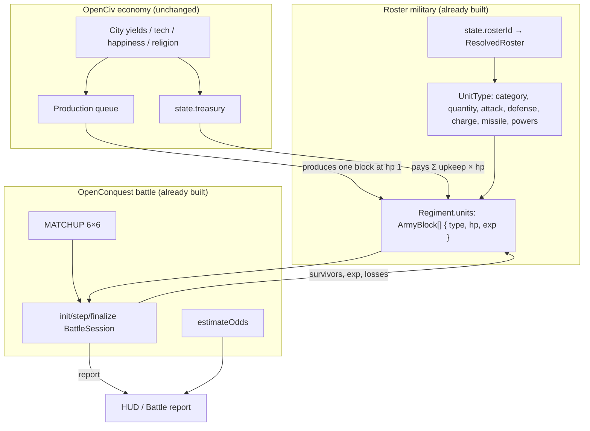

# Plan — Living World Armies: OpenCiv Economy × OpenConquest Combined-Arms Warfare

**Status:** Proposed — decisions resolved; rewritten around the `hp` capability model, ready for Phase A
**Updated:** 2026-11-04
**Supersedes:** the tactical half of [living-openciv.md](living-openciv.md) §5 (Slice 5, 1UPT single-unit duels).
**Companions:** [openconquest-military-integration.md](openconquest-military-integration.md), [living-openciv.md](living-openciv.md), [openconquest-magic-system.md](openconquest-magic-system.md).

---

## 1. Executive Summary

The Living World currently runs **two incompatible militaries**:

- The **economy** is OpenCiv (Slices 1–6 delivered): 7 yields, city buckets, tech tree, gold upkeep, happiness, religion.
- The **battlefield** is OpenCiv **Slice 5** 1UPT: one `Regiment` = one `UnitSimState` with 100 HP, one attacker vs one defender, a per-exchange exponential damage roll.
- The **roster military** is OpenConquest (completed in [openconquest-military-integration.md](openconquest-military-integration.md)): every state has a `rosterId`, every `Regiment` already carries `units: ArmyUnit[]` of culture-unique blocks, and `battle.ts` already implements combined-arms Lanchester combat with a 6×6 `MATCHUP` matrix, tactical orders, rout, magic and sieges.

The result is that **Living World combat throws the unique forces away**. `syncUnits()` overwrites `regent.u` with a single generic OpenCiv unit id (`living-generator.ts:5374-5377`), and `spawnUnit()` resets `regiment.units = []` (`:6297`). A Dwarven Ironbreaker stack becomes "one Swordsman". No `MATCHUP`, no monsters, no casters, no rout, no combined arms.

This plan keeps the **OpenCiv economy exactly as delivered** and replaces only the tactical layer with **OpenConquest army stacks**:

> **1 `Regiment` = 1 Army = up to 20 `ArmyBlock` blocks drawn from the state's `rosterId`.** A block is `{ type, hp, exp }`, where `hp ∈ (0, 1]` is its current capability and the battle model's `fill`. Composition lives on `regiment.units`; `living.armies[key]` holds only per-tick state (movement, stance, hasFought, lastBattle). Combat is `initBattleSession → stepBattleRound → finalizeBattle`.

The shared boundary is deliberate: **economy in OpenCiv, war in OpenConquest.**

---

## 2. Why the Current Design Blocked Unique Forces

| Where | What happens today | Consequence |
| :--- | :--- | :--- |
| `syncUnits` (`living-generator.ts:5352`) | `regiment.u = { [unit.unitTypeId]: regiment.a }` | Overwrites the roster composition authored by `Military.generate()`. |
| `createUnitSim` (`:5404`) | Picks `bestUnitForCategory()` from `UNIT_CHAINS` | Culture uniqueness is erased; only 4 generic chains survive. |
| `spawnUnit` (`:6250`) | `regiment.units = []` | New units have no roster blocks at all. |
| `resolveUnitBattle` (`:5750`) | 1v1 duel via `combatDamage` | Men counts, category matchup, monsters, casters, monster counters and rout never apply. |
| `UNIT_MAX_HP` (`:1184`) | HP is 0..100 | Army size is not a variable; a 5,000-man host and a 150-man patrol are equally "one unit". |
| `reconcileRegimentBlocks` (`military-generator.ts:95`) | Already builds `ArmyUnit[]` from `reg.u` | The data we need is *already there* and being discarded. |

The OpenConquest integration is complete and tested: `reg.units` is generated, persisted in `.map` files, editable in `RegimentEditor`, compiled zero-loss, and consumed by `battle-screen.ts`. The Living World is the only subsystem still on the old model.

---

## 3. Locked-In Decisions

1. **`regiment.units` is the single source of truth for composition.** `living.armies` never duplicates it. `reg.u` and `reg.a` are derived mirrors via `syncRegimentTotals()`.
2. **The OpenCiv economy is untouched.** Yields, city growth, borders, buildings, wonders, tech, happiness, religion, treasury, hurry pricing and building maintenance all keep working as delivered.
3. **One regiment is one army stack.** Max `config.military.maxUnitsPerArmy` blocks (already 20), max one combat army plus one utility regiment per cell per state. Utility regiments (Settler, Builder, Work Boat, Caravan, Cargo Ship, Missionary, Inquisitor, Great Prophet) stay separate, non-combat, and outside `living.armies`.
4. **Battle = OpenConquest `battle.ts`, not a new engine.** Reuse `computeBattleSetup`, `initBattleSession`, `stepBattleRound`, `finalizeBattle`, `estimateOdds`, `MATCHUP`, `applyLosses`, `aggregateSideMagic`.
5. **Stats come from `UnitType` (roster), not `CivUnitDef`.** `UnitType` already carries `category`, `attack`, `defense`, `charge`, `missile`, `powers`, `resistArcane` — the exact inputs `battle.ts` needs.
6. **A block's strength is `hp`, a fraction, and it is state.** `ArmyBlock.hp ∈ (0, 1]` is *% capability*, persisted beside `exp`. It is exactly the `fill` the battle model already uses, so a damaged block fights proportionally worse without any new battle code. What `hp` represents is fiction: 1,000 rats or one dragon, whatever `UnitType.quantity` claims.
7. **Tech gates roster units, not the reverse.** Add `requiredTech?: string` and `upgradesTo?: string` to `UnitType`, defaulting to a derived era ladder when absent.
8. **Deterministic.** Living World battles use `this.rng(...)`, never `Math.random`. Same tick + same save = same outcome.
9. **Auto-resolve in the simulation, report in the UI.** The seasonal tick resolves the whole battle; the Living World shows a compact battle card, and `battle-screen.ts` remains available for the FMG flow.

### 3.1. Resolved open decisions (2026-11-04)

| # | Decision | Resolution |
| :-- | :--- | :--- |
| 1 | Upkeep unit | **Per block, scaled by `hp`.** `max(0, Σ UnitType.upkeep × block.hp + 0.1 × civilians − 0.6)`. The 0.6 free allowance is three baseline blocks; a baseline 100-man block costs 0.2 Gold, so 1,000 men cost 2 Gold. |
| 2 | Production catalog | **Roster only.** `chooseCityProduction`, `productionCost` and `spawnArmyBlock` read `ResolvedRoster`. |
| 3 | Combat stat source | **Roster `UnitType`.** Civ **utility** units stay (Settler, Builder, Work Boat, Caravan, Cargo Ship, Missionary, Inquisitor, Great Prophet); every Civ combat unit, culture unique and the `CivUnitDef` combat stat path is deleted. |
| 4 | City strikes | **One block of damage per tick**, `−0.1 hp` on one deterministic block. |
| 5 | Reinforcements | **Deferred** to a later phase (support radius = 1). |
| 6 | Battle screen | **Compact report card first.** Replay later. |
| 7 | Feature flag | **Yes**, `config.military.armies` (from `options.map.military.armies`), for one release. |
| 8 | Block strength | **`hp` ∈ (0, 1] on `ArmyBlock`**, persisted in `reg.units`. Bridged to `battle.ts` as `count = round(hp × 1000)`, so the battle engine and its tests stay on absolute counts. |
| 9 | Unit price currency | **`cost` is Production, queued.** `upkeep` is Gold per tick at `hp = 1`. The two are on different scales and are calibrated independently (§10.0). |

---

## 4. Target Architecture



### 4.1. What moves, what stays

| Subsystem | Today | After |
| :--- | :--- | :--- |
| City yields, growth, borders | OpenCiv | **Unchanged** |
| Buildings, wonders, maintenance | OpenCiv | **Unchanged** |
| Tech tree, era gating | OpenCiv | **Unchanged** (+ gates roster units) |
| Happiness, religion, diplomacy | OpenCiv | **Unchanged** |
| Treasury, hurry purchase | OpenCiv | **Unchanged** (upkeep = Σ `unit.upkeep` × `hp`) |
| Regiments | `UnitSimState` 100 HP | **`ArmyBlock[]` with `hp` 0..1** |
| Movement | 1UPT per unit | **1 army per cell**, slowest-block cost |
| Combat | 1v1 `combatDamage` | **Army vs army `battle.ts`** |
| Sieges | HP attrition duel | **Army vs garrison battle** |
| City strikes | `combatDamage` | **One block takes `−0.1 hp`** |
| Healing | Fortify +HP | **Between-tick `hp` replenishment** |
| Rendering | HP badge | **Capability bar + nominal strength + stack composition** |
| Unique forces | Erased | **Native** |

---

## 5. Data Model

### 5.1. A block is `{ type, hp, exp }`

`ArmyUnit` is the **battle and campaign** type (`src/conquest/engine/common/types.ts`): `{ type, count, exp, temporaryMilitia?, disruption? }`. `battle.ts`, `battle-screen.ts`, `commands.ts` and `economy.ts` all read and mutate its `count`, so it is **not** changed.

The Living World gets its own persisted block type:

```ts
// src/conquest/engine/common/types.ts
export interface ArmyBlock {
  type: string;
  /** 0 < hp <= 1. % capability, and exactly the `fill` battle.ts already uses. */
  hp: number;
  /** Veteran rank 0..9 (replaces Civ promotions). */
  exp: number;
  /** Trouble-resolution fatigue carried over from `ArmyUnit` (0..3). */
  disruption?: number;
}
```

`Regiment.units` becomes `ArmyBlock[]`. `hp` is **state, not definition**: it lives on the persisted block, beside `exp`, inside `reg.units`. `UnitType` describes the full-strength archetype and carries no current strength.

Why a second type rather than redefining `ArmyUnit`: the campaign stores `count`, and both the battle engine and the battle screen mutate `u.count` in place. Renaming that type would ripple through the whole Conquest engine for no behavioural gain. `ArmyBlock` is a small, honest type with exactly three fields, and `temporaryMilitia`/`disruption` remain campaign-only concepts.

### 5.2. New types (`src/types/living.ts`)

```ts
/** Per-tick state for one army. Composition lives on Regiment.units. */
export interface ArmySimState {
  movement: number;
  maxMovement: number;
  stance: ArmyStance;
  hasFought: boolean;
  lastBattle?: ArmyBattleRecord;
}

export type ArmyStance = "march" | "encamp" | "fortify" | "raid" | "ambush";

export interface ArmyBattleRecord {
  tick: number;
  cell: number;
  role: "attacker" | "defender";
  winner: "attacker" | "defender";
  rounds: number;
  /** Σ hp this army lost. */
  lossesHp: number;
  /** Blocks reduced to 0 hp and removed. */
  blocksLost: number;
  /** Remaining hp / full-strength hp, 0..1. */
  survivorsHp: number;
}
```

`startMen` is gone: a wounded army is simply `armyHp(reg) < threshold`, because `hp` is already the current strength.

`LivingWorldState` gains:

```ts
armies?: Record<string, ArmySimState>; // key `${stateId}-${regimentId}`
units?: Record<string, UnitSimState>;  // utility regiments only
```

`UnitSimState` shrinks in role but is **not deleted**: Settler, Builder, Work Boat, Caravan, Cargo Ship, Missionary, Inquisitor and Great Prophet keep using it (`workOrder`, `spreadCharges`, `conversionStrength`).

`Regiment` needs **no new fields** — `units?: ArmyBlock[]`, `u`, `a`, `n`, `rosterId` already exist.

### 5.3. Roster access and the battle bridge

`Military.getRoster(state)` already resolves `state.rosterId` with a `commonBase` fallback (`military-generator.ts:793`). Add one pure helper module:

```ts
// src/model/physical/living-armies.ts
export function stateRoster(state: State): ResolvedRoster | undefined;
export function stateUnitTypes(state: State): Record<string, UnitType>;
export function armyBlocks(regiment: Regiment): ArmyBlock[];
export function armySlots(regiment: Regiment): number;          // blocks.length
export function armyHp(regiment: Regiment): number;             // mean hp, 0..1
export function armyStrength(regiment: Regiment): number;       // Σ hp, in blocks
export function armyMen(regiment: Regiment): number;            // Σ round(hp × quantity) — display mirror
export function armyIsEmpty(regiment: Regiment): boolean;
export function armyIsUtility(regiment: Regiment): boolean;
export function normalizeArmy(regiment: Regiment, maxSlots: number): void;
export function ensureArmy(regiment: Regiment): void;
export function requiredTechFor(unit: UnitType, roster: ResolvedRoster): string;
export function nextRosterUnitInCategory(roster: ResolvedRoster, id: string): UnitType | undefined;
export function pickRosterUnit(state: State, category: UnitCategory, techs: string[]): UnitType | undefined;
export function matchRosterUnitByCategory(roster: ResolvedRoster, cls: string): UnitType | undefined;
export function chooseOrder(side: ArmyBlock[], types: Record<string, UnitType>, stance: ArmyStance): BattleTacticalOrder;

/** Bridge — the only place `hp` and `count` meet. */
export const BATTLE_STRENGTH = 1000; // one full block is 1,000 abstract strength in battle.ts
export function toBattleUnits(units: ArmyBlock[]): ArmyUnit[];       // block-vs-block sessions
export function fromBattleUnits(units: ArmyUnit[]): ArmyBlock[];
export function toBattleUnitsMen(units: ArmyBlock[], types: Record<string, UnitType>): ArmyUnit[]; // mixed sessions
export function fromBattleUnitsMen(units: ArmyUnit[], types: Record<string, UnitType>): ArmyBlock[];
export function toBattleTypes(types: Record<string, UnitType>): Record<string, UnitType>;
```

**Two bridges, because the map already fights mixed battles.** `battle.ts` is not only the Living World's engine — the map's lair assaults, burg sieges and raid defence already call it with count-based garrisons (`garrisonUnits`, `lair.defenders`). Those sessions must keep real men on both sides:

- `toBattleUnits` / `fromBattleUnits` — **block vs block** (army battles, Phase C). Every block becomes `BATTLE_STRENGTH` abstract men so `fill = hp` exactly, independent of `quantity`.
- `toBattleUnitsMen` / `fromBattleUnitsMen` — **blocks vs counted units** (Phase A's map battles). `count = round(hp × quantity)`, so the counted side needs no rescaling and `fill = hp` still holds. Mixing the two scales in one session inflates the bridged side by `BATTLE_STRENGTH / quantity` — the exact bug Phase A had to fix.

**The bridge is deliberately trivial.** `battle.ts` needs `count` relative to `men`, and `fill = count / men`. So every block is handed to it as `count = round(hp × BATTLE_STRENGTH)` against a **shallow copy of the type table with `men = BATTLE_STRENGTH`**:

```ts
export function toBattleUnits(units: ArmyBlock[]): ArmyUnit[] {
  return units.map(u => ({ type: u.type, count: Math.max(1, Math.round(u.hp * BATTLE_STRENGTH)), exp: u.exp }));
}
export function fromBattleUnits(units: ArmyUnit[]): ArmyBlock[] {
  return units
    .map(u => ({ type: u.type, hp: Math.min(1, Math.max(0, u.count / BATTLE_STRENGTH)), exp: u.exp }))
    .filter(u => u.hp > 0);
}
export function toBattleTypes(types: Record<string, UnitType>) {
  return Object.fromEntries(Object.entries(types).map(([id, t]) => [id, { ...t, men: BATTLE_STRENGTH }]));
}
```

### Why not `count = hp × quantity`?

That is the literal mapping, and for the *maths* it is equivalent: `fill = count / men` still equals `hp`, and `applyLosses` takes a fraction of side men and splits it by `count`, so a block loses the same fraction of its `hp` either way.

It breaks in the **quantisation**, because `applyLosses` works in integer men:

```ts
loss = Math.min(unit.count, Math.floor(remaining * weight / weightSum));
```

- `quantity: 1` (a dragon) → one man is 100% of the block. Its share floors to `0` most rounds, so it can never take damage; when it finally does, it dies in one hit.
- `quantity: 10` (a Slann block) → each integer man is 10% of the block, so damage arrives in 0.1 jumps and magic healing is just as lumpy.

Mapping every block onto 1,000 abstract men gives every block 0.1% resolution regardless of what the fiction claims. That is the point of "`hp` is the state, `quantity` is fiction": `quantity` must have **zero** mechanical effect, including through rounding.

Consequences, all desirable:

- `fill = hp` **exactly**, for every unit type, including `quantity: 1` monsters. No rounding loss on small units.
- `quantity` never reaches a block-vs-block session, so in Phase C it has no mechanical effect at all. Mixed sessions use it only to leave the counted side unchanged.
- Every block is one tactical element, so losses split by block; a 10-priest block and a 150-axemen block lose approximately the same fraction of `hp` per round. Only the absolute `…Men` numbers in `BattleOutcome` differ, and the Living World never displays those.
- `BattleOutcome`'s `attackerLossMen` / `defenderLossMen` / `…RemainingMen` are in that same abstract strength. Never show them as a headcount: use `lossesHp` for the report and `armyMen(reg)` for the map.

`battle.ts` and `battle-screen.ts` therefore stay on absolute `count`; the only changes at their edges are the bridge calls (`battle-screen.ts:154-159`, `:185`, `regiment-editor.ts:429`, and the map battle sites listed in §15/Phase A).

### 5.4. Invariants

- `0 < block.hp <= 1`.
- `0 <= block.exp <= 9`.
- `blocks.length <= config.military.maxUnitsPerArmy`.
- `reg.a === Σ armyMen(reg)` and `reg.u[type] === Σ armyMen of blocks with that type` (enforced by `syncRegimentTotals`, which now reads `hp × quantity`).
- A combat regiment has **no** `living.units[key]`; a utility regiment has **no** `reg.units`.
- `living.armies[key]` exists iff the regiment is combat and alive.
- No block with `hp <= 0` is ever persisted; `normalizeArmy` prunes them.

---

## 6. Unit Catalog & Tech Gating

### 6.1. The gap

`UnitType` (conquest) has no tech field; `CivUnitDef` (OpenCiv) has `requiredTech`, `upgradesTo`, `uniqueTo`, `replaces`. We need roster units to respect the OpenCiv tech tree without rewriting 34 roster JSON files by hand.

### 6.2. Content schema change

`UnitType` in `src/conquest/engine/common/content.ts` currently authors `blocks`, and derives `men = blocks × MEN_PER_BLOCK`. Flip that: author **`quantity`**, derive the legacy fields.

```ts
export interface UnitType {
  id: string;
  name: string;
  category: UnitCategory;

  /** Nominal strength if the block were whole. Fiction: 100 levy, 1 dragon. */
  quantity: number;

  attack: number;
  defense: number;
  charge: number;
  missile: number;

  /**
   * Production points to raise one block at `hp = 1`. Queued in a city.
   * Replaces the old Conquest Gold recruit price.
   */
  cost: number;
  /** Gold per tick to keep one block at `hp = 1`. */
  upkeep: number;

  powers?: ...;
  resistArcane?: number;
  requiresGood?: number;

  /** OpenCiv tech id that unlocks this unit. Absent ⇒ derived era gate. */
  requiredTech?: string;
  /** Roster unit this upgrades into. Absent ⇒ next unit in the category ladder. */
  upgradesTo?: string;
  /** Explicit era override (1..8); otherwise derived from upkeep rank. */
  era?: number;

  /** @deprecated Derived: `men = quantity`. Kept so the capacity model compiles unchanged. */
  men: number;
  /** @deprecated Derived: `blocks = quantity / MEN_PER_BLOCK`. */
  blocks: number;
}
```

`parseRoster` (`content.ts:615-697`):

- read `quantity`; fall back to `blocks × MEN_PER_BLOCK` for the 32 un-migrated rosters;
- derive `men = quantity` and `blocks = quantity / MEN_PER_BLOCK`;
- add `requiredTech`, `upgradesTo`, `era` to `allowedUnitKeys`;
- keep warning on authored `men`/`blocks` (they are outputs now, not inputs).

**`cost` and `upkeep` change meaning**, from Conquest Gold to Production/Gold-per-tick, and the roster JSON is migrated with them (§13.2). The standalone Conquest campaign therefore loses its balance and is **not defended**: it is being phased out by this integration. What stays is `battle.ts`, which reads neither field. `men`/`blocks`/`capacityCost` remain only so the capacity model and the legacy-save path still compile.

### 6.3. Where each number comes from

| Field | Where | Meaning | Scale |
| :--- | :--- | :--- | :--- |
| `quantity` | definition | Nominal size the fiction claims | men-equivalent; 100 for the baseline swordsman |
| `hp` | instance | Current capability | 0..1 |
| `cost` | definition | Production to raise one block | ~25 for a baseline block |
| `upkeep` | definition | Gold per tick at `hp = 1` | 0.2 for a baseline block |
| `capacityCost` | definition | AER capacity points per block | legacy capacity model only |

`cost` and `upkeep` are **not** on the same scale and must never be converted into each other at runtime. §10.0 explains the two anchors.

### 6.4. Derived fallback ladder

When `requiredTech` is absent, gate by category + `upkeep` rank inside the roster:

```ts
const CATEGORY_TECH_LADDER: Record<UnitCategory, readonly string[]> = {
  melee:      ["", "", "bronze_working", "iron_working", "steel", "gunpowder", "rifling", "replaceable_parts"],
  ranged:     ["", "archery", "construction", "machinery", "gunpowder", "rifling", "ballistics"],
  cavalry:    ["", "horseback_riding", "horseback_riding", "chivalry", "military_science", "combustion", "mobile_tactics"],
  artillery:  ["", "mathematics", "engineering", "physics", "chemistry", "dynamite", "rocketry"],
  monster:    ["", "", "bronze_working", "iron_working", "steel", ""],
  spellcaster:["", "writing", "philosophy", "theology", "education", "astronomy"]
};
```

`requiredTechFor(unit, roster)` returns `unit.requiredTech` when authored, else the ladder entry at the unit's rank among same-category recruitable units, else `""` (always available).

This means **no roster edits are required to ship Phase A**. Explicit annotations can follow per culture (e.g. `ironbreaker → iron_working`, `waywatcher → machinery`).

### 6.5. Removal of Civ combat units

The OpenCiv combat catalog (`src/data/living-civ-units.ts`, 64 defs including 12 culture uniques) is retired. The roster `UnitType` catalog becomes the only source of combat stats.

**Delete:**

- Every non-`isUtility` `CivUnitDef` — `warrior`, `scout`, `archer`, `spearman`, `chariot_archer`, `horseman`, `swordsman`, `composite_bowman`, `catapult`, `pikeman`, `crossbowman`, `galleass`, `knight`, `trebuchet`, `longswordsman`, `caravel`, `musketman`, `frigate`, `privateer`, `cannon`, `lancer`, `cavalry`, `gatling_gun`, `rifleman`, `ironclad`, `artillery`, `destroyer`, `great_war_infantry`, `infantry`, `anti_tank_gun`, `submarine`, `battleship`, `tank`, `mechanized_infantry`, `marine`, `bazooka`, `rocket_artillery`, `nuclear_submarine`, `modern_armor`, `missile_cruiser`, `giant_death_robot`, `xcom_squad`, and all of `CIV_CULTURE_UNIQUE_UNITS`.
- `CIV_CULTURE_UNIQUE_UNITS` / `CIV_CULTURE_UNIT_MAP` and the unique-unit resolution helpers.
- `src/data/living-civ-promotions.ts` and its catalog test — veteran progression is now `ArmyBlock.exp` (0..9) consumed by `unitPower` (`0.85 + 0.03 × exp`).

**Keep:**

- `settler`, `builder`, `work_boat`, `caravan`, `cargo_ship`, `missionary`, `inquisitor`, `great_prophet` — they drive Civ mechanics (expansion, improvements, trade, religion) and keep `UnitSimState`.
- `CivUnitDef`/`UnitSimState` types, trimmed to the utility fields actually used (`isUtility`, `defaultMoveDistance`, `spreadCharges`, `conversionStrength`, `faithCost`, `domain`, `capturedAs`, `workOrder`).

**Rename** the file to `src/data/living-civ-civilians.ts` and export `CIV_CIVILIANS` / `CIV_CIVILIAN_BY_ID`, so nothing can accidentally reach for a combat def.

**Call sites to migrate** (`living-generator.ts` unless noted):

| Line | Today | After |
| :--- | :--- | :--- |
| `:57-60` | imports `CIV_ALL_UNITS`, `CIV_UNIT_BY_ID`, `CIV_PROMOTIONS` | import `CIV_CIVILIAN_BY_ID` only |
| `:1194-1215` | `UNIT_CHAINS` + `bestUnitForCategory` | **deleted**; `pickRosterUnit(state, category, techs)` |
| `:4816` | `CIV_UNIT_BY_ID[id]` for Builder | `CIV_CIVILIAN_BY_ID[id]` |
| `:4834` | `bestUnitForCategory("melee", techs)` | `pickRosterUnit(state, "melee", techs)` |
| `:4847` | `productionCost` | `isCivilian(id) ? CIV_CIVILIAN_BY_ID : rosterUnitById` |
| `:5387` / `:5404` | `unitDefinition`, `createUnitSim` | civilian-only; combat branch deleted |
| `:5611` | `CIV_PROMOTIONS` in `grantPromotion` | **deleted**; `ArmyBlock.exp` |
| `:5805` | battle news name | roster `unitTypes[block.type].name` (path retired in Phase C) |
| `:6696` | `spreadCharges` lookup | `CIV_CIVILIAN_BY_ID` |
| `:6880` | `entersForeignLands` lookup | `CIV_CIVILIAN_BY_ID` |
| `living-hud.ts:1643` | army name from `CIV_UNIT_BY_ID` | roster lookup |
| `living-hud.ts:1702` | production item name | civilians + roster |
| `burg-editor.ts:417` (`src/controllers/political/burgs/`) | production item name | civilians + roster |
| `living-civ-themes.ts:166` | `resolveCivUnitName(theme, CivUnitDef)` | civilian-only; roster `UnitType.name` is already culture-flavoured |
| `living-civ-catalogs.test.ts` | combat/unique/promotion assertions | rewritten for civilians only |
| `living-generator.test.ts:3138-3144` | `bestUnitForCategory` block | **deleted** |

---

## 7. Movement & Stacking

### 7.1. One army per cell

`unitOccupancy` (`living-generator.ts:5443`) becomes `armyOccupancy`: a `Map<cell, Array<{ stateId: number; utility: boolean }>>` built from every live regiment (`utility = armyIsUtility(reg)`), not from `living.units`.

Rules stay as today:
- one **combat** army + one **utility** regiment per state per cell;
- foreign armies never share a cell;
- friendly armies may pass through if the destination is free at the end of the tick.

This is already the OpenCiv 1UPT rule; only the occupant granularity changes (regiment, not unit).

### 7.2. Movement cost

`unitMovementCost(from, to, unit)` becomes `armyMovementCost(from, to, regiment)`:
- slowest block wins: `max(cost)` over distinct categories (cavalry does **not** speed up infantry);
- roads `1/3`, river crossing drains remaining movement, hills/forest/jungle/marsh `2`, mountains impassable;
- naval armies (`reg.n === 1`) use sea movement only; embarkation remains deferred.

`maxMovement` is the **minimum** of the army's block `defaultMoveDistance`-equivalent. Since `UnitType` has no movement field, derive: cavalry 4, melee/ranged/artillery 2, monster 2, spellcaster 2. Store on `ArmySimState`.

### 7.3. Stance

`ArmySimState.stance` is chosen by the state AI each tick:

| Trigger | Stance |
| :--- | :--- |
| `agenda.kind === "conquer"` / martial bias | `march` |
| At war, adjacent enemy, defensive bias | `fortify` |
| In a friendly city with `armyHp(reg) < 0.6` | `encamp` |
| Ranged/missile share > 50% and enemy adjacent | `ambush` |
| Deep in enemy territory, no siege | `raid` |

Stance feeds `BattleModifiers` (`defenderEncamped`, `defenderAmbushed`) and replenishment (`encamp` × `encampReplenishBonus`).

---

## 8. Combat

### 8.1. Entry point

Replace `resolveUnitBattle` (`living-generator.ts:5750`) with:

```ts
private resolveArmyBattle(
  attackerState: State,
  attackerRegiment: Regiment,
  defenderState: State,
  defenderRegiment: Regiment,
  living: LivingWorldState
): void
```

### 8.2. Steps

1. **Normalize both armies** (`ensureArmy`, `normalizeArmy`).
2. **Build sides through the bridge** (§5.3) — `hp` becomes `count` only here:
   ```ts
   const types = toBattleTypes(stateUnitTypes(attackerState));
   const attacker: BattleSide = {
     factionId: attackerState.i,
     armyId: `fm-${attackerState.i}-${attackerRegiment.i}`,
     units: toBattleUnits(attackerRegiment.units!)
   };
   ```
   `toBattleTypes` rewrites `men = BATTLE_STRENGTH` on every type, so `fill = count / men` equals `hp` exactly.
3. **Build modifiers** (table below).
4. **Seed the PRNG**: `const rng = this.rng("army:battle", attackerRegiment.i * 1000 + defenderRegiment.i, living.tick)`.
5. **Orders**: deterministic per side (§8.4).
6. **Run**:
   ```ts
   const session = initBattleSession({ config, unitTypes: types, attacker, defender, cell, regionId, assault: false, modifiers });
   while (session.status === "active" && session.round < config.battle.maxRounds) {
     stepBattleRound(session, () => rng.next(), ordersFor(session.round));
   }
   const outcome = finalizeBattle(session, () => rng.next());
   ```
7. **Write back through the bridge**, then mirror totals:
   ```ts
   attackerRegiment.units = fromBattleUnits(outcome.attacker.units);
   defenderRegiment.units = fromBattleUnits(outcome.defender.units);
   syncRegimentTotals(attackerRegiment, types);
   syncRegimentTotals(defenderRegiment, types);
   ```
   `fromBattleUnits` clamps to `(0, 1]` and drops wiped blocks, so no `hp <= 0` ever reaches the save.
8. **Remove wiped armies**, delete their `living.armies` entry.
9. **Award XP**: `exp = min(9, exp + (won ? 1 : 0))` per surviving block; +1 for monster kills is a later refinement.
10. **Occupy**: a melee attacker that wins moves onto the defender's cell (`moveRegimentTo`); a ranged-only winner stays.
11. **Record** `ArmyBattleRecord` on both armies — `lossesHp`, `blocksLost`, `survivorsHp` — and push a `battle` news dispatch.

The outcome is expressed in `hp` again before anything else reads it, so the only `count` arithmetic in the Living World is the three lines above.

### 8.3. Modifier mapping

| OpenCiv concept | OpenConquest field | Notes |
| :--- | :--- | :--- |
| Defender on hill/forest/jungle/marsh | **new** `BattleModifiers.defenderTerrain: boolean` + `config.battle.terrainDefenseBonus = 0.25` | Binary, not per-terrain tiers. Added to `defenderMult` before the lord multiplier. |
| City walls tier | `modifiers.walls` | `wallBonusPerTier = 0.1` → +30% at tier 3. The lanchester doc says +30%/tier; reconcile the doc or the config, not both. |
| Attacker crossed river | `modifiers.attackerCrossedRiver` | `riverDefenderBonus = 0.15`. |
| Defender fortified/encamped | `modifiers.defenderEncamped` | `encampBonus = 0.10`. |
| Defender in ambush | `modifiers.defenderAmbushed` | `ambushBonus` applies to attacker. |
| Very unhappy empire (×0.67) | `attackerLordMult` / `defenderLordMult` | `happinessCombatMultiplier()` (`:1157`). |
| Weapon relic (+15%) | `attackerLordMult` / `defenderLordMult` | `WEAPON_RELIC_COMBAT_PERCENT` (`:1320`). |
| Fortify healing | between-tick replenishment | §10.7. |
| Promotion defence/attack % | fold into `UnitType.attack`/`defense` at battle build | Phase C keeps it simple; promotions are retired with the Civ catalog. |

```ts
const modifiers: BattleModifiers = {
  walls: atBurg ? (pack.burgs[atBurg]?.walls ?? 0) : 0,
  defenderEncamped: defenderStance === "encamp" || defenderStance === "fortify",
  defenderAmbushed: defenderStance === "ambush",
  attackerCrossedRiver: crossedRiver(attackerRegiment.cell, defenderRegiment.cell),
  defenderTerrain: hasDefensiveTerrain(defenderRegiment.cell),
  labels: [],
  attackerLordMult: happinessCombatMultiplier(attackerSim.happiness) * relicCombatMult(attackerState.i),
  defenderLordMult: happinessCombatMultiplier(defenderSim.happiness) * relicCombatMult(defenderState.i)
};
```

`labels` is **required** by `BattleModifiers` (not optional) — always pass `[]` and let `computeBattleSetup` populate it. `attackerLordMult`/`defenderLordMult` carry the OpenCiv happiness and weapon-relic multipliers, so `battle.ts` needs no new fields for them.

### 8.4. Tactical orders (deterministic)

`categoryShares` is currently module-private in `battle.ts`; either export it or mirror the four-line share calculation in `living-armies.ts`.

```ts
function chooseOrder(side: ArmyBlock[], types: Record<string, UnitType>, stance: ArmyStance): BattleTacticalOrder {
  const shares = categoryShares(side, types);
  if (stance === "encamp" || stance === "fortify") return "brace";
  if (stance === "ambush") return "skirmish";
  if (shares.cavalry > 0.4) return "charge";
  if (shares.ranged + shares.artillery + shares.spellcaster > 0.5) return "skirmish";
  if (shares.melee + shares.monster > 0.5) return "press";
  return "balanced";
}
```

Round 1 uses the stance order; rounds 2+ use `balanced` unless the side is losing (`powerFrac < routThreshold + 0.15`) and has cavalry, in which case `charge`. The function is pure in `(side, types, stance, round)`; there is no die roll in order selection, so a replay of the same session makes the same choices.

Block `hp` enters `categoryShares` naturally, because it is the only strength field: a wrecked cavalry block contributes almost nothing to the charge decision.

### 8.5. What is deliberately lost

- **Per-unit range and line of sight.** `range`, `rangedLineOfSightBlocked` and `bombardCity` no longer gate combat; missile power is expressed through `missile` and `MATCHUP`.
- **Individual soldier casualties.** `hp` is the only strength number; there is no per-man or per-model tracking. `armyMen()` re-derives a plausible headcount for display.
- **1UPT stand-off bombardment.** Mitigation: a pre-contact **bombardment round** for armies whose missile share > 50% (§9.3).

---

## 9. Sieges

### 9.1. City as a defender army

Replace the HP duel in `bombardCity` / capture logic with a battle:

- **Defender side** = `garrisonUnits(roster, unitTypes, burg.walls)` (`units.ts:74`) plus any defending army on the cell.
- **Attacker side** = the besieging army.
- `modifiers.walls = burg.walls ?? 0`.
- `assault = true`.

On attacker win → existing capture path (`captureBurg`, `relocateCapital`, unrest, queue clear). On defender win → attacker loses the battle's casualties and **retreats one cell** (existing `moveRegimentTo` to the nearest friendly/unowned cell).

### 9.2. City HP

`BurgSimState.hp/maxHp` (0..100) stays as a **city** stat, separate from block `hp`. Keep it for the HUD and city strikes, but derive it from the battle: a city that loses a siege is captured; a city that wins keeps HP and heals `+20/tick` (already in `stepTactical`). `cityDefenseStrength` becomes the garrison's battle power, computed through the bridge and cached per tick — not a new formula.

### 9.3. Bombardment phase

Optional, one round before contact, expressed **directly in block `hp`** so no second scale enters:

```ts
const share = missileShare(attackerRegiment);
if (share > 0.5) {
  for (const block of defenderGarrison) {
    block.hp = Math.max(0, block.hp - BOMBARD_HP * share); // BOMBARD_HP = 0.1
  }
}
```

This restores the "archers soften the walls" feel without a separate LOS system, and reuses `normalizeArmy` to prune blocks that drop to 0.

---

## 10. Economy Integration

The OpenCiv economy is unchanged in structure; only the **unit** it prices changes.

### 10.0. Two scales, two anchors

The Living World prices a block in **Production** (to raise) and **Gold per tick** (to keep). Those are different scales, and one number cannot serve both:

- `upkeep: 0.2` Gold per 100-man block: ten blocks = 1,000 men = **2 Gold/tick**. Derived from measured income, not picked (§10.1).
- `cost: 0.1` Production would complete a unit in a single tick, because a measured city makes a median of 5 points per tick (§10.1). The raise price is anchored to city output instead.

| Block | `quantity` | `cost` (Production) | `upkeep` (Gold/tick) |
| :--- | ---: | ---: | ---: |
| Baseline (median block) | 100 | **25** | **0.2** |
| Dwarf Axemen | 150 | 17 | 0.138 |
| Gromril Ironwardens | 120 | 31 | 0.246 |
| Slann Star Priest | 10 | 50 | 0.4 |

**Measured, shipped** (§10.1): median roster upkeep 65 → `UPKEEP_SCALE = 0.003077`, `PRODUCTION_PER_UPKEEP = 125`. After migration across 32 rosters / 347 units: `quantity` 10–240 (median 100), `upkeep` 0.018–0.446 (median **0.2**), `cost` 5–56 (median 25).

Both values are authored in the roster JSON by the migration:

```ts
upkeep = round3(upkeep * UPKEEP_SCALE);                    // 0.2 for a baseline block
cost   = Math.max(5, Math.round(upkeep * PRODUCTION_PER_UPKEEP)); // 25 for a baseline block
```

`cost` is derived from `upkeep` **once**, so elites cost more to raise *and* more to keep without doubling the data.

### 10.1. Calibration — measure first

No divisor is guessed. Phase A measures, and the measured constants ship with the roster migration:

1. Load a real map (`src/conquest/test-data/sample-world.json`), decompress its cells to the runtime pack shape, clear stale armies, and run 12 ticks.
2. Record per-burg `cityYields.gold`/`.production`, and per-state gross gold, building maintenance and net gold before armies.
3. Set `UPKEEP_SCALE = BASELINE_UPKEEP / median(rosterUpkeep)` across the 347 roster units.
4. Set `PRODUCTION_PER_UPKEEP` so the baseline `cost` lands in **20–40 Production**, i.e. one block per 5–10 ticks of a young city.
5. Confirm the median state can field ~10 baseline blocks for ≤35% of its income. If not, move `UPKEEP_SCALE`, not the formula.

The measurement table (map, median income, median production, resulting constants) is committed alongside the data migration so the numbers are reproducible.

**Measured (Phase A, real map):** `sample-world.json` decompressed to the runtime pack shape, armies cleared, 12 ticks. 176 owned major burgs across 16 states:

| Measure | Median | q10 | q90 |
| :--- | ---: | ---: | ---: |
| Citizens per burg | 4 | 1 | 6 |
| Gold per burg / tick | **3** | 2 | 9 |
| Production per burg / tick | **5** | 1 | 8 |
| Burgs per state | 3 | 1 | 8 |
| Gross state Gold | 16 | — | 55 |
| Building maintenance per state | 7 | — | 17 |
| **Net state Gold before armies** | **10** | −1 | 38 |

Derivation at 30%:

- A median burg earns 3 Gold/tick ⇒ **0.9 Gold** for its army. At `0.2`/block that is **4–5 blocks (≈450 men)**; at the original `0.1` it was 9 blocks, which let a three-burg state pay for two max-size armies.
- A median state nets 10 Gold after maintenance ⇒ **3 Gold** for the army = **15 blocks (≈2,000 men)**, i.e. one field army with headroom for buildings, hurries and tech.
- Production is unaffected: 25 Production / 5 per tick = **5 ticks per block**, inside the 5–10 target.

So `BASELINE_UPKEEP = 0.2` Gold, `UPKEEP_SCALE = 0.2/65 = 0.003077`, and `PRODUCTION_PER_UPKEEP = 125` keeps the raise price at 25. The starting treasury (150) buys ~50 ticks of a 15-block army, so a realm must grow or shrink its host.

### 10.2. Upkeep

Today: `max(0, regiments - UNIT_UPKEEP_FREE) * 1 Gold` (`living-generator.ts:5052`).

After — **per block, scaled by capability**:

```ts
const types = stateUnitTypes(state); // roster lookup, cached per tick
const blockUpkeep = (reg: Regiment) =>
  (reg.units ?? []).reduce((sum, b) => sum + (types[b.type]?.upkeep ?? 0) * b.hp, 0);

const combat = state.military.filter(r => !armyIsUtility(r)).reduce((s, r) => s + blockUpkeep(r), 0);
const civilians = state.military.filter(armyIsUtility).length * CIVILIAN_UPKEEP;
const upkeep = Math.max(0, combat + civilians - UPKEEP_FREE);
```

- `BASELINE_UPKEEP = 0.2` Gold; `UPKEEP_FREE = 3 * BASELINE_UPKEEP = 0.6` Gold (three baseline blocks).
- `CIVILIAN_UPKEEP = 0.1` Gold per civilian regiment.
- A damaged block pays proportionally: `hp = 0.5` costs half.
- 1,000 men of baseline troops = 10 blocks = **2 Gold/tick**.
- Round only at the treasury boundary, to 2 decimals, exactly like `applyTreasury` (`:5242`); keep the unrounded figure for display.

`settleDebt` (`:5245`) disbands **one block** from the newest regiment, not the whole regiment; only remove the regiment when its last block dies.

> Balance note: 20 baseline blocks cost 4 Gold/tick and 20 elite blocks 6–8 Gold/tick, against a measured median state net of **10 Gold/tick** and a 150 Gold opening treasury. A median realm can hold one full army inside 30% of income; a second one eats most of the rest, which is the intended pressure. Checked against the measured income table (§10.1), not by feel.

### 10.3. Production

`productionCost(item)` (`:4846`) reads:

```ts
item.kind === "unit"
  ? (isCivilian(item.id) ? CIV_CIVILIAN_BY_ID[item.id]?.cost : rosterUnitById(state, item.id)?.cost)
  : CIV_BUILDING_BY_ID[item.id]?.cost
```

Both branches are **Production points** of the same order of magnitude (roster blocks 15–60; buildings 1–1000, median 282), which is what makes the production queue coherent. Civilians keep their existing OpenCiv production costs.

`chooseCityProduction` (`:4790`) keeps its priority order, but the id sources split:

- **Builder / Settler / Work Boat** → `CIV_CIVILIAN_BY_ID` (Civ mechanics preserved).
- **Combat** → `roster.recruitable` filtered by `requiredTechFor()`, sorted deterministically (category need → `cost` → id). The "at war, no melee" branch calls `pickRosterUnit(state, "melee", techs)` instead of `bestUnitForCategory("melee", techs)`.

The `ProductionItem` shape is unchanged (`{ kind: "unit", id: string }`); `id` is now either a civilian id or a roster unit id, and the two namespaces are disjoint by construction.

### 10.4. Recruitment

`spawnUnit` (`:6250`) becomes `spawnArmyBlock(state, burg, typeId)` and accepts **roster unit ids only**:

1. `ensureArmy` every combat regiment at the city.
2. If a combat army is at the city and `armySlots(reg) < config.military.maxUnitsPerArmy`, append `{ type, hp: 1, exp: trainingXp }`.
3. Else create a regiment via `Military.createRegiment`, set `units = [block]`, `reg.n` from the roster's naval flag, then `syncRegimentTotals`.
4. `normalizeArmy(reg, config.military.maxUnitsPerArmy)` afterwards (cap, clamp, drop `hp <= 0`, sort by category, `type`, `hp` desc).
5. Never write `reg.units = []`.

Blocks of the same type are **not** merged: a fresh `hp: 1` block and a veteran `exp: 5` block are different things, and merging would silently discard one of them.

The production item's `id` is disambiguated before this call: civilians take the existing `spawnUtilityUnit` path (settler/builder/work boat/caravan/cargo ship/missionary/inquisitor/great prophet), combat ids take `spawnArmyBlock`. Because the civilian and roster namespaces are disjoint, `isCivilian(id)` is the only check needed.

Training buildings (`barracks`, `armory`, `military_academy`) grant `+15 XP` each, as today (`:6287`), stored on `ArmyBlock.exp` and clamped to 9.

### 10.5. Upgrades

`upgradeRegiment` (`:6363`) becomes `upgradeArmyBlocks(stateId, regimentId)`:

- For each block whose resolved target exists — `UnitType.upgradesTo`, else `nextRosterUnitInCategory(roster, block.type)` — and whose `requiredTechFor(target)` is researched, replace the block type in place.
- Upgrades are paid in **Gold**, because they are an instant refit, not a production run:
  ```ts
  const upgradeCost = Math.max(5, Math.round(10 * target.upkeep / BASELINE_UPKEEP));
  ```
  (baseline block ≈ 10 Gold, elites 20–30 Gold).
- Preserve `hp` and `exp`; the block keeps its slot, its damage and its veterans.
- `autoUpgrade` (`:6400`) upgrades **one block per season** while `treasury >= 50`, scanning the oldest regiment first. Blocks without a successor are skipped.
- If no block upgrades, return `false` (no news, no charge).

### 10.6. Gold purchase

`hurryProduction` (`:5319`) is unchanged except that `productionCost` is now the roster's Production `cost`. The `GOLD_PURCHASE_RESERVE = 100` rule stays.

### 10.7. Replenishment

Remove `tickUnitHealing` for combat armies (keep it for utility). Add `replenishArmies(living)` after movement:

```ts
const gain = (stance === "encamp"
  ? config.military.replenishFraction * config.military.encampReplenishBonus
  : config.military.replenishFraction) * territoryFactor;
for (const block of regiment.units) block.hp = Math.min(1, block.hp + gain);
```

- Rates are now in **hp per tick**: `0.25` → four ticks from empty, `0.5` encamped → two ticks. No `men` arithmetic.
- Friendly city: `territoryFactor = 1`. Friendly territory: `0.5`. Neutral or enemy: `0`.
- Only if the army did not fight this tick.
- Repairs are free; the balance risk is logged in §17.

This replaces OpenCiv's fortify `+HP` and is the OpenConquest model (`economy.ts:574-580`) expressed in capability instead of men.

---

## 11. Utility Regiments

Settler, Builder, Work Boat, Caravan, Cargo Ship, Missionary, Inquisitor and Great Prophet keep `UnitSimState` and their existing logic (`stepSettler`, `stepBuilder`, `stepMissionary`, trade routes, spread charges). They are:

- **not** part of `living.armies`;
- **not** present in `armyBlocks`, so they contribute **nothing** to the combat upkeep sum;
- charged a flat **0.1 Gold each** (`civilians` term in §10.2);
- still 1 per cell, co-located with one combat army (the old combat/utility split in `hasStackingConflict` survives unchanged in spirit).

`syncUnits` splits cleanly:

```ts
if (CIV_CIVILIAN_BY_ID[regimentUnitId]) {
  ensureUtilitySim(regiment, key);           // today's createUnitSim path
} else {
  ensureArmy(regiment);                       // roster blocks
  delete living.units[key];                   // no combat UnitSimState
}
```

---

## 12. Rendering & UI

### 12.1. Map

- `draw-military.ts` already draws `regiment.a` and `regiment.icon`. Keep `reg.a = armyMen(reg)`, the nominal headcount mirror.
- Add a **capability bar** under the regiment box: `armyHp(reg)` as a 0..1 bar, coloured green → amber → red at 0.6 / 0.3.
- Add a **stack badge** (bottom-right of the regiment box) showing `armySlots(reg)` when `> 1`.
- Add a **composition strip**: up to 3 category glyphs (melee/ranged/cavalry) from `reg.units`.
- Wounded tint when `armyHp(reg) < 0.7`. No `startMen` comparison — current `hp` is the whole story.

### 12.2. Living HUD

`empirePanel` (`living-hud.ts:1587`) replaces the 1UPT list. All names come from the **roster** (`Military.getRoster(state)` → `unitTypes[block.type].name`), never `CivUnitDef`:

```
Armies (3)
  I. Ironbreakers — 82% · ~2,400 men · 6 blocks · exp 3.2
     [Melee 4] [Ranged 1] [Artillery 1]   Fortified · last: won
  II. Waywatchers — 55% · ~900 men · 2 blocks · exp 1.0
     [Ranged 2]   Encamped
  III. ...
```

Per army: `armyHp(reg)` as percent (the primary number), `armyMen(reg)` as fiction (`~2,400 men`), `armySlots(reg)`, composition counts by `UnitType.category`, mean `exp` (shown as `exp 3.2`), stance, and `lastBattle` result. The production list uses `CIV_CIVILIAN_BY_ID` for civilians and the roster for combat, mirroring `productionCost`.

Per block, a drill-down shows `UnitType.name`, `hp` percent, `exp`, and `quantity` as flavour (`a flight of ~10 Star Priests`), so the same bar reads sensibly for a dragon and for a levy.

### 12.3. Battle report

Ship the **compact battle card** first (§18 #8). It is a Living HUD panel, not a modal:

- header: attacker vs defender, cell, tick, winner;
- capability before / after per side (`survivorsHp`), and blocks lost;
- rounds fought, `session.history` loss curve (optional sparkline);
- modifiers actually applied (`session.labels`);
- `estimateOdds` shown **before** the fight on the army row for each adjacent enemy, and again as a pre-battle bar in the card.

It opens from the `battle` news dispatch and from the army row. `battle-screen.ts` stays as-is for the FMG flow; a read-only `BattleSession` replay is a later enhancement, not a dependency.

### 12.4. Settings

Battle config already lives in `config.ts`; Living World reuses it rather than adding parallel keys:
- `military.maxUnitsPerArmy` (already **20**)
- `military.replenishFraction` (already **0.25**)
- `military.encampReplenishBonus` (already **2**)
- `battle.maxRounds` (6)
- `battle.routThreshold` (0.25)
- `battle.terrainDefenseBonus` (**new**, 0.25)
- `military.armies` feature flag (**new**, §13.4)

These are engine config, not new user-facing toggles initially; expose them in the settings panel only if a balance pass needs them.

---

## 13. Migration & Backwards Compatibility

### 13.1. Old `.map` saves

Saves carry **counts**, not `hp`, so every path below ends in the same conversion: `hp = clamp(count / quantity)`.

- `reg.units` present with `count` and no `hp` → `hp = min(1, count / quantity)`; drop a `"fleet"` type or remap it to the roster's naval unit.
- `reg.units` missing but `reg.u` present → `reconcileRegimentBlocks(reg, unitTypes, config.military.maxUnitsPerArmy)`. It still splits men into slots internally; each slot it writes is `{ type, hp: count / quantity, exp }`.
- Both missing → one block of `roster.regimentMap.infantry` (or the cheapest recruitable melee) at `hp: 1`.
- `living.units[key]` for a combat regiment → convert once, then delete. Read the class from the sim itself, never the (soon-deleted) catalog:
  ```ts
  const rosterUnit = matchRosterUnitByCategory(roster, sim.combatClass);
  regiment.units = [{ type: rosterUnit.id, hp: 1, exp: Math.min(9, Math.max(0, sim.level - 1)) }];
  ```
  `UnitSimState.combatClass` (`recon | melee | ranged | mounted | siege | …`) maps onto `UnitCategory` via a small table, so the migration works before and after the catalogue removal. A live 1UPT unit was at full nominal strength, so `hp: 1` is the honest conversion; `sim.hp / UNIT_MAX_HP` is ignored because that HP was a tactical pool, not a headcount.
- `living.armies` is lazily initialized in `syncArmies`.

### 13.2. Roster data migration

One mechanical script, one commit, no hand edits across 32 files (`scripts/migrate-roster-quantity.mjs`). **Shipped** with `UPKEEP_SCALE = 0.003077` (median upkeep 65) and `PRODUCTION_PER_UPKEEP = 125`:

1. `quantity = round(blocks × MEN_PER_BLOCK)` — exactly today's derived `men`, so the capacity model and `reconcileRegimentBlocks` see identical numbers.
2. `men` and `blocks` become derived at parse time; delete both keys from the JSON.
3. `upkeep *= UPKEEP_SCALE` (§10.1 measurement), rounded to 3 decimals.
4. `cost = max(5, round(upkeep * PRODUCTION_PER_UPKEEP))` — the Conquest Gold `cost` (50–1250) is **not** migrated; it priced instant Gold recruitment and has no meaning here.
5. `capacityCost` is left untouched: the legacy capacity model only.

Acceptance check on the migrated directory: median `quantity` ≈ 100, `upkeep` ∈ [0.01, 0.25], `cost` ∈ [10, 60], and every roster still parses with zero warnings.

### 13.3. Old tests

- `combatDamage` stays exported for the Phase B interim duel, then is deleted in Phase F with the flag. Its city-strike usage disappears in Phase D (one block of damage, not an HP roll).
- `resolveUnitBattle` tests are rewritten as `resolveArmyBattle` tests in Phase C.
- `unitOccupancy` tests move to `armyOccupancy` in Phase B.
- `reg.a === unitSim.hp` assertions are deleted; replaced by `reg.a === Σ round(hp × quantity)`.
- `tickUnitHealing` tests shrink to utility units only.
- `battle.ts` tests are **not touched**. `battle-screen.ts` has no test and only gains an edge conversion; it still renders `count`.

### 13.4. Feature flag

Gate **stack combat** behind `config.military.armies` (surfaced from `options.map.military.armies`) for one release.

- `true` (default): `resolveArmyBattle` with `battle.ts`.
- `false`: the Phase B interim lead-block duel (`combatDamage` on the army's strongest block), which still preserves `reg.units`.

The flag deliberately **cannot** restore the pre-Phase-B model: `living.units` combat entries are converted in Phase B and the `CivUnitDef` combat stats are deleted at the end of Phase E. Document that in the settings tooltip so "turn it off" is not mistaken for a save rescue. The flag's real job is isolating a battle-model regression while leaving armies intact.

Remove the flag in Phase F one release after it ships on by default.

---

## 14. Determinism & Persistence

- Every random draw comes from `this.rng(stream, id, tick)` (`living-generator.ts` pattern).
- Battle stream: `"army:battle"` with `attackerRegiment.i * 1000 + defenderRegiment.i`.
- Orders are pure functions of `(units, types, stance, round)`.
- `applyLosses` jitter uses the same PRNG (`battle.ts:325`).
- The `hp ↔ count` bridge is pure: `count = round(hp × 1000)`, `hp = count / 1000`, no hidden state.
- Never import `Math.random` into `living-generator.ts`.
- `reg.units` serializes through the existing `pack.states` JSON path; `living.armies` through `pack.history.living`.
- Add a determinism test: same seed + same tick + same initial state → identical `BattleOutcome` and identical `reg.units`.

---

## 15. Phased Implementation

Each phase is independently shippable and testable. No phase may leave the map in a state where `reg.units` and `living.armies` disagree.

### Phase A — Foundations (no behavior change) — **DONE**

- [x] `src/conquest/engine/common/types.ts`: `ArmyBlock { type, hp, exp, disruption? }`; `ArmyUnit` unchanged; `Regiment.units: ArmyBlock[]`.
- [x] `src/controllers/political/military/battle-screen.ts`: edge conversion through the mixed bridge.
- [x] `src/controllers/political/military/regiment-editor.ts`: pushes `{ type, hp: 1, exp: 0 }`; counts still come from `reg.u`.
- [x] `src/conquest/engine/common/content.ts`: `UnitType.quantity`, `cost`/`upkeep` re-documented, `requiredTech`/`upgradesTo`/`era`; parser reads `quantity` (legacy `blocks` accepted silently), derives `men`/`blocks`; `allowedUnitKeys` extended.
- [x] Roster data migration (§13.2) in one scripted commit (`scripts/migrate-roster-quantity.mjs`).
- [x] `src/types/living.ts`: `ArmySimState`, `ArmyStance`, `ArmyBattleRecord`, `LivingWorldState.armies`; `units` documented as utility-only.
- [x] `src/conquest/engine/game/config.ts` + `game.json`: `battle.terrainDefenseBonus = 0.25`, `military.armies = true`.
- [x] `src/conquest/engine/game/battle.ts`: `defenderTerrain`, `terrainDefenseBonus` folded into `defenderMult`, `categoryShares` exported. No damage-maths change.
- [x] `src/model/physical/living-armies.ts` (**new**): helpers, both bridges, tech gating, `chooseOrder`.
- [x] Calibration: measured city income, `UPKEEP_SCALE = 0.003077`, `PRODUCTION_PER_UPKEEP = 125`.
- [x] Map battle sites converted to the mixed bridge (`living-generator.ts`: lair assault, siege, raid defenders, emergent hosts, `applyArmySurvivors`); `syncRegimentTotals` also converts legacy count blocks in place.
- [x] Tests: `living-armies.test.ts` (bridge round-trip, helpers, ladder, orders, terrain), parser equivalence and faction-override re-derivation (`content.test.ts`), fixture updates.

**Exit:** met — full suite green (245 files / 3,431 tests), `tsc` clean, no gameplay change, nothing imports `living-armies.ts` outside the bridge call sites yet.

**Deviations from the original sketch, deliberate:**

1. `ArmyBlock` keeps `disruption?` — the trouble-resolution system already stores fatigue on map blocks.
2. `blocks` remains accepted as a silent legacy alias (the migration removes it from shipped rosters); only `men` still warns.
3. A **second bridge** (`toBattleUnitsMen`) was required because the map already runs `battle.ts` against counted garrisons. Using the 1,000-strength scale there inflated attackers ~6×.
4. `syncRegimentTotals` converts count-based blocks in place, so pre-migration `.map` saves load instead of producing `NaN` totals.

### Phase B — Army sync, movement, stacking — **DONE**

- [x] `syncUnits` → `syncArmies`: creates/keeps one state record per regiment. Combat regiments get blocks + `living.armies`; utility regiments keep their `UnitSimState` and get no blocks. Nothing writes `reg.u`/`reg.a` outside `syncRegimentTotals`.
- [x] `unitOccupancy` → `armyOccupancy` (regiment granularity, one combat + one utility per state/cell).
- [x] `moveRegimentTo` unchanged; `living.armies` is keyed by the regiment, so it travels automatically.
- [x] `moveUnitToward` kept for utility; new `moveArmyToward` + `armyMovementCost`, speed = slowest block (cavalry 4, others 2) via `armySpeed`.
- [x] `stepTactical` dispatches on the state record: utility → Settler/Builder/Missionary pipeline; combat → `stepArmyOrders` (enemy army → duel, city in range → bombard, else march).
- [x] `spawnUnit`: civilians keep the 1UPT sim (`regiment.type` authoritative); combat ids map through `matchRosterUnitByCategory` and land in `spawnArmyBlock` as `{ type, hp: 1, exp }`.
- [x] `upgradeRegiment` / `autoUpgrade` return false for combat armies (they need a sim); Phase E reinstates them on blocks.
- [x] Migration: legacy combat sims convert to a full-strength block with `exp = level − 1`; count-based blocks convert in place (`migrateArmyBlocks` + `syncRegimentTotals`).
- [x] Tests: sync idempotence (composition stable over ticks), legacy sim → block, legacy count → hp, lead-block power, army speed, spawn path.

**Exit:** met — armies move and stack as regiments; the interim duel damages the lead block and preserves composition; utility units are untouched. Full suite green.

**Deviations / consequences, deliberate:**

1. **No passive healing for combat armies in Phase B.** `tickUnitHealing` now serves utility only; block replenishment arrives with §10.7 in Phase E. Damage therefore persists between battles until then.
2. **The regiment's `type` is authoritative for utility.** A civilian-type regiment can never be promoted into an army by stray blocks; `syncArmies` clears any blocks it finds on one.
3. **Muster and production both skip civilian regiments.** `findRegimentForUnit` / `spawnArmyBlock` only append to combat regiments, which fixed a bug where a Builder regiment received a levy block.
4. **City strikes already remove `CITY_STRIKE_HP = 0.1`** from one block, ahead of Phase D's fuller siege model.
5. **The interim duel uses `blockPower × 6`** on the 0–100 `combatDamage` scale. It exists only to keep the map playable until Phase C replaces it; no balance tuning was spent on it.

### Phase C — Combined-arms battle — **DONE**

- [x] `resolveArmyBattle` replaces the interim duel; `stepArmyOrders` calls it on contact.
- [x] Both sides are blocks, so `toBattleUnits` / `fromBattleUnits` / `toBattleTypes` are the boundary; write-back runs `normalizeArmy` + `syncRegimentTotals`.
- [x] Modifiers assembled from stance (`encamp`/`fortify`, `ambush`), terrain, river, city walls under the defender, happiness and the weapon relic. Labels come from `computeBattleSetup`.
- [x] Deterministic orders: `chooseOrder` on contact, then `balanced`, or `charge` when losing and cavalry is present. PRNG stream `"army:battle"`.
- [x] XP +1 per surviving block on the winning side (clamped 9); occupation only when the winner still has a melee block; `ArmyBattleRecord` (`lossesHp`, `blocksLost`, `survivorsHp`) stored on both armies.
- [x] `effectiveStrength` and the Civ promotion path removed; `assaultOdds` and sieges now read `armyStrengthAt`.
- [x] HUD army rows show capability %, slot count, stance, and `estimateOdds` against each adjacent enemy at war.
- [x] Tests: 2:1 battle and hp loss accounting, determinism, monster/spellcaster blocks, zero-hp pruning, slot cap, `reg.a` mirror.

**Exit:** met — armies fight through `battle.ts`; `MATCHUP`, orders, rout and magic are live; unique roster stats decide the outcome. Full suite green.

**Notes / consequences:**

1. **A "2:1 annihilation" is a rout, not a wipe.** `battle.ts` ends the fight at `routThreshold` and `finalizeBattle` applies extra losses to the loser, so a stronger army normally leaves the weaker one damaged rather than empty. That is the intended OpenConquest behaviour.
2. **Stance is still coarse.** Phase B's `stepTactical` assigns `march`/`fortify`; `encamp`/`ambush` are read by the modifier assembly and exercised by tests, but the AI stance table (§7.3) is not wired yet. Phase F can add it once balance data exists.
3. **The HUD is still a list, not the battle card.** Capability, blocks, stance and adjacent odds are in; the compact report card and the composition drill-down are Phase F.
4. **City battles are still Phase B's one-shot siege** (`openCivAssault`), using `armyStrengthAt`; Phase D replaces them with a real garrison battle.

### Phase D — Sieges & city strikes

- [ ] `bombardCity` → siege battle with `garrisonUnits` (hp blocks built from the roster, `hp: 1`).
- [ ] Capture/retreat paths.
- [ ] `stepCityStrikes` removes **one block step** of capability: deterministic target (highest `hp`, tie by `type`), `hp -= CITY_STRIKE_HP` (0.1).
- [ ] `cityDefenseStrength` = garrison battle power via the bridge; keep `8 + 0.4×citizens + defense` as a floor.
- [ ] Tests: garrison composition, walls tiers, capture, retreat, strike damage, `hp` pruning at 0.

**Exit:** sieges are stack battles; cities can fall to a real army.

### Phase E — Economy on `hp` & Civ combat retirement

- [ ] Upkeep `Σ upkeep × hp` (§10.2) plus `CIVILIAN_UPKEEP`; `settleDebt` disbands one block.
- [ ] `productionCost` + `chooseCityProduction` read the roster `cost` (Production) for combat, `CIV_CIVILIAN_BY_ID` for civilians.
- [ ] `spawnArmyBlock` (§10.4) appends `hp: 1`; `spawnUtilityUnit` for civilians.
- [ ] `upgradeArmyBlocks` + `autoUpgrade` on `UnitType.upgradesTo` / category ladder, preserving `hp`/`exp`.
- [ ] `replenishArmies` in `hp`; remove combat `tickUnitHealing`.
- [ ] `hurryProduction` price from roster `cost`.
- [ ] **Rename** `src/data/living-civ-units.ts` → `living-civ-civilians.ts`, exporting `CIV_CIVILIANS` / `CIV_CIVILIAN_BY_ID`; keep only the 8 utility defs.
- [ ] **Delete** every combat `CivUnitDef`, `CIV_CULTURE_UNIQUE_UNITS`, `CIV_CULTURE_UNIT_MAP`, `bestUnitForCategory`, `UNIT_CHAINS`, `createUnitSim` (combat branch), `grantPromotion`, and `src/data/living-civ-promotions.ts`.
- [ ] Migrate the call sites listed in §6.5 (`living-generator.ts`, `living-hud.ts`, `political/burgs/burg-editor.ts`, `living-civ-themes.ts`).
- [ ] Rewrite `living-civ-catalogs.test.ts` for civilians only; delete the `bestUnitForCategory` test block.
- [ ] Tests: upkeep at `hp` 1 / 0.5, free allowance, civilian upkeep, bankruptcy, production cost scale, block spawn at cap, upgrade tech gate and `hp` preservation, replenishment per terrain/stance.

**Exit:** the OpenCiv treasury prices armies by `Σ upkeep × hp`; the Civ combat catalog and promotion tree no longer exist; `reg.units` is the only combat composition.

### Phase F — UI, rendering, balance, cleanup

- [ ] `living-hud.ts` army panel (capability %, nominal men, blocks, exp, stance) + compact battle card (`survivorsHp`, blocks lost, rounds, modifiers, `estimateOdds` bar).
- [ ] `draw-military.ts` capability bar, stack badge, composition strip, wounded tint on `armyHp < 0.7`.
- [ ] `draw-living-overlay.ts` battle markers.
- [ ] Settings: `military.maxUnitsPerArmy`, `military.replenishFraction`, `battle.maxRounds`, `battle.routThreshold`, `battle.terrainDefenseBonus`.
- [ ] Delete the interim lead-block duel (`resolveUnitBattle`, `combatDamage`, `effectiveStrength` combat path) now that Phase D's city strike no longer needs an HP roll.
- [ ] Remove the `options.map.military.armies` flag one release after it ships on by default.
- [ ] Balance sweep: `UPKEEP_FREE`, `CIVILIAN_UPKEEP`, `PRODUCTION_PER_UPKEEP`, `replenishFraction`, `maxUnitsPerArmy`, `attritionScale`, `terrainDefenseBonus`, `CITY_STRIKE_HP`.
- [ ] Annotate roster JSON with explicit `requiredTech`/`upgradesTo` per culture (optional; ladder is the fallback).
- [ ] Update `living-openciv.md` §5 to point here.
- [ ] Delete obsolete tests; add the determinism + migration suite.

**Exit:** feature complete, documented, balanced, and the 1UPT tactical layer is gone.

---

## 16. Test Plan

### Pure units (no `pack`)

- **Bridge**: `hp 0.37 → count 370 → hp 0.37`; `hp 1 → 1000`; `hp 0.001 → count 1`; `fromBattleUnits` drops `count: 0`; `toBattleTypes` sets `men = 1000` and leaves the source table untouched.
- `armyHp` / `armyStrength` / `armyMen` / `armySlots` on mixed rosters, including `quantity: 1` and `quantity: 240`.
- `normalizeArmy`: `hp > 1` clamp, `hp <= 0` pruning, slot cap from `config.military.maxUnitsPerArmy`, unknown type drop, `fleet` remap.
- `ensureArmy`: builds from `reg.u` at `hp: 1`, preserves `exp`, no-ops when `units` exists.
- `requiredTechFor`: authored, derived ladder, empty-roster fallback.
- `matchRosterUnitByCategory`: every `UnitCombatClass` maps or returns `undefined` predictably.
- `chooseOrder`: each stance and composition share.
- `computeBattleSetup` with `defenderTerrain`, walls, river, encamp, ambush.

### Content

- `parseRoster` reads `quantity`; a legacy `blocks`-only roster yields the same `quantity`/`men`/`blocks`.
- Migrated rosters: `median(quantity) ≈ 100`, `upkeep ∈ [0.01, 0.25]`, `cost ∈ [10, 60]`, no parser warnings.

### Living model

- `syncArmies` idempotence and `reg.a === Σ armyMen(reg)`.
- Unique force survives: a Dwarf roster's `ironbreaker` block is still `ironbreaker` after 10 ticks.
- Stack clash and pass-through.
- Slowest-block movement cost.
- Battle: 2:1, rout at 25%, charge vs brace, cavalry vs ranged, monster vs melee, caster vs cavalry.
- Modifiers: hill, river, encamp, unhappy, weapon relic.
- `hp` conservation: `Σ hp before − Σ hp after === lossesHp`, and `0 < hp <= 1` after every step.
- Determinism: same seed → identical outcome and identical `hp` values.
- Siege: garrison composition, walls, capture, retreat.
- City strike removes `CITY_STRIKE_HP` from exactly one block.
- Upkeep: 20 baseline blocks = 4 Gold; a block at `hp 0.5` pays half; 0.6 free allowance; `CIVILIAN_UPKEEP` per civilian; bankruptcy disbands one block.
- Production: roster `cost` in Production, tech gate, block appended at cap → new regiment; civilian ids still resolve.
- Upgrade: tech gate, Gold cost, `hp` and `exp` preserved.
- Replenishment: `+0.25 hp` in a city, `+0.125` in friendly territory, `+0` neutral, `+0.5` encamped, nothing after fighting.
- Migration: old `living.units` combat entry → `hp: 1` block via `sim.combatClass`; old `count` blocks → `count / quantity`.
- Inventory guard: a test asserts no `src/**` module imports `CIV_UNIT_BY_ID`, `CIV_ALL_UNITS`, `CIV_PROMOTIONS`, `bestUnitForCategory` or `UNIT_CHAINS`.
- Untouched suite: `battle.test.ts` and the campaign suites (`engine.test.ts`, `capacity.test.ts`, `purse.test.ts`, `phase6.test.ts`) passed **unchanged** — they use inline fixtures, so the roster rescale never reached them.

### UI

- `living-hud.test.ts`: army panel renders capability %, nominal men, blocks and stance; battle card renders `survivorsHp` and blocks lost.
- `draw-military.test.ts`: capability bar fill, stack badge count, wounded tint at `armyHp < 0.7`.
- `draw-living-overlay.test.ts`: battle marker.

---

## 17. Risks & Mitigations

| Risk | Impact | Mitigation |
| :--- | :--- | :--- |
| `cost` and `upkeep` get conflated again | Units finish in one tick, or upkeep becomes trivial | They are separate anchors with separate scales (§10.0). A test asserts a baseline block's `cost ≥ 10` Production and its `upkeep == 0.2` Gold; no runtime conversion between them. |
| Calibration guessed, not measured | States bankrupt or free-ride | §10.1 measures median income/production over 5 generated maps before `UPKEEP_SCALE` and `PRODUCTION_PER_UPKEEP` are committed. Tune the constants, never the formula. |
| Rescaling roster `upkeep` unbalances the standalone Conquest campaign | Its armies become almost free | **Accepted.** The campaign is being retired by this integration; only `battle.ts` is carried forward. Its exact-value tests are updated, its economy is not rebalanced. |
| Upkeep swings the economy | Bankruptcy or runaway armies | `Σ upkeep × hp` is proportional to capability, so damaged armies are cheaper. 20 baseline blocks = 4 Gold/tick; free allowance 0.6 Gold; recalibrated against measured median income (3 Gold/burg, 10 Gold/state). |
| "One regiment = one Gold" assumptions leak | Wrong treasury forecasts | Grep `UNIT_UPKEEP_FREE`, `stateUnitCount`, `regiments` in `living-generator.ts`; route every count through `armyBlocks`/`armyHp`. |
| Deleting the Civ combat catalog breaks a missed call site | Build or runtime failure | Phase E lands only after a repo-wide search for `CIV_UNIT_BY_ID`, `CIV_ALL_UNITS`, `CIV_PROMOTIONS`, `bestUnitForCategory`, `UNIT_CHAINS` is empty. Rename the file so a stale import fails at compile time. |
| Old saves carry `living.units` combat entries with ids that no longer exist | Crash on load | Migrate by `sim.combatClass`, not by catalog id (§13.1); clamp `exp`; never look up a deleted `CivUnitDef`. |
| Old saves carry `count` blocks with no `hp` | `hp: undefined` reaches the battle bridge | One loader migration in `syncArmies`: any block without a finite `hp` is converted from `count / quantity`; a dev assertion rejects a non-finite `hp`. |
| `hp` rounding drifts over many ticks | Armies appear to heal or lose strength for free | `hp` is stored as a float and only rounded at the battle boundary; `fromBattleUnits` divides by `BATTLE_STRENGTH`, so a `hp` of 0.37 survives a round trip intact (tested). |
| `reg.units` and `living.armies` disagree | Desync, save corruption | Single source of truth (`reg.units`); `living` holds only transient state; dev-build invariant assertion in `syncArmies`. |
| `battle.ts` throws on unknown unit id (e.g. `"fleet"`) | Tick crash | `normalizeArmy` drops unknown types and maps `fleet` to the roster's naval unit; never pass `fleet` to `battle.ts`. |
| Free replenishment makes losses cheap | Wars have no cost | Replenishment is capability-only and gated on not fighting; the Phase F sweep raises `upkeep` or lowers `replenishFraction` if wars stop hurting. A per-hp reinforcement price is the documented fallback. |
| Losing 1UPT stand-off archers makes ranged weak | Balance | Bombardment round (§9.3); `MATCHUP` already rewards missile concentration. |
| 20-block armies make the map look sparse | Readability | Stack badge, composition strip and capability bar; one army per cell is already the rule. |
| Roster units lack movement/range stats | Movement regressions | Derive from `category` in `living-armies.ts`; no JSON edits needed. |
| `exp` is 0..9 and `unitPower` uses `0.85 + 0.03×exp` | Veteran advantage is tiny | Accept for Phase C; revisit in the Phase F balance sweep. |
| Feature flag raises false rescue expectations | User confusion | Tooltip states it only switches the battle model; composition and economy stay on the new path. |
| `quantity` is fiction and drifts from art/name | A "dragon" block shows as 1 man | `quantity` is display only and never enters combat or upkeep. Content review at Phase F sets it per unit; no code depends on it being realistic. |

---

## 18. Decision Log (resolved 2026-11-04)

| # | Decision | Rationale | Consequence |
| :-- | :--- | :--- | :--- |
| 1 | Strength is **`hp` ∈ (0, 1] on `ArmyBlock`** | It is exactly the battle model's `fill`, it is state rather than definition, and it makes a 1-dragon block and a 1,000-rat block use the same maths. | `hp` lives beside `exp` in `reg.units`; `ArmyUnit` (the campaign/battle type) keeps `count` and is unchanged. |
| 2 | Upkeep is **`Σ upkeep × hp`** | Proportional to capability, and algebraically identical to OpenConquest's `upkeep × count / men`. | Free allowance 0.6 Gold (three baseline blocks); `hp 0.5` pays half. |
| 3 | `cost` is **Production**, `upkeep` is **Gold**, calibrated separately | A single number cannot serve both: 0.1 Production completes in one tick, while 0.2 Gold is what measured income supports. | `cost` anchored at ~25 Production for a baseline block by measurement; `PRODUCTION_PER_UPKEEP = 125` used only by the migration. |
| 4 | **Roster** production catalog | The roster is the culture-unique source; Civ combat defs duplicate it with worse data. | `productionCost`, `chooseCityProduction`, `spawnArmyBlock` read `ResolvedRoster`. |
| 5 | **Only Civ civilians survive** | Civ mechanics need Settler/Builder/Work Boat/Caravan/Cargo Ship/Missionary/Inquisitor/Great Prophet; combat needs nothing from `CivUnitDef`. | `living-civ-units.ts` → `living-civ-civilians.ts`; `living-civ-promotions.ts` deleted. |
| 6 | City strikes remove **`CITY_STRIKE_HP = 0.1`** from one block | Keeps "cities defend themselves" without an HP duel or LOS. | Deterministic target: highest `hp`, tie by `type`. |
| 7 | **No reinforcements** in Phase C | Adjacent-army commit rules are a separate design problem. | Support radius 1 is a later phase, scaled by combined `hp`. |
| 8 | **Compact report card first** | The observer sim must not depend on a modal game screen. | `battle-screen.ts` stays for the FMG flow; Living World gets its own card. |
| 9 | **Feature flag**, one release | Isolates battle-model regressions. | `options.map.military.armies`; removed in Phase F. |
| 10 | **Bridge to `battle.ts`**, not a refactor | `battle.ts`, `battle-screen.ts` and their tests already work on absolute counts. | `toBattleUnits` / `fromBattleUnits` / `toBattleTypes` are the only place `hp` and `count` meet. |
| 11 | **The Conquest campaign is expendable** | This integration replaces it; only its battle engine is reused. | `cost`/`upkeep` are redefined for the Living World and the rosters are rescaled. Campaign balance is not defended; its exact-value tests are updated. |

Nothing remains open. Any new question discovered during implementation should be appended here with its resolution rather than reopened.

---

## 19. File-by-File Change Map

| File | Phase | Change |
| :--- | :--- | :--- |
| `src/types/living.ts` | A | `ArmySimState`, `ArmyStance`, `ArmyBattleRecord`; `LivingWorldState.armies`; `units` documented as utility-only |
| `src/conquest/engine/common/content.ts` | A | `UnitType.quantity`, `cost`/`upkeep` docs, `requiredTech`/`upgradesTo`/`era`; parser reads `quantity`, derives `men`/`blocks` |
| `src/conquest/engine/common/types.ts` | A | `ArmyBlock { type, hp, exp }`; `ArmyUnit` unchanged |
| `src/controllers/political/military/battle-screen.ts` | A | edge conversion to/from blocks; still renders `count` |
| `src/conquest/content/docs/rosters/*.json` | A | `blocks → quantity`, `upkeep` rescaled, `cost` re-derived (§13.2) |
| `src/conquest/engine/game/battle.ts` | A, C, D | `defenderTerrain`; export `categoryShares`; otherwise **untouched** |
| `src/conquest/engine/game/config.ts` | A | `battle.terrainDefenseBonus`, `military.armies` flag; reuses existing `military.maxUnitsPerArmy` |
| `src/conquest/engine/game/units.ts` | D | optional sorted `garrisonUnits` for stable block order |
| `src/model/physical/living-armies.ts` | A | **new** pure army helpers + both `hp ↔ count` bridges |
| `scripts/migrate-roster-quantity.mjs` | A | **new** one-shot roster migration (`blocks → quantity`, price rescale) |
| `src/model/physical/living-generator.ts` | B–E | `syncArmies`, `armyOccupancy`, movement, `resolveArmyBattle`, siege, economy on `hp`, spawn/upgrade/replenish |
| `src/model/political/military-generator.ts` | A–B | `generate`/`reconcileRegimentBlocks` map their count slots to `{ type, hp: count / quantity, exp }`; `syncRegimentTotals` computes `Σ round(hp × quantity)` |
| `src/data/living-civ-units.ts` → `living-civ-civilians.ts` | E | keep 8 utility defs; export `CIV_CIVILIANS` / `CIV_CIVILIAN_BY_ID` |
| `src/data/living-civ-promotions.ts` | E | **deleted** |
| `src/data/living-civ-themes.ts` | E | `resolveCivUnitName` limited to civilians |
| `src/data/living-civ-catalogs.test.ts` | E | rewritten for civilians only |
| `src/controllers/living-hud.ts` | F | army panel, battle card, roster lookups |
| `src/controllers/political/military/regiment-editor.ts` | A | push `{ type, hp: 1, exp }` instead of `{ type, count }`; counts still shown from `reg.u` |
| `src/controllers/political/burgs/burg-editor.ts` | E | `CIV_CIVILIAN_BY_ID` + roster lookup |
| `src/renderers/draw-military.ts` | F | stack badge, composition strip, wounded tint |
| `src/renderers/draw-living-overlay.ts` | F | battle marker |
| `docs/plans/living-openciv.md` | F | §5 superseded pointer |
| `docs/plans/living-openciv-armies.md` | — | this document |

---

## 20. Definition of Done

- A block's strength is a single `hp` fraction in `(0, 1]`, and it is the number used by upkeep, the battle engine's `fill`, the UI bar and replenishment. `quantity` appears only in display and in the legacy `men`/`blocks` mirror.
- A state whose roster contains `ironbreaker`, `waywatcher` and a `monster` fields an army that keeps all three block types through recruitment, movement, battle and upgrade.
- A 2:1 army wins with roughly Lanchester-scale losses, and a 25% rout ends the fight before annihilation.
- The OpenCiv treasury still charges building maintenance, and army upkeep is `Σ upkeep × hp` with a 0.6 Gold free allowance: 20 baseline blocks cost 4 Gold/tick, a half-strength block pays half.
- A baseline block costs ~25 **Production** and 0.1 **Gold/tick**; the two scales are never converted at runtime, and the constants come from the committed measurement table.
- Civilian units (Settler, Builder, Work Boat, Caravan, Cargo Ship, Missionary, Inquisitor, Great Prophet) still work and cost 0.1 Gold each.
- A median burg's 30% budget fields about 4–5 blocks; a median state's 30% fields about 15 blocks.
- A city falls only after its garrison is beaten in a stack battle, not after N single-duel exchanges.
- Same save + same tick reproduces the same battle result, block `hp` values and survivors.
- `battle.ts` is unmodified and its tests pass untouched; `battle-screen.ts` only converts at the edges and still renders absolute `count`.
- A repo-wide search for `CIV_UNIT_BY_ID`, `CIV_ALL_UNITS`, `CIV_CULTURE_UNIQUE_UNITS`, `CIV_PROMOTIONS`, `bestUnitForCategory`, `UNIT_CHAINS` returns nothing.
- No code path writes `reg.units = []` or overwrites `reg.u` with a generic OpenCiv unit id.
