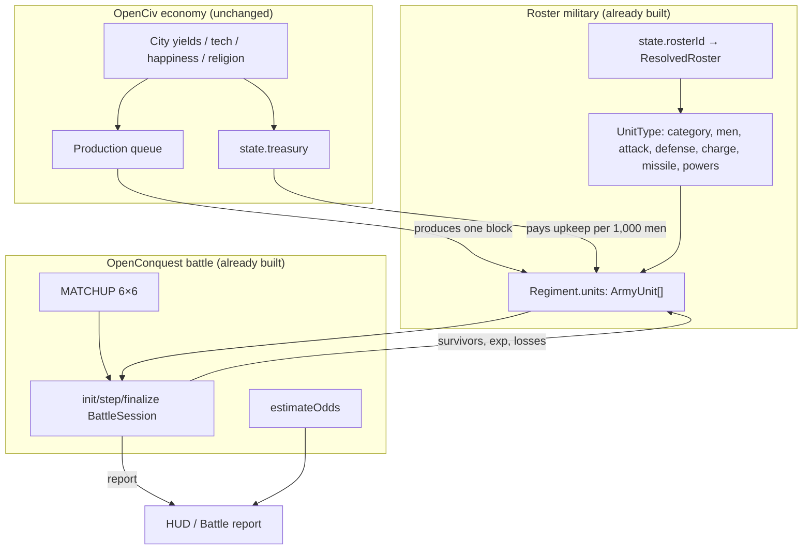

# Plan — Living World Armies: OpenCiv Economy × OpenConquest Combined-Arms Warfare

**Status:** Proposed — all decisions resolved, ready for Phase A
**Updated:** 2026-11-04
**Supersedes:** the tactical half of [living-openciv.md](living-openciv.md) §5 (Slice 5, 1UPT single-unit duels).
**Companions:** [openconquest-military-integration.md](openconquest-military-integration.md), [living-openciv.md](living-openciv.md), [openconquest-magic-system.md](openconquest-magic-system.md).

---

## 1. Executive Summary

The Living World currently runs **two incompatible militaries**:

- The **economy** is OpenCiv (Slices 1–6 delivered): 7 yields, city buckets, tech tree, gold upkeep, happiness, religion.
- The **battlefield** is OpenCiv **Slice 5** 1UPT: one `Regiment` = one `UnitSimState` with 100 HP, one attacker vs one defender, a per-exchange exponential damage roll.
- The **roster military** is OpenConquest (completed in [openconquest-military-integration.md](openconquest-military-integration.md)): every state has a `rosterId`, every `Regiment` already carries `units: ArmyUnit[]` of culture-unique blocks, and `battle.ts` already implements combined-arms Lanchester combat with a 6×6 `MATCHUP` matrix, tactical orders, rout, magic and sieges.

The result is that **Living World combat throws the unique forces away**. `syncUnits()` overwrites `regent.u` with a single generic OpenCiv unit id (`living-generator.ts:5374-5377`), and `spawnUnit()` resets `regiment.units = []` (`:6297`). A Dwarven Ironbreaker stack becomes "one Swordsman". No `MATCHUP`, no monsters, no casters, no rout, no combined arms.

This plan keeps the **OpenCiv economy exactly as delivered** and replaces only the tactical layer with **OpenConquest army stacks**:

> **1 `Regiment` = 1 Army = up to 20 `ArmyUnit` blocks drawn from the state's `rosterId`.** Composition lives on `regiment.units`; `living.armies[key]` holds only per-tick state (movement, stance, hasFought). Combat is `initBattleSession → stepBattleRound → finalizeBattle`.

The shared boundary is deliberate: **economy in OpenCiv, war in OpenConquest.**

---

## 2. Why the Current Design Blocked Unique Forces

| Where | What happens today | Consequence |
| :--- | :--- | :--- |
| `syncUnits` (`living-generator.ts:5352`) | `regiment.u = { [unit.unitTypeId]: regiment.a }` | Overwrites the roster composition authored by `Military.generate()`. |
| `createUnitSim` (`:5404`) | Picks `bestUnitForCategory()` from `UNIT_CHAINS` | Culture uniqueness is erased; only 4 generic chains survive. |
| `spawnUnit` (`:6250`) | `regiment.units = []` | New units have no roster blocks at all. |
| `resolveUnitBattle` (`:5750`) | 1v1 duel via `combatDamage` | Men counts, category matchup, monsters, casters, monster counters and rout never apply. |
| `UNIT_MAX_HP` (`:1184`) | HP is 0..100 | Army size is not a variable; a 5,000-man host and a 150-man patrol are equally "one unit". |
| `reconcileRegimentBlocks` (`military-generator.ts:95`) | Already builds `ArmyUnit[]` from `reg.u` | The data we need is *already there* and being discarded. |

The OpenConquest integration is complete and tested: `reg.units` is generated, persisted in `.map` files, editable in `RegimentEditor`, compiled zero-loss, and consumed by `battle-screen.ts`. The Living World is the only subsystem still on the old model.

---

## 3. Locked-In Decisions

1. **`regiment.units` is the single source of truth for composition.** `living.armies` never duplicates it. `reg.u` and `reg.a` are derived mirrors via `syncRegimentTotals()`.
2. **The OpenCiv economy is untouched.** Yields, city growth, borders, buildings, wonders, tech, happiness, religion, treasury, hurry pricing and building maintenance all keep working as delivered.
3. **One regiment is one army stack.** Max 20 blocks per army (`ARMY_MAX_BLOCKS`), max one army per cell per state. Utility regiments (Settler, Builder, Work Boat, Caravan, Cargo Ship, Missionary, Inquisitor, Great Prophet) stay separate, non-combat, and outside `living.armies`.
4. **Battle = OpenConquest `battle.ts`, not a new engine.** Reuse `computeBattleSetup`, `initBattleSession`, `stepBattleRound`, `finalizeBattle`, `estimateOdds`, `MATCHUP`, `applyLosses`, `aggregateSideMagic`.
5. **Stats come from `UnitType` (roster), not `CivUnitDef`.** `UnitType` already carries `category`, `attack`, `defense`, `charge`, `missile`, `men`, `powers`, `resistArcane` — the exact inputs `battle.ts` needs.
6. **Tech gates roster units, not the reverse.** Add `requiredTech?: string` and `upgradesTo?: string` to `UnitType`, defaulting to a derived era ladder when absent.
7. **Deterministic.** Living World battles use `this.rng(...)`, never `Math.random`. Same tick + same save = same outcome.
8. **Auto-resolve in the simulation, report in the UI.** The seasonal tick resolves the whole battle; the Living World shows a compact battle card, and `battle-screen.ts` remains available for the FMG flow.

### 3.1. Resolved open decisions (2026-11-04)

| # | Decision | Resolution |
| :-- | :--- | :--- |
| 1 | Upkeep unit | **Per 1,000 men.** `max(0, combatMen / MEN_PER_BLOCK − UNIT_UPKEEP_FREE) × GOLD_PER_BLOCK` + 1 Gold per civilian regiment. |
| 2 | Production catalog | **Roster only.** `chooseCityProduction`, `productionCost` and `spawnArmyBlock` read `ResolvedRoster`. |
| 3 | Civ combat units | **Removed.** Keep only Civ **utility** units (Settler, Builder, Work Boat, Caravan, Cargo Ship, Missionary, Inquisitor, Great Prophet). All Civ combat units, culture uniques and the `CivUnitDef` combat stat path are deleted. |
| 4 | City strikes | **One block of damage per tick.** |
| 5 | Reinforcements | **Deferred** to a later phase (support radius = 1). |
| 6 | Battle screen | **Compact report card first.** Replay later. |
| 7 | Feature flag | **Yes**, `config.military.armies` (from `options.map.military.armies`), for one release. |

---

## 4. Target Architecture



### 4.1. What moves, what stays

| Subsystem | Today | After |
| :--- | :--- | :--- |
| City yields, growth, borders | OpenCiv | **Unchanged** |
| Buildings, wonders, maintenance | OpenCiv | **Unchanged** |
| Tech tree, era gating | OpenCiv | **Unchanged** (+ gates roster units) |
| Happiness, religion, diplomacy | OpenCiv | **Unchanged** |
| Treasury, hurry purchase | OpenCiv | **Unchanged** (upkeep charged per 1,000 men) |
| Regiments | `UnitSimState` 100 HP | **`ArmyUnit[]` blocks** |
| Movement | 1UPT per unit | **1 army per cell**, slowest-block cost |
| Combat | 1v1 `combatDamage` | **Army vs army `battle.ts`** |
| Sieges | HP attrition duel | **Army vs garrison battle** |
| City strikes | `combatDamage` | **One block-damage round** |
| Healing | Fortify +HP | **Between-tick replenishment** |
| Rendering | HP badge | **Men badge + stack/composition** |
| Unique forces | Erased | **Native** |

---

## 5. Data Model

### 5.1. New types (`src/types/living.ts`)

```ts
/** Per-tick state for one army. Composition lives on Regiment.units. */
export interface ArmySimState {
  movement: number;
  maxMovement: number;
  stance: ArmyStance;
  hasFought: boolean;
  /** Men at battle start, for the wounded badge and post-battle recovery. */
  startMen: number;
  lastBattle?: ArmyBattleRecord;
}

export type ArmyStance = "march" | "encamp" | "fortify" | "raid" | "ambush";

export interface ArmyBattleRecord {
  tick: number;
  cell: number;
  role: "attacker" | "defender";
  winner: "attacker" | "defender";
  rounds: number;
  losses: number;
  survivors: number;
}
```

`LivingWorldState` gains:

```ts
armies?: Record<string, ArmySimState>; // key `${stateId}-${regimentId}`
units?: Record<string, UnitSimState>;  // utility regiments only
```

`UnitSimState` shrinks in role but is **not deleted**: Settler, Builder, Work Boat, Caravan, Cargo Ship, Missionary, Inquisitor and Great Prophet keep using it (`workOrder`, `spreadCharges`, `conversionStrength`).

`Regiment` needs **no new fields**. `units?: ArmyUnit[]`, `u`, `a`, `n`, `rosterId` already exist.

### 5.2. Roster access

`Military.getRoster(state)` already resolves `state.rosterId` with a `commonBase` fallback (`military-generator.ts:793`). Add a small pure helper module:

```ts
// src/model/physical/living-armies.ts
export function stateRoster(state: State): ResolvedRoster | undefined;
export function stateUnitTypes(): Record<string, UnitType>;
export function armyBlocks(regiment: Regiment): ArmyUnit[];
export function armyMen(regiment: Regiment): number;            // Σ block.count
export function armySlots(regiment: Regiment): number;          // (reg.units ?? []).length
export function armyPower(regiment: Regiment): number;          // reuses battle.ts armyPower()
export function armyIsEmpty(regiment: Regiment): boolean;
export function armyIsUtility(regiment: Regiment): boolean;
export function normalizeArmy(regiment: Regiment): void;        // clamp, drop 0-count, cap ARMY_MAX_BLOCKS
export function ensureArmy(regiment: Regiment): void;           // build from reg.u if units missing
export const ARMY_MAX_BLOCKS = 20;                              // mirrors config.military.maxUnitsPerArmy
```

All pure and unit-testable without a `pack`.

### 5.3. Invariants

- `reg.a === Σ block.count` (enforced by `syncRegimentTotals`).
- `reg.u[type] === Σ block.count where block.type === type`.
- `0 <= block.count <= UnitType.men`.
- `0 <= block.exp <= 9`.
- `blocks.length <= ARMY_MAX_BLOCKS`.
- A combat regiment has **no** `living.units[key]`; a utility regiment has **no** `reg.units`.
- `living.armies[key]` exists iff the regiment is combat and alive.

---

## 6. Unit Catalog & Tech Gating

### 6.1. The gap

`UnitType` (conquest) has no tech field; `CivUnitDef` (OpenCiv) has `requiredTech`, `upgradesTo`, `uniqueTo`, `replaces`. We need roster units to respect the OpenCiv tech tree without rewriting 34 roster JSON files by hand.

### 6.2. Content schema addition

Add to `UnitType` in `src/conquest/engine/common/content.ts`:

```ts
/** OpenCiv tech id that unlocks this unit. Absent ⇒ derived era gate. */
requiredTech?: string;
/** Roster unit this upgrades into (Gold upgrade path). */
upgradesTo?: string;
/** Explicit era override (1..8); otherwise derived from cost rank. */
era?: number;
```

Extend `parseRoster`'s `allowedUnitKeys` and the parse block (around `content.ts:615-697`) to read them. Purely additive: old rosters keep working.

### 6.3. Derived fallback ladder

When `requiredTech` is absent, gate by category + cost rank inside the roster:

```ts
const CATEGORY_TECH_LADDER: Record<UnitCategory, readonly string[]> = {
  melee:      ["", "", "bronze_working", "iron_working", "steel", "gunpowder", "rifling", "replaceable_parts"],
  ranged:     ["", "archery", "construction", "machinery", "gunpowder", "rifling", "ballistics"],
  cavalry:    ["", "horseback_riding", "horseback_riding", "chivalry", "military_science", "combustion", "mobile_tactics"],
  artillery:  ["", "mathematics", "engineering", "physics", "chemistry", "dynamite", "rocketry"],
  monster:    ["", "", "bronze_working", "iron_working", "steel", ""],
  spellcaster:["", "writing", "philosophy", "theology", "education", "astronomy"]
};
```

`requiredTechFor(unit, roster)` returns `unit.requiredTech` when authored, else the ladder entry at the unit's rank among same-category recruitable units, else `""` (always available).

This means **no roster edits are required to ship Phase A**. Explicit annotations can follow per culture (e.g. `ironbreaker → iron_working`, `waywatcher → machinery`).

### 6.4. Removal of Civ combat units

The OpenCiv combat catalog (`src/data/living-civ-units.ts`, 64 defs including 12 culture uniques) is retired. The roster `UnitType` catalog becomes the only source of combat stats.

**Delete:**

- Every non-`isUtility` `CivUnitDef` — `warrior`, `scout`, `archer`, `spearman`, `chariot_archer`, `horseman`, `swordsman`, `composite_bowman`, `catapult`, `pikeman`, `crossbowman`, `galleass`, `knight`, `trebuchet`, `longswordsman`, `caravel`, `musketman`, `frigate`, `privateer`, `cannon`, `lancer`, `cavalry`, `gatling_gun`, `rifleman`, `ironclad`, `artillery`, `destroyer`, `great_war_infantry`, `infantry`, `anti_tank_gun`, `submarine`, `battleship`, `tank`, `mechanized_infantry`, `marine`, `bazooka`, `rocket_artillery`, `nuclear_submarine`, `modern_armor`, `missile_cruiser`, `giant_death_robot`, `xcom_squad`, and all of `CIV_CULTURE_UNIQUE_UNITS`.
- `CIV_CULTURE_UNIQUE_UNITS` / `CIV_CULTURE_UNIT_MAP` and the unique-unit resolution helpers.
- `src/data/living-civ-promotions.ts` and its catalog test — veteran progression is now `ArmyUnit.exp` (0..9) consumed by `unitPower` (`0.85 + 0.03 × exp`).

**Keep:**

- `settler`, `builder`, `work_boat`, `caravan`, `cargo_ship`, `missionary`, `inquisitor`, `great_prophet` — they drive Civ mechanics (expansion, improvements, trade, religion) and keep `UnitSimState`.
- `CivUnitDef`/`UnitSimState` types, trimmed to the utility fields actually used (`isUtility`, `defaultMoveDistance`, `spreadCharges`, `conversionStrength`, `faithCost`, `domain`, `capturedAs`, `workOrder`).

**Rename** the file to `src/data/living-civ-civilians.ts` and export `CIV_CIVILIANS` / `CIV_CIVILIAN_BY_ID`, so nothing can accidentally reach for a combat def.

**Call sites to migrate** (`living-generator.ts` unless noted):

| Line | Today | After |
| :--- | :--- | :--- |
| `:57-60` | imports `CIV_ALL_UNITS`, `CIV_UNIT_BY_ID`, `CIV_PROMOTIONS` | import `CIV_CIVILIAN_BY_ID` only |
| `:1194-1215` | `UNIT_CHAINS` + `bestUnitForCategory` | **deleted**; `pickRosterUnit(state, category, techs)` |
| `:4816` | `CIV_UNIT_BY_ID[id]` for Builder | `CIV_CIVILIAN_BY_ID[id]` |
| `:4834` | `bestUnitForCategory("melee", techs)` | `pickRosterUnit(state, "melee", techs)` |
| `:4847` | `productionCost` | `isCivilian(id) ? CIV_CIVILIAN_BY_ID : rosterUnitById` |
| `:5387` / `:5404` | `unitDefinition`, `createUnitSim` | civilian-only; combat branch deleted |
| `:5611` | `CIV_PROMOTIONS` in `grantPromotion` | **deleted**; `ArmyUnit.exp` |
| `:5805` | battle news name | roster `unitTypes[block.type].name` (path retired in Phase C) |
| `:6696` | `spreadCharges` lookup | `CIV_CIVILIAN_BY_ID` |
| `:6880` | `entersForeignLands` lookup | `CIV_CIVILIAN_BY_ID` |
| `living-hud.ts:1643` | army name from `CIV_UNIT_BY_ID` | roster lookup |
| `living-hud.ts:1702` | production item name | civilians + roster |
| `burg-editor.ts:417` (`src/controllers/political/burgs/`) | production item name | civilians + roster |
| `living-civ-themes.ts:166` | `resolveCivUnitName(theme, CivUnitDef)` | civilian-only; roster `UnitType.name` is already culture-flavoured |
| `living-civ-catalogs.test.ts` | combat/unique/promotion assertions | rewritten for civilians only |
| `living-generator.test.ts:3138-3144` | `bestUnitForCategory` block | **deleted** |

---

## 7. Movement & Stacking

### 7.1. One army per cell

`unitOccupancy` (`living-generator.ts:5443`) becomes `armyOccupancy`: a `Map<cell, Array<{ stateId: number; utility: boolean }>>` built from every live regiment (`utility = armyIsUtility(reg)`), not from `living.units`.

Rules stay as today:
- one **combat** army + one **utility** regiment per state per cell;
- foreign armies never share a cell;
- friendly armies may pass through if the destination is free at the end of the tick.

This is already the OpenCiv 1UPT rule; only the occupant granularity changes (regiment, not unit).

### 7.2. Movement cost

`unitMovementCost(from, to, unit)` becomes `armyMovementCost(from, to, regiment)`:
- slowest block wins: `max(cost)` over distinct categories (cavalry does **not** speed up infantry);
- roads `1/3`, river crossing drains remaining movement, hills/forest/jungle/marsh `2`, mountains impassable;
- naval armies (`reg.n === 1`) use sea movement only; embarkation remains deferred.

`maxMovement` is the **minimum** of the army's block `defaultMoveDistance`-equivalent. Since `UnitType` has no movement field, derive: cavalry 4, melee/ranged/artillery 2, monster 2, spellcaster 2. Store on `ArmySimState`.

### 7.3. Stance

`ArmySimState.stance` is chosen by the state AI each tick:

| Trigger | Stance |
| :--- | :--- |
| `agenda.kind === "conquer"` / martial bias | `march` |
| At war, adjacent enemy, defensive bias | `fortify` |
| In a friendly city with `armyMen < 0.6 × full strength` | `encamp` |
| Ranged/missile share > 50% and enemy adjacent | `ambush` |
| Deep in enemy territory, no siege | `raid` |

Stance feeds `BattleModifiers` (`defenderEncamped`, `defenderAmbushed`) and replenishment (`encamp` × `encampReplenishBonus`).

---

## 8. Combat

### 8.1. Entry point

Replace `resolveUnitBattle` (`living-generator.ts:5750`) with:

```ts
private resolveArmyBattle(
  attackerState: State,
  attackerRegiment: Regiment,
  defenderState: State,
  defenderRegiment: Regiment,
  living: LivingWorldState
): void
```

### 8.2. Steps

1. **Normalize both armies** (`ensureArmy`, `normalizeArmy`).
2. **Build sides**:
   ```ts
   const attacker: BattleSide = {
     factionId: attackerState.i,
     armyId: `fm-${attackerState.i}-${attackerRegiment.i}`,
     units: attackerRegiment.units!.map(u => ({ ...u }))
   };
   ```
3. **Build modifiers** (table below).
4. **Seed the PRNG**: `const rng = this.rng("army:battle", attackerRegiment.i * 1000 + defenderRegiment.i, living.tick)`.
5. **Orders**: deterministic per side (§8.4).
6. **Run**:
   ```ts
   const session = initBattleSession({ config, unitTypes, attacker, defender, cell, regionId, assault: false, modifiers });
   while (session.status === "active" && session.round < config.battle.maxRounds) {
     stepBattleRound(session, () => rng.next(), ordersFor(session.round));
   }
   const outcome = finalizeBattle(session, () => rng.next());
   ```
7. **Write back**:
   ```ts
   attackerRegiment.units = outcome.attacker.units.filter(u => u.count > 0);
   defenderRegiment.units = outcome.defender.units.filter(u => u.count > 0);
   syncRegimentTotals(attackerRegiment, unitTypes);
   syncRegimentTotals(defenderRegiment, unitTypes);
   ```
8. **Remove wiped armies**, delete their `living.armies` entry.
9. **Award XP**: `exp = min(9, exp + (won ? 1 : 0))` per surviving block; +1 for monster kills is a later refinement.
10. **Occupy**: a melee attacker that wins moves onto the defender's cell (`moveRegimentTo`); a ranged-only winner stays.
11. **Record** `ArmyBattleRecord` on both armies and push a `battle` news dispatch.

### 8.3. Modifier mapping

| OpenCiv concept | OpenConquest field | Notes |
| :--- | :--- | :--- |
| Defender on hill/forest/jungle/marsh | **new** `BattleModifiers.defenderTerrain: boolean` + `config.battle.terrainDefenseBonus = 0.25` | Binary, not per-terrain tiers. Added to `defenderMult` before the lord multiplier. |
| City walls tier | `modifiers.walls` | `wallBonusPerTier = 0.1` → +30% at tier 3. The lanchester doc says +30%/tier; reconcile the doc or the config, not both. |
| Attacker crossed river | `modifiers.attackerCrossedRiver` | `riverDefenderBonus = 0.15`. |
| Defender fortified/encamped | `modifiers.defenderEncamped` | `encampBonus = 0.10`. |
| Defender in ambush | `modifiers.defenderAmbushed` | `ambushBonus` applies to attacker. |
| Very unhappy empire (×0.67) | `attackerLordMult` / `defenderLordMult` | `happinessCombatMultiplier()` (`:1157`). |
| Weapon relic (+15%) | `attackerLordMult` / `defenderLordMult` | `WEAPON_RELIC_COMBAT_PERCENT` (`:1320`). |
| Fortify healing | between-tick replenishment | §10.6. |
| Promotion defence/attack % | fold into `UnitType.attack`/`defense` at battle build | Phase C keeps it simple; promotions are retired with the Civ catalog. |

```ts
const modifiers: BattleModifiers = {
  walls: atBurg ? (pack.burgs[atBurg]?.walls ?? 0) : 0,
  defenderEncamped: defenderStance === "encamp" || defenderStance === "fortify",
  defenderAmbushed: defenderStance === "ambush",
  attackerCrossedRiver: crossedRiver(attackerRegiment.cell, defenderRegiment.cell),
  defenderTerrain: hasDefensiveTerrain(defenderRegiment.cell),
  labels: [],
  attackerLordMult: happinessCombatMultiplier(attackerSim.happiness) * relicCombatMult(attackerState.i),
  defenderLordMult: happinessCombatMultiplier(defenderSim.happiness) * relicCombatMult(defenderState.i)
};
```

`labels` is **required** by `BattleModifiers` (not optional) — always pass `[]` and let `computeBattleSetup` populate it. `attackerLordMult`/`defenderLordMult` carry the OpenCiv happiness and weapon-relic multipliers, so `battle.ts` needs no new fields for them.

### 8.4. Tactical orders (deterministic)

`categoryShares` is currently module-private in `battle.ts`; either export it or mirror the four-line share calculation in `living-armies.ts`.

```ts
function chooseOrder(side: ArmyUnit[], types: Record<string, UnitType>, stance: ArmyStance, seed: number): BattleTacticalOrder {
  const shares = categoryShares(side, types);
  if (stance === "encamp" || stance === "fortify") return "brace";
  if (stance === "ambush") return "skirmish";
  if (shares.cavalry > 0.4) return "charge";
  if (shares.ranged + shares.artillery + shares.spellcaster > 0.5) return "skirmish";
  if (shares.melee + shares.monster > 0.5) return "press";
  return seed % 3 === 0 ? "press" : "balanced";
}
```

Round 1 uses the stance order; rounds 2+ use `balanced` unless the side is losing (`powerFrac < routThreshold + 0.15`) and has cavalry, in which case `charge`. No randomness beyond the seeded `prng`.

### 8.5. What is deliberately lost

- **Per-unit range and line of sight.** `range`, `rangedLineOfSightBlocked` and `bombardCity` no longer gate combat; missile power is expressed through `missile` and `MATCHUP`.
- **Individual HP.** Survivability is men, not `hp`.
- **1UPT stand-off bombardment.** Mitigation: a pre-contact **bombardment round** for armies whose missile share > 50% (§9.3).

---

## 9. Sieges

### 9.1. City as a defender army

Replace the HP duel in `bombardCity` / capture logic with a battle:

- **Defender side** = `garrisonUnits(roster, unitTypes, burg.walls)` (`units.ts:74`) plus any defending army on the cell.
- **Attacker side** = the besieging army.
- `modifiers.walls = burg.walls ?? 0`.
- `assault = true`.

On attacker win → existing capture path (`captureBurg`, `relocateCapital`, unrest, queue clear). On defender win → attacker loses the battle's casualties and **retreats one cell** (existing `moveRegimentTo` to the nearest friendly/unowned cell).

### 9.2. City HP

Keep `BurgSimState.hp/maxHp` for the HUD and ranged strikes, but derive it from the battle: a city that loses a siege is captured; a city that wins keeps HP and heals `+20/tick` (already in `stepTactical`). `cityDefenseStrength` becomes `armyPower(garrison)` for display and for city strikes.

### 9.3. Bombardment phase

Optional, one round before contact:

```
if (attacker missile share > 0.5) {
  applyLosses(defenderGarrison, attackerMissilePower * 0.15, rng);
}
```

This restores the "archers soften the walls" feel without a separate LOS system.

---

## 10. Economy Integration

The OpenCiv economy is unchanged in structure; only the **unit** it prices changes.

### 10.1. Upkeep

Today: `max(0, regiments - UNIT_UPKEEP_FREE) * 1 Gold` (`living-generator.ts:5052`).

After — **charged per 1,000 men**, not per regiment and not per `ArmyUnit` slot:

```ts
import { MEN_PER_BLOCK } from "@/conquest/engine/common/content";

const combatMen = state.military.filter(r => !armyIsUtility(r)).reduce((sum, reg) => sum + armyMen(reg), 0);
const civilians = state.military.filter(armyIsUtility).length;       // 1 Gold each
const upkeep =
  Math.max(0, combatMen / MEN_PER_BLOCK - UNIT_UPKEEP_FREE) * GOLD_PER_BLOCK + civilians;
```

- `UNIT_UPKEEP_FREE = 3` means **3,000 men free**, not 3 regiments.
- `GOLD_PER_BLOCK = 1`.
- Civilian regiments add a flat 1 Gold each and never enter the men pool (§11).
- This is numerically identical to OpenConquest's `upkeep × count / men` (`economy.ts:353-361`) and to the AER/`MEN_PER_BLOCK` conversion used everywhere else.
- Example: a 3,000-man army is free; 4,500 men costs 1.5 Gold; 10,000 men costs 7 Gold.
- Round the banked delta to 2 decimals exactly like `applyTreasury` does today (`:5242`).

`settleDebt` (`:5245`) disbands **one block** (one `ArmyUnit`) from the newest regiment, not the whole regiment; only remove the regiment when its last block dies.

> Balance note: because upkeep is per 1,000 men, a 20-slot army of 150-man blocks is still free (3,000 men). This is intentionally gentler than per-slot pricing and keeps the OpenCiv economy recognisable.

### 10.2. Production

`productionCost(item)` (`:4846`) reads:

```ts
item.kind === "unit"
  ? (isCivilian(item.id) ? CIV_CIVILIAN_BY_ID[item.id]?.cost : rosterUnitById(state, item.id)?.cost)
  : CIV_BUILDING_BY_ID[item.id]?.cost
```

`chooseCityProduction` (`:4790`) keeps its priority order, but the id sources split:

- **Builder / Settler / Work Boat** → `CIV_CIVILIAN_BY_ID` (Civ mechanics preserved).
- **Combat** → `roster.recruitable` filtered by `requiredTechFor()`, sorted deterministically (category need → cost → id). The "at war, no melee" branch calls `pickRosterUnit(state, "melee", techs)` instead of `bestUnitForCategory("melee", techs)`.

The `ProductionItem` shape is unchanged (`{ kind: "unit", id: string }`); `id` is now either a civilian id or a roster unit id, and the two namespaces are disjoint by construction.

### 10.3. Recruitment

`spawnUnit` (`:6250`) becomes `spawnArmyBlock(state, burg, typeId)` and accepts **roster unit ids only**:

1. `ensureArmy` every combat regiment at the city.
2. If a combat army is at the city and `blocks < ARMY_MAX_BLOCKS`, append `{ type, count: unit.men, exp: trainingXp }`. If the roster unit is already present, merge into the existing block (respecting `men`) before adding a slot.
3. Else create a regiment via `Military.createRegiment`, set `units = [block]`, `reg.n` from the roster's naval flag, then `syncRegimentTotals`.
4. `normalizeArmy` afterwards (cap, clamp, sort by `men` desc then `type`).
5. Never write `reg.units = []`.

The production item's `id` is disambiguated before this call: civilians take the existing `spawnUtilityUnit` path (settler/builder/work boat/caravan/cargo ship/missionary/inquisitor/great prophet), combat ids take `spawnArmyBlock`. Because the civilian and roster namespaces are disjoint, `isCivilian(id)` is the only check needed.

Training buildings (`barracks`, `armory`, `military_academy`) grant `+15 XP` each, as today (`:6287`), stored on `ArmyUnit.exp` and clamped to 9.

### 10.4. Upgrades

`upgradeRegiment` (`:6363`) becomes `upgradeArmyBlocks(stateId, regimentId)`:

- For each block whose resolved target exists — `UnitType.upgradesTo`, else `nextRosterUnitInCategory(roster, block.type)` — and whose `requiredTechFor(target)` is researched, replace the block type in place.
- Cost stays the current formula, now reading roster `cost` instead of `CivUnitDef.cost`:
  ```ts
  Math.floor((10 + 2 * Math.max(0, target.cost - current.cost)) / 5) * 5;
  ```
- Preserve `count` and `exp`; the block keeps its slot and its veterans.
- `autoUpgrade` (`:6400`) upgrades **one block per season** while `treasury >= 200`, scanning the oldest regiment first. Blocks without a successor are skipped.
- If no block upgrades, return `false` (no news, no charge).

### 10.5. Gold purchase

`hurryProduction` (`:5319`) is unchanged except `productionCost` now reads the roster unit cost. The `GOLD_PURCHASE_RESERVE = 100` rule stays.

### 10.6. Replenishment

Remove `tickUnitHealing` for combat armies (keep it for utility). Add `replenishArmies(living)` after movement:

```ts
const fraction = stance === "encamp"
  ? config.military.replenishFraction * config.military.encampReplenishBonus
  : config.military.replenishFraction;
for (const block of regiment.units) {
  const def = unitTypes[block.type];
  block.count = Math.min(def.men, block.count + Math.round(def.men * fraction));
}
```

- Friendly city: full fraction.
- Friendly territory: fraction × 0.5.
- Neutral/enemy: 0.
- Only if the army did not fight this tick.

This is the OpenConquest model (`economy.ts:574-580`) and replaces OpenCiv's fortify `+HP`.

---

## 11. Utility Regiments

Settler, Builder, Work Boat, Caravan, Cargo Ship, Missionary, Inquisitor and Great Prophet keep `UnitSimState` and their existing logic (`stepSettler`, `stepBuilder`, `stepMissionary`, trade routes, spread charges). They are:

- **not** part of `living.armies`;
- **not** counted by `armyMen`, so they contribute **0 men** to the per-1,000-men upkeep pool;
- charged a flat **1 Gold each** (`civilians` term in §10.1), preserving today's `regiments - UNIT_UPKEEP_FREE` behaviour for civilians only;
- still 1 per cell, co-located with one combat army (the old combat/utility split in `hasStackingConflict` survives unchanged in spirit).

`syncUnits` splits cleanly:

```ts
if (CIV_CIVILIAN_BY_ID[regimentUnitId]) {
  ensureUtilitySim(regiment, key);           // today's createUnitSim path
} else {
  ensureArmy(regiment);                       // roster blocks
  delete living.units[key];                   // no combat UnitSimState
}
```

---

## 12. Rendering & UI

### 12.1. Map

- `draw-military.ts` already draws `regiment.a` and `regiment.icon`. Keep `reg.a = total men`.
- Add a **stack badge** (bottom-right of the regiment box) showing `reg.units.length` when `> 1`.
- Add a **composition strip**: up to 3 category glyphs (melee/ranged/cavalry) from `reg.units`.
- Wounded tint when `armyMen(reg) < living.armies[key].startMen × 0.7`.

### 12.2. Living HUD

`empirePanel` (`living-hud.ts:1587`) replaces the 1UPT list. All names come from the **roster** (`Military.getRoster(state)` → `unitTypes[block.type].name`), never `CivUnitDef`:

```
Armies (3)
  I. Ironbreakers — 2,400 men · 6 blocks · exp 3.2
     [Melee 4] [Ranged 1] [Artillery 1]   Fortified · last: won
  II. Waywatchers — 900 men · 2 blocks · exp 1.0
     [Ranged 2]
  III. ...
```

Per army: `armyMen(reg)`, `reg.units.length` blocks, composition counts by `UnitType.category`, mean `exp` (show as `exp 3.2`, not a Civ level), stance, and `lastBattle` result. The production list uses `CIV_CIVILIAN_BY_ID` for civilians and the roster for combat, mirroring `productionCost`.

### 12.3. Battle report

Ship the **compact battle card** first (decision 6). It is a Living HUD panel, not a modal:

- header: attacker vs defender, cell, tick, winner;
- men at start / after, per side;
- rounds fought, `session.history` loss curve (optional sparkline);
- modifiers actually applied (`session.labels`);
- `estimateOdds` shown **before** the fight on the army row for each adjacent enemy, and again as a pre-battle bar in the card.

It opens from the `battle` news dispatch and from the army row. `battle-screen.ts` stays as-is for the FMG flow; a read-only `BattleSession` replay is a later enhancement, not a dependency.

### 12.4. Settings

Battle config already lives in `config.ts`; Living World reuses it rather than adding parallel keys:
- `military.maxUnitsPerArmy` (already **20**)
- `military.replenishFraction` (already **0.25**)
- `military.encampReplenishBonus` (already **2**)
- `battle.maxRounds` (6)
- `battle.routThreshold` (0.25)
- `battle.terrainDefenseBonus` (**new**, 0.25)
- `military.armies` feature flag (**new**, §13.3)

These are engine config, not new user-facing toggles initially; expose them in the settings panel only if a balance pass needs them.

---

## 13. Migration & Backwards Compatibility

### 13.1. Old `.map` saves

- `reg.units` missing but `reg.u` present → `reconcileRegimentBlocks(reg, unitTypes, ARMY_MAX_BLOCKS)` (already implemented). Drop or remap a `"fleet"` block type here.
- Both missing → create one block of `roster.regimentMap.infantry` (or the cheapest recruitable melee) with `count = max(1, reg.a)`.
- `living.units[key]` for a combat regiment → convert once, then delete. Read the class from the sim itself, never the (soon-deleted) catalog:
  ```ts
  const rosterUnit = matchRosterUnitByCategory(roster, sim.combatClass);
  regiment.units = [{ type: rosterUnit.id, count: rosterUnit.men, exp: Math.min(9, Math.max(0, sim.level - 1)) }];
  ```
  `UnitSimState.combatClass` (`recon | melee | ranged | mounted | siege | …`) maps onto `UnitCategory` via a small table, so the migration works before and after the catalogue removal.
- `living.armies` is lazily initialized in `syncArmies`.

### 13.2. Old tests

- `combatDamage` stays exported for the Phase B interim duel, then is deleted in Phase F with the flag. Its city-strike usage disappears in Phase D (one block of damage, not an HP roll).
- `resolveUnitBattle` tests are rewritten as `resolveArmyBattle` tests in Phase C.
- `unitOccupancy` tests move to `armyOccupancy` in Phase B.
- `reg.a === unitSim.hp` assertions are deleted; replaced by `reg.a === Σ block.count`.
- `tickUnitHealing` tests shrink to utility units only.

### 13.3. Feature flag

Gate **stack combat** behind `config.military.armies` (surfaced from `options.map.military.armies`) for one release.

- `true` (default): `resolveArmyBattle` with `battle.ts`.
- `false`: the Phase B interim lead-block duel (`combatDamage` on the army's strongest block), which still preserves `reg.units`.

The flag deliberately **cannot** restore the pre-Phase-B model: `living.units` combat entries are converted in Phase B and the `CivUnitDef` combat stats are deleted at the end of Phase E. Document that in the settings tooltip so "turn it off" is not mistaken for a save rescue. The flag's real job is isolating a battle-model regression while leaving armies intact.

Remove the flag in Phase F one release after it ships on by default.

---

## 14. Determinism & Persistence

- Every random draw comes from `this.rng(stream, id, tick)` (`living-generator.ts` pattern).
- Battle stream: `"army:battle"` with `attackerRegiment.i * 1000 + defenderRegiment.i`.
- Orders are pure functions of `(units, types, stance, round)`.
- `applyLosses` jitter uses the same PRNG (`battle.ts:325`).
- Never import `Math.random` into `living-generator.ts`.
- `reg.units` serializes through the existing `pack.states` JSON path; `living.armies` through `pack.history.living`.
- Add a determinism test: same seed + same tick + same initial state → identical `BattleOutcome` and identical `reg.units`.

---

## 15. Phased Implementation

Each phase is independently shippable and testable. No phase may leave the map in a state where `reg.units` and `living.armies` disagree.

### Phase A — Foundations (no behavior change)

- [ ] `src/types/living.ts`: add `ArmySimState`, `ArmyStance`, `ArmyBattleRecord`; add `armies?` to `LivingWorldState`; re-document `units?` as utility-only.
- [ ] `src/conquest/engine/common/content.ts`: add `requiredTech`, `upgradesTo`, `era` to `UnitType` + parser (`allowedUnitKeys`).
- [ ] `src/conquest/engine/game/config.ts`: `battle.terrainDefenseBonus = 0.25` + `military.armies = true` (reuse the existing `military.maxUnitsPerArmy = 20`).
- [ ] `src/conquest/engine/game/battle.ts`: optional `BattleModifiers.defenderTerrain`; fold `terrainDefenseBonus` into `defenderMult`; export `categoryShares`.
- [ ] `src/model/physical/living-armies.ts` (**new**): `stateRoster`, `stateUnitTypes`, `armyBlocks`, `armyMen`, `armySlots`, `armyPower`, `armyIsEmpty`, `armyIsUtility`, `normalizeArmy`, `ensureArmy`, `requiredTechFor`, `nextRosterUnitInCategory`, `pickRosterUnit`, `matchRosterUnitByCategory`, `chooseOrder`, `ARMY_MAX_BLOCKS`.
- [ ] `src/model/physical/living-generator.ts`: import `MEN_PER_BLOCK`; add `GOLD_PER_BLOCK = 1`. No call-site changes yet.
- [ ] Tests: helpers against `default` + `dwarf` rosters, `computeBattleSetup` terrain, `requiredTechFor` ladder.

**Exit:** all existing tests pass; no gameplay change; nothing imports `living-armies.ts` yet except its test.

### Phase B — Army sync, movement, stacking

- [ ] `syncUnits` → `syncArmies`: combat branch calls `ensureArmy`, never writes `reg.u`/`reg.a` (except `syncRegimentTotals`).
- [ ] `unitOccupancy` → `armyOccupancy`.
- [ ] `moveRegimentTo` unchanged; ensure `living.armies` entry travels with the regiment.
- [ ] `moveUnitToward` → `moveArmyToward`; cost = slowest block.
- [ ] `stepTactical` reads `living.armies` for combat regiments and `living.units` for utility.
- [ ] `spawnUnit` stops clearing `reg.units`: interim it maps the produced `CivUnitDef.unitClass` to a roster unit via `matchRosterUnitByCategory` and appends one block (keeps Phase B shippable before the production swap in Phase E).
- [ ] `upgradeRegiment` / `autoUpgrade` are no-ops for combat regiments during Phase B–D (return `false`); `living.units[key]` is already gone. Phase E reinstates them on blocks.
- [ ] Migration for old `living.units` combat entries.
- [ ] Tests: sync idempotence, stack clash, slowest-block cost, utility coexistence, migration, interim spawn.

**Exit:** armies move and stack correctly; combat still uses the old duel on the lead block (interim). Unique composition is preserved end-to-end.

### Phase C — Combined-arms battle

- [ ] `resolveArmyBattle` (§8) replacing `resolveUnitBattle` in `stepUnitOrders`.
- [ ] `chooseOrder`, modifier assembly, seeded PRNG, write-back, XP, occupation, news.
- [ ] Delete `effectiveStrength` combat path for armies (keep for city strikes until Phase D).
- [ ] `estimateOdds` surfaced on the HUD for each adjacent enemy.
- [ ] Tests: 2:1 annihilation, rout, charge vs brace, cavalry vs ranged, monster/spellcaster, terrain, river, encamp, unhappy, relic, determinism, zero-count pruning, `reg.a` mirror.

**Exit:** battles are army stacks; `MATCHUP` and rout are live; unique forces fight with their real stats.

### Phase D — Sieges & city strikes

- [ ] `bombardCity` → siege battle with `garrisonUnits`.
- [ ] Capture/retreat paths.
- [ ] `stepCityStrikes` damages **one block** (deterministic pick: highest `count`, tie by `type`).
- [ ] `cityDefenseStrength` = `armyPower(garrison)`; keep `8 + 0.4×citizens + defense` as a floor.
- [ ] Tests: garrison composition, walls tiers, capture, retreat, strike damage, no-strike-below-1-HP rule retired or redefined.

**Exit:** sieges are stack battles; cities can fall to a real army.

### Phase E — Economy on blocks & Civ combat retirement

- [ ] Upkeep per 1,000 men (§10.1) plus flat civilian upkeep; `settleDebt` disbands one block.
- [ ] `productionCost` + `chooseCityProduction` read the roster for combat, `CIV_CIVILIAN_BY_ID` for civilians.
- [ ] `spawnArmyBlock` (§10.3); `spawnUtilityUnit` for civilians.
- [ ] `upgradeArmyBlocks` + `autoUpgrade` on `UnitType.upgradesTo` / category ladder.
- [ ] `replenishArmies`; remove combat `tickUnitHealing`.
- [ ] `hurryProduction` price from roster cost.
- [ ] **Rename** `src/data/living-civ-units.ts` → `living-civ-civilians.ts`, exporting `CIV_CIVILIANS` / `CIV_CIVILIAN_BY_ID`; keep only the 8 utility defs.
- [ ] **Delete** every combat `CivUnitDef`, `CIV_CULTURE_UNIQUE_UNITS`, `CIV_CULTURE_UNIT_MAP`, `bestUnitForCategory`, `UNIT_CHAINS`, `createUnitSim` (combat branch), `grantPromotion`, and `src/data/living-civ-promotions.ts`.
- [ ] Migrate the call sites listed in §6.4 (`living-generator.ts`, `living-hud.ts`, `political/burgs/burg-editor.ts`, `living-civ-themes.ts`).
- [ ] Rewrite `living-civ-catalogs.test.ts` for civilians only; delete the `bestUnitForCategory` test block.
- [ ] Tests: upkeep scaling (3,000 men free, 4,500 = 1.5 Gold), civilian upkeep, bankruptcy, production cost, block spawn at cap, upgrade tech gate, replenishment per terrain/stance.

**Exit:** the OpenCiv treasury prices armies by men; the Civ combat catalog and promotion tree no longer exist; `reg.units` is the only combat composition.

### Phase F — UI, rendering, balance, cleanup

- [ ] `living-hud.ts` army panel + compact battle card (sides, initial/surviving men, rounds, losses, modifiers, `estimateOdds` bar).
- [ ] `draw-military.ts` stack badge + composition strip + wounded tint.
- [ ] `draw-living-overlay.ts` battle markers.
- [ ] Settings: `military.maxUnitsPerArmy`, `military.replenishFraction`, `battle.maxRounds`, `battle.routThreshold`, `battle.terrainDefenseBonus`.
- [ ] Delete the interim lead-block duel (`resolveUnitBattle`, `combatDamage`, `effectiveStrength` combat path) now that Phase D's one-block city strike no longer needs an HP roll.
- [ ] Remove the `options.map.military.armies` flag one release after it ships on by default.
- [ ] Balance sweep: `UNIT_UPKEEP_FREE`, `replenishFraction`, `maxUnitsPerArmy`, `attritionScale`, `terrainDefenseBonus`.
- [ ] Annotate roster JSON with explicit `requiredTech`/`upgradesTo` per culture (optional; ladder is the fallback).
- [ ] Update `living-openciv.md` §5 to point here.
- [ ] Delete obsolete tests; add the determinism + migration suite.

**Exit:** feature complete, documented, balanced, and the 1UPT tactical layer is gone.

---

## 16. Test Plan

### Pure units (no `pack`)

- `armyBlocks` / `armyMen` / `armySlots` on mixed rosters.
- `normalizeArmy`: overflow `count > men`, zero-count pruning, `ARMY_MAX_BLOCKS` cap, unknown type drop, `fleet` remap.
- `ensureArmy`: builds from `reg.u`, preserves `exp`, no-ops when `units` exists.
- `requiredTechFor`: authored, derived ladder, empty-roster fallback.
- `matchRosterUnitByCategory`: every `UnitCombatClass` maps or returns `undefined` predictably.
- `chooseOrder`: each stance and composition share.
- `computeBattleSetup` with `defenderTerrain`, walls, river, encamp, ambush.

### Living model

- `syncArmies` idempotence and `reg.a === Σ count`.
- Unique force survives: a Dwarf roster's `ironbreaker` block is still `ironbreaker` after 10 ticks.
- Stack clash and pass-through.
- Slowest-block movement cost.
- Battle: 2:1, rout at 25%, charge vs brace, cavalry vs ranged, monster vs melee, caster vs cavalry.
- Modifiers: hill, river, encamp, unhappy, weapon relic.
- Determinism: same seed → identical outcome and survivors.
- Siege: garrison composition, walls, capture, retreat.
- City strike targets one block.
- Upkeep: 3,000 men free, 4,500 men = 1.5 Gold, 10,000 men = 7 Gold; civilian regiments add 1 Gold each; bankruptcy disbands one block.
- Production: roster unit cost, tech gate, block appended at cap → new regiment; civilian ids still resolve.
- Upgrade: tech gate, Gold cost, `count`/`exp` preserved.
- Replenishment: city > friendly > neutral, encamp bonus, no replenish after fighting.
- Migration: old `living.units` combat entry → block via `sim.combatClass`; old `reg.u` → `reconcileRegimentBlocks`.
- Inventory guard: a test asserts no `src/**` module imports `CIV_UNIT_BY_ID`, `CIV_ALL_UNITS`, `CIV_PROMOTIONS`, `bestUnitForCategory` or `UNIT_CHAINS`.

### UI

- `living-hud.test.ts`: army panel renders men/blocks/stance; battle card renders losses.
- `draw-military.test.ts`: stack badge count; wounded tint threshold.
- `draw-living-overlay.test.ts`: battle marker.

---

## 17. Risks & Mitigations

| Risk | Impact | Mitigation |
| :--- | :--- | :--- |
| Upkeep swings the economy | States bankrupt or free-ride | Per-1,000-men pricing is close to today's numbers: 3,000 men free, 4,500 = 1.5 Gold, 10,000 = 7 Gold. Add a measurement test across generated maps before Phase E; tune `GOLD_PER_BLOCK` / `UNIT_UPKEEP_FREE`, not the formula. |
| "One regiment = one Gold" assumptions leak elsewhere | Wrong treasury forecasts | Grep for `UNIT_UPKEEP_FREE`, `stateUnitCount` and `regiments` in `living-generator.ts`; route every count through `armyMen`/`armySlots`. |
| Deleting the Civ combat catalog breaks a missed call site | Build or runtime failure | Phase E lands only after a repo-wide search for `CIV_UNIT_BY_ID`, `CIV_ALL_UNITS`, `CIV_PROMOTIONS`, `bestUnitForCategory`, `UNIT_CHAINS` is empty. Rename the file so a stale import fails at compile time, not at runtime. |
| Old saves carry `living.units` combat entries with ids that no longer exist | Crash on load | Migrate by `sim.combatClass`, not by catalog id (§13.1); clamp `exp`; never look up a deleted `CivUnitDef`. |
| `reg.units` and `living.armies` disagree | Desync, save corruption | Single source of truth (`reg.units`); `living` holds only transient state; dev-build invariant assertion in `syncArmies`. |
| `battle.ts` throws on unknown unit id (e.g. `"fleet"`) | Tick crash | `normalizeArmy` drops unknown types and maps `fleet` to the roster's naval unit; never pass `fleet` to `battle.ts`. |
| Losing 1UPT stand-off archers makes ranged weak | Balance | Bombardment round (§9.3); `MATCHUP` already rewards missile concentration. |
| 20-block armies make the map look sparse | Readability | Stack badge + composition strip; one army per cell is already the rule. |
| Roster units lack movement/range stats | Movement regressions | Derive from `category` in `living-armies.ts`; no JSON edits needed. |
| `exp` is 0..9 and `unitPower` uses `0.85 + 0.03×exp` | Veteran advantage is tiny | Accept for Phase C; revisit in the Phase F balance sweep. |
| Feature flag raises false rescue expectations | User confusion | Tooltip states it only switches the battle model; composition and economy stay on the new path. |
| Balance drifts from OpenCiv's tuned numbers | Hard to compare | Keep `estimateOdds` and the battle card reporting men/losses; document the two damage models side by side in the plan. |

---

## 18. Decision Log (resolved 2026-11-04)

| # | Decision | Rationale | Consequence |
| :-- | :--- | :--- | :--- |
| 1 | Upkeep **per 1,000 men** | Matches OpenConquest `upkeep × count / men` and the AER `MEN_PER_BLOCK` primitive already used across rosters. | Free tier is 3,000 men; fractional Gold (round to 2dp). No per-slot pricing. |
| 2 | **Roster** production catalog | The roster is the culture-unique source; Civ combat defs duplicate it with worse data. | `productionCost`, `chooseCityProduction`, `spawnArmyBlock` read `ResolvedRoster`. |
| 3 | **Delete all Civ combat units**, keep civilians | Civ mechanics need Settler/Builder/Work Boat/Caravan/Cargo Ship/Missionary/Inquisitor/Great Prophet; combat needs nothing from `CivUnitDef`. | `living-civ-units.ts` → `living-civ-civilians.ts`; `living-civ-promotions.ts` deleted; `bestUnitForCategory`/`UNIT_CHAINS` deleted. |
| 4 | City strikes deal **one block** | Keeps "cities defend themselves" without an HP duel or LOS. | Deterministic target: largest `count`, tie by `type`. |
| 5 | **No reinforcements** in Phase C | Adjacent-army commit rules are a separate design problem. | Support radius 1 is a later phase, scaled by `armyPower`. |
| 6 | **Compact report card first** | The observer sim must not depend on a modal game screen. | `battle-screen.ts` stays for the FMG flow; Living World gets its own card. |
| 7 | **Feature flag**, one release | Isolates battle-model regressions. | `options.map.military.armies`; removed in Phase F. |

Nothing remains open. Any new question discovered during implementation should be appended here with its resolution rather than reopened.

---

## 19. File-by-File Change Map

| File | Phase | Change |
| :--- | :--- | :--- |
| `src/types/living.ts` | A | `ArmySimState`, `ArmyStance`, `ArmyBattleRecord`; `LivingWorldState.armies`; `units` documented as utility-only |
| `src/conquest/engine/common/content.ts` | A | `UnitType.requiredTech/upgradesTo/era` + parser keys |
| `src/conquest/engine/common/types.ts` | — | `ArmyUnit` unchanged |
| `src/conquest/engine/game/battle.ts` | A, C, D | `defenderTerrain`; export `categoryShares`; reused by living |
| `src/conquest/engine/game/config.ts` | A | `battle.terrainDefenseBonus`, `military.armies` flag; reuses existing `military.maxUnitsPerArmy` |
| `src/conquest/engine/game/units.ts` | D | optional sorted `garrisonUnits` for stable block order |
| `src/model/physical/living-armies.ts` | A | **new** pure army helpers |
| `src/model/physical/living-generator.ts` | B–E | `syncArmies`, `armyOccupancy`, movement, `resolveArmyBattle`, siege, economy, spawn/upgrade/replenish |
| `src/model/political/military-generator.ts` | B | `syncRegimentTotals` called after every army mutation; no new helpers |
| `src/data/living-civ-units.ts` → `living-civ-civilians.ts` | E | keep 8 utility defs; export `CIV_CIVILIANS` / `CIV_CIVILIAN_BY_ID` |
| `src/data/living-civ-promotions.ts` | E | **deleted** |
| `src/data/living-civ-themes.ts` | E | `resolveCivUnitName` limited to civilians |
| `src/data/living-civ-catalogs.test.ts` | E | rewritten for civilians only |
| `src/controllers/living-hud.ts` | F | army panel, battle card, roster lookups |
| `src/controllers/political/burgs/burg-editor.ts` | E | `CIV_CIVILIAN_BY_ID` + roster lookup |
| `src/renderers/draw-military.ts` | F | stack badge, composition strip, wounded tint |
| `src/renderers/draw-living-overlay.ts` | F | battle marker |
| `docs/plans/living-openciv.md` | F | §5 superseded pointer |
| `docs/plans/living-openciv-armies.md` | — | this document |

---

## 20. Definition of Done

- A state whose roster contains `ironbreaker`, `waywatcher` and a `monster` fields an army that keeps all three block types through recruitment, movement, battle and upgrade.
- A 2:1 army wins with roughly Lanchester-scale losses, and a 25% rout ends the fight before annihilation.
- The OpenCiv treasury still charges building maintenance, and army upkeep scales with men: 3,000 men free, 4,500 = 1.5 Gold, 10,000 = 7 Gold.
- Civilian units (Settler, Builder, Work Boat, Caravan, Cargo Ship, Missionary, Inquisitor, Great Prophet) still work and cost 1 Gold each.
- A city falls only after its garrison is beaten in a stack battle, not after N single-duel exchanges.
- Same save + same tick reproduces the same battle result, block counts and survivors.
- A repo-wide search for `CIV_UNIT_BY_ID`, `CIV_ALL_UNITS`, `CIV_CULTURE_UNIQUE_UNITS`, `CIV_PROMOTIONS`, `bestUnitForCategory`, `UNIT_CHAINS` returns nothing.
- No code path writes `reg.units = []` or overwrites `reg.u` with a generic OpenCiv unit id.
