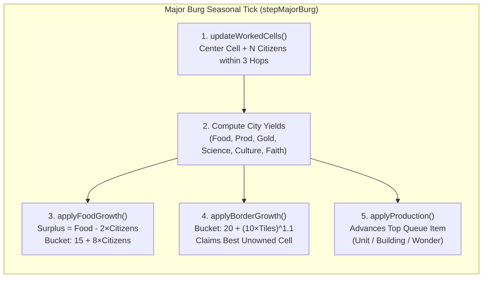

# Plan — Living World 2.0: OpenCiv 4X Simulation Engine Under the Hood

Updated: 2026-11-03. Status: **delivered — Slices 1–6 complete** (Living World now runs the OpenCiv 4X simulation).

Companions: [living-world.md](living-world.md), [living-idle-guild.md](living-idle-guild.md),
[lair-ascension.md](lair-ascension.md), [history-epochs.md](history-epochs.md),
[culture-traits.md](culture-traits.md), [unified-figures.md](unified-figures.md).

---

## 1. Executive Summary & Design Decisions

**Living World 2.0** replaces the abstract *An Echo Resounding* (AER) tabletop domain capacity pools (`M/W/S/C`) and `1d20` 3-check building rolls inside `src/model/physical/living-generator.ts` with the tried-and-true, deterministic 4X mechanics of **OpenCiv (Civilization V: Brave New World)**—while preserving **100% of FMG's native UI, editors, feel, and `.map` compatibility**.

### Locked-In Architectural Decisions
1. **Full Mechanics Replacement in Living World (Option A)**:
   - `src/model/physical/living-generator.ts` transitions completely from AER capacity stocks/rolls to OpenCiv's deterministic 7-yield economy (**Food, Production, Gold, Science, Culture, Faith, Happiness**), autonomous city buckets, tech tree progression, 1UPT tactical combat, and passive religious pressure.
   - `src/conquest/` remains untouched as its own standalone campaign game.
2. **Two-Tier Settlement Hierarchy (Major Burgs = Cities, Minor Burgs = Hamlet Improvements)**:
   - **Major Burgs** (State Capitals `burg.capital === 1`, Province Capitals `province.burg === burg.i`, and major Free City-States) operate as full **OpenCiv Cities** with citizen tile assignment, Food growth buckets, Culture border expansion buckets, Production queues (Units, Buildings, Wonders), and City Combat (`200+ HP` & ranged strikes).
   - **Minor Burgs** (non-capital settlements inside a province) act as **Village Tile Improvements** feeding their parent Province Capital (`+Food, +Gold, +Prod/Faith` based on burg flags and automatically connecting underlying `pack.cells.good`), growing alongside their capital, and serving as pillage/occupation targets in war.
3. **1 FMG `Regiment` = 1 OpenCiv Unit (1UPT Tactical Units)**:
   - Every [`Regiment`](../../src/model/political/military-generator.ts) in `pack.states[s].military` represents a **single OpenCiv unit** (`Warrior`, `Swordsman`, `Crossbowman`, `Catapult`, `Knight`, `Builder`, `Settler`, `Missionary`, `Galleass`, etc.) with `100 HP`, movement points, melee/ranged combat strength, XP, promotions, fortification healing, and Gold upgrades.
4. **Adaptive Era & Culture-Set Scaling**:
   - The underlying OpenCiv math scales its tech tree, era cap, and unit/building vocabulary to match the map's configured **Culture Set & Era** (**Fantasy / RPG** with cultural unique units from FMG's rosters, **Historical / Modern** through the Information Era, or **Astral Cartographer** when `isAstralView()` is active).
5. **Observer, Sandbox God Mode & Grand Guild Only (No Manual 4X Player Mode)**:
   - All states and burgs remain autonomous AI actors. The user interacts as a **Cartographer / Sandbox Deity** (via FMG editors and God Mode buttons) or as the **Grand Guild Master** (via the idle Guild bar, clickable map popups, Hero dispatches, Relics, and The Wheel of Ages).

---

## 2. Native `pack` Mapping (OpenCiv $\longleftrightarrow$ FMG)

Every OpenCiv subsystem reads and mutates FMG's live `pack` directly so all native FMG editors (`StatesEditor`, `BurgsEditor`, `ProvincesEditor`, `DiplomacyEditor`, `ReligionsEditor`, `RegimentEditor`, `GoodsEditor`, `RoutesEditor`, `LegendsOverview`) stay in sync without adapters:

| OpenCiv Subsystem | FMG `pack` Source of Truth | Bidirectional Reconciliation |
| :--- | :--- | :--- |
| **Tiles & Terrain** | `pack.cells` (`biome`, `h`, `r`, `fl`, `f`, `harbor`) | Elevation `h < 20` = water (`freshwater` lake vs `shallow_ocean` coast vs `ocean`), `20..49` = flat land, `50..69` = hill, `>= 70` = mountain. `cells.r[c]` & `fl[c]` = rivers/floodplains. |
| **Map Resources** | `pack.goods` & `pack.cells.good[c]` | Classified by `good.demandCoverage`: `food`/`utilities`/`construction` $\rightarrow$ **Bonus**, `military` $\rightarrow$ **Strategic** (gated by tech), `luxury` $\rightarrow$ **Luxury** (`+4 Happiness` per unique connected good). |
| **Improvements & Roads** | `pack.routes`, `pack.cells.routes`, `living.cells[c]` | Roads are native `pack.routes` (`1/3` movement cost; river bridges with `Engineering`). Builders construct `farm`, `mine`, `plantation`, `camp`, `pasture`, `quarry`, `lumber_mill`, `trading_post`, and new roads. |
| **Cities & Citizens** | `pack.burgs[b]` (Major Burgs) | `citizens` derives from and writes back to `burg.population`. Buildings sync bidirectionally with `burg.walls`, `burg.citadel`, `burg.plaza`, `burg.temple`, `burg.port`, and `burg.capital`. |
| **Villages / Hamlets** | `pack.burgs[b]` (Minor Burgs) | Non-capital burgs act as super-improvements on `burg.cell` (`+1 Food, +2 Gold` + flag bonuses) worked by their Province Capital; pillaging sets `burg.shanty = 1`. |
| **Cultural Borders** | `pack.cells.state`, `pack.cells.province` | Major Burg culture buckets expand into adjacent unowned wildland cells (`cells.state === 0`) via `States.setCells()`, prioritizing goods, rivers, and minor Free Burgs. |
| **Units & Movement** | `pack.states[s].military` (`Regiment[]`) | 1 `Regiment` = 1 OpenCiv unit. `reg.a` reflects unit HP (`1..100`), `reg.icon` reflects unit class/type, and `reg.u` stores `{ [unitTypeId]: reg.a }`. |
| **Treasury & Upkeep** | `state.treasury` & `burg.treasury` | Net Gold/tick banks into `state.treasury`. States spend Gold to hurry production (`GoldPurchase`) and upgrade units (`UnitUpgrades`); `< 0` treasury disbands a unit (`settleDebt`). |
| **Empire Happiness** | `living.states[s].happiness` & `unravel` | Base `9` + `4` per unique Luxury + Buildings/Wonders/Beliefs $-$ (`3 × cities + citizens + unrest`). Drives growth penalties (`0.25×` / `0×`), `-33%` combat penalty, and `unravel` rebellions. |
| **Religion & Pressure** | `pack.religions` & `pack.cells.religion` | Major Burgs track per-religion pressure (`60` per citizen) and radiate `6` pressure (`12` from Holy City) within `10` Voronoi hops, flipping `pack.cells.religion` when a city converts. |
| **Barbarians & Ruins** | `ProvinceLair`, `pack.markers` | Unclaimed wildlands and troubled provinces spawn tech-scaling Barbarian Camps / Lairs (`25g` on clear, or `ascendLairToState` if unchecked); `ruins` markers grant Ancient Ruin bonuses or Guild Relics. |

---

## 3. Pillar 1: Voronoi Cell Yields, Resources, Improvements & Minor Burgs

### 3.1. Cell Yield Calculation (`getCellYields(cell, playerStateId)`)

Each Voronoi cell `c` computes its 7 OpenCiv yields (`food`, `production`, `gold`, `science`, `culture`, `faith`, `happiness`) deterministically from `pack.cells`:

1. **Base Terrain & Elevation (`pack.cells.h[c]`, `pack.cells.biome[c]`, `pack.features`)**:
   - **Mountains (`h >= 70`)**: Impassable (`movementCost = 9999`), unworkable (`isWorkable = false`), blocks line of sight (`elevation = 2`), enables `Observatory` (+50% Science) in adjacent Major Burgs.
   - **Water (`h < 20`)**:
     - Freshwater Lake (`pack.features[f].subtype === "freshwater"`): `2 Food` (grants `hasFreshWater = true` to adjacent land cells).
     - Shallow Coast (`pack.cells.harbor[c] > 0` or adjacent to land): `1 Food, 1 Gold` (`+1 Food` with `Lighthouse`).
     - Deep Ocean: `1 Food`.
   - **Hills (`50 <= h < 70`)**: Base yield `0 Food, 2 Production` (`elevation = 1`, `+25%` defense, `movementCost = 2`).
   - **Flat Land Biomes (`20 <= h < 50`, `pack.cells.biome[c]`)**:
     - Grassland / Temperate (`biome 4, 6`): `2 Food`.
     - Plains / Savanna / Steppe (`biome 3, 5`): `1 Food, 1 Production`.
     - Desert (`biome 1, 2`): `0` base, or **Floodplains (`2 Food`)** if `pack.cells.r[c] > 0`.
     - Tundra / Taiga (`biome 9, 10`): `1 Food`.
     - Glacier / Permafrost (`biome 11`): `0`.
     - Wetland / Marsh (`biome 12`): `1 Food` (`movementCost = 2`).
   - **Forest & Jungle Canopy (`biome 5, 6, 7, 8, 9`)**:
     - Tropical Rainforest / Jungle (`biome 7`): Replaces base yield with `2 Food` (`+2 Science` with `University`, `+1` sight-blocking canopy, `+25%` defense, `movementCost = 2`).
     - Deciduous / Boreal Forest (`biome 6, 8, 9`): Replaces base/hill yield with `1 Food, 1 Production` (`+1` sight-blocking canopy, `+25%` defense, `movementCost = 2`).

2. **Rivers & Fresh Water (`pack.cells.r[c]`, `hasFreshWater(cell)`)**:
   - A cell has fresh water if `pack.cells.r[c] > 0` or it borders a `freshwater` lake feature or desert oasis.
   - Stepping between two cells where the destination or shared border crosses a river (`cells.r[c1] !== cells.r[c2]` and `cells.r[c2] > 0`) imposes OpenCiv's `-20%` melee attack penalty and drains remaining movement unless connected by a road in `pack.cells.routes` and the state has researched `Engineering` (`BRIDGE_TECH`).

3. **FMG Trade Goods as OpenCiv Resources (`pack.cells.good[c]`, `pack.goods`)**:
   - Every good placed on the map in `pack.cells.good[c]` maps automatically to one of OpenCiv's 3 resource classes via `good.demandCoverage`:
     - **Luxury Goods (`demandCoverage.luxury > 0`, e.g., Gold, Silver, Gems, Marble, Wine, Silk, Incense, Spices, Furs, Ivory, Dyes)**:
       - Unimproved: `+1 Gold` (or `+1 Food/+1 Prod` by tag). Improved: `+2 Gold` (or `+1 Prod, +2 Gold`).
       - Grants **`+4 Empire Happiness`** to the owning state for each *unique* improved luxury good within its borders (or under a Burg).
     - **Strategic Goods (`demandCoverage.military > 0` and not luxury, e.g., Horses, Iron, Coal, Oil, Aluminum, Uranium, Mithril)**:
       - Hidden until its `revealTech` is researched (`Animal Husbandry` for Horses, `Bronze Working` for Iron, `Industrialization` for Coal, etc.).
       - Once revealed: `+1 Production` unimproved; `+2 Production` improved, and unlocks strategic units (`Swordsman`, `Knight`, `Frigate`, `Tank`, etc.).
     - **Bonus Goods (`demandCoverage.food > 0` or `construction > 0`, e.g., Grain/Wheat, Cattle, Sheep, Fish, Deer, Stone, Timber)**:
       - Unimproved: `+1 Food` (or `+1 Prod` for Stone/Timber). Improved: `+2 Food` (or `+2 Prod`).

4. **Tile Improvements (`living.cells[c]`) & Minor Burg Villages**:
   - **Builder Improvements**:
     - `farm` (`+1 Food`, `+1 Food` with `Civil Service` if fresh water, or `Fertilizer` if dry; `7` ticks).
     - `mine` (`+1 Prod`, `+1 Prod` with `Chemistry`; `7` ticks on hills or ore goods).
     - `quarry` (`+1 Prod`, `+1 Prod` with `Chemistry`; `7` ticks on stone/marble).
     - `pasture` (`+1 Prod` or `+1 Food`, `+1 Food` with `Fertilizer`; `7` ticks on livestock/horses).
     - `plantation` (`+2 Gold` / `+1 Food`, `+1 Gold` with `Economics`; `5` ticks).
     - `camp` (`+1 Prod` / `+1 Gold`, `+1 Gold` with `Economics`; `6` ticks).
     - `lumber_mill` (`+1 Prod`, `+1 Prod` with `Scientific Theory`; `10` ticks on forest).
     - `trading_post` (`+1 Gold`, `+1 Gold` with `Economics`; `8` ticks).
     - `fishing_boats` (`+1 Food, +1 Gold` on sea resources; built instantly by `Work Boat`).
   - **Minor Burg Hamlets (`isMinorBurg(burg)`)**:
     - Any non-capital burg inside a province functions as an innate **Village Improvement** on `burg.cell`:
       - Automatically connects `pack.cells.good[burg.cell]` once its tech is known.
       - Adds `+1 Food, +2 Gold` base, plus `+1 Gold` (`burg.plaza`), `+1 Faith, +1 Culture` (`burg.temple`), `+1 Production` (`burg.walls`), and `+1 Food, +1 Gold` (`burg.port`).
       - If pillaged during a war (`bSim.pillaged = true`, `burg.shanty = 1`), its bonus yields and good connection are disabled until repaired by a friendly Builder (`3` ticks) or `4` peaceful ticks pass.

---

## 4. Pillar 2: Autonomous Major Burgs (Growth, Borders, Production & Wonders)

Every **Major Burg** (State Capital, Province Capital, or independent Free City-State) runs the complete OpenCiv [`City`](../../src/model/physical/living-generator.ts) simulation each tick:



### 4.1. Citizen Count & Worked Cell Assignment (`updateWorkedCells`)
- **Citizen Mapping**:
  - A Major Burg's integer `citizens` count (`1..30`) initializes from `burg.population` ($\text{citizens} = \max(1, \lfloor \sqrt{\text{burg.population} \times 2} \rfloor)$).
  - Whenever `citizens` increments or decrements, `burg.population` updates proportionally ($\text{pop} = \max(0.5, \text{round}((\text{citizens}^2 / 2) \times 10) / 10)$), and its satellite Minor Burgs in the same province grow by `+6%`.
- **Two-Phase Auto-Assignment**:
  - The city center (`burg.cell`) is always worked for free and yields at least **2 Food**.
  - Candidate cells are all workable cells (`!isMountain`) owned by the state within the province (or within `MAX_WORK_DISTANCE = 3` Voronoi hops of `burg.cell`) not already worked by another Major Burg.
  - **Phase 1 (Food Floor)**: Assigns citizens to the highest-Food cells (prioritizing Minor Burg villages and improved resources) until net Food surplus ($\text{Total Food} - 2 \times \text{citizens}$) reaches `DEFAULT_FOCUS_GROWTH_TARGET = 1`.
  - **Phase 2 (Ruler-Weighted Total Yield)**: Assigns remaining citizens to cells maximizing total yield weighted by the state ruler's [`figureBias`](../../src/model/physical/living-generator.ts) (`martial` weights Production $\times 1.4$, `civic` weights Gold/Science $\times 1.4$, `pious` weights Faith/Culture $\times 1.4$).

### 4.2. Food Bucket, Growth, Carryover & Starvation (`applyFoodGrowth`)
- **Consumption**: Each citizen consumes **2 Food/tick**.
- **Settler Production Lock**: While a `Settler` is at the top of `productionQueue`, net Food growth is `0` and any positive Food surplus adds `1:1` to the Burg's Production (`SETTLER_FOOD_TO_PRODUCTION_FACTOR = 1`).
- **Growth Multipliers**: Positive Food surplus is multiplied by:
  - Growth bonuses: `Fertility Rites` (+10%), `Swords into Plowshares` (+15% when not at war), `Temple of Artemis` (+10% total food).
  - Empire Happiness factor: `1.0` when Content (`happiness >= 0`), `0.25` when Unhappy (`-9 <= happiness < 0`), `0` when Very Unhappy (`happiness <= -10`).
- **Growth Threshold**:
  $$\text{Food Needed} = 15 + 8 \times \text{citizens}$$
  Upon filling the bucket, `citizens += 1`, and stored food retains `carryoverPct` (`40%` from `Aqueduct`, `+25%` from `Hospital`).
- **Starvation**: If `foodStored < 0`, the Burg loses `1` citizen (minimum `1`) and resets `foodStored = 0`.

### 4.3. Cultural Border Expansion (`BorderGrowth`)
- **Culture Bucket Formula**:
  $$\text{Culture Needed} = \max\left(1, \left\lfloor \frac{\lfloor 20 + (10 \times \text{tilesAcquired})^{1.1} \rfloor \times \text{costFactor}}{\text{speedFactor}} \right\rfloor\right)$$
  where `Angkor Wat` sets `costFactor = 0.75` and `Religious Settlements` sets `speedFactor = 1.15`.
- **Target Cell Selection (`getInfluenceCost`)**:
  - Scans unowned land/coastal cells (`pack.cells.state[c] === 0`) adjacent to the province's territory within `MAX_ACQUIRE_DISTANCE = 5` Voronoi hops of `burg.cell`.
  - Scores each candidate:
    $$\text{Influence Score} = 100 \times \text{hopDistance} + \text{featureBonus}$$
    where `featureBonus` is `-250` (visible Luxury good), `-200` (visible Strategic good or Minor Free Burg), `-150` (Bonus good), `-75` (adjacent to a good), `-50` (River/Freshwater), `+100` (Mountain).
  - Claims the lowest-score cell into the state and province (`pack.cells.state[c] = stateId`, `pack.cells.province[c] = provinceId`).
  - **Free Burg Encounter**: If the claimed cell contains a **Free Burg** (`burg.state === 0`), it triggers the kinship/faith check (`sharesKinshipOrFaith`): peaceful annexation (`unrest = 0`) if shared culture or religion, or queues an armed assault if foreign!

### 4.4. Production Queue, Buildings & World Wonders (`BuildingEffects`, `Wonders`)
- **Autonomous Queue Selection**:
  When a Major Burg's `productionQueue` is empty, its AI governor selects the next project based on state needs and ruler `figureBias`:
  1. **Emergency Defense**: If at war or under siege and `burg.walls === 0` (or garrison is missing), prioritizes `Walls` or a defensive `Ranged` / `Melee` regiment.
  2. **Economic & Science Core**: Prioritizes `Monument`, `Granary`, `Library`, `Market`, `Shrine`, `Workshop`, `Aqueduct`, `University`, `Bank`, `Public School`, `Factory`.
  3. **Tile Improvement & Expansion**: If the province has $\ge 2$ unimproved goods/cells and no `Builder`, trains a `Builder`; if Empire Happiness $\ge 4$, `citizens >= 3`, and unclaimed fertile wildlands exist within 6 hops, trains a `Settler`.
  4. **Military & Wonders**: Trains offensive regiments (`Swordsman`, `Knight`, `Catapult`/`Trebuchet`, naval ships in coastal burgs) or competes for available **National Wonders** (requires prerequisite building in the city) and **World Wonders** (1 per world).
- **World Wonder Race & Gold Refund**:
  - Tracked globally in `living.worldWonders: Record<string, { burgId: number; stateId: number; year: number }>`.
  - When a Major Burg completes a World Wonder, any other Burg in the world with that wonder in its `productionQueue` removes it and refunds **1 Gold per 1 Production** invested into its owner's `state.treasury`.
- **Bidirectional FMG `Burg` Flag Sync**:
  - `Palace` $\leftrightarrow$ `burg.capital = 1` (+3 Science, +3 Prod, +3 Gold, +1 Culture, +2 Defense).
  - `Walls` / `Castle` / `Arsenal` / `Military Base` $\leftrightarrow$ `burg.walls = 1..3`, `burg.citadel = 1`.
  - `Market` / `Bank` / `Stock Exchange` / `Bazaar` $\leftrightarrow$ `burg.plaza = 1`.
  - `Shrine` / `Temple` / `Cathedral` / `Monastery` / `Mosque` / `Pagoda` $\leftrightarrow$ `burg.temple = 1`.
  - `Lighthouse` / `Harbor` / `Seaport` $\leftrightarrow$ `burg.port` (requires `isCoastal(burg.cell)`).
  - Manual user edits to `burg.walls`, `burg.plaza`, `burg.temple`, or `burg.citadel` in `BurgsEditor` reconcile immediately into `bSim.buildings` on the next `syncWorld()`.

### 4.5. Slice 3 Delivery Notes (Autonomous Major Burg Loop)
- **Runtime**: `LivingModel.stepCities()` runs right after `syncWorld()` on every seasonal tick. It only touches owned Major Burgs (`isMajorBurg()`) and only runs when the pack carries a real terrain grid (`cells.h`, `cells.biome`, `cells.c`) — stripped fixtures and pre-terrain saves keep the legacy AER loop.
- **Per-city state** (`living.burgs[burgId]`): `citizens`, `foodStored`, `cultureStored`, `tilesAcquired`, `workedCells`, `lockedCells`, `productionQueue`, `productionProgress`, `civBuildings`, `cityYields`, `hp`/`maxHp` placeholders.
- **Worked cells**: centre is free (minimum 2 Food), `lockedCells` are honoured first, Phase 1 fills the Food floor (`surplus >= 1`), Phase 2 spends the rest on a ruler-weighted total yield (`cityWorkWeight`). Cells worked by another Major Burg of the same state are never stolen, and candidates are limited to `MAX_WORK_DISTANCE = 3` hops of owned, workable land/coast.
- **Food**: `15 + 8 × citizens` bucket, 2 Food per citizen, Aqueduct (+40%) and Hospital (+25%) carryover, `Fertility Rites` / `Swords into Plowshares` / `Temple of Artemis` multipliers, Empire Happiness gating (`1.0` / `0.25` / `0`), starvation at a negative bucket, and Settler food→Production conversion.
- **Borders**: `borderCultureNeeded()` plus `borderInfluenceScore()` claim the lowest-score unowned cell within `MAX_ACQUIRE_DISTANCE = 5` hops, tagging it into the burg's province. Claims are written directly (`cells.state`/`cells.province`) and `States.collectStatistics()` runs once per tick after any border move, instead of the heavy per-cell `States.setCells()`.
- **Free Burg encounter**: a claimed cell holding a Free Burg checks `sharesKinshipOrFaith()`; kin are annexed peacefully (`unrest = 0`), foreigners are taken by force with occupation unrest.
- **Production**: governor priority is (1) `Walls` when at war or restive, (2) the economy/science core (`monument → granary → library → market → shrine → workshop → aqueduct → university → bank → public_school → factory`), (3) the cheapest available National/World Wonder. `applyProduction()` banks production per item and spills overflow into the next project.
- **World Wonders**: `living.worldWonders[wonderId]` records `{ burgId, stateId, year }`; every rival with the wonder queued drops it and receives a `1 Gold per 1 invested Production` refund into `state.treasury`.
- **Flag sync**: `syncCivBuildingsFromFlags()` (flags win, families added/removed as a unit) and `syncCivFlagsFromBuildings()` (completed buildings raise flags) keep `palace`, `walls`→`castle`→`arsenal`/`military_base`, `market`/`bank`/`stock_exchange`/`bazaar`, `shrine`→`temple`→`cathedral`/`monastery`/`mosque`/`pagoda`, and `harbor`/`lighthouse`/`seaport` mirrored on `burg.capital`/`walls`/`citadel`/`plaza`/`temple`/`port`.
- **Transitional seams (resolved in later slices)**:
  - OpenCiv buildings live in `bSim.civBuildings` and directly feed state & province M/W/S/C capability calculations via `civBuildingCapacity()`. Legacy AER `bSim.buildings` remains as a compatibility fallback for older saves.
  - The governor queues buildings and wonders only; `kind: "unit"` items are recognised and completed through the legacy `muster()` until Slice 5 introduces `UnitSimState`.
  - Major Free City-States (`burg.state === 0`, tier 3+) are still skipped because production needs an owning state.
- **Tests**: `living-generator.test.ts` adds the *OpenCiv slice 3* block covering population↔citizen mapping, growth thresholds, influence scoring, worked-cell assignment, growth/starvation/carryover, happiness gating, border claim + kinship/forced Free Burg annexation, building completion + flag sync, governor project selection, the World Wonder race/refund, Settler food→Production, bidirectional flag sync, determinism and lazy initialization on old saves.

---

## 5. Pillar 3: Tactical Regiments, Builders, Settlers & Combat

> **Superseded for combat (armies migration).** The 1UPT single-unit battlefield
> described in this section is retired: one regiment is now a combined-arms stack
> of `ArmyBlock`s fought through OpenConquest `battle.ts`. See
> [living-openciv-armies.md](living-openciv-armies.md) §5–§10 for the current
> model, economy and sieges. The civilian half (Settlers, Builders, Missionaries)
> still applies unchanged.

### 5.1. Civilian regiments (Builders, Settlers & co.) still apply
Combat regiments no longer carry a tactical `UnitSimState`. The eight **civilian** regiment types — Settler, Builder, Work Boat, Caravan, Cargo Ship, Missionary, Inquisitor and Great Prophet — keep their single-unit simulation (work orders, spread charges, conversion strength, trade routes) and are stored as before on `living.units`. See [living-openciv-armies.md §14](living-openciv-armies.md) for the civilian roster and `living-civ-civilians.ts`.

### 5.2. Movement & stacking (civilian only)
A cell holds at most one **combat army** plus one **utility** regiment per state; foreign armies never share a cell. Civilian movement costs (roads `1/3`, unbridged rivers drain the remainder, hills/forest/jungle/marsh `2`) still apply to civilian regiments. Combat movement is slowest-block based and is described in [living-openciv-armies.md §6](living-openciv-armies.md).

### 5.3. Combat, sieges & city strikes
All combat moved to the OpenConquest combined-arms stack model: one regiment = one army of up to 20 `ArmyBlock`s (`{ type, hp, exp }`), fought through OpenConquest `battle.ts` with category matchup, orders, magic, rout and sieges. City sieges are garrison battles; city strikes remove one block step (`0.1 hp`) per tick. The old 1UPT damage formula (`combatDamage`), promotions tree and `UnitSimState` combat fields are deleted.

For the full current model — rosters, recruitment, upkeep on `hp`, replenishment, veterancy, sieges and city strikes — see [living-openciv-armies.md](living-openciv-armies.md) §5–§10.

---

## 6. Pillar 4: Science, Adaptive Tech Tree & Cultural Unique Units

### 6.1. Science & Research Queue (`Technology.ts`, `TechEffects.ts`, `ResearchPath.ts`)
- **Science Generation**: Each Major Burg generates `1 Science` per citizen (`+0.5/citizen` with `Library`, `+0.5/citizen` + `+3` with `Public School`, `+33%` + `+2 per Jungle` with `University`, `+50%` with `Observatory`, `+50%` + `+3` with `National College`), plus tile/wonder Science (`Academy`, `Great Library`, `Oxford University`, `Krakatoa`, `Barringer Crater`).
- **Research Progression**:
  - States maintain `currentTechId: string | null`, `researchQueue: string[]`, and `researchedProgress: Record<string, number>` (banking partial beakers if switching techs).
  - Completing `Great Library` or `Oxford University` immediately grants the state its highest-value available technology for free.

### 6.2. Adaptive Era & Culture-Set Scaling
The 75-technology OpenCiv tree (`src/data/living-techs.ts`) supports three automatic flavor/era profiles based on the map's configuration:

1. **Fantasy / Default FMG Mode** (Default when using fantasy/historical culture sets):
   - Caps progression at **Era 5 (Renaissance / Arcane-Clockwork)** by default (or uncapped if the user sets a Modern/Industrial year/era in `options.map.lore.calendar`), keeping knights, trebuchets, crossbows, muskets, and galleons on the map without modern tanks or jet fighters appearing in a medieval fantasy world.
   - Maps cultural `rosterId` (`dwarf`, `elf`, `wood_elf`, `dark_elf`, `orc`, `empire`, `chivalric`, `steppe`, `tomb_kings`, `vampire`, `chaos`, `east_asia`, `mughal`, `ottoman`) to **Unique Unit (`unique_to` / `replaces`)** and **Unique Building** overrides on top of the standard unit tree (e.g., Rome/Empire `Legion` replacing `Swordsman`, Steppe `Keshik` replacing `Knight`, Dwarf `Ironbreaker` replacing `Longswordsman`, Elf `Waywatcher` replacing `Crossbowman`).
2. **Full Historical / Modern Mode**:
   - Enabled when the map uses modern/earth presets or when toggled in Living options: unlocks all 8 Eras (`Ancient` $\rightarrow$ `Classical` $\rightarrow$ `Medieval` $\rightarrow$ `Renaissance` $\rightarrow$ `Industrial` $\rightarrow$ `Modern` $\rightarrow$ `Atomic` $\rightarrow$ `Information` / `Future Tech`).
3. **Astral Cartographer Mode (`isAstralView()`)**:
   - Automatically relabels eras, units, and buildings into sci-fi sector equivalents (*Pre-Warp $\rightarrow$ System Expansion $\rightarrow$ Sector Hegemony $\rightarrow$ Galactic Ascendancy*).

---

## 7. Pillar 5: Treasury, Happiness, Religion Pressure & Diplomacy

### 7.1. Gold Treasury, Upkeep, Hurry Purchasing & Bankruptcy (`PlayerTreasury`, `GoldPurchase`)
- **Net Gold per Tick**:
  $$\Delta\text{Gold} = \sum_{\text{Burgs}} \text{CityGold} + \text{BeliefGold} + \text{RelicLeaseTribute} - \sum_{\text{Buildings}} \text{Maintenance} - \max(0, \text{numRegiments} - 3)$$
  Added directly to `pack.states[s].treasury`.
- **Gold Hurry (`GoldPurchase`)**:
  - States with surplus treasury (`state.treasury >= cost + 100` reserve, or via Sandbox/Guild actions) can buy a Unit or non-Wonder Building outright in a Major Burg:
    $$\text{Gold Cost} = \left\lfloor \frac{(30 \times \text{remainingProduction})^{0.75} \times (\text{isUnit} \ ? \ 1.2 : 1.0) \times (\text{hasBigBen} \ ? \ 0.85 : 1.0)}{10} \right\rfloor \times 10$$
- **Bankruptcy (`settleDebt`)**:
  - If `state.treasury < 0` after turn rollover, `state.treasury` resets to `0` and the state disbands 1 regiment (prioritizing newest military regiments).

### 7.2. Empire Happiness, Unrest & Rebellions (`PlayerHappiness`)
- **Happiness Formula**:
  $$\text{Happiness} = 9 + 4 \times |\text{UniqueConnectedLuxuries}| + \text{BuildingHappiness} + \text{WonderHappiness} + \text{ReligionHappiness}$$
  $$\text{Unhappiness} = 3 \times |\text{MajorBurgs}| + \sum_{\text{MajorBurgs}} \text{citizens} + \sum_{\text{ConqueredBurgs}} \lceil \text{unrest} / 2 \rceil$$
  $$\text{Net Happiness} = \text{Happiness} - \text{Unhappiness}$$
  *(Note: Local city happiness from `Colosseum`, `Zoo`, `Stadium`, `Circus`, `Stone Works` is capped by the city's `citizens` count, exactly as in OpenCiv; global happiness from Wonders, Luxuries, and Founder Beliefs is uncapped).*
- **Happiness Tiers & `unravel` Coupling**:
  - **Content (`Net Happiness >= 0`)**: `100%` food growth, normal combat strength, state `unravel` decays by `-2/tick` (and `-1/tick` per excess `+5` happiness).
  - **Unhappy (`-9 <= Net Happiness <= -1`)**: `25%` food growth across all Major Burgs, state `unravel` increases by `+2/tick`.
  - **Very Unhappy (`Net Happiness <= -10`)**: `0%` food growth, `Settler` training disabled, all state regiments suffer **`-33%` combat strength**, and state `unravel` increases by `+6/tick`. When `unravel >= 100`, the most restive province/burg breaks away in a rebellion!

### 7.3. Dynamic Religion: Pantheons, Great Prophets, Beliefs & Pressure (`Religions.ts`)
- **Pantheon Founding**:
  - States accumulate `faith` from `Shrine`/`Temple` buildings, Natural Wonders,Pantheon/Follower beliefs, and pious Minor Burgs.
  - Once banked Faith reaches $10 + 5 \times |\text{FoundedPantheons}|$, the state selects 1 of 24 **Pantheon Beliefs** (`src/data/living-religions.ts`), boosting matching terrain/resource tiles across its cities.
- **Great Prophets & Religion Founding / Enhancing**:
  - At $\text{Faith} \ge \lfloor (200 + 100 \times \text{prophetsEarned}) \times (\text{hasMessiah} \ ? \ 0.75 : 1) \rfloor$, each tick rolls $5\% + (\text{faith} - \text{cost})\%$ to birth a **Great Prophet** at the capital.
  - Expending the 1st Great Prophet links to the state's native FMG `pack.religions` entry (or founds a new `Organized` religion in `pack.religions` if none exists), designates the capital as its **Holy City**, converts all citizens of that city, and picks **1 Founder Belief + 1 Follower Belief**.
  - Expending a 2nd Great Prophet enhances the religion with **+1 Follower Belief + 1 Enhancer Belief**.
- **Passive Pressure & Map Conversion (`spreadPressure`)**:
  - Each citizen slot in a Major Burg represents `60` pressure (`CONVERSION_PRESSURE = 60`). A religion is the city's **majority religion** when its followers $\ge$ non-followers and strictly exceed any rival religion.
  - Every tick, each Major Burg with a majority religion radiates `6` pressure (`12` if Holy City; `+25%/+50%` with `Religious Texts`; `+25%` with `Grand Temple`) to all Major Burgs within `10` Voronoi hops (`13` with `Itinerant Preachers`).
  - **Live `pack.cells.religion` Sync**: When a Major Burg's majority religion changes (via passive pressure, a `Missionary` spread of `180` pressure, a `Great Prophet` spread of `240` pressure, or an `Inquisitor` `Remove Heresy`), `pack.cells.religion` across that Burg's province updates to reflect the new majority faith on FMG's **Religions Layer**!

### 7.4. Diplomacy: Closed Borders, Trespasser Expulsion & War/Peace Timers (`PlayerDiplomacy`)
- **Closed Borders at Peace**: Non-religious regiments (`!canEnterForeignLands`) cannot enter cells owned by another state while at peace. If border expansion claims a cell under a foreign regiment—or a peace treaty is signed—[`expelTrespassers`](../../src/model/physical/living-generator.ts) moves the regiment via BFS to the nearest passable unowned/friendly cell.
- **War & Peace Locks**:
  - Wars must last at least `MIN_WAR_TURNS = 10` ticks before peace can be signed.
  - Signing peace locks both states into a `PEACE_TREATY_TURNS = 10` tick truce (`peaceTreatyTurns: Record<number, number>`) during which neither can redeclare war.
  - Retains `ClaimRecord` and `GrudgeRecord` casus belli weights for war target scoring.

### 7.5. Slice 4 Delivery Notes (Science, Treasury & Happiness)
- **Runtime**: `LivingModel.stepEmpire()` runs after `stepCities()` on every seasonal tick (terrain packs only). For each state it refreshes `yieldsPerTurn`, `happiness`/`happinessBreakdown`, research progress, the treasury and the unravel clock.
- **Adaptive theme**: `activeCivThemeId()` maps Astral view → `astral`, a calendar year ≥ 1800 or a Steam/Industrial/Modern era label → `historical`, and everything else → `fantasy`. The theme's `eraCap` (`renaissance` for fantasy, `information` otherwise) gates which technologies are selectable.
- **Research**: `currentTechId`, `researchQueue`, `researchedProgress`, `researchedTechs` and `freeTechs` live on `StatePolitySim`. `applyResearch()` banks the empire's Science into the current tech, completes it, then immediately selects the next cheapest selectable tech (`nextTech`, deterministic on cost → row → slot → id). `setResearch()` and `grantTech()` are the public hooks; `freeTechs` from `Great Library` / `Oxford University` are consumed at the start of the next research step.
- **Science rollup** (§6.1): per-city flat tile/building Science plus Library (`+0.5/citizen`), Public School (`+0.5/citizen +3`), University (`+33%` and `+2` per worked Jungle) and Observatory (`+50%`) / National College (`+50% +3`) multipliers. Strategic goods reveal and building `requiredTech` gates already read `researchedTechs` from Slice 2/3.
- **Tech tile bonuses**: the catalog's `tileBonuses` are matched against the active improvement plus resource-specific tile ids (`mine` → `iron_mine`, `pasture` → `improved_cattle`, `plantation` → `wine_plantation`, …) and appear as a distinct `tech` cell-yield source. Base improvement yields no longer carry tech checks, so the same upgrade is never counted twice.
- **Treasury** (§7.1): `yieldsPerTurn.gold = sum(city Gold) - sum(building maintenance) - max(0, regiments - 3) upkeep + leased-relic tribute`. The delta is banked into `state.treasury` each tick. `hurryProduction(burgId)` applies the OpenCiv GoldPurchase price (`hurryGoldCost`) with a 100 Gold reserve and Big Ben's 15% discount. `settleDebt()` clamps a negative treasury to 0 and disbands the newest regiment.
- **Happiness** (§7.2): `happinessBreakdown` records `base (9)`, `luxuries (4 × unique improved Luxury)`, `buildings` (local city happiness capped by that city's citizens; wonders uncapped), `religion` (pantheon/founder/follower belief `yields.happiness`), and the costs `3 × Major Burgs`, `Σ citizens`, `Σ ⌈unrest / 2⌉` for conquered cities.
- **Capacity calculation**: recruitment (`pickMusterUnit`), trouble resolution and province development read the `M/W/S/C` capability ledger, which is computed from constructed OpenCiv buildings via `civBuildingCapacity()` (mapping military, economic, cultural/religious, and scientific buildings to M, W, S, and C capability scores) alongside province trade goods and levies. Science, Gold, Happiness and research come from the OpenCiv rollup, while unit upkeep is settled in Gold rather than capacity load.
- **Tests**: `living-generator.test.ts` adds the *OpenCiv slice 4* block covering theme/era selection, hurry Gold pricing and the combat multiplier, `setResearch`/`grantTech`, Science accumulation and tech completion, Great Library free techs, tech-gated buildings, tech tile bonuses, gold income with maintenance/upkeep, bankruptcy disbanding, the happiness breakdown (luxuries, capped local happiness, unrest), unravel decay/inflation, `hurryProduction`, and lazy empire initialization on old saves.

### 7.6. Slice 6 Delivery Notes (Religion, Diplomacy, HUD & Guild Wiring)
- **Runtime**: `stepReligion()` runs after `stepEmpire()` and `stepDiplomacy()` after `stepStates()` on terrain packs.
- **Faith & Pantheons**: `stepFaithAndPantheon()` banks `yieldsPerTurn.faith` (city Faith plus belief and `idol` relic yields) into `sSim.faith`. A Pantheon costs `10 + 5 × foundedPantheons` and is chosen deterministically from `CIV_PANTHEONS`; its `yields` (and every Founder/Follower/Enhancer belief yield) join the empire rollup, while Happiness goes through the happiness breakdown.
- **Great Prophets**: cost `floor((200 + 100 × prophetsEarned) × (Messiah ? 0.75 : 1))`; a `5% + (faith − cost)%` roll births one at the capital. The first links the capital's native `pack.religions` entry (or founds a new `Organized` religion), records the Holy City and picks one Founder + one Follower belief; the second enhances it with another Follower and an Enhancer belief; later prophets add `240` pressure to the Holy City.
- **Pressure**: each citizen seeds `60` pressure (`CONVERSION_PRESSURE`); a city with a majority radiates `6` pressure (`12` from the Holy City) within `10` hops (`13` with Itinerant Preachers), `+25%` (`+50%` when enhanced) with Religious Texts and `+25%` with Grand Temple, capped at `6000`. Majority flips repaint `pack.cells.religion` across the burg's province and post a `religion` dispatch.
- **Units**: Missionaries auto-spread `180` pressure to the nearest city and spend one of two charges; Inquisitors halve rival pressure in their own cities. Both carry `entersForeignLands` so they ignore closed borders.
- **Diplomacy**: `warTurns` increments each season; peace requires `MIN_WAR_TURNS = 10`, and signing sets a `PEACE_TREATY_TURNS = 10` truce that blocks `declareWar`. Exhausted states (`warExhaustion ≥ 50`) or a 15%/tick roll sue for peace through the public `signPeace()` API. `expelTrespassers()` returns regiments standing in foreign land to the nearest friendly or unowned cell when peace is signed, and `unitMovementCost`-driven movement refuses foreign-owned cells at peace unless the unit ignores borders.
- **Relic perks**: leased `regalia` grant `+4` Empire Happiness and `−2` unravel/tick; `charter` adds `15%` of the capital's Gold to the treasury flow; `tome` adds `15%` of the capital's Science; `idol` adds `+4` Faith and `+2` Culture; `weapon` grants `+15%` combat strength to the state's 1UPT regiments. The Guild-side `charter` (+25% contract gold) and `tome` (+50% hero XP) mappings are deferred to a Guild pass.
- **HUD** (`src/controllers/living-hud.ts`): the inspector now renders an **OpenCiv Empire** panel (yield chips, treasury, net Happiness with its breakdown, research progress and known technologies, Faith/religion/pantheon/Holy City, and the 1UPT regiment list with HP, level and promotions) plus an **OpenCiv City** panel (city yields, citizens/food store/tiles, City HP, production queue progress, and religious pressure with the current majority). The legacy AER capacity meter remains visible below them.
- **OpenCiv inspector cards**: the state card links each held province as a chip, opening a dedicated **province card** (order, stability, development, province capital and faith, active Trouble and Lair, and editor shortcuts). `LivingHud.inspect(kind, id)` is the public entry point used by the native editors.
- **Native editor integration**: the **Burgs Editor** shows a *Living World* summary for the selected burg (citizens, city yields, City HP, majority faith, current production item) and an **Inspect** button; the **Provinces Editor** adds a **Living** column (order %, ⚠️ trouble, 💀 lair) that opens the province card.
- **Overlay** (`src/renderers/draw-living-overlay.ts`): new `tech` and `religion` dispatch icons plus tactical badges for wounded regiments and besieged cities.
- **Master UI merge**: `origin/master` (PR #21) reworked the Living HUD (ruler/capacity/title-button layout, threat-first Claims & Grudges, compact guild bar), added the **Trouble** layer with hover/pinnable trouble-lair notes, danger-marker hydration (`activeLairs`/`activeTroubles`), a province details dialog with M/W/S/C checks, and native marker → ruins conversion. The civ UI is layered on top: OpenCiv Empire/City cards before the capacity block, clickable province chips and province cards, the `LivingHud.inspect()` bridge, the Burgs Editor Living summary and the Provinces Editor Living column.
- **Tests**: `living-generator.test.ts` adds the *OpenCiv slice 6* block (Faith banking and Pantheons, Great Prophet founding/enhancing, pressure-driven conversion repainting the religion layer, Missionary spread and charges, war/peace timing and truce, trespasser expulsion, relic yield/happiness perks, lazy religion state); `living-hud.test.ts` covers the empire, research, faith and city panels; `draw-living-overlay.test.ts` covers the wounded-unit and besieged-city badges.

---

## 8. Pillar 6: Provincial Troubles, Lairs, Ancient Ruins & The Grand Guild Bridge

The 37 fantasy **Provincial Troubles** (`src/data/living-troubles.ts`) and 20 **Provincial Lairs** (`src/data/living-lairs.ts`) remain first-class roleplay and simulation drivers, upgraded so their effects and resolutions tie directly into OpenCiv's physical cells, city yields, happiness, and 1UPT regiments.

### 8.1. Provincial Troubles (`ProvinceTrouble` on OpenCiv Cities & Cells)
Instead of loading abstract `M/W/S` pools, an active Trouble anchored at `trouble.cell` in a province inflicts concrete OpenCiv penalties based on its `theme` and `save`:

1. **Physical Cell & Resource Suppression (`trouble.theme`)**:
   - **`theme === "resource"`** (*Leyline Blight*, *Hazardous Extraction*, *Contaminated Land*, *Barren Surroundings*):
     - Suppresses all bonus yields on `trouble.cell` (`0 Food, 0 Prod, 0 Gold`) and **disconnects `pack.cells.good[trouble.cell]`** from the state's resource network (costing `-4 Happiness` if it was the state's only copy of a Luxury good, or blocking strategic unit training until quelled).
   - **`theme === "burg"`** (*Corrupt Leadership*, *Zealous Demagogue*, *Class Hatred*, *Riotous Thugs*, *Sinister Cult*):
     - If anchored on a **Minor Burg**, disables its village yield bonuses (`0 Food, 0 Gold`) and halts its population growth.
     - If anchored on a **Major Burg**, floors `bSim.unrest >= trouble.level` and penalizes the city's OpenCiv yields according to `trouble.save`:
       - `poverty`: `-10% × level` Food and Gold in the Major Burg.
       - `ignorance`: `-10% × level` Science and Production in the Major Burg.
       - `corruption`: Siphons `level × 2` Gold/tick from `state.treasury`.
       - `despair`: Adds `+⌈level / 2⌉` Empire Unhappiness and `-10% × level` Culture and Faith.
       - `disorder` / `uprising`: Reduces Major Burg defense strength by `-2 × level` and blocks passive `+20 HP` city regeneration.
   - **`theme === "ruin"`** (*Ancient Curse*, *Angry Dead*, *Dark Wizards*, *Conquering Heirs*):
     - Renders `trouble.cell` and its adjacent cells unworkable (`isWorkable = false`) by citizens until cleared, and adds `+⌈level / 2⌉` Empire Unhappiness.
2. **Dual Resolution Paths (State Civic/Military vs. Grand Guild)**:
   - **State Resolution (`resolveTrouble`)**: Rolls $1\text{d}20 + \text{CityInfrastructureBonus} + \text{CommanderSkill} + \text{TraitBonus}$ vs. $\text{DC} = 14 + \text{level}$, where `CityInfrastructureBonus` counts matching OpenCiv buildings and garrisoned regiments in the province:
     - `disorder` / `uprising`: `+1` per garrison promotion level + `+1` per military/order building (`Walls`, `Castle`, `Barracks`, `Armory`, `Courthouse`).
     - `poverty` / `ignorance`: `+1` per economic/science building (`Granary`, `Market`, `Bank`, `Workshop`, `Library`, `University`, `Aqueduct`, `Hospital`).
     - `despair` / `corruption`: `+1` per religious/happiness building (`Shrine`, `Temple`, `Monument`, `Colosseum`, `Courthouse`) + `+2` if an `Inquisitor` or `Great Prophet` is stationed in the province.
   - **Grand Guild Dispatch**: Idle or player-dispatched Guild Heroes (`adventurer`, `sage`, `merchant`, `prophet`, `magistrate`, `guardsmen`) travel to `trouble.cell` and roll `figureCheckRoll()` to quell the trouble for **Guild Gold & Renown**.
3. **Escalation, Direct Coup (`promoteTroubleToState`) & Metastasis**:
   - Unchecked Troubles gain `+1 level` every 2 ticks.
   - **Direct Coup (`promoteTroubleToState`)**: When a promotable Trouble (`19 of 37` archetypes: *Exiled Lord*, *Zealous Demagogue*, *Class Hatred*, *Corrupt Leadership*, *Sinister Cult*, etc.) reaches `level >= 7` in a low-order province (`order <= 25`) or while the state is **Unhappy / Very Unhappy (`happiness < 0`)**, it stages a revolution and seizes the province as a new sovereign `State`!
   - **Metastasis to Lair (`metastasizeTroubleToLair`)**: Otherwise, at `seasonsUnchecked >= 3` or `level >= 5`, the Trouble metastasizes into its paired **`ProvinceLair`**.

### 8.2. Provincial Lairs Unified with OpenCiv Barbarian Camps (`Barbarians.ts` + `living-lairs.ts`)
Rather than spawning generic nameless barbarian huts, OpenCiv's barbarian system and Living World's **20 Lair Natures** (*Ancient Evil*, *Ruined Keep*, *Aspiring Warlord*, *Bandit Camp*, *Blood-Cult Shrine*, *Infernal Fane*, *Exiled Clan Hold*, *Renegade Arcanist's Tower*, *Planar Rift*, *Monster Nest*, *Marauder Warcamp*, etc.) are unified into a single system:

1. **Dual Origins (Province Metastasis + Wildland Spawning)**:
   - **In Provinces**: Formed when a `ProvinceTrouble` metastasizes, placing its thematic `markerIcon` (`☠️`, `🏰`, `🗡️`, `🩸`, `😈`, `🐉`) in `pack.markers` at `lair.cell`.
   - **In Unclaimed Wildlands (`cells.state === 0`)**: Spawns up to $\max(1, \lfloor \text{landCells} / 100 \rfloor)$ camps in fogged/unowned territory, picking a Lair Nature matched to the cell's biome, elevation, or ruin marker.
2. **1UPT Lair Garrisons & Seasonal Roaming Raiders**:
   - Each Lair holds an entrenched **Lair Garrison** on `lair.cell` (`100 HP`, combat strength scaled by `lair.level` and the global 50%-adoption tech tier, plus `+25%` fortification defense when `lair.fortified === true`).
   - Each tick, rolling `1d6 >= lair.raidThreshold` (or `raidPending`) spawns a **1UPT Raider Regiment** on the `#armies` layer from `lair.raidUnits` (e.g., *Dead Legion*, *Orc Boyz*, *Cultist Thralls*, *North Marauders*).
   - Raiders pursue targets within `aggro_range = 6` Voronoi hops:
     - **Pillage Minor Burgs & Tile Improvements**: Stepping onto a Minor Burg or improved cell sets `pillaged = true` (`burg.shanty = 1`), heals the raider `+25 HP`, and increments `lair.level += 1` (up to `10`).
     - **Capture Civilians**: Overrunning an unescorted `Builder` or `Settler` captures/destroys it.
     - **Besiege Major Burgs**: Attacks Major Burgs via `CityCombat`; if raiders reduce a poorly defended town to `0 HP`, they sack a standing building in `bSim.buildings` (or trigger **Path A Raid Takeover**!).
3. **Three Resolution / Transformation Paths**:
   - **Path 1 — Military Assault (`clear_lair` / 1UPT Combat)**: State regiments bombard and storm `lair.cell` using `Combat.getDamage()`. Destroying the Lair garrison clears `pSim.lair`, removes the marker, awards **`25 + 10 × lair.level` Gold** to `state.treasury`, grants `+15` province order, and relieves `living.eschaton` by `-5`.
   - **Path 2 — Grand Guild Hero Delve (`hire_adventurers` / Guild `lair` Mission)**: Guild Heroes delve the Lair (`figureCheckRoll` vs `DC = 14 + lair.level`) for **Guild Gold, Renown**, and a chance to unearth a cursed **`idol` Relic** on Level 7+ Lairs.
   - **Path 3 — Emergent State Ascension (`ascendLairToState`)**: If a state-capable Lair (`15 of 20` archetypes) reaches `level >= 8` & `seasonsActive >= 8` (or captures a vulnerable Burg during a raid), it **ascends into a full OpenCiv Sovereign State** in `pack.states`—claiming the province (or founding a new Major Burg on `lair.cell`), receiving starting OpenCiv buildings (`Walls`, `Barracks`, `Market`), `150` Gold, all technologies known by $\ge 50\%$ of states, its archetype's cultural `stateRosterId`, and converting its defenders into 1UPT Regiments!

### 8.3. Ancient Ruins, Relics & The Grand Guild (`AncientRuins.ts` + `living-idle-guild.md`)
- **Ancient Ruins**:
  - When a state's military/recon regiment steps onto an unexcavated `ruins` marker, it claims an OpenCiv Ancient Ruin bonus (`+75 Gold`, `+1 Citizen` in nearest Major Burg, or `+50%` science toward current tech).
- **Grand Guild Heroes & Relics on OpenCiv Stats**:
  - **Guild Contracts**: Idle Guild Heroes (`pack.history.figures`) continue to auto-dispatch (`auto_bounties`, `auto_lairs`, `auto_excavate`, `auto_pacify`, `auto_patron`) to quell provincial Troubles, purge Lairs/Barbarian Camps, pacify city unrest, and excavate `chronicle` markers for **Historical Relics**.
  - **Relic Bonuses Mapped to OpenCiv**:
    - `regalia`: `+4 Empire Happiness` & `-2 Unravel/tick` when leased to a State.
    - `charter`: `+15% Gold` in the State's capital & `+25% Guild Gold` on contracts.
    - `tome`: `+15% Science` in the State's capital & `+50% Hero XP`.
    - `weapon`: `+15% Combat Strength` to the State's regiments (or `+2` Hero delve roll).
    - `idol`: `+4 Faith/tick` & `+2 Culture/tick` (cursed: vice risk on fumble).
  - **Guild Mode vs. Sandbox God Mode Operations**:
    - **Guild Mode**: *Dispatch Hero* (free), *Rush Production Charter* (`50g` $\rightarrow$ completes top item in Burg's `productionQueue`), *Pacify & Mediate* (`40g` $\rightarrow$ clears `unrest` & adds `+4 Happiness` for 10 ticks), *Grant Tech Scroll* (`75g` $\rightarrow$ completes current tech), *Incite Uprising* (`75g`), *Assassinate Ruler* (`100g`), *War Broker* (`80g`).
    - **Sandbox God Mode**: Zero-cost instant buttons for *Complete Production*, *Add +1 Citizen*, *Expand Border*, *Grant Free Tech*, *Add +500 Gold / +200 Faith*, *Spawn Unit / Settler / Builder*, *Pacify Unrest*, *Spark Rebellion*, *Smite Ruler*, *Force War*, *Spawn/Clear Trouble*, *Spawn/Clear Lair*, *Promote Trouble / Ascend Lair*.

---

## 9. Updated Data Model (`src/types/living.ts`)

All state remains inside `pack.history.living` (Record 53 of `.map` files) with lazy initialization on old saves.
`LivingWorldState` also carries `worldWonders: Record<string, { burgId; stateId; year }>` (Slice 3) and
`religions?: Record<number, ReligionBeliefState>` (Slice 6):

```ts
export interface YieldValues {
  food: number;
  production: number;
  gold: number;
  science: number;
  culture: number;
  faith: number;
  happiness: number;
}

export interface CellSimState {
  improvement?: string | null;       // "farm" | "mine" | "plantation" | "camp" | "pasture" | "quarry" | "lumber_mill" | "trading_post" | "fishing_boats"
  pillaged?: boolean;
  progress?: Record<string, number>; // saved builder turns per improvementId
}

export interface ProductionItem {
  kind: "unit" | "building" | "wonder";
  id: string;
}

export interface BurgSimState {
  burgId: number;
  isMajor: boolean;                  // true = full OpenCiv City; false = Minor Burg village improvement
  citizens: number;                  // 1..30 citizens (synced with burg.population)
  foodStored: number;
  cultureStored: number;
  tilesAcquired: number;
  nextBorderCell?: number | null;
  workedCells: number[];
  lockedCells?: number[];
  buildings: string[];               // legacy AER (Conquest) building ids, retired in Slice 4
  civBuildings?: string[];           // constructed OpenCiv building & wonder IDs (Slice 3)
  cityYields?: YieldValues;          // cached OpenCiv yields for the Living inspector
  productionQueue: ProductionItem[];
  productionProgress: Record<string, number>;
  hp: number;                        // 1..325 City HP
  maxHp: number;
  hasStruckThisTurn?: boolean;
  soldBuildingThisTurn?: boolean;
  religionPressure: Record<number, number>; // religionId -> accumulated pressure (60 per citizen)
  pantheonId?: string | null;
  unrest: number;
  pillaged?: boolean;
  conqueredBy?: number;
  originalOwner?: number;
  originalCulture?: number;
  originalReligion?: number;
}

export interface ReligionBeliefState {
  religionId: number;                // links to pack.religions[i]
  founderStateId: number;
  holyCityBurgId: number;
  pantheonId?: string;
  founderBeliefId?: string;
  followerBeliefIds: string[];       // 1 on founding, 2 when enhanced
  enhancerBeliefId?: string;
  enhanced: boolean;
}

export interface StatePolitySim {
  stateId: number;
  rulerId?: number;
  // OpenCiv Empire Stats & Research
  faith: number;
  prophetsEarned: number;
  pantheonId?: string | null;
  religionId?: number | null;
  happiness: number;                 // net Empire Happiness (Happiness - Unhappiness)
  happinessBreakdown?: {
    base: number;
    luxuries: number;
    buildings: number;
    religion: number;
    cityUnhappiness: number;
    citizenUnhappiness: number;
    unrestUnhappiness: number;
  };
  yieldsPerTurn?: YieldValues;
  currentTechId: string | null;
  researchQueue: string[];
  researchedTechs: string[];
  researchedProgress: Record<string, number>;
  freeTechs: number;
  // Diplomacy & Narrative Clocks
  warTurns: Record<number, number>;         // rivalStateId -> turns at war
  peaceTreatyTurns: Record<number, number>; // rivalStateId -> remaining truce turns
  agenda: StateAgenda | null;
  unravel: number;
  warExhaustion: number;
  claims: ClaimRecord[];
  grudges: GrudgeRecord[];
}
```

---

## 10. Implementation Slices & Build Order

Each slice is independently shippable, keeps `npm run test` green, and preserves backward compatibility with existing `.map` files via lazy migration in `Living.syncWorld()`:

| Slice | Scope | Key Modules | Acceptance Criteria |
| :---: | :--- | :--- | :--- |
| **Slice 1** ✅ | **OpenCiv Data Catalogs & Adaptive Theme Profiles** | `src/data/living-civ-techs.ts`<br>`src/data/living-civ-buildings.ts`<br>`src/data/living-civ-units.ts`<br>`src/data/living-civ-promotions.ts`<br>`src/data/living-civ-beliefs.ts`<br>`src/data/living-civ-improvements.ts`<br>`src/data/living-civ-themes.ts`<br>`src/types/living.ts` | **Delivered** (commit `9f2d2a71`). Generated typed catalogs from OpenCiv YAML: 80 techs / 8 eras, 94 buildings, 52 base + 12 cultural units, 78 promotions, 60 beliefs, 13 religions, 14 improvements, 27 resources, 83 tiles. Fantasy caps at `renaissance`, Historical/Astral at `information`. `living-civ-catalogs.test.ts` verifies integrity and prerequisite DAGs. |
| **Slice 2** ✅ | **Voronoi Cell Yields, Resources, Improvements & Minor Burgs** | `src/model/physical/living-generator.ts`<br>`src/types/living.ts` | **Delivered.** `getCellYields()`, `getCellYieldSources()`, `getCellTerrainInfo()`, `getCellResource()` and `classifyGood()` cover terrain/elevation/water/river yields and Bonus/Strategic/Luxury goods with tech-gated strategic reveals. `living.cells` drives improvement yields and pillage state; `isMajorBurg()`/`isMinorBurg()` split capitals from villages. Minor Burgs add flag-based village yields, auto-connect their underlying good, and shut down when pillaged or troubled. Seven focused tests added. |
| **Slice 3** ✅ | **Autonomous Major Burg Loop (Worked Cells, Food, Culture Borders, Production & Wonders)** | `src/model/physical/living-generator.ts`<br>`src/types/living.ts` | **Delivered.** `stepCities()` runs `updateWorkedCells()`, `applyFoodGrowth()` ($15 + 8P$ bucket, Aqueduct/Hospital carryover, Settler food to Production), `applyBorderGrowth()` ($\lfloor 20 + (10N)^{1.1} \rfloor$ with `borderInfluenceScore()` claiming `cells.state === 0` and Free Burg kinship checks), `applyProduction()` with governor queue selection, World Wonder 1:1 Gold refunds via `living.worldWonders`, and bidirectional `burg.capital`/`walls`/`citadel`/`plaza`/`temple`/`port` ↔ `civBuildings` sync. See §4.5 for delivery notes and transitional seams. |
| **Slice 4** ✅ | **Science, Tech Tree, Treasury, Gold Hurry & Empire Happiness** | `src/model/physical/living-generator.ts`<br>`src/types/living.ts` | **Delivered.** `stepEmpire()` rolls city yields into the OpenCiv empire: Science drives `currentTechId`/`researchQueue`/`researchedProgress`/`freeTechs` with the adaptive theme era cap and catalog tile bonuses; gold nets building maintenance, unit upkeep ($>3$) and relic tribute into `state.treasury` with `GoldPurchase` (`hurryProduction`) and `settleDebt`; Happiness $9 + 4×Luxuries + Buildings - (3×Cities + Citizens + Unrest)$ with a full breakdown drives $0.25×$/$0×$ growth, the $×0.67$ combat penalty and unravel. The AER `recomputeStateCapacity()` ledger is retained only as a compatibility bridge for recruitment, troubles and development pending Slices 5–6 (see §7.5). |
| **Slice 5** ✅ | **1UPT Tactical Regiments, Builders, Settlers, Combat & City Sieges** | `src/model/physical/living-generator.ts`<br>`src/types/living.ts` | **Delivered.** `living.units` stores one `UnitSimState` per native regiment (`100 HP`, category→OpenCiv unit chains, `reg.a`/`reg.u` mirrors); `stepTactical()` handles 1UPT movement (roads `1/3`, river drains, terrain `2`), fortification healing (`+10/+20/+25`), the exponential `combatDamage()` formula with terrain/river/happiness/promotions, ranged bombardment with hill/canopy line of sight and `Indirect Fire`, XP/levels/promotions, `200+ HP` city sieges with range-2 strikes and capture, autonomous Builders (`living.cells` improvements + native routes), Settlers (`Burgs.add` founding) and Gold upgrades. See §5.4 for delivery notes and deferred refinements. |
| **Slice 6** ✅ | **Dynamic Religion Pressure, Diplomacy Timers, HUD Inspector & Grand Guild Wiring** | `src/model/physical/living-generator.ts`<br>`src/controllers/living-hud.ts`<br>`src/renderers/draw-living-overlay.ts` | **Delivered.** Pantheons (`10 + 5N` Faith), Great Prophets (`200 + 100N`, Messiah discount) that found/link and enhance religions with Founder/Follower/Enhancer beliefs, 10-hop passive pressure (`60`/citizen, `6`/`12`, Religious Texts, Grand Temple, Itinerant Preachers) repainting `pack.cells.religion`, Missionaries/Inquisitors, 10-turn war and peace-treaty locks with `signPeace()` and `expelTrespassers()`, closed borders, the OpenCiv relic perk set, the updated Living Inspector (yields, research, happiness breakdown, city queues, unit promotions) and overlay badges. See §7.6 for delivery notes and the deferred Guild-side relic mappings. |

---

## 11. Verification & Invariants

1. **`pack` Single-Source-of-Truth Invariant**:
   - After any number of `Living.tick()` calls, every cell with `pack.cells.state[c] > 0` points to a valid non-removed `State`; every `burg.state` matches `pack.cells.state[burg.cell]`; every `burg.walls`/`plaza`/`temple`/`citadel`/`port` flag matches its `bSim.buildings`; and every `Regiment` in `state.military` has `reg.a === unitSim.hp` (or scaled headcount) and respects 1UPT stacking on `pack.cells`.
2. **Editor Interoperability**:
   - Editing `burg.population`, `burg.walls`, `state.treasury`, `state.diplomacy`, `pack.cells.state`, `pack.cells.good`, or `state.military` in FMG's native editors mid-simulation is immediately adopted by `Living.syncWorld()` on the next tick without throwing or reverting user changes.
3. **Determinism**:
   - Given the same starting `pack` and `seed`, stepping $N$ ticks produces identical cell yields, city populations, border expansions, tech completions, wonder winners, battle outcomes, religious conversions, and chronicle events.
4. **Save / Load Compatibility**:
   - All simulation data serializes inside `pack.history.living` (Record 53). Existing `.map` saves without OpenCiv fields initialize lazily on first tick/HUD open.
5. **Empire Economy Invariants**:
   - Every researched technology satisfies its prerequisites and the active theme's era cap; `state.treasury` is `>= 0` after each tick (bankruptcy clamps and disbands); `happinessBreakdown` sums exactly to `sSim.happiness`; local city building happiness never exceeds that city's citizens; and `yieldsPerTurn.gold` stays net of maintenance, upkeep and relic tribute.
6. **Tactical Invariants**:
   - Every `living.units` entry maps to a live regiment and `reg.a === unitSim.hp`; no cell holds two military or two utility units of the same state; city HP stays within `0..maxHp` (ranged strikes floor at `1`); units heal only while fortified; and defeated units are removed from both `state.military` and `living.units`.
7. **Faith & Diplomacy Invariants**:
   - A city's majority religion satisfies `majorityReligion()` (its pressure at least equals every rival combined); a majority flip repaints `pack.cells.religion` only inside that burg's province and state; no war can start while `peaceTreatyTurns > 0`; peace requires `warTurns >= MIN_WAR_TURNS`; and regiments never remain in foreign land after a peace treaty is signed.
