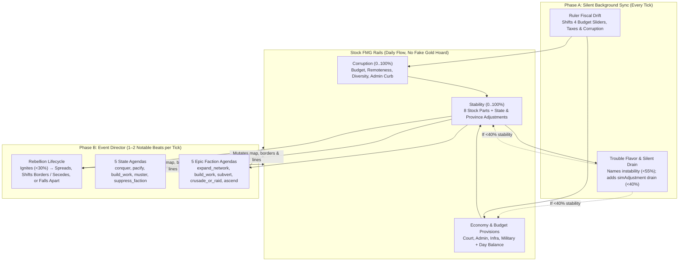

# Plan — Living World Simplification (Stability Rails, Flavor Troubles, Epic Factions & 1–2 Beat Ticks)

**Status:** Complete (Phases 1–5)  
**Companions:** [living-fmg-native.md](living-fmg-native.md), `src/model/political/stability.ts`, `src/model/economy/corruption.ts`, `src/ui/economy-view.ts`

---

## 1. Locked Decisions

1. **Stability Adjustments at Both State & Province Levels**: User-editable `stabilityAdjustments` and sim-owned `simStabilityAdjustments` live on **both** `StateFinance` and `Province` (editable in `src/controllers/political/stability-overview.ts` and `src/controllers/political/province-dialog.ts`, with provincial lines rolling up into the state's stability breakdown by population share).
2. **10 Epic Factions Confirmed**: `FACTIONS_CATALOG` is pruned from 57 to the 10 epic archetypes (§8.1), with map generation capped at $< 12$ active factions worldwide.
3. **Silent Trouble Escalation**: A trouble escalating from pure flavor to an economic/stability drain (`severity: "drain"`)—or clearing when stability recovers—happens **silently during background rail sync** when a province stays unstable (`< 40%`), never consuming one of the tick's 1–2 notable event notifications.

---

## 2. Thesis & Architecture Overview



---

## 3. Why States Stored Gold in a Treasury — and How We Simplify It

### 3.1 The Mismatch Today
- **In Stock FMG (`src/model/economy/taxes.ts`, `src/model/economy/state-orders.ts`)**:
  - The economy is a **daily flow**, not a multi-year bank account.
  - Every day, a state collects taxes (`salesTax + tariffs + pollTax + marketFees + adjustments`), officials pocket `corruption`, and the state immediately spends its **4 Budget Sliders** buying real goods on its markets:
    - **`military` slider** $\rightarrow$ buys weapons/armor/food $\rightarrow$ sets `Military.getUpkeep(stateId)` (`0..1`, driving army combat power and `parts.army` stability).
    - **`administration` slider** $\rightarrow$ buys utilities at provincial capitals $\rightarrow$ curbs `Corruption` (`Corruption.curb`).
    - **`infrastructure` slider** $\rightarrow$ buys construction goods at provincial capitals $\rightarrow$ raises provincial `Prosperity` (`StateOrders.getInfrastructure`).
    - **`court` slider** $\rightarrow$ buys luxuries at the capital $\rightarrow$ raises `Stability` (`parts.court`) and religious conversion pressure.
  - In stock FMG, `state.economy.treasury` is literally the **Day Balance** (`collected − pocketed − spent`—the unspent daily surplus or deficit).
- **What Living World bolted on (`bankSeasonalGold`)**:
  - Living World multiplied `Day Balance × 90` each season and overwrote `state.economy.treasury` into a cumulative gold pile (which then got wiped back to 1 day's balance every Spring when `Production.regenerate()` ran!).
  - It only existed so states had a lump-sum currency to buy Public Works (`60–180g`), muster blocks (`15g`), or pay for faction suppression (`10–18g`).

### 3.2 The Fix: Pure Stock Flow (No Overwriting `state.economy.treasury`)
We **delete `bankSeasonalGold`, `sSim.treasury`, and `bSim.treasury`**, leaving `state.economy.treasury` and `burg.treasury` as stock FMG's honest **Day Balance**:
- **How States pay for things without a gold hoard**:
  1. **Public Works (`build_work`)**: Instead of paying a lump sum from a banked stockpile, a state can build a public work when its **Day Balance is non-negative** (`state.economy.treasury >= 0`) and its **Infrastructure / Court provision** (`StateOrders.getProvision`) is funded. While a work is under construction (2–3 seasons), it writes a temporary `"Construction: <Work Name>"` cost line into `state.economy.simAdjustments` (e.g., `-5/day`) and draws the required construction goods (`stone`, `wood`, `tools`, etc.) from the target burg's market on completion.
  2. **Armies (`muster`)**: Gated by stock **Military Upkeep** (`Military.getUpkeep(stateId) >= 0.7`) and spare military goods (`Military.getEquipmentSpare`), rather than a flat `15g` purchase. If daily balance is deeply negative and upkeep falls below `0.4`, `settleDebt` demotes/disbands an unaffordable block.
  3. **Suppression & Pacification (`suppress_faction`, `pacify`)**: Driven by **Administration provision** (`StateOrders.getProvision(state, "administration")`) and stationed regiments, rather than deducting lump-sum gold.

---

## 4. What Agendas Drive States & Factions — and How They Manifest

### 4.1 Why Current Agendas Feel Disconnected
- **States** currently have two overlapping systems: `sSim.agenda` (12 kinds, including legacy OpenConquest `develop` and `build` that use deleted/obsolete M/W/S/C pools) **plus** a separate `sSim.project` slot for the 13 native public works.
- **Factions** have 11 `FactionAgendaKind` strings in `src/types/factions.ts`, **10 of which have zero runtime implementation**—factions just run automatic background loops instead.

### 4.2 Unified State Agendas (5 Clean Agendas — Merging `project` into `agenda`)
Each State holds **one active `StateAgenda`** at a time, chosen from the ruler's traits (`martial`, `civic`, `pious`, `cruel`) and the state's most urgent need:

| State Agenda | Trigger / Driver | How It Manifests on the Map & Stock Rails |
| :--- | :--- | :--- |
| **1. `conquer`** *(War, Reclaim, or Border Raid)* | `martial`/`ambitious` ruler, active territorial claim/grudge, or strong army vs. weak/unstable neighbor | **Map**: Draws a war vector arrow on `#livingOverlay`; regiments march and fight (`battle.ts`); winning a siege captures the burg/province and **shifts borders** (`cells.state`).<br/>**Rails**: War spikes the ruler's military budget target; prolonged war adds a `"War Exhaustion"` line to `simStabilityAdjustments`. |
| **2. `pacify`** *(Quell Rebellion)* | Active provincial **Rebellion** or critical instability (`Stability < 30%`) | **Map**: State regiments march to the restive province; floating badge on resolution.<br/>**Rails**: Ends the rebellion, removes its negative economy/stability lines, and writes a temporary `"Pacified (+10%)"` stability adjustment. |
| **3. `build_work`** *(Public Works — absorbs `sSim.project` & old `build`/`develop`)* | At peace, non-negative Day Balance, funded infrastructure/court; scored by ruler affinity and provincial need | **Map**: Builds one of the 13 works from `living-projects.ts` (*Aqueduct, Royal Road, Market Charter, Courthouse, Walls, Harbor Works, Temple, College, Land Improvement, etc.*) — draws new road routes, raises native burg icons (`walls`/`port`/`temple`/`plaza`), or charters a new market center.<br/>**Rails**: Writes a temporary `-cost/day` line while building; on completion, writes permanent `simAdjustments` (economy or stability), raises `cells.development`, or cuts `budget.corruption`. |
| **4. `muster`** *(Raise / Refit Army)* | Below target army strength with `Military.getUpkeep >= 0.7` | **Map**: Spawns or reinforces a regiment pin on the `#military` layer at the capital using the state's cultural roster.<br/>**Rails**: Consumes spare military goods (`Military.getEquipmentSpare`), increasing daily military demand. |
| **5. `suppress_faction`** *(Crackdown)* | Hostile or draining Epic Faction operating inside the state's borders | **Map**: Field army storms a wilderness HQ (`Dread Sovereign Host` / `Apocalyptic Cult`), or high Administration provision shuts down an urban syndicate outpost.<br/>**Rails**: Pillages the faction node and removes its negative `simAdjustments` drain from the host burg/province. |

### 4.3 Unified Epic Faction Agendas (5 Real Agendas)
Replace the 11 mostly-dead `FactionAgendaKind` values with **5 implemented agendas** tailored to the 10 Epic Factions:

| Faction Agenda | Archetypes That Use It | How It Manifests on the Map & Stock Rails |
| :--- | :--- | :--- |
| **1. `expand_network`** *(Found Outpost)* | *Merchant Consortium, Shadow Brotherhood, Adventurers' Conclave, Arcane Conclave, Apocalyptic Cult* | **Map**: Places a new outpost node and dashed connection arc on the `#factions` layer in a target burg (chosen by market turnover, low stability, or shared faith).<br/>**Rails**: Extends the faction's trade commission or graft reach into that burg. |
| **2. `build_work`** *(Commission Asset)* | All 10 (*Counting House, Seeker Archives, Safe House, Ritual Sanctum, War Citadel*) | **Map**: Upgrades the HQ or outpost tier and asset list on `#factions`.<br/>**Rails**: Writes a daily `Faction: <Name>` line into the host burg's `simAdjustments` (positive for commercial/scholarly/warden orders; negative for underworld/cults). |
| **3. `subvert`** *(Foment Unrest & Graft)* | *Apocalyptic Cult, Shadow Brotherhood, Claimant Confederacy* | **Map**: Targets an unstable or rival province; floating toast when executed.<br/>**Rails**: Writes `"Subversion: <Faction> (-15%)"` into the province's `simStabilityAdjustments` and bumps host `budget.corruption`, pushing the province toward **Rebellion** or border defection. |
| **4. `crusade_or_raid`** *(Strike / Pacify)* | *Dread Sovereign Host, Iron Free Company, Crusader Order, Frontier Wardens, Adventurers' Conclave* | **Map**: Raid/crusade vector arrow on `#livingOverlay`.<br/>**Rails**: *Hostile/Mercenary*: raids a vulnerable burg, plundering gold and razing a flag/asset. *Crusaders/Wardens/Adventurers*: clears a `"drain"` Trouble in a province or battles a `Dread Sovereign Host` / `Apocalyptic Cult`, restoring provincial stability and earning state favor. |
| **5. `ascend`** *(Seize Sovereignty / Coup)* | *Claimant Confederacy, Dread Sovereign Host, Iron Free Company, Apocalyptic Cult* | **Map**: When the host province is in unchecked **Rebellion** or critical instability (`< 25%`), the faction seizes the province/burg and **mints a new sovereign State on the map** (shifting borders, raising its coat of arms and military roster). |

---

## 5. Stock `Stability` & `Corruption` + Stability Adjustments

### 5.1 Retire Parallel Unrest & Order Stats
- **`ProvinceSimState`**: remove `order`, `stability` (the old dev-currency counter), `development`, `developmentProgress`, and `computeProvinceCapacity` (M/W/S/C domain pools).
- **`BurgSimState`**: remove `unrest`, `development`, `developmentProgress`, `treasury`.
- **`StatePolitySim`**: remove `unravel`, `treasury`, `project` (merged into `agenda`).
- All simulation checks read `Stability.getProvince(provinceId)?.stability` (`0..1`) and `Stability.get(stateId)?.stability` (`0..1`).

### 5.2 Add Adjustments to `Stability` (Both State and Province Levels)
In `src/model/political/stability.ts`, extend `STABILITY_PARTS`:
```ts
export const STABILITY_PARTS = [
  "base",
  "prosperity",
  "court",
  "army",
  "remoteness",
  "diversity",
  "corruption",
  "burden",
  "adjustments"
] as const;
```
- **Data storage**:
  - On `StateFinance` (`state.economy`): `stabilityAdjustments?: { name: string; value: number }[]` (user-owned) and `simStabilityAdjustments?: { name: string; value: number }[]` (sim-owned).
  - On `Province`: `stabilityAdjustments?: { name: string; value: number }[]` (user-owned) and `simStabilityAdjustments?: { name: string; value: number }[]` (sim-owned).
- **Calculation**:
  - In `Stability.getProvinces(stateId)`, each province sums the state-level stability adjustments plus its own province-level stability adjustments into `parts.adjustments`.
  - In `Stability.get(stateId)`, `parts.adjustments` is weighted by `province.share` across provinces just like `prosperity`, `remoteness`, `diversity`, and `corruption`, clamping total stability to `[0, 1]`.
- **UI**:
  - In `src/controllers/political/stability-overview.ts`: show the `Adjustments` bar in the parts breakdown and mount `mountAdjustments` + `renderSimAdjustments` for state-level stability adjustments (plus a roll-up of provincial sim adjustments).
  - In `src/controllers/political/province-dialog.ts`: replace the old `Checks: M/W/S/C` and `Order / Stab / Dev` inputs with stock `Stability`, `Corruption`, `Prosperity`, the `Trouble` flavor selector, and `mountAdjustments` + `renderSimAdjustments` for province-level stability adjustments.

---

## 6. Trouble / Hazards as Fictional Flavor & Remove `#trouble` Layer

### 6.1 Silent Flavor & Silent Drain
- `ProvinceTrouble` on `ProvinceSimState`:
  ```ts
  export interface ProvinceTrouble {
    id: string;
    name: string;
    severity?: "flavor" | "drain";
    seasonsLow?: number;
  }
  ```
- **Silent assignment & escalation during background sync** (never a notification):
  - When province stability drops below `0.55`, it gets a fitting `severity: "flavor"` trouble name matched to its worst stability part (`diversity` $\rightarrow$ *Cultural Feuding / Xenophobia*; `corruption`/`remoteness` $\rightarrow$ *Brigand Raiders / Rapacious Officials*; `burden`/low `prosperity` $\rightarrow$ *Pervasive Hunger / Tax Riots*; terrain/markers $\rightarrow$ *Seasonal Flooding / Ancient Curse*). Zero mechanical impact.
  - If stability stays below `0.40` for 2+ seasons, `severity` silently steps up to `"drain"`, writing a negative line into `state.economy.simAdjustments` (e.g., `"Trouble: Brigand Raiders in Nordmark": -3/day`) and/or `province.simStabilityAdjustments` (`-0.05`).
  - When stability recovers above `0.55`, the drain and auto-flavor silently clear.

### 6.2 Remove the `#trouble` Map Layer
- Delete `src/renderers/draw-trouble.ts` and `src/renderers/draw-trouble.test.ts`.
- Remove `"trouble"` from `src/renderers/layers.ts`, `src/data/layer-labels.ts`, `src/index.html` (`<g id="trouble"></g>`), `src/controllers/living-hud.ts`, and `src/ui/map/map-tooltip.ts`.

---

## 7. Instability → Rebellion Lifecycle & Border Shifting

### 7.1 Rebellion Lifecycle: Ignite → Spread / Shift Borders or Fall Apart
1. **Ignite**: A province with `stability < 0.30` (and no full-upkeep garrison) can be picked by the Event Director to ignite a **Rebellion** (`pSim.rebellion = { name, seasonsActive: 0 }`), writing `"Rebellion: <name>"` (`-0.15` to `province.simStabilityAdjustments` and `-5/day` to `state.economy.simAdjustments`).
2. **Checked**: If the state runs the `pacify` agenda, stations a regiment, or raises stability above `0.45`, the rebellion is crushed and replaced with a temporary `"Pacified (+10%)"` stability adjustment.
3. **Unchecked** (when picked on a later tick by the Event Director):
   - **Spreads**: If an adjacent province of the same state has `stability < 0.45` and no rebellion, the revolt spreads into that neighbor.
   - **Shifts Borders / Breaks Away** (if `seasonsActive >= 2` and `stability < 0.25`):
     - If bordering a stable neighbor (`stability > 0.60`) sharing its culture/faith or prior ownership, the province **defects and shifts borders** into that neighbor.
     - Otherwise, if it has a non-capital burg, it **secedes as a new independent State** (`foundSecessionState` + `raiseRebelRegiment`).
   - **Falls Apart**: If surrounding provinces are stable (`>= 0.50`) or the rebels lose momentum (`seasonsActive >= 2` with `stability >= 0.25`), the rebellion **collapses on its own**, clearing `pSim.rebellion`.

### 7.2 Border Drift from Corruption & Instability
- A border province with high corruption (`> 35%`) and low stability (`< 0.35`) adjacent to a high-stability neighbor (`> 0.70`) can trigger a **Border Shift** beat where frontier cells or a border burg flip to the healthier neighbor.

---

## 8. The 10 Epic Factions & the 1–2 Beat Tick Director

### 8.1 Curated Catalog of 10 Epic Archetypes
1. `merchant_consortium` — **Grand Merchant Consortium** (`commercial`, `chartered`)
2. `adventurer_guild` — **Adventurers' Conclave** (`adventuring`, `autonomous`)
3. `arcane_college` — **Arcane Conclave** (`adventuring`, `chartered`)
4. `ranger_wardens` — **Frontier Warden Order** (`adventuring`, `autonomous`)
5. `holy_order` — **Crusader Knightly Order** (`religious`, `chartered`)
6. `heretical_cult` — **Apocalyptic Cult** (`religious`, `clandestine`)
7. `shadow_syndicate` — **Shadow Brotherhood** (`underworld`, `clandestine`)
8. `noble_league` — **Claimant Confederacy** (`political`, `autonomous`)
9. `mercenary_company` — **Iron Free Company** (`martial`, `autonomous`)
10. `dread_host` — **Dread Sovereign Host** (`martial`, `hostile`)

`Factions.generate()` spawns at most 1 of each (typically 6–9 worldwide, hard cap of 10). Petty/lair factions from old saves migrate to `"drain"` troubles or map to the closest epic archetype.

### 8.2 The 1–2 Beat Tick (`Living.tick()`)
- **Phase A (Silent Background Sync)**: Advance season/year; run `Production.regenerate()` in Spring or when `economyDirty`; silently drift ruler fiscal sliders in Spring; silently update provincial trouble flavor labels (`< 55%` stability), `"drain"` escalations (`< 40%` stability), and active rebellion lines.
- **Phase B (`stepNotableEvents(living, 2)`)**: Score all ripe world beats across **Rebellions** (ignite / spread / secede / fall apart), **Border Shifts**, **State Agendas** (`conquer`, `pacify`, `build_work`, `muster`, `suppress_faction`), **Ruler Succession / Fiscal Turns**, and **Epic Faction Agendas** (`expand_network`, `build_work`, `subvert`, `crusade_or_raid`, `ascend`). Execute **only the top 1 or 2 notable events**, log 1–2 headlines, and display 1–2 map badges/vectors.

---

## 9. Phased Implementation Plan

| Phase | Scope | Key Files | Exit Criteria |
| :--- | :--- | :--- | :--- |
| **Phase 1: Stability Adjustments & Stock Flow Cleanup** | Add `"adjustments"` (`stabilityAdjustments` + `simStabilityAdjustments`) to `Stability`, `StabilityOverview`, and `ProvinceDetailsDialog`; delete `bankSeasonalGold` (keep `treasury` as stock Day Balance); remove `pSim.order`, `pSim.stability`, `bSim.unrest`, `sSim.unravel`, and M/W/S/C domain pools. | `src/model/political/stability.ts`, `src/controllers/political/stability-overview.ts`, `src/controllers/political/province-dialog.ts`, `src/types/living.ts` | ✅ Complete — Stability adjustments editable at State & Province levels; `treasury` is pure stock Day Balance; legacy unrest/order fields removed. |
| **Phase 2: Remove Trouble Layer & Silent Flavor/Drain Troubles** | Delete `draw-trouble.ts` and `"trouble"` layer; simplify `ProvinceTrouble` to silent flavor (`< 55%` stability) and silent `"drain"` step-up (`< 40%` stability). | `src/renderers/draw-trouble.ts` (deleted), `src/renderers/layers.ts`, `src/data/living-troubles.ts`, `src/model/physical/living-threats.ts`, `src/model/physical/living-generator.ts` | ✅ Complete — `#trouble` layer removed; troubles silently name instability and write drain lines without notifications. |
| **Phase 3: 10 Epic Factions & 5 Faction Agendas** | Prune `FACTIONS_CATALOG` to the 10 epic archetypes; cap `Factions.generate()` at $\le 10$; implement the 5 real Faction Agendas (`expand_network`, `build_work`, `subvert`, `crusade_or_raid`, `ascend`). | `src/data/factions-catalog.ts`, `src/model/political/factions-generator.ts`, `src/model/physical/living-generator.ts`, `src/types/factions.ts` | ✅ Complete — Map generates $\le 10$ unique epic archetypes; all 5 faction agendas implemented and verified. |
| **Phase 4: Rebellions, Border Shifts & 5 State Agendas** | Implement the rebellion lifecycle (ignite $\rightarrow$ spread, shift borders / secede, or fall apart), corruption/stability border drift, and unify the 5 State Agendas (`conquer`, `pacify`, `build_work`, `muster`, `suppress_faction`). | `src/model/physical/living-generator.ts`, `src/model/physical/living-threats.ts` | ✅ Complete — Provincial rebellions ignite, spread, shift borders/secede, or collapse; frontier corruption/instability drifts borders; all states run on the 5 unified agendas. |
| **Phase 5: The 1–2 Beat Tick Director & UI Polish** | Replace the 19-step tick loop with silent Phase A + `stepNotableEvents(living, 2)` Phase B; update Living HUD inspector and docs. | `src/model/physical/living-generator.ts`, `src/controllers/living-hud.ts`, `docs/wiki/Living-World.md` | ✅ Complete — Phase A silent sync + Phase B `stepNotableEvents(living, 2)` cap every tick at 1–2 notable events/headlines/badges; Living HUD & wiki updated. |

---

## 10. Phase 1 Completion Record (done)

**Shipped:** `src/model/political/stability.ts`, `src/model/political/states-generator.ts`, `src/model/political/provinces-generator.ts`, `src/controllers/political/stability-overview.ts`, `src/controllers/political/province-dialog.ts`, `src/ui/economy-view.ts`, `src/types/living.ts`, `src/model/physical/living-generator.ts`, `src/model/physical/living-threats.ts`, `src/model/political/factions-generator.ts`, `src/controllers/living-hud.ts`, `src/controllers/political/provinces-editor.ts`, `src/controllers/political/burgs/burg-editor.ts`, `src/controllers/political/state-cities-dialog.ts`, `src/model/units.ts`, `src/services/assistant/provider/context.generated.ts`, and updated test suites.

- **Stability adjustments**: `STABILITY_PARTS` gained `"adjustments"`. Both `StateFinance` and `Province` carry optional `stabilityAdjustments` (user-owned, percentage points) and `simStabilityAdjustments` (sim-owned). `Stability.getProvinces` sums state + provincial lines into `parts.adjustments`, weighted into `Stability.get` by population share. Both `StabilityOverview` and `ProvinceDetailsDialog` mount `mountAdjustments` and `renderSimAdjustments` (`Of which the Living World`) with percentage-point formatting.
- **Stock Day Balance**: Deleted `bankSeasonalGold`, `upstreamSeasonalNet`, `sSim.treasury`, and `bSim.treasury`; `state.economy.treasury` and `burg.treasury` stay pure stock Day Balances across ticks.
- **Legacy unrest/order/domain cleanup**: Removed `pSim.order`, `pSim.stability`, `pSim.development`, `pSim.developmentProgress`, `bSim.unrest`, `bSim.development`, `bSim.developmentProgress`, `sSim.unravel`, `stepBurgUnrest`, and `computeProvinceCapacity` (M/W/S/C domain checks), and added legacy pruning in `Living.pruneLegacyFields`. Replaced simulation reads (`retireFallenEmpires`, `fiscalEvents`, `stepRebellions`, `stepProvinces`, faction defection/suppression/ascension) with stock `Stability` via `effectiveStateStability`.
- **Verification**: `npm run build` (`tsc` + Vite + PWA precache) and `npm run lint` (Biome, 856 files) passed; `living-generator.test.ts` (162/162), `province-dialog.test.ts`, `burg-editor.test.ts`, `context.test.ts`, and `stability.test.ts` passed; full `npm run test -- --run` ran 269/272 files passing on the run and the remaining 3 files (`discovery.test.ts`, `language.test.ts`, `model-edits.test.ts`) passed 84/84 in isolation after concurrent build load cleared.

---

## 11. Phase 2 Completion Record (done)

**Shipped:** Deleted `src/renderers/draw-trouble.ts` and `src/renderers/draw-trouble.test.ts`; updated `src/renderers/layers.ts`, `src/data/layer-labels.ts`, `src/ui/map/map-tooltip.ts`, `src/ui/map/viewbox-events.ts`, `src/types/living.ts`, `src/data/living-troubles.ts`, `src/data/hero-aspects.ts`, `src/model/physical/living-heroes.ts`, `src/model/physical/living-threats.ts`, `src/model/physical/living-generator.ts`, `src/controllers/political/province-dialog.ts`, `src/controllers/political/provinces-editor.ts`, `src/controllers/living-hud.ts`, and updated test suites (`living-troubles.test.ts`, `living-threats.test.ts`, `living-generator.test.ts`, `living-hud.test.ts`, `province-dialog.test.ts`, `map-tooltip.test.ts`).

- **Layer removal**: Deleted `draw-trouble.ts` and removed the `"trouble"` `Layer` registration, layer toggle label, Living HUD redraw target, and DOM tooltip/pin handlers.
- **Simplified `ProvinceTrouble`**: Replaced `theme`, `pool`, `save`, `requiredRole`, `level`, `seasonsUnchecked` with `severity?: "flavor" | "drain"` and `seasonsLow?: number`. Grouped the 28 trouble archetypes in `TROUBLE_CATALOG` by `cause` (`"diversity" | "corruption" | "poverty" | "site"`), removed legacy `UNIT_ROLE_POOLS`, `UNIT_ROLE_LABELS`, `SAVE_KIND_LABELS`, `troubleUnitMatchMultiplier`, and pruned legacy trouble fields in `Living.pruneLegacyFields` and `migrateLegacyThreats`.
- **Silent flavor & drain sync**: `stepProvinces` (with `effectiveProvinceStability`) silently assigns a cause-matched `"flavor"` trouble when provincial stability `< 0.55`, escalates to `"drain"` when `< 0.40` for 2+ seasons (`syncTroubleLines` writes `-3/day` to `state.economy.simAdjustments` and `-5` to `province.simStabilityAdjustments`), steps back to `"flavor"` at `>= 0.48`, and clears silently at `>= 0.55` without `pushNews` notifications or hazard-to-faction metastasis.
- **UI**: `ProvinceDetailsDialog` exposes `#provDialogTroubleFlavor` (`None` + 28 flavor options) with `Flavor`/`Drain` badges; `ProvincesEditor` and `LivingHud` show flavor/drain status cleanly without legacy levels or saves.
- **Verification**: `npm run generate:assistant-context`, `npx tsc --noEmit`, `npm run lint` (Biome, 854 files), `npm run build` (`tsc` + Vite + PWA precache, 378 precache entries), and all 11 targeted Vitest suites (`261/261` tests across `living-troubles.test.ts`, `factions-catalog.test.ts`, `layer-labels.test.ts`, `layers.test.ts`, `map-tooltip.test.ts`, `living-hud.test.ts`, `province-dialog.test.ts`, `stability.test.ts`, `living-threats.test.ts`, `living-generator.test.ts`, and `context.test.ts`) passed after the final edit.

---

## 12. Phase 3 Completion Record (done)

**Shipped:** `src/data/factions-catalog.ts`, `src/data/factions-catalog.test.ts`, `src/types/factions.ts`, `src/model/political/factions-generator.ts`, `src/model/political/factions-generator.test.ts`, `src/model/physical/living-threats.ts`, `src/model/physical/living-threats.test.ts`, `src/model/physical/living-generator.ts`, `src/model/physical/living-generator.test.ts`.

- **10 Epic Archetypes**: Pruned `FACTIONS_CATALOG` strictly to the 10 curated archetypes (`merchant_consortium`, `adventurer_guild`, `arcane_college`, `ranger_wardens`, `holy_order`, `heretical_cult`, `shadow_syndicate`, `noble_league`, `mercenary_company`, `dread_host`) with `LEGACY_FACTION_ALIASES` and `resolveFactionArchetypeType` preserving backwards compatibility for all 20 legacy lair templates and 18 retired organizational troubles.
- **Hard Cap ($\le 10$) & Save Migration**: Rewrote `Factions.generate()` to spawn at most 1 of each epic archetype (hard cap `<= 10`). Capped `syncDangerMarkers` at 10 active factions / unique archetypes, and updated `migrateLegacyThreats` to canonicalize legacy `faction.type` entries onto the 10 epic archetypes while converting excess duplicate petty marker factions into `"drain"` troubles.
- **5 Unified Faction Agendas**: Replaced the 11 unused `FactionAgendaKind` variants with `expand_network`, `build_work`, `subvert`, `crusade_or_raid`, and `ascend`. Implemented end-to-end agenda selection, execution, `Subversion:` provincial stability penalties (with stale-line cleanup), outpost establishment/upgrades, hostile strike/trouble relief, raid triggers, and sovereign ascension in `Living.stepFactionAgendas`.
- **Verification**: `npx tsc --noEmit`, `npm run lint` (Biome, 854 files), `npm run build` (`tsc` + Vite + PWA precache, 378 precache entries), and all 9 targeted Vitest suites (`211/211` tests across `factions-catalog.test.ts`, `living-troubles.test.ts`, `living-lairs.test.ts`, `danger-markers.test.ts`, `factions-generator.test.ts`, `factions-editor.test.ts`, `living-threats.test.ts`, `living-generator.test.ts`, and `context.test.ts`) passed after the final code edit.

---

## 13. Phase 4 Completion Record (done)

**Shipped:** `src/types/living.ts`, `src/renderers/draw-living-overlay.ts`, `src/model/physical/living-threats.ts`, `src/model/physical/living-generator.ts`, `src/model/physical/living-generator.test.ts`, `src/services/assistant/provider/context.generated.ts`.

- **Provincial Rebellions (`stepRebellions`)**: Added `ProvinceRebellion` (`name`, `seasonsActive`) and `pacifiedUntilTick` to `ProvinceSimState`. Provinces below `30%` effective stability without a full-upkeep garrison (and outside a pacification grace window) ignite a named rebellion (`-15` to `province.simStabilityAdjustments` and `-5/day` to `state.economy.simAdjustments` via `syncTroubleLines`). Each season checked rebellions (targeted by `"pacify"`, occupied by a full-upkeep garrison, or `>= 45%` stability) are crushed and grant a temporary `+10` `"Pacified"` stabilization bonus; unchecked rebellions spread to adjacent `< 45%` same-state provinces (guarding against same-tick chain aging via `justSpread`), defect (`defectProvinceToState`) to stable (`> 60%`) kin/former-owner neighbors or secede (`breakAway`) at `seasonsActive >= 2` below `25%` stability, or collapse on their own at `seasonsActive >= 2` when `>= 25%` stability or surrounded by calm provinces (`>= 50%`).
- **Corruption & Instability Border Drift (`stepBorderDrift`)**: Added `effectiveProvinceCorruption` using `Corruption.ofProvince`. Non-rebellious provinces below `35%` stability with corruption `> 35` drift exposed frontier cells (and non-capital burgs on them) to adjacent high-stability (`> 70%`) neighbors while recording historical claims.
- **5 Unified State Agendas**: Simplified `AgendaKind` to `"conquer" | "pacify" | "build_work" | "muster" | "suppress_faction"`, added legacy save remapping in `pruneLegacyFields`, unified `chooseAgenda`, `stepAgenda`, `warAgenda`, and `stepArmyOrders` onto the 5 agendas, and removed dead helpers (`hasDevelopment`, `pickDevelopProvince`, `pickRaidTarget`).
- **Verification**: `npm run generate:assistant-context`, `npm run lint` (Biome, 854 files, 0 fixes/warnings), `npx tsc --noEmit`, `npm run build` (`tsc` + Vite + PWA precache, 378 precache entries), and all 4 targeted Living World Vitest suites (`198/198` tests across `living-generator.test.ts` (170), `living-threats.test.ts` (8), `draw-living-overlay.test.ts` (8), and `living-hud.test.ts` (12)) passed after the final code edit.

---

## 14. Phase 5 Completion Record (done)

**Shipped:** `src/model/physical/living-generator.ts`, `src/renderers/draw-living-overlay.ts`, `src/controllers/living-hud.ts`, `docs/wiki/Living-World.md`, `src/model/physical/living-generator.test.ts`, `src/renderers/draw-living-overlay.test.ts`, `src/controllers/living-hud.test.ts`.

- **The 1–2 Beat Tick Director**: Split `Living.tick()` into **Phase A (`stepBackgroundSync`)** — silent calendar progression, Spring ruler backfills & fiscal slider drift, grudge decay, Legends snapshots, faction empire upkeep, development diffusion, silent trouble flavor/drain tracking, `syncTroubleLines` recovery cleanup, upstream `stepEconomy`, diplomacy timers, tactical positioning/battles, mobile burg movement, and passive build/project countdowns (`stepPassiveTimers`) — and **Phase B (`stepNotableEvents(living, 2)`)**, which scores all ripe world beats across rebellions, border drift, Spring succession, diplomacy resolutions, epic faction agendas/raids, state agendas/projects, and Spring religious/fiscal turns, executes at most **2 notable beats**, and caps headlines pushed per tick (`clampTickNews`) to **2**. Silenced routine faction Watchmen HQ musters in `factionAutoMuster`.
- **Overlay & Living HUD Polish**: Capped `#livingOverlay` notable news badges (`MAX_NEWS_BADGES = 2`) in `collectLivingBadges`. Added active rebellion indicators (`🔥` markers, `Rebellions` zoom list in `Claims & Crises`, and active `Rebellion:` status banners in the Province and Burg inspectors) in `LivingHud`.
- **Wiki Documentation**: Updated `docs/wiki/Living-World.md` to reflect pure stock Day Balance treasuries, State & Province stability adjustments, removed `#trouble` layer, silent flavor/drain troubles, the 10 Epic Factions, unified 5 State + 5 Faction agendas, rebellion/border drift lifecycles, and the 1–2 beat tick director.
- **Verification**: `npm run generate:assistant-context`, `npm run lint` (Biome, 854 files, 0 warnings/fixes), `npx tsc --noEmit`, `npm run build` (`tsc` + Vite + PWA precache, 378 precache entries), and the 4 targeted Living World suites (`201/201` tests across `living-generator.test.ts` (171), `living-threats.test.ts` (8), `draw-living-overlay.test.ts` (9), and `living-hud.test.ts` (13)) passed after the final code edit. Full `npm run test -- --run` ran `270/271` test files (`3725/3726` tests) passing (the sole failure was an unrelated pre-existing 0.005 rounding tolerance in `living-faction-economy.test.ts:190`).
