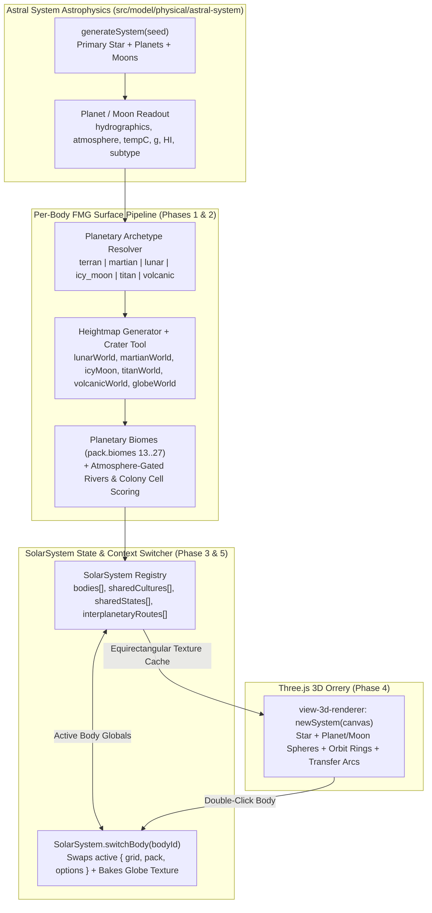

# Plan — Colonized Solar System: Planetary Templates, Biomes, Multi-Body State & 3D Orrery

Updated: 2026-11-01. Inputs:
[globe-world.md](globe-world.md),
[astral-system-details.md](astral-system-details.md),
[3d-view.md](../domain/3d-view.md),
[data-model.md](../architecture/data-model.md),
[`src/model/physical/astral-system/`](../../src/model/physical/astral-system/).

---

## 1. Goal & Architectural Philosophy

Extend Fantasy Map Generator's **Globe World** workflow (`lonT === 360` spherical maps) and the existing **Astral System** astrophysics generator (`src/model/physical/astral-system/`) into a **Near-Future Colonized Solar System** mode where:

1. **Planetary & Moon Surface Generation**: FMG can generate distinct celestial body archetypes—Cratered Airless Moons (Luna/Mercury/Callisto), Tectonic Rust Deserts (Mars), Fractured Ice-Shell Moons (Europa/Enceladus), Hydrocarbon Worlds (Titan), Volcanic Worlds (Io/Venus), and Earthlike/Terraformed Globes—complete with a dedicated **`Crater`** heightmap primitive and planetary biome palettes.
2. **100% Pure `.map` Compatibility via `SolarSystem.switchBody(bodyId)`**: At any given moment, the ambient globals (`grid`, `pack`, `options`, `styles`) hold a single active celestial body's surface map. Switching bodies swaps those globals cleanly in memory. Saving a `.map` file on any planet or moon writes a standard, valid FMG `.map` file (using native `pack.biomes` custom slots `13+`, standard `pack.cells`, `pack.burgs`, and `pack.states`) that vanilla FMG can load without custom parsers.
3. **3D Solar System Orrery (`System` View Mode)**: Alongside `Standard`, `3D scene`, and `Globe`, a new `System` view in [`view-3d-renderer.ts`](../../src/renderers/view-3d-renderer.ts) renders the star, orbiting planets, nested moons, orbital rings, and interplanetary transfer arcs in Three.js, wrapping each colonized body with its baked equirectangular globe texture and allowing click-to-focus and double-click to enter any world's surface.
4. **Cross-World Cultures, States & Colonization**: Homeworld superpowers, colonial charter corporations, and independent off-world republics share canonical Culture and State IDs across `SolarSystem.bodies`, allowing states and cultures to span multiple planets and moons, establish spaceport burgs, and trade across interplanetary routes.



---

## 2. Non-Negotiables & Invariants

- **Pure `.map` Compatibility**: Every individual body's `{ grid, pack, options, styles }` must remain 100% compliant with [`save.ts`](../../src/services/io/save.ts) and [`load.ts`](../../src/services/io/load.ts). No custom biome IDs below `13` may delete the built-in `0..12` slots; planetary biomes append at indices `13..27` so [`biomes-generator.ts`](../../src/model/physical/biomes-generator.ts) and [`draw-satellite-texture.ts`](../../src/renderers/draw-satellite-texture.ts) work out of the box.
- **Zero-Mutation 3D Views**: Just like `Mesh` and `Globe` modes, the `System` 3D view is presentation-only and never mutates `grid` or `pack` data.
- **Lazy Surface Materialization**: A generated solar system may have 6–10 planets and 15+ moons. Do not run `GenerationPipeline` for all 25 bodies at boot. Only materialize a body's full `grid`/`pack` when:
  1. It is the starting Homeworld,
  2. The user switches to it via `SolarSystem.switchBody(bodyId)`, or
  3. The user triggers **"Colonize System"** (which materializes candidate habitable/colonizable bodies with a progress indicator).
  Unmaterialized bodies in the 3D System view render lightweight procedural shader/canvas textures derived from their `astral-system` color and archetype.
- **No New Production Dependencies**: Built entirely on the existing `three`, `alea`, and `d3` stack.

---

## 3. Phase 1 — `Crater` Heightmap Primitive & Planetary Globe Templates

### 3.1. The `Crater` Tool (`src/model/physical/heightmap-generator.ts`)

In [`heightmap-generator.ts`](../../src/model/physical/heightmap-generator.ts), `Hill` and `Pit` each select a random `(x, y)` cell and BFS-propagate height changes outward using `this.blobPower`. A real impact crater requires a raised outer ejecta rim and a steeper excavated inner bowl **centered on the exact same cell**, plus a central rebound peak for large complex basins.

1. **Extend `Tool` union (line 11)**:
   ```ts
   type Tool =
     | "Hill"
     | "Pit"
     | "Crater"
     | "Range"
     | "Trough"
     | "Strait"
     | "Mask"
     | "Invert"
     | "Add"
     | "Multiply"
     | "Power"
     | "Smooth";
   ```

2. **Add `addCrater(count: string, depth: string, rangeX: string, rangeY: string): void`**:
   - Syntax matches `Hill` and `Pit`: `Crater <count> <depth> <rangeX> <rangeY>`.
   - For each crater in `desiredCraterCount = getNumberInRange(count)`:
     1. Pick `(x, y)` within `(rangeX, rangeY)` and resolve `start = Lattice.findSlot(x, y, grid)`.
     2. Draw `d = lim(getNumberInRange(depth))`.
     3. **Outer Ejecta Rim (`Hill` pass at `start`)**:
        - Propagate an elevation boost from `start` with initial height `rimH = lim(d * 0.55)` and decay exponent `this.blobPower`.
     4. **Excavated Bowl (`Pit` pass at `start`)**:
        - Propagate an elevation depression from the **same `start`** with initial depth `bowlD = d` and a slightly steeper decay exponent `bowlPower = this.blobPower * 0.985`.
        - Because `bowlD > rimH` at the center (`d - 0.55d = 0.45d` net depression) and `bowlPower < blobPower` at the periphery, the center excavates into a concave bowl while the outer ring remains elevated as a circular crater rim.
     5. **Complex Crater Central Peak (when `d >= 40`)**:
        - Propagate a tight rebound hill at `start` with height `peakH = lim(d * 0.25)` and fast decay `this.blobPower * 0.92`.

3. **Wire into `addStep` (`src/model/physical/heightmap-generator.ts`)**:
   ```ts
   if (tool === "Crater") {
     this.addCrater(a2, a3, a4, a5);
     return;
   }
   ```

4. **Wire into Template Editor UI (`src/controllers/physical/heightmap-editor.ts`)**:
   - Add `Crater: t("Crater")` to `STEP_LABELS` (line 1267).
   - Add `"Crater"` to the 5-argument step branch in `getStepHTML` (line 1310):
     `if (type === "Hill" || type === "Pit" || type === "Crater" || type === "Range" || type === "Trough")`.
   - Add `else if (type === "Crater") HeightmapGenerator.addCrater(count, height, x, y);` in `executeTemplate()` (line 1484).
   - Add a `Crater` button to `#templateTools` in `src/index.html` (or the template editor dialog template).

### 3.2. Antimeridian Seam Blending for Dry Globes

- On wet globes (`globeWorld`), `Mask 2` forces the left (`x = 0`) and right (`x = width`) map edges below `SEA_LEVEL = 20` so the antimeridian is open ocean.
- On dry globes (`lunarWorld`, dry `martianWorld`) where $h \ge 20$ everywhere, `Mask 2` would create an artificial vertical canal of water at the seam.
- **Solution (`smoothSeam` in `HeightmapModule`)**:
  - When `options.map.geography.coordinates?.lonT === 360` and the template does not end with a positive `Mask` that submerges the border (or when invoked after template execution on a 360° map where edge cells have $h \ge 20$), blend the leftmost and rightmost 3 columns row-by-row:
    - For each row $y \in [0, \text{cellsY})$ and offset $k \in \{0, 1, 2\}$, interpolate `heights[row + k]` and `heights[row + cellsX - 1 - k]` toward their seam mean so the elevation profile is $C^0$ continuous across $180^\circ$ longitude without dropping below 20.

### 3.3. Planetary Heightmap Templates (`src/data/heightmap-templates.ts`)

Append 5 new planetary globe templates (preserving existing IDs `0..14`):

| ID | Key | Name | Template Script |
| :---: | :--- | :--- | :--- |
| **15** | `lunarWorld` | `Lunar World` | `Add 32 all 0 0`<br/>`Hill 4-6 20-35 15-85 15-85`<br/>`Crater 2-3 50-65 20-80 20-80`<br/>`Smooth 2 0 0 0`<br/>`Crater 8-12 30-45 15-85 15-85`<br/>`Smooth 3 0 0 0`<br/>`Crater 18-25 15-28 10-90 10-90`<br/>`Add 12 0-19 0 0` *(keeps mare floors dry at $h \ge 20$)* |
| **16** | `martianWorld` | `Martian World` | `Add 22 all 0 0`<br/>`Hill 6-8 35-55 15-85 45-90` *(southern highlands)*<br/>`Crater 10-15 25-45 15-85 45-90`<br/>`Pit 3-5 20-30 15-85 10-40` *(northern basin)*<br/>`Smooth 2 0 0 0`<br/>`Hill 2-3 80-95 25-75 35-65` *(Tharsis shield volcanoes)*<br/>`Trough 2-3 45-65 25-75 40-60` *(Valles Marineris rift)*<br/>`Crater 8-12 15-25 15-85 15-85`<br/>`Mask 2 0 0 0` |
| **17** | `icyMoon` | `Icy Moon` | `Add 38 all 0 0`<br/>`Hill 5-8 15-25 15-85 15-85`<br/>`Smooth 1 0 0 0`<br/>`Trough 10-15 30-45 10-90 10-90` *(tidal lineae rifts)*<br/>`Strait 1-2 vertical 0 0`<br/>`Crater 4-6 20-35 20-80 20-80`<br/>`Smooth 3 0 0 0` |
| **18** | `titanWorld` | `Hydrocarbon World` | `Hill 1 55-65 22-38 20-80`<br/>`Hill 1 55-65 62-78 20-80`<br/>`Hill 5-7 20-30 20-80 15-85`<br/>`Range 5-7 25-40 20-80 40-60` *(equatorial dune chains)*<br/>`Crater 5-8 35-50 20-80 10-30` *(polar methane lakes)*<br/>`Crater 5-8 35-50 20-80 70-90`<br/>`Smooth 2 0 0 0`<br/>`Mask 2 0 0 0`<br/>`Smooth 3 0 0 0` |
| **19** | `volcanicWorld` | `Volcanic World` | `Hill 4-6 60-80 20-80 20-80`<br/>`Range 6-9 55-80 15-85 15-85`<br/>`Crater 8-12 45-65 20-80 20-80` *(calderas)*<br/>`Trough 5-8 40-60 15-85 15-85` *(lava channels)*<br/>`Smooth 2 0 0 0`<br/>`Mask 2 0 0 0` |

> **Probability weights**: Set `probability: 0` on templates `15..19` for standard random fantasy map rolls so default fantasy generation is unchanged unless explicitly selected or rolled by the Solar System / Planetary generator.

### 3.4. Phase 1 Acceptance Criteria
- Unit tests in [`src/model/physical/heightmap-generator.test.ts`](../../src/model/physical/heightmap-generator.test.ts):
  - `Crater 1 50 50-50 50-50` on a flat `h = 40` grid lowers the center cell below `40` while raising a ring of cells around it above `40`.
  - Templates `lunarWorld`, `martianWorld`, `icyMoon`, `titanWorld`, and `volcanicWorld` execute deterministically at a fixed seed without throwing.

---

## 4. Phase 2 — Planetary Archetypes, Climate Sync & Pure-FMG Biomes

### 4.1. Planetary Archetype Schema (`src/types/planetary.ts` & `options.map`)

Define six surface archetypes that bridge `astral-system` astrophysical properties and FMG's physical generators:

```ts
export type PlanetaryArchetype =
  | "terran"        // Earthlike or fully terraformed world (default FMG behavior)
  | "lunar"         // Airless cratered regolith + basalt maria (Luna, Mercury, Callisto)
  | "martian"       // Cold ferric desert, shield volcanoes, canyons, optional lowland ocean/ice
  | "icy_moon"      // Frozen ice shell with thermal lineae rifts (Europa, Enceladus, Ganymede)
  | "titan"         // Cryogenic nitrogen/methane world with hydrocarbon seas & dunes
  | "volcanic";     // High-heat or tidal-flexing caldera/lava world (Io, Venusian)
```

Add an optional `archetype?: PlanetaryArchetype` and `hydrographics?: number` to `options.map.geography` (defaulting to `"terran"` when absent so existing `.map` files and standard maps behave identically).

### 4.2. Resolving Archetype & Climate from `astral-system` (`src/model/physical/planetary-profile.ts`)

Given a `Planet` or `Moon` from [`src/model/physical/astral-system/planet.ts`](../../src/model/physical/astral-system/planet.ts):

1. **`resolveArchetype(body: Planet | Moon): PlanetaryArchetype`**:
   - If `body.HI === 1` or (`body.hydrographics >= 25` && `["Breathable", "Filterable"].includes(body.atmosphere)`): return `"terran"`.
   - If `["inferno", "extremely hot", "very hot"].includes(body.temp)` or `body.atmosphere === "Corrosive"`: return `"volcanic"`.
   - If `["frigid", "extremely cold"].includes(body.temp)` && `body.hydrographics > 0` && `["Toxic", "Inert", "Crushing"].includes(body.atmosphere)`: return `"titan"`.
   - If `["frigid", "extremely cold"].includes(body.temp)`: return `"icy_moon"`.
   - If `body.hydrographics === 0` && `body.atmosphere === "Trace"`: return `"lunar"`.
   - Otherwise: return `"martian"`.

2. **`applyPlanetaryOptions(body: Planet | Moon)`**:
   - Sets `options.map.geography.coordinates` to full globe (`latT = 180`, `latN = 90`, `lonT = 360`).
   - Derives equator and polar temperatures from `Number(body.tempC)` (clamped to `Int8Array` range `[-120, 120]`):
     - Thick atmosphere (`Crushing`, `Toxic`, `Corrosive`): narrow pole-to-equator delta (`equator = tempC + 8`, `poles = tempC - 12`).
     - Standard/Filterable/Inert atmosphere: moderate delta (`equator = tempC + 18`, `poles = tempC - 28`).
     - `Trace` atmosphere: wide delta (`equator = tempC + 30`, `poles = tempC - 50`).
   - Scales `options.map.climate.precipitation` from `body.hydrographics` (`0` when `hydrographics === 0` and `atmosphere === "Trace"`).

### 4.3. Planetary Biomes (`src/data/planetary-biomes.ts` & `src/model/physical/biomes-generator.ts`)

To preserve 100% compatibility with pure FMG `.map` files:
- `Biomes.getDefault()` continues to return the 13 built-in terrestrial biomes (`0..12`).
- When `options.map.geography.archetype` is not `"terran"`, `Biomes.generate()` appends the planetary biome definitions at indices `13..27` in `pack.biomes`:

| Biome ID | Archetype | Name | Color | Habitability | Cost | Relief Icons | Classification Rule (`Biomes.define`) |
| :---: | :--- | :--- | :---: | :---: | :---: | :--- | :--- |
| **13** | `lunar` | Basalt Mare | `#3d3c42` | `18` | `40` | `{}` | $20 \le h < 34$, flat low basins |
| **14** | `lunar` | Anorthosite Highlands | `#8c8b90` | `5` | `90` | `{ dune: 1 }` | $34 \le h < 62$ |
| **15** | `lunar` | Crater Ejecta Ridge | `#b5b4bc` | `2` | `200` | `{}` | $h \ge 62$ |
| **16** | `lunar` | Shadowed Polar Ice Crater | `#99c5d6` | `85` | `60` | `{}` | $\|\text{lat}\| > 70^\circ$ & local depression ($h < 38$) |
| **17** | `martian` | Ferric Regolith Plains | `#c16641` | `16` | `50` | `{ dune: 2 }` | $20 \le h < 45$, moisture $< 12$ |
| **18** | `martian` | Oxide Dune Sea | `#a34828` | `6` | `120` | `{ dune: 8 }` | $45 \le h < 68$, dry |
| **19** | `martian` | Tharsis Basalt Shield | `#6e3524` | `3` | `250` | `{}` | $h \ge 68$ |
| **20** | `martian` | Polar CO₂ / Water Ice Cap | `#e8ded5` | `45` | `150` | `{}` | $T < -55^\circ\text{C}$ or $\|\text{lat}\| > 72^\circ$ |
| **21** | `icy_moon` | Smooth Ice Shell | `#d8e8f0` | `6` | `70` | `{}` | $32 \le h < 55$ |
| **22** | `icy_moon` | Chaos Ice Matrix | `#9bb8c9` | `14` | `140` | `{}` | $h \ge 55$ |
| **23** | `icy_moon` | Thermal Lineae Rift | `#4f86a6` | `80` | `40` | `{}` | $20 \le h < 32$ (warm subsurface upwelling) |
| **24** | `titan` | Hydrocarbon Dune Band | `#7a5c38` | `8` | `100` | `{ dune: 6 }` | $20 \le h < 45$ & $\|\text{lat}\| < 35^\circ$ |
| **25** | `titan` | Cryo-Bedrock Plains | `#9e9589` | `22` | `60` | `{}` | All other land cells on `titan` |
| **26** | `volcanic` | Basalt Flood Plain | `#2b2626` | `12` | `80` | `{}` | $20 \le h < 55$ |
| **27** | `volcanic` | Sulfur Fumarole / Caldera | `#d4b838` | `4` | `200` | `{}` | $h \ge 55$ or adjacent to lava lake/sea |

- **Hybrid / Terraformed Worlds**: On a `martian` world where `hydrographics > 0` and moisture is high near an ocean or lake (`moisture >= 12` and $T > -15^\circ\text{C}$), `Biomes.define()` falls through to the standard terrestrial `biomesMatrix` (`Tundra`, `Taiga`, `Grassland`, `Cold desert`), automatically creating green/lichen-tinted terraformed coastal basins surrounded by red Ferric Regolith highlands!

### 4.4. Atmosphere-Gated Rivers & Lake Subtypes

1. **Rivers (`src/model/physical/river-generator.ts`)**:
   - In `Rivers.generate()`, if `options.map.geography.archetype` is `"lunar"`, `"icy_moon"`, or `"volcanic"` (or `options.map.climate.precipitation === 0`), set `pack.rivers = []` and skip river path generation.
2. **Lake & Sea Subtypes (`src/model/physical/features-generator.ts`)**:
   - On `volcanic` worlds, default enclosed lakes to `subtype = "lava"`.
   - On `icy_moon` worlds, default enclosed lakes to `subtype = "frozen"`.
3. **Colony Suitability (`src/model/society/population-generator.ts`)**:
   - Because [`Population.rankCells()`](../../src/model/society/population-generator.ts) already weights `biomes[cells.biome[i]].habitability` and `cells.good`, high-habitability exo-biomes (`16: Shadowed Polar Ice Crater`, `23: Thermal Lineae Rift`, `13: Basalt Mare`, `17: Ferric Regolith Plains`) naturally attract Spaceport Burgs and Colonial States without custom scoring hacks.

### 4.5. Phase 2 Acceptance Criteria
- Unit tests in `src/model/physical/biomes-generator.test.ts`:
  - Generating biomes with `archetype = "lunar"`, `"martian"`, `"icy_moon"`, `"titan"`, and `"volcanic"` keeps `pack.biomes[0..12]` intact and populates `pack.cells.biome` with the expected planetary biome IDs.
  - Saving and reloading a Martian or Lunar map preserves `pack.biomes` and `pack.cells.biome` identically.

---

## 5. Phase 3 — `SolarSystem` State Container & `switchBody(bodyId)`

### 5.1. Data Model (`src/model/system/solar-system.ts`)

Create the multi-body orchestrator that wraps [`generateSystem`](../../src/model/physical/astral-system/system.ts) and manages body snapshots:

```ts
export interface WorldSnapshot {
  grid: GridGraph;
  pack: PackedGraph;
  options: MapData;
  styles: StylesData;
  seed: string;
}

export interface CelestialBody {
  id: string;                        // e.g. "planet-2", "planet-2-moon-0", "planet-4-moon-1"
  name: string;                      // e.g. "Sol III (Terra)", "Luna", "Mars", "Europa"
  kind: "planet" | "moon";
  parentId: string | null;           // null for planets; planet bodyId for moons
  archetype: PlanetaryArchetype | "gas_giant";
  astro: Planet | Moon;              // full astrophysics record from astral-system
  orbit: {
    semiMajorAxisAU: number;         // AU for planets; planetary radii / scaled units for moons
    eccentricity: number;
    angleRad: number;
    periodDays: number;
  };
  colonizable: boolean;              // true for rocky planets & major moons; false for gas giants
  materialized: boolean;             // true once GenerationPipeline has built snapshot
  snapshot?: WorldSnapshot;          // full FMG state for this body
  textureUrl?: string;               // cached equirectangular dataURL/blobURL for 3D Orrery
}
```

### 5.2. Context Switching (`SolarSystem.switchBody(bodyId)`)

```ts
async switchBody(bodyId: string): Promise<void>
```

1. **Save Current Body**:
   - Store the current ambient `{ grid, pack, options: structuredClone(options), styles: structuredClone(styles), seed: options.map.seed }` onto `currentBody.snapshot`.
   - If the current body's `textureUrl` is dirty or missing, asynchronously refresh its equirectangular thumbnail canvas.
2. **Materialize Target Body (if `materialized === false`)**:
   - Configure `options.map.seed = body.astro.seed`, set `2:1` aspect ratio (`latT = 180, lonT = 360`), call `applyPlanetaryOptions(body.astro)`, select the body's heightmap template (`lunarWorld`, `martianWorld`, `icyMoon`, etc.), and run `GenerationPipeline.run()`.
   - Sync shared `system.cultures` and `system.states` into `pack.cultures` and `pack.states` (Phase 5).
   - Mark `body.materialized = true`.
3. **Restore Target Body**:
   - Reassign the ambient `grid`, `pack`, `options`, and `styles` globals from `targetBody.snapshot`.
   - Call `Layers.drawAll()` (or `ThreeD.redraw()` if in `Globe` or `Mesh` view).
   - Dispatch `window.dispatchEvent(new CustomEvent("system:bodySwitched", { detail: { bodyId } }))`.

### 5.3. Presets: Procedural Star System vs. Sol System Preset

In `src/data/sol-system-preset.ts`, provide a built-in **"Sol System (Near-Future)"** preset alongside procedural `generateSystem(seed)` rolls:
- **Mercury** (`lunar`), **Venus** (`volcanic`), **Earth** (`terran` homeworld) + **Luna** (`lunar`), **Mars** (`martian`), **Ceres** (`lunar`), **Jupiter** (`gas_giant`) + **Io** (`volcanic`), **Europa** (`icy_moon`), **Ganymede** (`icy_moon`), **Callisto** (`lunar`), **Saturn** (`gas_giant`) + **Titan** (`titan`), **Enceladus** (`icy_moon`).

### 5.4. Phase 3 Acceptance Criteria
- Unit test `src/model/system/solar-system.test.ts`:
  - `SolarSystem.initFromSeed("42")` creates planets and moons from `astral-system`.
  - `SolarSystem.switchBody(marsId)` swaps `pack` and `grid` to the Martian globe, and switching back to `homeworldId` restores the exact original `pack.burgs`, `pack.states`, and `grid.cells.h`.

---

## 6. Phase 4 — 3D Solar System Orrery (`System` View Mode)

### 6.1. View Mode Extension (`src/renderers/view-mode.ts` & `src/controllers/view-3d.ts`)

1. Expand `ViewMode` in [`src/renderers/view-mode.ts`](../../src/renderers/view-mode.ts):
   ```ts
   type ViewMode = "standard" | "mesh" | "globe" | "system";
   export const isSystemView = (): boolean => viewMode === "system";
   ```
2. Add a **`System`** button (`#viewSystem`) next to `Standard | 3D scene | Globe` in `#viewMode` (`src/index.html`).
3. In [`src/controllers/view-3d.ts`](../../src/controllers/view-3d.ts), route `open("viewSystem")` to `ThreeD.create(canvas, "viewSystem")`.

### 6.2. Orrery Scene Graph (`src/renderers/view-3d-renderer.ts` or `src/renderers/system-3d-renderer.ts`)

To keep `view-3d-renderer.ts` modular and readable, implement the Orrery scene builder in `src/renderers/system-3d-renderer.ts` and delegate to it when `isSystemView()` is active:

1. **Compressed Logarithmic Scale**:
   - Real AU distances make planets invisible dots. Map orbital radius $a_{\text{AU}}$ to scene units via compressed power scaling:
     $$R_{\text{scene}}(a) = R_0 + k \cdot \ln(1 + a \cdot c)$$
     with moon orbits placed at $1.8 \times \text{planetMeshRadius} \dots 4.0 \times \text{planetMeshRadius}$ around their parent planet's `THREE.Group`.
2. **Star & Lighting**:
   - Central star `THREE.SphereGeometry(2.2, 48, 48)` with emissive `MeshBasicMaterial` tinted by `starTypeData[spectral].color` plus a soft glow sprite.
   - `THREE.PointLight(starColor, 2.5, 0, 0)` at `(0, 0, 0)` + low `THREE.AmbientLight(0xffffff, 0.25)` so every planet and moon displays a realistic sunlit hemisphere and nightside terminator (`MeshLambertMaterial`).
3. **Planet & Moon Meshes**:
   - **Materialized Bodies**: Wrap their cached equirectangular texture (`body.textureUrl`) onto `THREE.SphereGeometry(r, 48, 48)`.
   - **Unmaterialized / Gas Giant Bodies**: Generate a lightweight procedural `256×128` equirectangular `CanvasTexture` on the fly (banded atmospheric zones for gas giants using `GasGiantColors`, cratered noise for unvisited rocky moons using `RockyColors`).
   - **Ring Systems**: Gas giants with `i % 2 === 1` (and Saturn in the Sol preset) get a tilted `THREE.RingGeometry` with radial alpha banding.
4. **Orbital Paths & Labels**:
   - Draw subtle `THREE.LineLoop` ellipses in the ecliptic plane for each planet and moon.
   - Floating sprite labels above each body showing its name, archetype badge, and controlling state color dots.
5. **Interactive Raycasting & HUD Inspector**:
   - **Single Click**: Smoothly lerps `OrbitControls.target` to the clicked planet or moon and opens a compact **Celestial Body Inspector** overlay showing:
     - Name, Classification, Archetype, Gravity ($g$), Surface Temp ($^\circ\text{C}$), Atmosphere, Hydrographics ($\%$), Habitability Index (`HI 1–5`).
     - Population, Spaceports, and Controlling States/Factions.
     - Buttons: **`[Open Globe]`**, **`[Open 2D Surface Map]`**, **`[Colonize / Regenerate Surface]`**.
   - **Double Click**: Calls `await SolarSystem.switchBody(bodyId)` and transitions directly into `Globe` or `Standard` view for that world.

### 6.3. Phase 4 Acceptance Criteria
- Clicking `System` in `#viewMode` opens `#canvas3d` in Orrery mode, renders the primary star, planets, moons, and orbit rings, and disposes all WebGL geometries/textures cleanly when returning to `Standard`.
- Clicking a planet/moon focuses the camera on it; double-clicking switches the active FMG map to that body.

---

## 7. Phase 5 — Cross-World Colonization, Shared Cultures/States & Interplanetary Routes

### 7.1. Shared System Registry (`system.cultures` & `system.states`)

When a solar system is initialized from a Homeworld:
1. **Canonical IDs**:
   - The Homeworld's `pack.cultures` and `pack.states` become the baseline `system.cultures` and `system.states`.
   - Every secondary body's `pack.cultures` and `pack.states` is initialized as a clone of `system.cultures` and `system.states` (with local `cells = 0, area = 0, burgs = 0, rural = 0, urban = 0` on uninhabited worlds).
   - This guarantees that State `#1` (e.g., *United Nations of Earth*) or Culture `#3` has the **exact same ID, name, color, heraldry (`coa`), and diplomatic relations** on Earth, Luna, Mars, and Europa.

### 7.2. Automated & Interactive Off-World Colonization (`src/model/system/colonization-generator.ts`)

When materializing or colonizing a secondary body (`bodyId !== homeworldId`):

1. **Colonization Eligibility**:
   - Ranked by `body.astro.HI` (`1..4`) and top cell suitability `pack.cells.s`.
2. **Sponsor Selection (Who Colonizes?)**:
   - Top Homeworld states (ranked by urban population, ports, and treasury) plus 1–3 newly chartered **Colonial / Orbital Factions** (e.g., *Martian Congressional Republic*, *Tycho Orbital Syndicate*, *Jovian Combine*, added to `system.states` with `type = "Naval"` or `"Nomadic"`).
3. **Spaceport Burg Placement**:
   - Place $N$ colonial outposts/domes (`pack.burgs`) on the highest-scoring cells (`pack.cells.s`, prioritizing polar ice craters on `lunar`, thermal rifts on `icy_moon`, and lowland coastlines/basins on `martian`/`titan`).
   - Mark the primary colonial settlements with `burg.port = 1` (or `burg.spaceport = true`) so they act as orbital transfer hubs.
4. **Cultural Drift (`culture.origins`)**:
   - Depending on orbital distance and habitability:
     - Inner moons (`Luna`) retain their founding Homeworld `culture` IDs.
     - Major planetary colonies (`Mars`, `Titan`, `Ganymede`) can spawn a derived colonial culture in `system.cultures` with `origins: [founderCultureId]` (e.g., *Martian*, *Jovian*, *Belter*), preserving the full cultural evolution tree across the solar system.
5. **Territory Expansion on the Colony Globe**:
   - Run `States.expandStates()` on the secondary body with expansionism scaled by `body.astro.HI` (tight dome-city perimeters on `HI = 3..4` airless moons; broad regional territories on `HI = 1..2` Mars/terraformed worlds).

### 7.3. Interplanetary Trade Routes (`system.interplanetaryRoutes`)

1. **Route Generation**:
   - Pair Spaceport Burgs across colonized bodies using a minimum spanning tree + high-population hub links (Earth $\leftrightarrow$ Luna, Earth $\leftrightarrow$ Mars, Mars $\leftrightarrow$ Ceres/Jupiter Moons, Jupiter $\leftrightarrow$ Saturn).
   - Store as `InterplanetaryRoute { id, fromBodyId, fromBurgId, toBodyId, toBurgId, deltaV, goods }`.
2. **3D Visualization in `System` View**:
   - Render each `InterplanetaryRoute` as a curved 3D transfer arc (`THREE.CubicBezierCurve3` with a dashed/animated material) connecting the origin body and destination body in the Orrery.
3. **System Overview Dialog (`src/controllers/system-overview.ts`)**:
   - A unified table listing all bodies in the system, their archetype, habitability (`HI`), total population, number of colonies/burgs, controlling states, and a one-click **`[Switch to World]`** action.

---

## 8. Implementation Order & Shippable Slices

| Slice | Scope | Key Files | Deliverable |
| :---: | :--- | :--- | :--- |
| **Phase 1** | `Crater` tool + Seam blending + 5 Planetary Heightmap Templates | `heightmap-generator.ts`, `heightmap-templates.ts`, `heightmap-editor.ts` | Generate Lunar, Martian, Icy Moon, Titan, and Volcanic globes right in the existing app & Globe view. |
| **Phase 2** | Planetary Archetypes + Climate Sync + Exo-Biomes (`13..27`) + Atmosphere-gated rivers | `biomes-generator.ts`, `planetary-profile.ts`, `river-generator.ts` | Authentic planetary colors, biomes, habitability scoring, and 100% pure `.map` save/load compatibility. |
| **Phase 3** | `SolarSystem` model + `switchBody(bodyId)` + Sol/Procedural system initialization | `src/model/system/solar-system.ts`, `sol-system-preset.ts` | Multi-world state management and instant body switching from `FMG.SolarSystem` and UI. |
| **Phase 4** | 3D Solar System Orrery (`System` button in `#viewMode`) + Body Inspector | `view-mode.ts`, `view-3d.ts`, `system-3d-renderer.ts` | Interactive Three.js solar system view with live globe textures, orbit rings, and click-to-enter world. |
| **Phase 5** | Cross-world shared `Cultures`/`States`, Spaceport colonization & Interplanetary routes | `colonization-generator.ts`, `system-overview.ts` | Multi-planet empires, colonial cultural drift, 3D transfer arcs, and System Overview table. |
