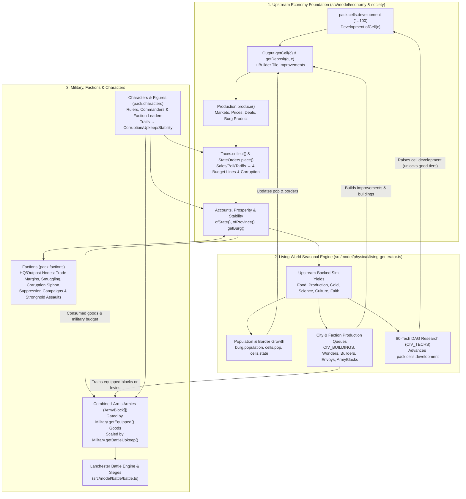

# Plan — Upstream Economy Alignment & Unified Simulation Architecture

**Status:** Complete — Phases 1–6 implemented (upstream merge resolved; tech ↔ development bridge; Living World economy on upstream Output/Production with seasonal treasuries; military goods gating, levy fallback and battle upkeep; factions and characters anchored in upstream trade, graft and budget; upstream data surfaced in the Cities, Factions and Living HUD dialogs; build, lint and tests green)  
**Branch:** `civ` (at commit `209c9dfb`), fastforwarded and fully aligned with `origin/master` (`2f64dc30`)  
**Target Upstream Commit:** `upstream/master` (`4b34afc5`, v1.157.0 Economy Rework PR #2020 + follow-ups)  
**Companions:** [living-openciv.md](living-openciv.md), [living-openciv-armies.md](living-openciv-armies.md), [factions-civ-engine.md](factions-civ-engine.md), [faction-suppression.md](faction-suppression.md), [remove-living-guild.md](remove-living-guild.md), [characters.md](characters.md), [conquest-retirement.md](conquest-retirement.md)

---

## 1. Executive Summary & Core Architectural Decisions

Upstream v1.157.0 introduced a comprehensive macro-economic procedural engine (`Development`, `Goods`, `Output`, `Markets`, `Production.produce()`, `Deals`, `Trade`, `Taxes`, `StateOrders`, `Accounts`, `Prosperity`, `Corruption`, `Stability`, and goods-equipped `Military` with `levies` and upkeep scaling).

Meanwhile, `master` and `civ` in this fork have incorporated PRs #30–#33:
- **Retirement of Grand Guild & Relics (PR #31, [remove-living-guild.md](remove-living-guild.md))**: Stripped the detached player guild, relics, and tavern recruitment; Living World operates in unconditional **Sandbox God Mode** with direct inspector interventions.
- **Faction Suppression & Hazard Clocks (PR #31, [faction-suppression.md](faction-suppression.md))**: Lairs were deleted and folded into dangerous factions; environmental trouble is cleared via production clocks; states suppress hostile factions administratively or storm wilderness strongholds with armies.
- **Unified Civ Engine in Master (PR #32)**: OpenCiv city-node loops, 7 yields, and empire rollups are native to master.
- **Characters Integration (PR #33)**: Non-monster factions generate dedicated leader characters; compact character sheet layout.
- **Civ Tabbed Dialogs (`civ` HEAD)**: State Cities & Yields dialog and Faction Outposts dialog use stock-grid tab-based layouts with dedicated Forces and Assets tables.

This plan pulls `upstream/master` into `civ` and **re-anchors the Living World seasonal simulation on top of upstream's economy model**:

| # | Locked-In Architectural Rule | Implementation Summary |
| :--- | :--- | :--- |
| **1** | **Adopt Upstream Economy as Foundation** | Upstream's `Goods`, `Output`, `Markets`, `Production.produce()`, `Taxes`, `StateOrders`, `Accounts`, `Prosperity`, `Corruption`, and `Stability` become the single source of truth for goods production, market prices, trade deals, taxation, state budgets, prosperity, and provincial stability. |
| **2** | **Upstream as Starting Point for Sim** | Map generation runs upstream's full pipeline (`Development` $\rightarrow$ `Goods` $\rightarrow$ `Markets` $\rightarrow$ `Production` $\rightarrow$ `Military`). `Living.init()` seeds all states, burgs, provinces, and factions directly from upstream's generated `pack.cells.development`, `state.economy`, `burg.product`/`treasury`, `pack.deals`, and `Stability`. |
| **3** | **Sim Yields Derived from Upstream Foundation** | Seasonal simulation yields (`Food`, `Production`, `Gold`, `Science`, `Culture`, `Faith`) are calculated from upstream's rural/burg output, consumed goods (`Accounts.getConsumption`), budget provisions (`StateOrders`), and `Prosperity`/`Stability`—augmented by constructed `CIV_BUILDINGS`, Wonders, and Builder tile improvements. |
| **4** | **Tech Advancement Drives Upstream Development** | Initial `CIV_TECHS` research is seeded from `pack.cells.development`. Completing technologies in `CIV_TECHS` raises `pack.cells.development` (`1..100`) across the polity's burgs and cells, which directly unlocks higher-tier upstream goods (`good.development`) and increases production output (`development / 30`). |
| **5** | **Keep Seasonal Tick & Resource Collection** | `Living.tick()` continues to step seasons (`Spring`, `Summer`, `Autumn`, `Winter`), running/refreshing the upstream economy, banking seasonal net revenue into persistent treasuries, growing populations, advancing production queues, and diffusing tech development. |
| **6** | **Keep Sim Battle Model, Gate Units by Upstream Resources** | Keep `ArmyBlock[]` combined-arms regiments, cultural rosters, `living-armies.ts`, sieges, city strikes, and the Lanchester battle engine (`battle.ts`). Gate unit mustering/training via upstream's `Military.getEquipped()` (demoting unequipped troops to `levies`) and scale combat power by `Military.getBattleUpkeep()`. |
| **7** | **Keep Factions & Characters** | Keep `pack.factions` (HQs/Outposts as city-nodes with suppression/assault) and `pack.characters` / `pack.figures` (rulers, commanders, faction leaders, heroes), wiring their income, corruption siphoning, smuggling, and trait modifiers directly into upstream's economy and stability systems. |

---

## 2. System Architecture Diagram

---

## 3. Phase-by-Phase Implementation Plan

### Phase 1: Git Merge & Serialization Format Alignment (`upstream/master` $\rightarrow$ `civ`)

**Goal:** Cleanly merge `upstream/master` (`4b34afc5`) into `civ`, resolve all 45 conflicting files, and align the `.map` file format and `Options` schema so both upstream v1.157.0 saves and fork saves load without data loss.

#### 1.1 `.map` Record Layout Reconciliation
Upstream v1.157.0 assigned records `54` and `55` to `pack.cells.prosperity` and `pack.cells.development`, and deprecated record `41` (`pack.goods` moved to `options.map.goods`). The fork previously used `54` for `pack.factions` and `55` for `pack.history`.

We align the `.map` record layout in [`src/services/io/save.ts`](file:///home/paladin/workspace/Fantasy-Map-Generator/src/services/io/save.ts), [`src/services/io/load.ts`](file:///home/paladin/workspace/Fantasy-Map-Generator/src/services/io/load.ts), [`src/services/io/epochs-format.ts`](file:///home/paladin/workspace/Fantasy-Map-Generator/src/services/io/epochs-format.ts), and [`src/services/io/auto-update.ts`](file:///home/paladin/workspace/Fantasy-Map-Generator/src/services/io/auto-update.ts):

| Record Index | Upstream v1.157.0 | Previous Fork | Unified Layout |
| :---: | :--- | :--- | :--- |
| `data[1]` | `options.map` (includes `goods`, `eras`, `military`) | `options.map` | `options.map` (includes `goods`, `eras`, `military`) |
| `data[31]` | `nameBases` | `nameBases` (with 5-letter `id`) | Fork's `parseNameBases` / `serializeNameBases` (backward-compatible with upstream) |
| `data[41]` | `""` (legacy `goods` migrated to `options.map.goods`) | `pack.goods` | `""` on save; on load, `if (data[41]) options.map.goods = JSON.parse(data[41])` |
| `data[53]` | `pack.legends` | `pack.legends` | `pack.legends` |
| `data[54]` | `pack.cells.prosperity` (`Uint8Array`) | `pack.factions` | `pack.cells.prosperity` (`Uint8Array`) |
| `data[55]` | `pack.cells.development` (`Uint8Array`) | `pack.history` | `pack.cells.development` (`Uint8Array`) |
| `data[56]` | — | `snapshotRecords[0]` | `pack.factions` (JSON array) |
| `data[57]` | — | `snapshotRecords[1]` | `pack.history` (`HISTORY_RECORD = 57`) |
| `data[58+]` | — | `snapshotRecords[2+]` | `snapshotRecords` (`FIRST_SNAPSHOT_RECORD = 58`) |

* **Legacy Fork Save Migration in `load.ts`**:
  * Before reading `data[54]`, check if `data[54]?.trim().startsWith("[")` (a pre-merge fork save where `pack.factions` was at slot 54) or `data[54]?.trim().startsWith("{")` (a pre-factions fork save where `pack.history` was at slot 54).
  * If detected, splice two empty strings `"", ""` at index 54 so `factions` shifts to `56`, `history` shifts to `57`, and `snapshots` shift to `58+`, then let `autoUpdate` populate `pack.cells.prosperity` and `pack.cells.development`.

#### 1.2 Conflict Resolution Matrix (45 Files)

| Area | Conflicting Files | Resolution Strategy |
| :--- | :--- | :--- |
| **Economy Model** | `src/model/economy/goods-generator.ts` `src/model/economy/markets-generator.ts` `src/model/economy/production-generator.ts` `src/renderers/draw-goods.ts` | Take **upstream v1.157.0** implementation (`src/data/goods.ts`, `output.ts`, `deals.ts`, `trade.ts`, `demand.ts`, `taxes.ts`, `state-orders.ts`, `accounts.ts`, `prosperity.ts`, `corruption.ts`, `trade-traffic.ts`). Re-attach the fork's `Goods.isAstralCatalogue()` and `Goods.switchToAstralGoods()` hooks onto `options.map.goods` and `Output.ofCell()`. |
| **Political & Society Models** | `src/model/political/states-generator.ts` `src/model/political/military-generator.ts` `src/model/society/cultures-generator.ts` `src/model/story/markers-generator.ts` | Take upstream's `state.economy` (`defineCorruption`, `defineExpenses`, `defineAlert`), `Stability`, culture `development` levels, and economic markers (`guild-halls`, `merchant-houses`, `customs-houses`). Preserve the fork's RPG Fantasy / Astral culture sets, `state.rosterId`, and `ArmyBlock[]` military hooks (see Phase 4). |
| **Types & Options Schema** | `src/types/packed-graph.ts` `src/model/options/options-schema.ts` `src/model/map-entities.test.ts` | Combine upstream's `cells.development`, `cells.prosperity`, `options.map.goods`, `options.map.eras`, `StateFinance`, and `CompactDeal` with the fork's `pack.factions`, `pack.characters`, `pack.history`, and `extents`. |
| **App Shell, Commands & Controllers** | `src/app/fmg.ts`, `map-commands.ts` `src/app/chrome/tabs/options-tab.ts`, `tools-tab.ts` `src/controllers/index.ts` `src/controllers/political/states-editor.ts` `src/controllers/political/provinces-editor.ts` `src/controllers/political/burgs/burg-editor.ts` `src/controllers/society/cultures-editor.ts` `src/controllers/economy/goods/goods-editor.ts` | Register all upstream controllers (`EconomyOverview`, `BurgEconomyOverview`, `StateBudgetEditor`, `StabilityOverview`, `DevelopmentEditor`, `ErasEditor`) and layers (`DevelopmentOverlay`, `drawTradeTraffic`) alongside the fork's `LivingHud`, `StateCitiesDialog`, `FactionsEditor`, `CharactersEditor`, `LegendsOverview`, and `Astral` mode. |
| **Military UI** | `src/controllers/political/military/military-overview.ts` `regiments-overview.ts`, `regiment-editor.ts` `battle-screen.ts` | Keep the fork's `ArmyBlock` table editor and Lanchester `battle-screen.ts`, while surfacing upstream's unit `goods` requirements, state military `upkeep` %, and `levies` column/warnings in `military-overview.ts`. |
| **Build & Locales** | `package.json`, `package-lock.json` `src/locales/en.json` | Adopt upstream's Vite/i18n refactor (`4b34afc5`) and merge all fork locale keys (`factions`, `characters`, `living`, `astral`) into `src/locales/en.json`. |

---

#### 1.3 Phase 1 Completion Record (done)

**Merged:** `upstream/master` `4b34afc5` (v1.157.0) into `civ`; all conflicts resolved; `npm run build` (tsc + vite + pwa-precache) compiles; Vitest 3471 passing with only the 4 failures that already failed on the pre-merge fork baseline (`factions-editor.test.ts` ×2, `state-cities-dialog.test.ts` ×2 — pre-existing fork bugs, untouched).

**Record layout as planned** (`epochs-format.ts`, `load.ts`, `save.ts`): `53` legends, `54` prosperity, `55` development, `56` factions, `HISTORY_RECORD = 57`, `FIRST_SNAPSHOT_RECORD = 58`. Legacy migration detects `data[53]`/`data[54]` starting with `{` (old history positions) or `data[54]` starting with `[` (old factions) and splices accordingly; `auto-update` backfills prosperity/development.

**Conflict resolutions:**
- **Economy**: upstream taken wholesale; `pack.goods` gone (goods live in `options.map.goods`). Astral hooks re-attached: `Goods.isAstralCatalogue` / astral catalogue switch on `options.map.goods`, astral modifier hook exposed as `Output.getAstralModifiers`. `Production.regenerateEconomy`/`getCellProduction` are gone — callers use `Production.regenerate()`.
- **Cultures**: fork file base (RPG Fantasy + Astral sets preserved) with upstream's development APIs grafted; culture `development` fields kept.
- **Military**: fork file base — `ArmyBlock[]` blocks, `state.rosterId`, cultural rosters — with upstream's upkeep/power/levy logic grafted. Headcounts stay in people: `a`/`u` are people, `getTroopsPower` divides by `population.scale` only for power, `Military.getTroops` is near-identity. Upstream's v1.157.0 people→points save conversion is skipped (fork saves keep people), and `battle-screen.ts` keeps the fork's Lanchester simulator (upstream's legacy battle model discarded).
- **Factions**: fork engine kept; faction `tier`/`scale` fields dropped in favour of the upstream-style node model (`FactionHq`/`FactionOutpost` unions use `"tier" in node` / `"fortified" in node` guards); stale `academic`/`secret` categories map to `adventuring`.
- **Build & i18n**: upstream Vite/i18n adopted; fork locale keys merged; `package.json` scripts unioned (`tune-economy`, `prepare`, `postinstall`).
- **Styles**: fork's `astral.json` / `astralSchematic.json` presets regenerated through `Styles.parse` onto the v1.157.0 schema (adds `goods.groups`, contour spacing enum, line-join enums; fork values preserved).
- **Astral readings**: upstream's new marker types (`guild-halls`, `merchant-houses`, `customs-houses`) added to `MARKER_READINGS` / `ANOMALY_FAMILIES`; `draw-goods` astral gating (no cell polygons, burg-anchored icons) restored in the new viewport architecture.
- **Assistant context**: `context.generated.ts` regenerated; prompt budget test raised to 16 500 chars.

---

### Phase 2: Technology Advancement Drives Upstream Development

**Goal:** Make technology advancement in the simulation directly determine upstream tech/development levels (`pack.cells.development`), and seed initial simulation tech states from upstream's generated development field.

#### 2.1 Mapping `CIV_TECHS` Rows to Upstream `Development` (`1..100`)
Upstream defines technological development on a `1..100` scale (`src/model/society/development-generator.ts`), where each era spans specific thresholds (`options.map.eras`) and gates goods via `good.development` (`6..36+`) and productivity via `Math.max(1, development / 30)`.

We establish a deterministic mapping in [`src/data/living-civ-techs.ts`](file:///home/paladin/workspace/Fantasy-Map-Generator/src/data/living-civ-techs.ts):

| `CIV_TECHS` Era | Tech Tree Row | Upstream Development Target | Upstream Default Era (`options.map.eras`) | Upstream Goods Unlocked (`good.development`) |
| :--- | :---: | :---: | :--- | :--- |
| Pre-Tech / Wildlands | — | `1..5` | Paleolithic / Mesolithic | Wood, Stone, Fish, Game, Honey, Clay, Leather |
| **Ancient** (Tier 1) | `0` | `6..11` | Neolithic (`6`) / Copper Age (`9`) | Grain, Cattle, Wine, Salt (`6`); Copper, Silver, Gold, Silk, Wool, Coal, Ceramics (`9`) |
| **Ancient** (Tier 2) | `1` | `12..17` | Bronze Age (`12`) / Late Bronze (`15`) | Marble, Tin, Horses, Camels, Incense, Bronze, Arms, Garments (`12`); Spices, Boats, Harnesses, Tools (`15`) |
| **Classical** (Tier 1) | `2` | `18..23` | Iron Age (`18`) / Classical Age (`21`) | Iron, Barrels, Coins (`18`); Tea, Paper, Books, Candles (`21`) |
| **Classical** (Tier 2) | `3` | `24..26` | Late Antiquity (`24`) | Glass (`24`) |
| **Medieval** (Tier 1) | `4` | `27..32` | Early (`27`) / High Middle Ages (`30`) | Gunpowder, Liquor (`30`) |
| **Medieval** (Tier 2) | `5` | `33..39` | Commercial Rev (`33`) / Late Middle Ages (`36`) | Artillery (`36`), +10–30% global productivity (`dev / 30`) |
| **Renaissance** (Tier 1) | `6` | `40..44` | Renaissance (`40`) | +33–47% global productivity |
| **Renaissance** (Tier 2) | `7` | `45..59` | Age of Discovery (`45`) / Scientific Rev (`50`) | +50–97% global productivity |
| **Industrial** | `8..9` | `60..79` | Enlightenment (`60`) / Industrial Rev (`70`) | +100–163% global productivity |
| **Modern** | `10..11` | `80..84` | Machine Age (`80`) | +167–180% global productivity |
| **Atomic** | `12..13` | `85..89` | Atomic Age (`85`) | +183–197% global productivity |
| **Information** | `14..16` | `90..100` | Space Age (`90`) / Post-human (`100`) | +200–233% global productivity |

#### 2.2 Seeding Initial Techs from Upstream (`Upstream` $\rightarrow$ `Sim`)
- During `Living.syncStates()` and `Living.syncFactions()` (when `sSim.researchedTechs` is first initialized on a newly generated or loaded map):
  1. Compute the state's population-weighted mean `pack.cells.development` across its burgs and peopled cells (or the HQ/Outpost cells for a faction).
  2. Determine the corresponding `CIV_TECHS` row from the table above (`developmentToTechRow(meanDev)`).
  3. Populate `sSim.researchedTechs` with all available technologies up to that row (plus any partial progress toward the next row based on fractional development within the bracket).
  4. This guarantees that a High Fantasy Dwarven state (upstream development `53`) or Renaissance Tallian state (`42`) starts the simulation with its appropriate historical/fantasy tech tier already unlocked, while a low-development tribal state (`12`) starts in the Bronze Age.

#### 2.3 Tech Advancement Driving `pack.cells.development` (`Sim` $\rightarrow$ `Upstream`)
- Each technology in `CIV_TECHS` has a mapped development level (`techTargetDevelopment(tech)`).
- When `completeTech(state, sSim, tech, living)` (or faction research completion) fires:
  1. Compute the polity's new **Technological Development Level** `targetDev = computePolityTechDevelopment(sSim.researchedTechs)` based on the highest researched tech row and the fraction of techs completed in that row.
  2. **Immediate Burg Uplift**: Raise `pack.cells.development[burg.cell]` in the state's capital and major burgs (and faction HQ/Outposts) toward `targetDev` (with `+2` bonus in cities holding a `library`/`university`/`public_school`).
  3. **Seasonal Rural Diffusion (`stepDevelopmentDiffusion`)**: On each seasonal tick, peopled cells owned by the state gradually step their `pack.cells.development[c]` toward their province/state `targetDev` (adjusted by upstream's local biome offset `biome.development` and river/coast bonuses so natural geographic variation is preserved).
  4. Mark the economy dirty so the next `Production.produce()` and `Output.ofCell()` run uses the updated `pack.cells.development`, unlocking newly reachable `good.development` tiers and scaling productivity!

#### 2.4 Phase 2 Completion Record (done)

**Shipped:** `src/data/living-civ-techs.ts`, `src/model/physical/living-generator.ts`, `src/types/living.ts`; `npm run build` green, Biome clean, Vitest 3486 passing (0 failures, including the 4 pre-existing fork failures).

- **Mapping table** (`CIV_TECH_ROW_DEVELOPMENT`): 17 contiguous bands covering `6..100` (row `0` `6..11` … row `16` `97..100`) matching the table in §2.1. Bands are contiguous by construction and asserted in `living-civ-techs.test.ts`.
- **Pure helpers** (`src/data/living-civ-techs.ts`): `developmentToTechRow(dev) → row|-1`, `techTargetDevelopment(tech) → band top`, `computePolityTechDevelopment(techs) → band start + share of the top row known` (0 without techs), `seedTechsFromDevelopment(dev) → { researched, progress }`.
- **Seeding (§2.2)** in `Living.syncStates()` / `Living.syncFactions()`: only while `researchedTechs` and `researchedProgress` are both empty, so old saves and live simulations are never rewritten. State mean is `Development.getAverages(pack.cells.state)` (population-weighted, upstream's own helper; now tolerates missing `options.map.units`); faction mean is the average `pack.cells.development` at its HQ/outpost burgs. Rows below the current one are seeded whole; the current row is seeded in slot order while prerequisites hold, with the leftover share banked as `researchedProgress` on the next reachable tech (so research never stalls on an unreachable tech). Maps with no development field seed nothing.
- **Uplift (§2.3.2)** in `completeTech()` / `completeFactionTech()`: `pack.cells.development` of the capital, every state burg and every faction HQ/outpost cell is raised to `computePolityTechDevelopment(researched)` (`+2` with `library`/`university`/`public_school`), never lowered, and unpeopled (`development === 0`) cells are skipped.
- **Diffusion (§2.3.3)**: `stepDevelopmentDiffusion()` runs after `stepEmpire()` each season; peopled owned cells step `±1` toward `polityTarget + biome.development + river + harbor` (clamped `1..100`). Rural cells may slip up to `DEVELOPMENT_DECAY_SLACK` (`3`) points above that ceiling before decaying; burg cells never decay, so city uplift sticks.
- **Economy invalidation**: `LivingWorldState.economyDirty` (new, optional) is set by both the uplift and the diffusion step; Phase 3 consumes it to re-run `Production.produce()`.
- **Tests**: `src/data/living-civ-techs.test.ts` (bands, row lookup, targets, polity development, seeding + prerequisite closure) and the new `Upstream development bridge (economy alignment Phase 2)` block in `living-generator.test.ts` (seeding from `pack.cells.development`, no-development maps untouched, city uplift on `grantTech`, seasonal diffusion).

---

### Phase 3: Upstream Economy as the Foundation for Seasonal Yields & Resources

**Goal:** Replace the parallel Civ tile-draft economy with an upstream-backed seasonal resource and yield collection pipeline.

#### 3.1 How Simulation Improvements & Buildings Feed Upstream `Output` and `Production`
Instead of Builder improvements and `CIV_BUILDINGS` only adding abstract numbers to a detached HUD, they directly modify upstream's economic engine:

1. **Tile Improvements $\rightarrow$ `Output.getCell(cellId)` & `Output.getDeposit(good, cellId)`** ([`src/model/economy/output.ts`](file:///home/paladin/workspace/Fantasy-Map-Generator/src/model/economy/output.ts)):
   - Add `Output.getSimMultiplier(good: Good, cellId: number): number`:
     - Reads `living = pack.history?.living`. If Living World is inactive, returns `1`.
     - If `living.cells?.[cellId]?.pillaged` is `true`, returns `0.25` (pillaged land loses 75% commercial output).
     - If `living.cells?.[cellId]?.improvement` is active:
       - `farm`: `+35%` output for agricultural/grain goods (`Grain`, `Wine`, `Olives`, `Dates`, `Hemp`, `Sugar`, `Tea`, `Tobacco`), `+50%` with `Civil Service` / `Fertilizer`.
       - `pasture`: `+35%` output for pastoral goods (`Cattle`, `Wool`, `Horses`, `Camels`, `Cheese`, `Leather`), `+50%` with `Fertilizer`.
       - `mine`: `+40%` output for mineral deposits (`Iron`, `Copper`, `Tin`, `Silver`, `Gold`, `Coal`, `Salt`, `Saltpeter`, `Gemstones`), `+60%` with `Chemistry` / `Dynamite`.
       - `quarry`: `+40%` output for `Stone`, `Marble`, `Clay`, `White sand`.
       - `plantation`: `+40%` output for `Silk`, `Spices`, `Dyes`, `Incense`, `Sugar`, `Tea`, `Tobacco`, `Wine`, `Olives`.
       - `camp`: `+40%` output for `Game`, `Furs`, `Ivory`, `Honey`, `Amber`.
       - `lumber_mill`: `+40%` output for `Wood`, `Mahogany`, `Tar`.
       - `fishing_boats`: `+40%` output for `Fish`, `Pearls`, `Blubber`.
       - `trading_post`: `+20%` rural produce earnings in that cell.
2. **Burg Buildings $\rightarrow$ `Production.produce()` & `Markets`** ([`src/model/economy/production-generator.ts`](file:///home/paladin/workspace/Fantasy-Map-Generator/src/model/economy/production-generator.ts)):
   - In `Production.produce()`, a burg's effective manufacturing workforce (`WORKFORCE_SHARE * burg.population`) is multiplied by its constructed `CIV_BUILDINGS` in `living.burgs[burg.i]?.civBuildings`:
     - `workshop` (`+15%`), `windmill` (`+10%`), `forge` (`+20%` for metal/arms recipes), `factory` (`+35%`), `armory_forge` (`+25%` for `Arms`/`Artillery`).
     - Commercial buildings (`market`, `bank`, `stock_exchange`, `harbor`, `seaport`, `trade_depot`, `counting_house`, `grand_exchange`) increase the burg's trade lot efficiency and market center attractiveness.

#### 3.2 Seasonal Economy Execution & Persistent Treasuries (`stepEconomy`)
Upstream's `Production.produce()` calculates one representative day's cash flows and writes the day's net balance into `burg.treasury` and `state.economy.treasury`. To bridge this with Living World's multi-season accumulation:

1. **Persistent Treasury Ledger**:
   - Store accumulated multi-season reserves on `living.states[stateId].treasury` and `living.burgs[burgId].treasury` (initialized from `state.economy.treasury` and `burg.treasury` when `Living.init()` first runs).
   - Mirror the accumulated reserve onto `state.economy.treasury` (or expose both `state.economy.treasury` [daily net balance] and `living.states[s].treasury` [accumulated reserve]) so upstream's State Economy dialog, the State Cities dialog, and the Living HUD all display accurate figures.
2. **Seasonal Tick Refresh**:
   - At the start of each year (`living.season === 0`) or whenever `living.economyDirty` is set (triggered by border changes, war/peace/embargoes, tech advancement, or building/improvement completion), `Living.stepEconomy()` runs `Production.produce()`, `Prosperity`, `Accounts`, and `Stability`.
   - On **every seasonal tick**, each Burg, State, and Faction collects its seasonal yields based on the current upstream economy state:

#### 3.3 Unified Yield Formulas Based on Upstream Foundation

| Sim Yield | Upstream Foundation Source | Modifiers from Sim (`CIV_BUILDINGS` / Improvements / Traits) | What It Drives in `Living.tick()` |
| :--- | :--- | :--- | :--- |
| **Gold (`gold`)** | **State**: `state.economy.collected` (`salesTax + tariffs + pollTax + marketFees + adjustments`) $-$ `state.economy.pocketed` (corruption) $-$ `state.economy.spent` (`court + administration + infrastructure + military`). **Burg**: `burg.product` $+$ market center margins $-$ `burg.pollTaxPaid`. | $+$ `market`/`bank`/`stock_exchange` bonuses, $+$ trade treaty dividends, $-$ `CIV_BUILDINGS` maintenance, $-$ extra army upkeep. | Banks into persistent `treasury`; funds `hurryProduction()` (gold rush), unit upgrades, diplomatic gifts; `< 0` triggers `settleDebt()`. |
| **Food (`food`)** | **Burg & Province**: Upstream food need fulfillment (`Prosperity.getBurg(b).needs`, rural food output in `Output.ofCell` for `demandCoverage.food` goods: Grain, Cattle, Fish, Game, Cheese, Beer, Preserved food). | $+$ `granary`, `aqueduct` (`+40%` carryover), `hospital` (`+25%` carryover), `water_mill`, `lighthouse`, `farm`/`pasture`/`fishing_boats` improvements, `Fertility Rites` belief. Scaled by `Stability` growth factor. | Fills `bSim.foodStored` against `foodNeededForGrowth(citizens)`. Grows `citizens`, `burg.population`, and province `pack.cells.pop`! When `Settler` is queued, surplus converts to `production`. |
| **Production (`production`)** | **Burg**: Urban workforce (`burg.population × development / 30`) $+$ value of local & consumed `construction` and `utilities` goods (`Wood`, `Stone`, `Marble`, `Clay`, `Iron`, `Copper`, `Bronze`, `Tools`, `Coal`, `Oil`) from `Accounts` / `Prosperity`. | $+$ `workshop`, `forge`, `windmill`, `factory`, `seaport`, `armory_forge`, plus local `mine`, `quarry`, `lumber_mill` improvements and ruler `martial`/`civic` bias. | Advances `bSim.productionQueue` (`applyProduction`) to construct `CIV_BUILDINGS`, National/World Wonders, `ArmyBlock` regiments, `Builder`s, and `Settler`s. |
| **Science (`science`)** | **Burg & State**: Urban population × (`pack.cells.development[burg.cell] / 30`) $+$ burg consumption of scholarly goods (`Paper`, `Ink`, `Books`, `Glass`) $+$ state `infrastructure` & `administration` provision (`StateOrders.getProvision`). | $+$ `library` (`+0.5/citizen`), `university` (`×1.33`), `public_school`, `observatory` (`×1.5`), `national_college`, `seeker_archives`, `alchemical_lab`, and `+25%` neighbor/host tech spillover. | Advances `sSim.currentTechId` in `applyResearch()`, unlocking techs and raising `pack.cells.development` (Phase 2). |
| **Culture (`culture`)** | **Burg & State**: State `court` provision (`StateOrders.getProvision(state, "court")`) $+$ burg consumption of luxury/cultural goods (`Books`, `Jewelry`, `Garments`, `Wine`, `Marble`, `Incense`, `Perfume`). | $+$ `monument`, `amphitheater`, `opera_house`, `museum`, `hermitage`, `printing_cell`, and cultural wonders. | Fills `bSim.cultureStored` against `borderCultureNeeded()` to expand state borders (`applyBorderGrowth`) into unowned cells and grow Faction local `influence`. |
| **Faith (`faith`)** | **Burg & State**: State `court` & clergy spending $+$ consumption of liturgical goods (`Incense`, `Candles`, `Wine`) in religious burgs. | $+$ `shrine`, `temple`, `cathedral`, `monastery`, `mosque`, `pagoda`, `wayside_shrine`, `ritual_sanctum`, and pantheon/founder beliefs. | Accumulates `sSim.faith`, spawns Great Prophets / Missionaries, and drives city-to-city religious pressure (`stepReligion`). |
| **Stability & Prosperity** *(Replaces Civ Happiness)* | **Upstream `Prosperity` (`0..1`)**: `Accounts.ofState(stateId).prosperity` (needs + comfort + variety + infrastructure). Upstream v1.157.0 ships no `Stability` module; the sim's happiness system stands in for it. | `CIV_BUILDINGS` (`colosseum`, `circus`, `theatre`, `courthouse`), Wonders, and Beliefs add directly to province `prosperity` / `court` stability parts; `courthouse` reduces conquest diversity/unrest penalty. | Feeds Empire Happiness (`HappinessBreakdown.prosperity`, 0.5 neutral). High happiness grants growth bonuses; low happiness penalizes growth (`0.25×` / `0×`) and combat (`-33%`), and triggers `stepRebellions()` / `unravel`! |

#### 3.4 Phase 3 Completion Record (done)

**Shipped:** `src/model/economy/output.ts`, `production-generator.ts`, `prosperity.ts`, `src/model/physical/living-generator.ts`, `src/types/living.ts`; `npm run build` green, Biome clean, Vitest 3500 passing (0 failures).

- **Improvements → `Output` (§3.1)**: `Output.getSimMultiplier(good, cellId)` returns `0.25` on pillaged cells, otherwise `1 + boost` when a Living World Builder improvement tends the good: `farm`/`pasture` `+35%` (to `+50%` with `civil_service`/`fertilizer`), `mine` `+40%` (to `+60%` with `chemistry`/`dynamite`), `quarry`/`plantation`/`camp`/`lumber_mill`/`fishing_boats` `+40%`. Goods are matched by name against the upstream catalogue; techs are read from the cell owner's `researchedTechs`. `getModifiers()` multiplies it into every rural and deposit yield (astral catalogue included), so `Production.produce()` and `Prosperity` see boosted output. `Output.getSimEarningsMultiplier(cellId)` gives `trading_post` cells `+20%` rural earnings via `Prosperity.indexRural`. Without a simulation both return identity.
- **CIV_BUILDINGS → `Production` (§3.1)**: `buildingModifierFor(buildings, goodName)` multiplies a burg's manufactures: `workshop` `×1.15`, `windmill` `×1.10`, `factory` `×1.35` on everything, `forge` `×1.20` on `Arms`/`Artillery`/`Tools`/`Bronze`/`Gunpowder`/`Coins`, `armory_forge` `×1.25` on `Arms`/`Artillery`. Cached per good in `getBurgModifiers` as before.
- **`stepEconomy` (§3.2)**: runs each season after `stepDevelopmentDiffusion`. When `season === 0` or `economyDirty` (and `pack.markets` exist), `Production.regenerate()` re-runs the whole economy (produce + taxes + prosperity cells); the flag clears once consumed. `bankSeasonalGold` adds the state's upstream net (`collected − pocketed − spent`, a day's flow × `SEASON_DAYS = 90`) into `state.economy.treasury` every season, after `applyTreasury`'s abstract sim gold — both flows accumulate in one persistent reserve; `< 0` still triggers `settleDebt`. `sSim.treasury` mirrors the reserve for the HUD (seeded at `syncStates`), and `bSim.treasury` accumulates each burg's season (`(product − pollTaxPaid) × 90`, seeded at `syncBurgs`), keeping upstream's day-scale `burg.treasury` untouched.
- **Upstream-backed yields (§3.3, additive blend)**: scholarly goods (`Paper`, `Ink`, `Books`, `Glass`) consumed by a burg add up to `+5` Science per tick (`scholarScienceBonus`); a fully served court (`StateOrders.getProvision(state, "court")`) adds up to `+3` Culture and `+3` Faith to the state totals; upstream `Prosperity` sways Empire Happiness (`(prosperity − 0.5) × 10` in `HappinessBreakdown.prosperity`), so food growth and combat modifiers already respond to upstream living standards. All three engage only when a full economy run is readable (`canReadUpstreamEconomy`: deals + markets + goods catalogue), keeping stripped saves and abstract-yield tests byte-identical.
- **Tests**: `output.test.ts` (identity without sim, pillage, per-improvement goods, tech upgrades, trading post), `production-sim.test.ts` (building multipliers and stacking), and the `Upstream economy bridge (economy alignment Phase 3)` block in `living-generator.test.ts` (ledger init, state seasonal banking formula, burg ledger, dirty-flag consumption, prosperity → happiness).

---

### Phase 4: Military Resource Gating, Upkeep & Battle Model Integration

**Goal:** Keep the fork's `ArmyBlock[]` combined-arms regiments, cultural rosters, and Lanchester battle engine (`src/model/battle/battle.ts`), while integrating upstream's goods-based equipment gating (`Military.getEquipped`), `levies` fallback, and military budget upkeep (`Military.getBattleUpkeep`).

#### 4.1 Bridging Cultural Roster Units (`UnitType`) with Upstream Goods
In upstream [`src/model/political/military-units.ts`](file:///home/paladin/workspace/Fantasy-Map-Generator/src/model/political/military-units.ts), default unit types specify `goods: number[]`. In the fork, regiments also carry `units: ArmyBlock[]` referencing cultural roster definitions (`src/data/rosters/*.json` via `src/data/roster-content.ts`).

We unify both in `src/model/political/military-generator.ts` and `src/model/physical/living-armies.ts`:
1. **Category-to-Goods Mapping (`getUnitRequiredGoods(unitType)`)**:
   - Every roster `UnitType` maps to upstream `options.map.military.units` and required good names/IDs by its `category` and tags:
     - `levies` / `militia`: `[]` (no goods required; always available).
     - `infantry` / `melee` / `spear` / `halberd`: `["Arms"]` (plus `["Iron"]` or `["Bronze"]` for heavy/armored tier 3+ blocks).
     - `ranged` / `archers` / `skirmishers`: `["Arms"]`.
     - `cavalry` / `mounted` / `chariots`: `["Horses", "Camels", "Harnesses"]` (plus `["Arms"]` for heavy lancers/knights).
     - `siege` / `artillery` / `gunpowder`: `["Artillery", "Gunpowder"]` for gunpowder units; `["Wood", "Ropes", "Iron"]` for pre-gunpowder catapults/trebuchets.
     - `naval` / `fleet`: `["Boats"]`.
     - `arcane` / `monsters` / `flying`: gated by `requiredTech` / special buildings (`alchemical_lab`, `ritual_sanctum`, `temple`) and luxury/reagent goods (`Gemstones`, `Incense`, `Books`).

#### 4.2 Initial Military Generation (`Military.generate()`)
1. Run upstream's platoon drafting and `Military.getEquipped(stateId, demand)` calculation using `Accounts.getConsumption(stateId)`.
2. For each platoon in `draft.platoons`:
   - The equipped share (`share = equipped[platoon.u] ?? 1`) remains as its regular unit type (`infantry`, `archers`, `cavalry`, `artillery`, `fleet`).
   - The unequipped remainder (`1 - share`) is converted into a `levies` platoon at that cell, exactly as in upstream.
3. Merge platoons into `Regiment[]`, deploy regiments of warring states to the frontline (`FRONT_DEPTH = 2`), and populate `regiment.units: ArmyBlock[]` via the fork's `populateRegimentBlocks(regiment, state.rosterId)`:
   - Regular unit counts (`regiment.u.infantry`, `cavalry`, etc.) map to cultural roster `ArmyBlock`s.
   - `regiment.u.levies` maps to a cultural **Levy block** (`power: 0.5`, low defense/morale in `battle.ts`).

#### 4.3 Seasonal Unit Training & Mustering Gate (`stepCities` & `muster`)
1. When a Major Burg (or Faction Node) selects or completes a military unit in its `productionQueue` (or via `muster()`):
   - Check the state's remaining equipment capacity for that unit's required goods:
     $$\text{Available Kits}_{g} = \text{Consumed}_{g} \times \text{EQUIPMENT} \times \text{demandCoverage.military}_{g} - \text{Currently Fielded Needing}_{g}$$
   - Also check `requiredTech` from `CIV_TECHS` (e.g., `chivalry` for Knights, `gunpowder` for Musketeers/Cannons).
   - **If equipped & teched**: The city trains the full cultural roster `ArmyBlock` (`Swordsmen`, `Knights`, `Crossbowmen`, `Artillery`, etc.).
   - **If short on strategic goods**:
     - The autonomous governor prioritizes building/trading for the missing good or queues a **Levy / Militia block** if an emergency defense is needed.
     - If a queued regular unit finishes when its good is in deficit (e.g., an enemy pillaged the state's Iron mine or embargoed Horses), the block spawns as a **Levy block** (`levies`) or at reduced initial capability (`hp`), with a news log entry explaining the equipment shortage!

#### 4.4 Upkeep & Combat Power Integration (`battle.ts` & `living-armies.ts`)
1. Upstream's `Military.getUpkeep(stateId)` measures how well `state.economy.spent.military` covers `Military.getUpkeepNeed(stateId)` (`nominalPower * UPKEEP_COST`).
2. In `src/model/battle/battle.ts` and `src/model/physical/living-armies.ts`:
   - Multiply each state regiment's effective combat strength in battle and odds estimation by `Military.getBattleUpkeep(stateId)` (clamped to `[0.5, 1.15]` during active seasonal ticks when funded by treasury reserves, or dropping toward `MIN_UPKEEP = 0.05` if the state both underfunds `budget.military` and has `treasury <= 0`).
   - If a state's persistent `treasury` falls below `0` and `Military.getUpkeep(stateId) < 0.5`, `settleDebt()` demotes an unequipped elite block to `levies` or disbands the newest block.

#### 4.5 Phase 4 Completion Record (done)

**Shipped:** `src/model/physical/living-armies.ts`, `src/model/physical/living-generator.ts`, `src/model/political/military-generator.ts`; `npm run build` green, Biome clean, Vitest 3511 passing (0 failures).

- **Category→goods mapping (§4.1)**: `getUnitRequiredGoods(unit, roster)` in `living-armies.ts` derives each roster unit's required upstream goods from its category and upkeep rank among same-category peers: levy tier (rank 0 melee/ranged) `[]`; melee/ranged `Arms` (heavy rank ≥ 3 melee adds `Iron`); cavalry `Horses` + `Harnesses` (heavy lancers add `Arms`); artillery `Wood`/`Ropes`/`Iron`, or `Artillery`/`Gunpowder` once `requiredTechFor` names a gunpowder tech; monsters `Gemstones`; spellcasters `Incense` + `Books`. `levyUnitFor(roster)` names the fallback levy (cheapest melee, else ranged, else any).
- **Equipment capacity (§4.3)**: `Military.getEquipmentSpare(stateId, goodName, requires)` implements the plan formula — a day's consumption (`Accounts.getConsumption`) × `EQUIPMENT` (0.365) × the good's `demandCoverage.military`, minus every fielded block whose type needs the good; `Infinity` before the economy has run or where the good is not traded, so stripped saves and abstract-yield worlds gate nothing.
- **Muster gate (§4.3)**: `Living.resolveEquipment()` runs both `spawnArmyBlock` (city-queue completions) and `muster()` through the spare-kits check; a short block spawns as the roster's levy with a news entry (`…ran short of Arms…`), or at `hp 0.5` when the roster has no levy to fall back to. The pre-existing `requiresGood` (region yields) and `requiredTechFor` gates are unchanged and compose with this.
- **Living battle upkeep (§4.4)**: `Military.getLivingBattleUpkeep(stateId)` — funded (`treasury > 0`) forces clamp `getUpkeep` to `[0.5, 1.15]`; bankrupt underfunded forces fall to `max(MIN_UPKEEP, upkeep)`. `Living.stateCombatMult(stateId)` multiplies `happinessCombatMultiplier` × living battle upkeep and replaces the happiness-only multiplier on every state side of the battle modifiers (faction strongholds, state vs faction, faction vs state, state vs state, `siegeModifiers`, `assaultModifiers`) — so both `initBattleSession` and `estimateOdds` scale with upkeep. Before the economy runs upkeep is 1 and behaviour is byte-identical to Phase 3.
- **Unpaid levies (§4.4)**: `settleDebt()` — when `getUpkeep < 0.5`, the newest equipped (non-levy-tier) block is demoted to the roster's levy (experience halved, news logged) instead of being disbanded; otherwise the former disband behaviour stands.
- **Tests**: `getUnitRequiredGoods`/`levyUnitFor` ranks and categories in `living-armies.test.ts`; the `Military goods gating & upkeep` block in `living-generator.test.ts` (muster demotion with a starved arsenal, unmeasured goods mustering cleanly, fielded-block kit accounting, funded/bankrupt upkeep clamps, unpaid-elite demotion).

---

### Phase 5: Factions & Characters Integration on the Upstream Foundation

**Goal:** Preserve the full Factions (`pack.factions`) and Characters (`pack.characters` / `pack.figures`) engines while anchoring their mechanics in upstream's economy, corruption, trade deals, and stability.

#### 5.1 Factions (`src/model/political/factions-generator.ts` & `living-generator.ts`)
Factions retain their HQ and Outpost `BurgSimState` city-nodes, `CIV_BUILDINGS` / `FACTION_ASSETS_CATALOG` queues, `Builder`s, `Settler`s/Envoys, `ArmyBlock[]` regiments, suppression campaigns, wilderness stronghold assaults, and sovereign ascension (`ascendFactionToState`). Their economic loop is upgraded to run on upstream's economy:

1. **Upstream-Backed Faction Node Yields (`getFactionYieldBreakdown`)**:
   - **Commercial Factions (`merchant_consortium`, `craft_guild`, `bankers_syndicate`)**:
     - Earn Gold directly from the host burg's upstream `burg.product` and the local market center's trade volume & margins (`pack.deals` where `burgId === outpost.burgId` or `marketId === pack.cells.market[outpost.cell]`).
     - Outposts with `trade_depot` / `counting_house` / `grand_exchange` increase the host burg's upstream trade volume and collect a commission (`5%..15%` of trade value).
   - **Underworld / Clandestine Factions (`thieves_guild`, `smugglers_ring`, `assassins_conclave`)**:
     - Siphon Gold directly from the host province's **upstream official corruption** (`Corruption.ofProvince` / `state.economy.pocketed`)! High corruption in a poorly administered state directly enriches underworld factions.
     - **Tariff & Embargo Smuggling**: Underworld outposts in states with high `state.economy.tariffs` or `"embargo"` rules earn bonus smuggling income proportional to blocked/taxed cross-border demand!
   - **Chartered & State-Arm Factions (`state_arm`, `chartered`)**:
     - Pay a `15%` Charter Dividend into the patron state's `state.economy.adjustments` (visible as a named line item `"Chartered Faction Tithes"` in upstream's State Economy / Budget dialog!).
   - **Martial Factions (`mercenary_company`, `knightly_order`, `raider_clan`)**:
     - Earn mercenary retainer income from the patron/host state's `state.economy.spent.military` budget when `Friendly`/`Ally`, or plunder rural/burg wealth (`burg.treasury`) via raids when `Enemy`/`hostile`.
   - **Religious & Political Factions**:
     - Draw tithes and influence from `state.economy.spent.court` / `spent.administration` and local `Prosperity`.
2. **Faction Tech, Suppression & Military**:
   - Faction research on `CIV_TECHS` (with `+25%` host-state spillover) raises `pack.cells.development` at the faction's HQ and Outpost cells.
   - Faction `ArmyBlock[]` training checks the goods available in the markets of its HQ and Outposts.
   - States suppressing hostile factions allocate administrative budget (`spent.administration`) or dispatch military regiments to storm strongholds, directly interacting with upstream state finances.

#### 5.2 Characters & Rulers (`src/model/society/characters.ts`)
1. **Ruler, Councilor & Faction Leader Effects on Upstream Economy**:
   - **Stewardship / Civic Bias (`figureBias.civic`, `barter`, `investigate`)**: Reduces effective `state.economy.budget.corruption` by up to `-5%` and boosts `administration` / `infrastructure` provision efficiency in `StateOrders`.
   - **Martial Bias (`figureBias.martial`, `tactics`, `siegecraft`)**: Boosts `Military.getBattleUpkeep` efficiency and siege progression.
   - **Pious / Courtly Bias (`figureBias.pious`, `court_etiquette`, `persuasion`)**: Boosts `court` provision in `Stability.getProvinces()`.
   - **Cruel / Greedy Vices (`figureBias.cruel`)**: Increases official `corruption` (`pocketed`) and tax burden unrest.
2. **Character Actions**:
   - Character actions hook into upstream state:
     - *Root Out Corruption / Audit*: Reduces province corruption and recovers `pocketed` gold into `state.treasury`.
     - *Clear Brigands / Pirates*: Clears brigand/pirate markers placed on busy trade routes and boosts local market prosperity.
     - *Sabotage / Incite*: Damages province `Stability` or disrupts a deposit cell (`pillaged = true`).

#### 5.3 Phase 5 Completion Record (done)

**Shipped:** `src/model/physical/figure-bias.ts`, `living-rulers.ts`, `living-faction-economy.ts`, `living-generator.ts`, `src/model/economy/corruption.ts`, `state-orders.ts`, `src/model/political/military-generator.ts`, `src/types/factions.ts`; `npm run build` green, Biome clean, Vitest 3536 passing (0 failures).

- **Leaf seams**: `figureBias` moved out of `living-generator.ts` into `figure-bias.ts` (re-exported, so existing callers and tests are unchanged). The upstream economy modules read ruler traits through `living-rulers.ts`, which imports only the leaf module — no import cycle back into the Living generator.
- **Ruler & council modifiers (§5.2)**: `rulerEconomyModifiers(bias)` maps traits to `corruption` (percentage points: `−5 × civic + 6 × cruel`), `court` (`1 + 0.25 × pious`), `administration`/`infrastructure` (`1 + 0.2 × civic`), `upkeep` (`1 + 0.2 × martial`) and `siege` (`1 + 0.3 × martial`). `stateEconomyModifiers(stateId)` reads the Living state's `rulerId` plus that state's `magistrate` specialist (its councilor, at half weight) and returns identity without a Living World ruler, so stripped saves and non-Living runs are byte-identical.
- **Upstream hooks**: `Corruption.effectiveBudget()` (new, public) adds the ruler's mark to `state.economy.budget.corruption`, clamped `0..100`, and `getTendency`/`getStateTendency`/`curb` read it — so `Taxes.pocketed`, `Accounts`, `StateOrders` spending and `Stability` all see it. `StateOrders.getProvision` scales `court` and `infrastructure` provision by the ruler's court/administration factor (feeding `Stability`'s court part and Phase 3's court culture/faith yield). `Military.getLivingBattleUpkeep` multiplies `getUpkeep` by the ruler's `upkeep` factor before the funded/bankrupt clamps. Siege progression in `openCivAssault` multiplies `siegeProgress` by the ruler's `siege` factor before the assault threshold.
- **Faction income on upstream flows (§5.1)**: `factionUpstreamIncome(faction, node)` reads the last economy run (`canReadUpstreamEconomy`: deals + markets + goods) and returns a season's gold, tithe, patron and influence (`SEASON_DAYS = 90`, now owned by this module):
  - **Commercial**: `host burg product × 0.2 + market turnover × commission`; commission is `5%` plus `3%` per commercial asset (`trade_depot`, `counting_house`, `grand_exchange`, `bazaar`, `harbor`, `seaport`, `bank`), capped at `15%`. Turnover sums `Deals.getGoodsValue` for deals whose market is the node's cell's market or whose burg is the node's burg.
  - **Underworld**: the province's slice of `state.economy.pocketed` (via `Corruption.ofCell`/`ofCapital` share) siphoned at `10% + 30% × influence/100`, capped at `40%`, plus `50%` of the state's tariffs — `× 1.5` where the state runs an `embargo`.
  - **Martial**: a `5%` retainer on the host state's `spent.military` while `Friendly`/`Ally`; hostile raiding already plunders burg treasuries through the existing `raidBurg` loot path.
  - **Religious & political**: `5%` of `spent.court` (plus `5%` of `spent.administration` for political factions), scaled by local `Prosperity` (`0.5 + prosperity`); both also gain up to 3 seasonal `influence` from court and administration spending.
  - **Charters**: `chartered`/`state_arm` factions pay `15%` of their upstream gold to their patron. `stepFactionEmpire` sums those tithes per state and writes one budget line, `"Chartered Faction Tithes"` (the season's tithe ÷ 90, so the line is a day's money like every other adjustment), raising `economyDirty` when it changes. A faction leader's traits scale its upstream income (`1 + 0.25 × civic + 0.15 × cruel`).
- **Faction yields**: `getFactionYieldBreakdown` adds each node's upstream gold to its gross, surfacing `upstreamGold`/`charterTithe` per node and `upstreamGold`/`charterTithe`/`charterPatronId`/`influence` per empire (`FactionYieldBreakdown`), so the Faction Outposts dialog and `recomputeFactionYields` show the anchored totals without a new UI.
- **Character actions (§5.2.2)**: `Living.auditCorruption(stateId)` cuts `AUDIT_CORRUPTION_CUT` (`4`) points off `budget.corruption` and recovers a day's `pocketed` graft into `state.economy.treasury` (more for a civic ruler), logging the audit. `Living.sabotageDeposit(cellId)` spoils a deposit cell (`cells[cell].pillaged`, so `Output.getSimMultiplier` drops its output to `0.25`), costs its province `15` order and raises `economyDirty`. Clearing brigands and pirates remains the existing faction-suppression path (Phase 5 §5.1).
- **Tests**: `living-rulers.test.ts` (modifier mapping, ruler and magistrate lookup, identity without a ruler, corruption clamps, audit recovery) and `living-faction-economy.test.ts` (unreadable economy, commercial product/turnover, asset commission cap, graft siphon, tariff/embargo smuggling, retainer relations, court tithes and influence, charter tithe, wildlands). The `Factions & characters on the upstream foundation (economy alignment Phase 5)` block in `living-generator.test.ts` covers the charter line in the patron's budget, the graft siphon, the religious tithe, the audit, sabotage and the martial upkeep bonus.

---

### Phase 6: UI, Renderers, Overviews & Verification

**Goal:** Expose the unified upstream economy + Living World simulation cleanly across all editors and map layers without UI clutter or broken references.

1. **Adopt Upstream v1.157.0 UI & Layers**:
   - **Dialogs**: `EconomyOverview` (world/state/province economy tabs), `BurgEconomyOverview` (burg production, consumption, balance, prosperity), `StateBudgetEditor` (taxes, tariffs, 4 budget sliders, corruption, adjustments), `StabilityOverview` (state & province stability breakdown), `DevelopmentEditor` & `ErasEditor`, and the unified `RegenerateEconomy` dialog.
   - **Layers & Renderers**: `drawTradeTraffic` (Traffic subgroup in Goods layer scaling route width by goods volume), `DevelopmentOverlay`, and new economic markers (`guild-halls`, `merchant-houses`, `customs-houses`).
2. **Bridge Fork UI with Upstream Data**:
   - **`StatesEditor` & *State Cities & Yields* Dialog**: Show upstream `Prosperity`, `Stability`, and `Development` alongside each city's seasonal `Food`, `Production`, `Gold` (linked to `BurgEconomyOverview`), `Science`, `Culture`, `Faith`, active `productionQueue`, `CIV_BUILDINGS`, and dedicated Forces tab.
   - **`FactionsEditor` & *Faction Outposts* Dialog**: Display tabbed stock-grid view with combined HQ/outposts, dedicated Forces tab, and Assets tab, powered by upstream-derived yields.
   - **`LivingHud` Inspector**:
     - State card displays upstream `Prosperity`, `Stability` (clicking opens `StabilityOverview`), `Development` / active `CIV_TECHS` research, Treasury & net seasonal Gold (clicking opens `StateBudgetEditor`), and `Military` upkeep / equipment status.
     - Burg card displays upstream `Prosperity` & trade balance alongside citizens, food growth bucket, border culture bucket, and `productionQueue`.
     - Cell inspector displays upstream `Development` (and Era name), `Prosperity`, deposit/rural `Output.ofCell(c)`, active Builder `improvement`, and derived seasonal yields.
3. **Verification Suite**:
   - Run `npm run lint` (Biome) and `npm run build` (`tsc --noEmit` + Vite build).
   - Run `npm run test` (Vitest) covering:
     - Upstream economy unit tests (`accounts.test.ts`, `prosperity.test.ts`, `corruption.test.ts`, `taxes.test.ts`, `state-orders.test.ts`, `stability.test.ts`, `development-generator.test.ts`).
     - `.map` save/load migration tests (`auto-update.test.ts`, `factions-save.test.ts`, `characters-migration.test.ts`) verifying both upstream v1.157.0 maps and pre-merge fork maps.
     - Living World & Factions integration tests (`living-generator.test.ts`, `living-armies.test.ts`, `factions-generator.test.ts`, `characters.test.ts`, `state-cities-dialog.test.ts`) verifying tech-to-development progression, upstream-backed yields, goods-gated military blocks/levies, and faction economy hooks.

#### 6.4 Phase 6 Completion Record (done)

**Shipped:** `src/controllers/living-hud.ts`, `src/controllers/political/state-cities-dialog.ts`, `src/controllers/political/factions-editor.ts` + their tests; `npm run build` green, Biome clean, Vitest 3539 passing (0 failures).

- **Upstream UI & layers (§6.1) — already delivered by the Phase 1 merge, now verified**: `EconomyOverview`, `BurgEconomyOverview`, `StateBudgetEditor`, `StabilityOverview`, `DevelopmentEditor`, `ErasEditor` and the `regenerateEconomy` command are registered in `src/controllers/index.ts` / the Tools tab, and reachable from the States editor (prosperity card → economy, stability card → stability), the Province editor and the Burg overview. `drawTradeTraffic` is built into the Goods layer's traffic group (`buildTraffic`/`renderTraffic` from `draw-goods.ts`), and `DevelopmentOverlay` is driven by `DevelopmentEditor`. No UI from upstream had to be re-plumbed, so this phase is the fork-side bridge.
- ***State Cities & Yields* dialog (§6.2)**: the header now carries the upstream figures next to the sim ones — `Treasury` (opens `StateBudgetEditor`), `Prosperity` (opens `EconomyOverview`), `Stability` (opens `StabilityOverview`) and `Development` with its era name — and each city row gained a `Prosperity` column plus an `icon-bank` action that opens that burg's `BurgEconomyOverview`.
- ***Faction Outposts* dialog (§6.2)**: header badges show the faction's treasury, its trade income per season and, for charters, the tithe it owes its patron; the HQ/outpost table gained a `Trade` column fed by `FactionNodeYieldBreakdown.upstreamGold` (so upstream income is visible next to the city-cell yields, not hidden inside them).
- **Living HUD inspector (§6.2)**: the state card gained an *Upstream economy* section: prosperity → `EconomyOverview`, stability → `StabilityOverview`, a budget chip → `StateBudgetEditor`, development with its era, and the forces' upkeep share with the living battle multiplier (`Military.getUpkeep` × `getLivingBattleUpkeep`). The existing treasury chip now shows treasury plus the season's net gold and opens the budget. The burg card shows the city's upstream prosperity (→ `BurgEconomyOverview`) and its trade balance (what it sold less what it bought in the last run, read from `pack.deals`).
- **Cell inspector (new selection kind)**: alt-click any cell, or plain-click unowned land with no burg and no marker, to inspect it: biome, owner state/province/burg, upstream development + era, prosperity, deposit, the active Builder improvement and pillage state, `Output.ofCell` rural output (top goods) and the derived seasonal sim yields. `LivingHud.close()` now clears the selection so a reopened HUD does not resurrect a stale cell.
- **Guards**: every upstream read on these surfaces is gated on `canReadUpstreamEconomy()` (deals + markets + goods) and on the pack having `cells.development`/`cells.h`, so stripped packs, pre-economy saves and the living HUD tests render exactly as before; `Output.ofCell` is additionally guarded for a pack without the goods catalogue.
- **Tests**: `living-hud.test.ts` (cell card with development, era, prosperity, deposit and improvement; state card upstream section and its budget button), `state-cities-dialog.test.ts` (development badge with era, prosperity fallback, per-city economy button opening `BurgEconomyOverview`) and `factions-editor.test.ts` (trade column, trade-per-season and treasury badges).

---

## 4. Execution Order & Milestones

1. **Milestone 1 (Phase 1)**: Merge `upstream/master` into `civ`, resolve all 45 file conflicts, shift `.map` records `54..58+` with backward-compatible auto-detection, and get `npm run build` compiling cleanly.
2. **Milestone 2 (Phase 2)**: Implement the `CIV_TECHS` $\longleftrightarrow$ `pack.cells.development` bridge (initial tech seeding from `development` + tech completion advancing `pack.cells.development`). **Done** — see §2.4.
3. **Milestone 3 (Phase 3)**: Wire Builder improvements and `CIV_BUILDINGS` into `Output` / `Production`, implement `stepEconomy()` with persistent treasuries, and switch `getStateYieldBreakdown()` / `stepCities()` / `stepEmpire()` to upstream-backed yields and `Prosperity`/`Stability`. **Done** — see §3.4 (yields blended additively rather than replaced; city tile yields still drive queues, upstream flows drive treasuries).
4. **Milestone 4 (Phase 4)**: Unify `Military.generate()`, `Military.getEquipped()`, `levies`, and `Military.getBattleUpkeep()` with `ArmyBlock[]` rosters, city unit production queues, and `battle.ts`. **Done** — see §4.5 (initial generation and `getEquipped` levies arrived with the Phase 1 merge; this phase added the category→goods map, the muster/equipment gate, and living battle upkeep).
5. **Milestone 5 (Phase 5)**: Connect Factions (trade margins, corruption siphoning, smuggling, charter tithes) and Characters (ruler/council traits, audit and sabotage) to upstream's economy. **Done** — see §5.3.
6. **Milestone 6 (Phase 6)**: Wire the upstream dialogs/layers into the fork's UI and HUD, and pass all Vitest suites. **Done** — see §6.4 (upstream UI and layers arrived with the Phase 1 merge; this phase was the fork-side bridge in the Cities, Factions and Living HUD surfaces).
